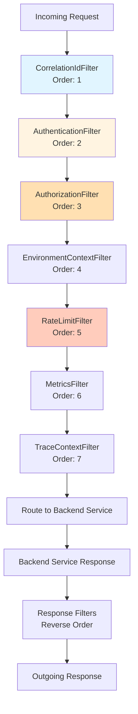
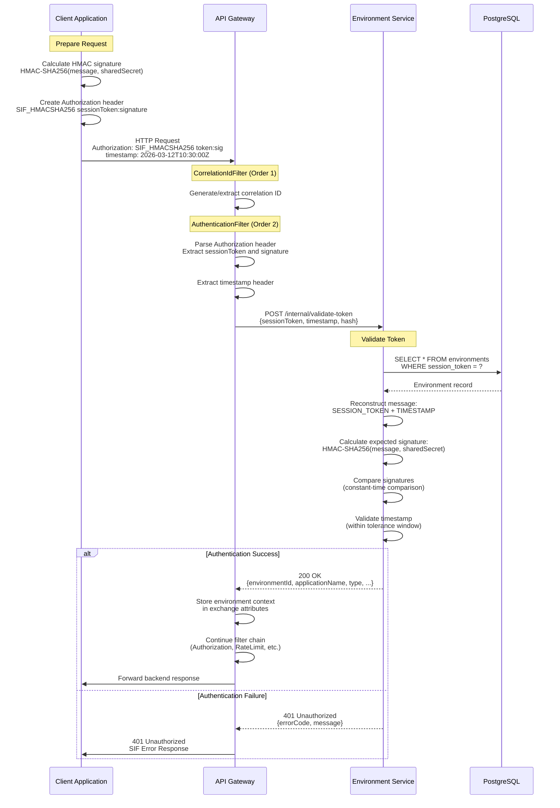
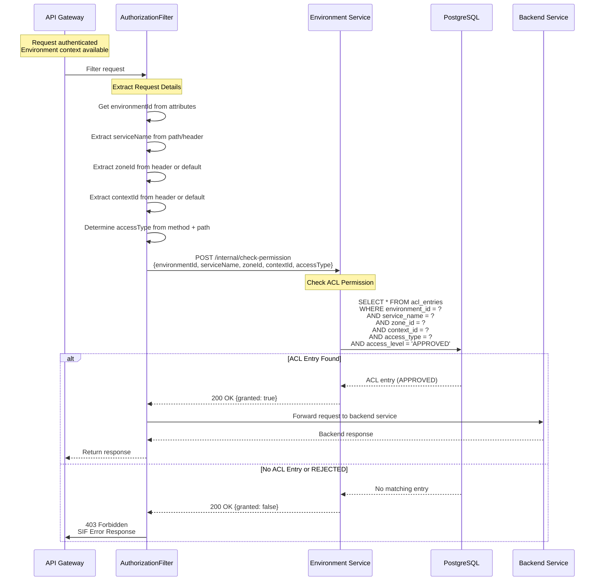
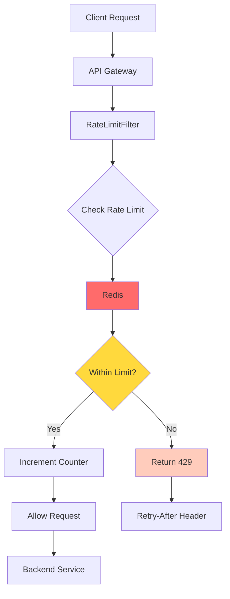
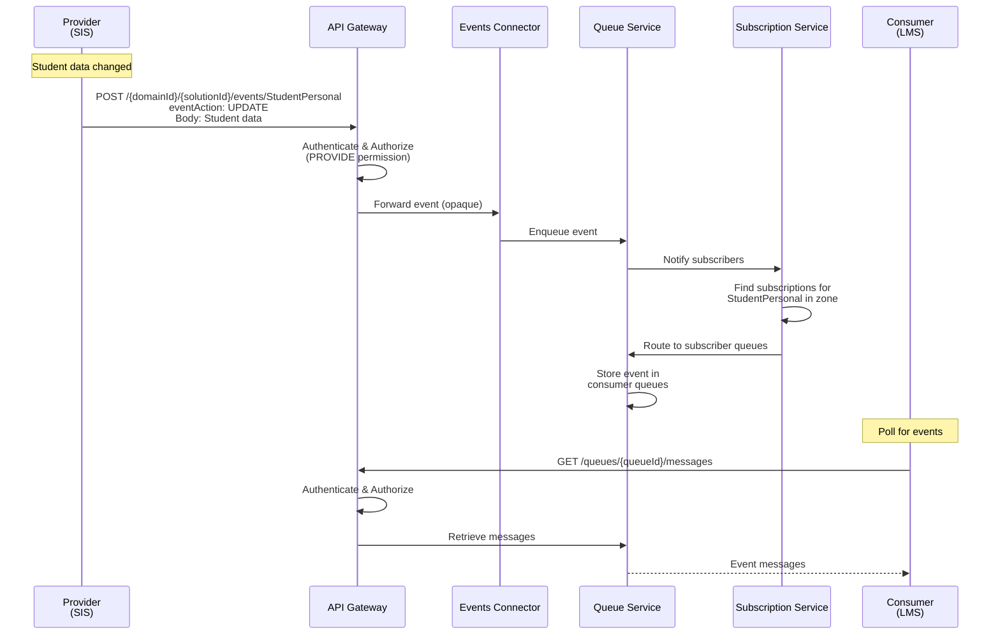
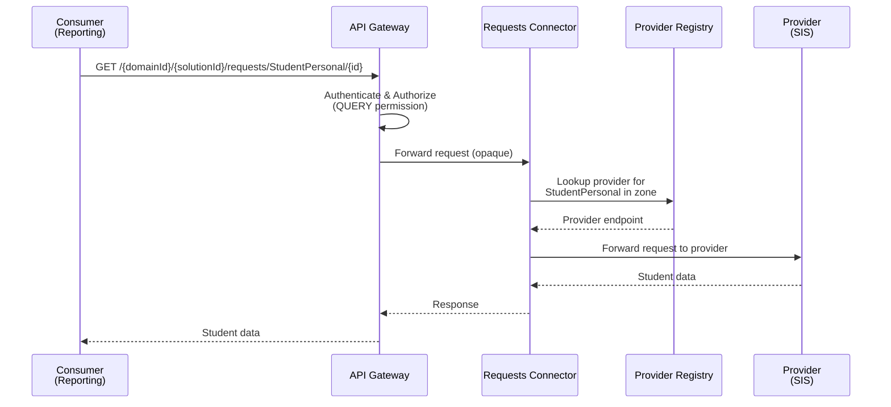
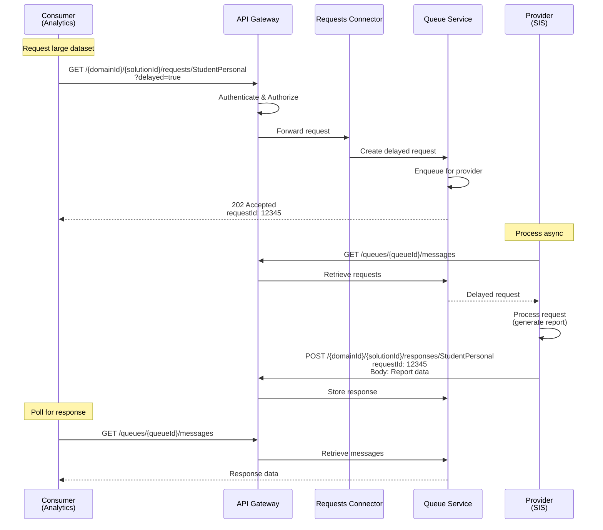
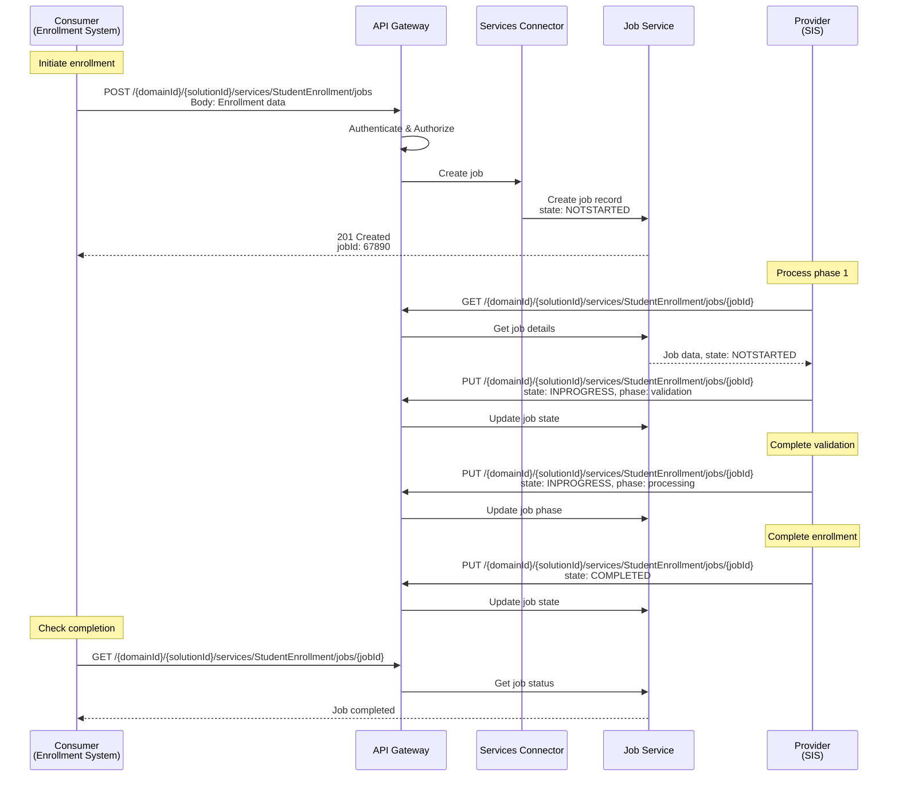

# SIF Unity Broker - API Architecture

**Version:** 1.1  
**Date:** March 12, 2026  
**Status:** Active  
**Updated:** April 6, 2026 — Controller URL paths, infrastructure service URLs, port layout corrections

## Table of Contents

1. [API Design Principles](#api-design-principles)
2. [API Gateway Architecture](#api-gateway-architecture)
3. [Authentication Flow](#authentication-flow)
4. [Authorization Model](#authorization-model)
5. [Request/Response Standards](#requestresponse-standards)
6. [Error Handling Standards](#error-handling-standards)
7. [Rate Limiting Strategy](#rate-limiting-strategy)
8. [API Versioning Strategy](#api-versioning-strategy)
9. [SIF 3.7 Compliance Mapping](#sif-37-compliance-mapping)
10. [OpenAPI Documentation](#openapi-documentation)
11. [References](#references)

---

## API Design Principles

The SIF Unity Broker API follows RESTful design principles aligned with the SIF 3.7 specification. These principles ensure consistency, predictability, and ease of integration for educational software vendors and system integrators.

### Core Principles

**1. Resource-Oriented Design**

APIs are organized around resources (nouns) rather than actions (verbs):
- `/environments` - Environment resources
- `/zones` - Zone resources
- `/subscriptions` - Subscription resources
- `/jobs` - Job resources

**2. HTTP Method Semantics**

Standard HTTP methods are used with consistent semantics:
- **GET**: Retrieve resource(s) - idempotent, safe, cacheable
- **POST**: Create new resource - non-idempotent
- **PUT**: Update entire resource - idempotent
- **PATCH**: Partial update - idempotent
- **DELETE**: Remove resource - idempotent

**3. Stateless Communication**

Each request contains all information needed to process it:
- Authentication credentials in every request (HMAC signature)
- No server-side session state (session tokens are stateless identifiers)
- Enables horizontal scaling and load balancing


**4. Uniform Interface**

Consistent patterns across all APIs:
- Standard URL structure: `/resource` (collection), `/resource/{id}` (item)
- Standard query parameters: `?type=ADMIN`, `?zoneId=default`
- Standard headers: `Authorization`, `timestamp`, `zoneId`, `contextId`
- Standard response format: JSON with consistent error structure

**5. HATEOAS (Hypermedia as the Engine of Application State)**

While not fully implemented in v1.0, the API is designed to support hypermedia links in future versions:
- Resource representations include `id` fields for navigation
- Error responses include `errorCode` for programmatic handling
- Future: Include `_links` section in responses for discoverability

### RESTful Conventions

**URL Structure Patterns**

```
# Collection endpoints (list, create)
GET    /environments              # List all environments
POST   /environments              # Create new environment

# Item endpoints (get, update, delete)
GET    /environments/{id}         # Get specific environment
PUT    /environments/{id}         # Update environment
DELETE /environments/{id}         # Delete environment

# Sub-resource endpoints
GET    /environments/{id}/acl-entries    # List ACL entries for environment
POST   /environments/{id}/acl-entries    # Create ACL entry for environment

# Query parameters for filtering
GET    /environments?type=ADMIN           # Filter by type
GET    /environments?solutionId=prod      # Filter by solution
```

**Resource Naming Conventions**

- **Plural nouns**: `/environments`, `/zones`, `/subscriptions` (not `/environment`, `/zone`)
- **Lowercase with hyphens**: `/acl-entries`, `/provider-registrations` (not `/aclEntries`, `/providerRegistrations`)
- **Hierarchical paths**: `/zones/{zoneId}/contexts` (parent-child relationships)
- **No verbs in URLs**: Use HTTP methods instead (not `/getEnvironment`, `/createZone`)


**HTTP Method Usage**

| Method | Idempotent | Safe | Cacheable | Use Case |
|--------|------------|------|-----------|----------|
| GET | Yes | Yes | Yes | Retrieve resource(s), no side effects |
| POST | No | No | No | Create new resource, non-idempotent operations |
| PUT | Yes | No | No | Replace entire resource, idempotent updates |
| PATCH | Yes | No | No | Partial update, idempotent modifications |
| DELETE | Yes | No | No | Remove resource, idempotent deletion |

**Query Parameter Conventions**

- **Filtering**: `?type=ADMIN`, `?solutionId=prod`, `?zoneId=default`
- **Pagination**: `?page=1&size=20` (future)
- **Sorting**: `?sort=createdAt,desc` (future)
- **Field selection**: `?fields=id,applicationName` (future)

**Path Parameter Conventions**

- **Resource IDs**: UUIDs for primary resources (`/environments/{uuid}`)
- **Natural keys**: Business identifiers for hierarchical resources (`/zones/{zoneId}`)
- **Consistent naming**: Match entity field names (`{environmentId}`, `{zoneId}`)

---

## API Gateway Architecture

The API Gateway serves as the single entry point for all external requests to the SIF Unity Broker. It provides centralized authentication, authorization, rate limiting, routing, and observability.

### Gateway Responsibilities

**1. Request Routing**

Routes incoming requests to appropriate backend microservices:
- `/environments/**` → Environment Service
- `/{domainId}/{solutionId}/requests/**` → Requests Connector
- `/{domainId}/{solutionId}/responses/**` → Responses Connector
- `/{domainId}/{solutionId}/events/**` → Events Connector
- `/{domainId}/{solutionId}/services/**` → Services Connector
- `/queues/**` → Queue Service
- `/subscriptions/**` → Subscription Service
- `/jobs/**` → Job Service

> **Note**: Connector services no longer use an `/api/v1/` prefix in their controller paths. The gateway routes are simple pass-through (no `RewritePath` filters for connectors).

**2. Authentication**

Validates HMAC-SHA256 signatures for all requests (except exempt paths):
- Extracts `Authorization` header and `timestamp` header
- Parses session token and HMAC signature
- Calls Environment Service to validate credentials
- Stores environment context in exchange attributes


**3. Authorization**

Enforces ACL-based permissions for all requests:
- Extracts service name, zone, context from request
- Determines access type (QUERY, CREATE, UPDATE, DELETE, SUBSCRIBE, PROVIDE) based on HTTP method and path
- Calls Environment Service to check permissions
- Returns 403 Forbidden if access denied

**4. Rate Limiting**

Protects backend services from overload:
- Distributed rate limiting using Redis
- Per-environment rate limits based on environment type
- Sliding window algorithm for accurate rate tracking
- Returns 429 Too Many Requests with Retry-After header

**5. Security Headers**

Manages security-related headers:
- Adds correlation ID for request tracing
- Propagates zone and context headers
- Blocks internal API paths (`/internal/**`)
- CORS configuration (future)

**6. Observability**

Provides comprehensive monitoring and tracing:
- Request/response logging with correlation IDs
- Metrics collection (authentication, authorization, rate limiting)
- Health checks for backend services
- Distributed tracing (future with Spring Cloud Sleuth)

### Gateway Filter Chain

The Gateway uses Spring Cloud Gateway's filter chain architecture. Filters execute in order, with each filter performing a specific responsibility:




**Filter Execution Order**

| Order | Filter | Responsibility | Key Actions |
|-------|--------|----------------|-------------|
| 0 | InternalApiBlockingFilter | Block internal APIs | Reject `/internal/**` paths with 403 |
| 1 | CorrelationIdFilter | Request tracing | Generate/extract correlation ID |
| 2 | AuthenticationFilter | Validate credentials | HMAC signature validation via Environment Service |
| 3 | AuthorizationFilter | Check permissions | ACL permission check via Environment Service |
| 4 | EnvironmentContextFilter | Propagate context | Add environment details to headers |
| 5 | RateLimitFilter | Enforce rate limits | Redis-based sliding window rate limiting |
| 6 | MetricsFilter | Collect metrics | Record request/response metrics |
| 7 | TraceContextFilter | Distributed tracing | Propagate trace context (future) |

**Exempt Paths**

Certain paths bypass authentication and authorization:
- `POST /environments` - Environment registration (bootstrap)
- `/actuator/health` - Health check endpoints
- `/internal/**` - Blocked entirely (403 Forbidden)

### Gateway Technology Stack

- **Spring Cloud Gateway**: Reactive gateway built on Spring WebFlux
- **Project Reactor**: Reactive programming model for non-blocking I/O
- **Redis**: Distributed rate limiting and caching
- **WebClient**: Non-blocking HTTP client for backend service calls
- **Micrometer**: Metrics collection and export

### Gateway Deployment

The Gateway is deployed as a standalone microservice:
- **Port**: 8080 (default)
- **Scaling**: Horizontal scaling with load balancer
- **High Availability**: Multiple instances behind load balancer
- **Health Checks**: `/actuator/health` for liveness and readiness probes

---

## Authentication Flow

The SIF Unity Broker uses **HMAC-SHA256 authentication** for secure API access. This cryptographic authentication mechanism ensures request integrity and prevents replay attacks.

### HMAC-SHA256 Overview

**HMAC (Hash-based Message Authentication Code)** provides:
- **Authentication**: Verifies the request comes from a known environment
- **Integrity**: Ensures the request hasn't been tampered with
- **Non-repudiation**: Proves the sender created the request

**Key Components:**
- **Session Token**: Unique identifier for the environment (public)
- **Shared Secret**: Cryptographic key known only to environment and broker (private)
- **Timestamp**: ISO 8601 timestamp for replay attack prevention
- **HMAC Signature**: Cryptographic hash of request details using shared secret


### Authentication Sequence Diagram



### HMAC Signature Calculation

**Message Format:**
```
SESSION_TOKEN\n
TIMESTAMP
```

**Example:**
```
abc123-session-token
2026-03-12T10:30:00.000Z
```

**Signature Calculation:**
```java
String message = sessionToken + "\n" + timestamp;

Mac hmac = Mac.getInstance("HmacSHA256");
SecretKeySpec secretKey = new SecretKeySpec(sharedSecret.getBytes(UTF_8), "HmacSHA256");
hmac.init(secretKey);
byte[] hash = hmac.doFinal(message.getBytes(UTF_8));
String signature = Base64.getEncoder().encodeToString(hash);
```


### Authorization Header Format

```
Authorization: SIF_HMACSHA256 <sessionToken>:<base64Signature>
timestamp: <ISO8601Timestamp>
```

**Example:**
```
Authorization: SIF_HMACSHA256 admin-bootstrap-token:k7J9mP2xQ5vR8wT3nY6zL1aB4cD0eF
timestamp: 2026-03-12T10:30:00.000Z
```

### Timestamp Validation

**Purpose**: Prevent replay attacks by ensuring requests are recent.

**Validation Rules:**
- Timestamp must be in ISO 8601 format: `YYYY-MM-DDTHH:mm:ss.SSSZ`
- Timestamp must be within tolerance window (default: ±5 minutes)
- Timestamp must not be in the future (beyond clock skew tolerance)

**Tolerance Window:**
```
currentTime - 5 minutes <= requestTimestamp <= currentTime + 1 minute
```

**Clock Skew Handling:**
- Allows 1 minute future tolerance for clock skew
- Allows 5 minutes past tolerance for network delays
- Configurable via `sif.broker.auth.timestamp-tolerance-seconds`

### Session Token Management

**Session Token Characteristics:**
- Unique identifier for each environment
- Stored in `environments.session_token` column
- Used as public identifier in Authorization header
- Does not expire (environment-level credential)

**Shared Secret Characteristics:**
- Cryptographic key for HMAC signature
- Stored in `environments.shared_secret` column (encrypted at rest)
- Never transmitted over the network
- Rotatable via environment update API

### Bootstrap Admin Credentials

**Initial Setup:**
- Admin environment created via Flyway migration
- Session Token: `admin-bootstrap-token`
- Shared Secret: `admin-bootstrap-secret`
- Type: `ADMIN` (full permissions)

**Security Recommendations:**
1. Change bootstrap credentials immediately after deployment
2. Create separate admin environments for each administrator
3. Rotate shared secrets regularly
4. Use secrets management backend (Vault, AWS Secrets Manager)

---

## Authorization Model

The SIF Unity Broker uses **ACL (Access Control List) based authorization** for fine-grained access control. Each environment has explicit permissions for specific services, zones, and contexts.

### ACL Architecture

**Access Control List (ACL) Entry:**
- **Environment**: The environment requesting access
- **Service Name**: The SIF service being accessed (e.g., "StudentPersonal")
- **Zone ID**: The organizational unit scope
- **Context ID**: The sub-unit scope (optional)
- **Access Type**: QUERY, CREATE, UPDATE, DELETE, SUBSCRIBE, or PROVIDE
- **Access Level**: APPROVED, SUPPORTED, REJECTED, UNSUPPORTED, or REQUESTED


### Authorization Flow Diagram



### Access Type Determination

The Gateway determines the required access type based on HTTP method and request path:

| HTTP Method | Path Pattern | Access Type | Description |
|-------------|--------------|-------------|-------------|
| GET | `/{domainId}/{solutionId}/requests/**` | QUERY | Retrieving request data |
| POST | `/{domainId}/{solutionId}/requests/**` | CREATE | Creating new request data |
| PUT | `/{domainId}/{solutionId}/requests/**` | UPDATE | Updating existing request data |
| DELETE | `/{domainId}/{solutionId}/requests/**` | DELETE | Deleting request data |
| POST | `/{domainId}/{solutionId}/responses/**` | PROVIDE | Provider submitting response data |
| POST | `/{domainId}/{solutionId}/events/**` | PROVIDE | Provider publishing event |
| GET | `/{domainId}/{solutionId}/services/**` | QUERY | Querying service job |
| POST/PUT/DELETE | `/{domainId}/{solutionId}/services/**` | PROVIDE | Provider managing service job |
| Default | Any other path | QUERY | Default to query access |

**Access Type Definitions:**

- **PROVIDE**: Environment can provide (publish) data for a service
  - Used by data providers (SIS, LMS, Assessment systems)
  - Allows POST to `/{domainId}/{solutionId}/events`, `/{domainId}/{solutionId}/responses`, `/{domainId}/{solutionId}/services`
  
- **QUERY**: Environment can query (retrieve) data for a service
  - Used by data consumers (reporting systems, analytics platforms)
  - Allows GET from `/{domainId}/{solutionId}/requests`, `/{domainId}/{solutionId}/services`
  
- **CREATE**: Environment can create new data for a service
  - Allows POST to create new resources

- **UPDATE**: Environment can update existing data for a service
  - Allows PUT/PATCH to modify resources

- **DELETE**: Environment can delete data for a service
  - Allows DELETE to remove resources

- **SUBSCRIBE**: Environment can subscribe to events for a service
  - Used by event subscribers (notification systems, integrations)
  - Allows creating subscriptions for event delivery


### ACL Permission Scoping

**Hierarchical Scoping:**

ACL entries are scoped to specific zones and contexts:
```
Domain: state-doe
  └─ Solution: production
      └─ Zone: district-001
          └─ Context: school-123
              └─ Environment: SIS-Provider
                  └─ ACL Entry: {
                      serviceName: "StudentPersonal",
                      zoneId: "district-001",
                      contextId: "school-123",
                      accessType: PROVIDE,
                      accessLevel: APPROVED
                    }
```

**Default Context:**
- Every zone has a mandatory `DEFAULT` context. If no context is specified in a request, `DEFAULT` is assumed.

**Wildcard Support (Future):**
- `zoneId: "*"` - Access to all zones within solution (future, admin only)

### Admin Environment Privileges

**ADMIN Environment Type:**
- Bypasses ACL checks for administrative operations
- Full access to all services, zones, and contexts
- Used for broker administration and monitoring
- Should be restricted to trusted administrators

**Admin Operations:**
- Environment registration and management
- ACL entry creation and modification
- Provider registration management
- System monitoring and health checks

---

## Request/Response Standards

The SIF Unity Broker follows consistent request and response standards across all APIs to ensure predictability and ease of integration.

### Standard Request Headers

**Required Headers:**

| Header | Description | Example | Required For |
|--------|-------------|---------|--------------|
| `Authorization` | HMAC authentication | `SIF_HMACSHA256 token:sig` | All authenticated requests |
| `timestamp` | ISO 8601 timestamp | `2026-03-12T10:30:00.000Z` | All authenticated requests |
| `Content-Type` | Request body format | `application/json` | POST, PUT, PATCH requests |

**Optional Headers:**

| Header | Description | Example | Use Case |
|--------|-------------|---------|----------|
| `zoneId` | Override default zone | `district-001` | Multi-zone operations |
| `contextId` | Override default context | `school-123` | Multi-context operations |
| `serviceName` | Explicit service name | `StudentPersonal` | Service-specific operations |
| `X-Correlation-Id` | Request tracing ID | `550e8400-e29b-41d4-a716-446655440000` | Distributed tracing |


### Standard Response Format

**Success Response (2xx):**

```json
{
  "id": "550e8400-e29b-41d4-a716-446655440000",
  "applicationName": "StudentIS-Prod",
  "type": "BROKERED",
  "sessionToken": "sis-prod-token-123",
  "defaultZoneId": "district-001",
  "defaultContextId": "default",
  "createdAt": "2026-03-12T10:30:00.000Z",
  "expiresAt": null
}
```

> **Infrastructure Service URLs**: Environment registration responses include infrastructure service URLs that are now gateway-routed rather than direct service URLs. For example, `{"name": "eventsConnector", "value": "http://localhost:8080/{domainId}/{solutionId}/events"}`. These are constructed dynamically using the `sif.broker.infrastructure.gateway-base-url` property combined with the environment's domain/solution hierarchy.
```

**Collection Response (SIF 3.7 Wrapper):**

Collection endpoints return a SIF 3.7 double-nested wrapper structure: `{"<plural>": {"<singular>": [...]}}`. This applies to domains, solutions, zones, contexts, environments, and queues.

```json
{
  "domains": {
    "domain": [
      {
        "id": "550e8400-e29b-41d4-a716-446655440000",
        "domainId": "state-a-edu",
        "description": "State A Department of Education"
      },
      {
        "id": "660f9511-f30c-52e5-b827-557766551111",
        "domainId": "state-b-district",
        "description": "State B School District"
      }
    ]
  }
}
```

Other collection endpoints follow the same pattern:
- `GET /domains` → `{"domains": {"domain": [...]}}`
- `GET /{domainId}/solutions` → `{"solutions": {"solution": [...]}}`
- `GET /{domainId}/{solutionId}/zones` → `{"zones": {"zone": [...]}}`
- `GET /{domainId}/{solutionId}/zones/{zoneId}/contexts` → `{"contexts": {"context": [...]}}`
- `GET /environments` → `{"environments": {"environment": [...]}}`
- `GET /queues` → `{"queues": {"queue": [...]}}`

Single-resource endpoints (GET by ID, POST, PUT, DELETE) continue to return unwrapped DTOs.

**Future: Paginated Response:**

```json
{
  "content": [...],
  "page": {
    "number": 0,
    "size": 20,
    "totalElements": 150,
    "totalPages": 8
  },
  "_links": {
    "self": "/environments?page=0&size=20",
    "next": "/environments?page=1&size=20",
    "last": "/environments?page=7&size=20"
  }
}
```

### Standard Response Headers

**All Responses:**

| Header | Description | Example |
|--------|-------------|---------|
| `Content-Type` | Response format | `application/json` |
| `X-Correlation-Id` | Request tracing ID | `550e8400-e29b-41d4-a716-446655440000` |

**Rate Limited Responses (429):**

| Header | Description | Example |
|--------|-------------|---------|
| `Retry-After` | Seconds until retry | `60` |
| `X-RateLimit-Limit` | Requests per second | `100` |
| `X-RateLimit-Remaining` | Remaining requests | `0` |

### HTTP Status Code Usage

**Success Codes (2xx):**

| Code | Status | Use Case |
|------|--------|----------|
| 200 | OK | Successful GET, PUT, PATCH, DELETE |
| 201 | Created | Successful POST (resource created) |
| 202 | Accepted | Asynchronous operation accepted |
| 204 | No Content | Successful DELETE (no response body) |

**Client Error Codes (4xx):**

| Code | Status | Use Case |
|------|--------|----------|
| 400 | Bad Request | Invalid request format or parameters |
| 401 | Unauthorized | Authentication failed (invalid credentials) |
| 403 | Forbidden | Authorization failed (insufficient permissions) |
| 404 | Not Found | Resource does not exist |
| 409 | Conflict | Resource already exists (duplicate) |
| 422 | Unprocessable Entity | Validation failed (business rule violation) |
| 429 | Too Many Requests | Rate limit exceeded |

**Server Error Codes (5xx):**

| Code | Status | Use Case |
|------|--------|----------|
| 500 | Internal Server Error | Unexpected server error |
| 502 | Bad Gateway | Backend service unavailable |
| 503 | Service Unavailable | Service temporarily unavailable |
| 504 | Gateway Timeout | Backend service timeout |

---

## Error Handling Standards

The SIF Unity Broker uses a consistent error response format across all APIs, aligned with SIF 3.7 specification error handling.


### SIF Error Response Format

**Standard Error Response:**

```json
{
  "errorCode": "AUTH_001",
  "message": "Invalid session token",
  "description": "The provided session token does not match any registered environment",
  "scope": "BROKER",
  "timestamp": "2026-03-12T10:30:00.000Z",
  "correlationId": "550e8400-e29b-41d4-a716-446655440000",
  "details": {
    "sessionToken": "invalid-token-123",
    "path": "/environments"
  }
}
```

**Field Descriptions:**

| Field | Type | Description | Required |
|-------|------|-------------|----------|
| `errorCode` | String | Machine-readable error code | Yes |
| `message` | String | Human-readable error message | Yes |
| `description` | String | Detailed error description | No |
| `scope` | String | Error scope (BROKER, SERVICE, CLIENT) | Yes |
| `timestamp` | ISO 8601 | When error occurred | Yes |
| `correlationId` | UUID | Request correlation ID | No |
| `details` | Object | Additional error context | No |

### Error Code Taxonomy

**Error Code Format:** `<CATEGORY>_<NUMBER>`

**Categories:**

| Category | Prefix | Description | HTTP Status |
|----------|--------|-------------|-------------|
| Authentication | `AUTH_` | Authentication failures | 401 |
| Authorization | `AUTHZ_` | Authorization failures | 403 |
| Validation | `VAL_` | Input validation errors | 400, 422 |
| Not Found | `NF_` | Resource not found | 404 |
| Conflict | `CONF_` | Resource conflicts | 409 |
| Rate Limit | `RATE_` | Rate limit exceeded | 429 |
| Gateway | `GATEWAY_` | Gateway errors | 502, 503, 504 |
| Internal | `INT_` | Internal server errors | 500 |

**Complete Error Code Table:**

| Error Code | HTTP Status | Message | Description |
|------------|-------------|---------|-------------|
| `AUTH_001` | 401 | Invalid session token | Session token not found or invalid |
| `AUTH_002` | 401 | Invalid HMAC signature | HMAC signature validation failed |
| `AUTH_003` | 401 | Timestamp expired | Request timestamp outside tolerance window |
| `AUTH_004` | 401 | Malformed Authorization header | Authorization header format invalid |
| `AUTH_005` | 401 | Missing timestamp header | Timestamp header required but not provided |
| `AUTHZ_001` | 403 | Insufficient permissions | Environment lacks required ACL permission |
| `AUTHZ_002` | 403 | Access denied | Access explicitly denied by ACL |
| `AUTHZ_003` | 403 | Internal API access forbidden | Internal APIs not accessible externally |
| `VAL_001` | 400 | Invalid request format | Request body JSON parsing failed |
| `VAL_002` | 422 | Validation failed | Business rule validation failed |
| `VAL_003` | 400 | Missing required field | Required field not provided |
| `VAL_004` | 400 | Invalid field value | Field value does not meet constraints |
| `NF_001` | 404 | Environment not found | Environment ID does not exist |
| `NF_002` | 404 | Zone not found | Zone ID does not exist |
| `NF_003` | 404 | Service not found | Service name not registered |
| `CONF_001` | 409 | Duplicate environment | Environment with same name exists |
| `CONF_002` | 409 | Duplicate zone | Zone with same ID exists in solution |
| `CONF_003` | 409 | Duplicate ACL entry | ACL entry already exists |
| `RATE_001` | 429 | Rate limit exceeded | Request rate limit exceeded |
| `GATEWAY_001` | 502 | Backend service unavailable | Backend service connection failed |
| `GATEWAY_002` | 503 | Service temporarily unavailable | Service is temporarily unavailable |
| `GATEWAY_003` | 504 | Gateway timeout | Backend service timeout |
| `INT_001` | 500 | Internal server error | Unexpected internal error |


### Error Response Examples

**Authentication Error (401):**

```json
{
  "errorCode": "AUTH_002",
  "message": "Invalid HMAC signature",
  "description": "The HMAC signature does not match the expected value",
  "scope": "BROKER",
  "timestamp": "2026-03-12T10:30:00.000Z",
  "correlationId": "550e8400-e29b-41d4-a716-446655440000"
}
```

**Authorization Error (403):**

```json
{
  "errorCode": "AUTHZ_001",
  "message": "Insufficient permissions",
  "description": "Environment lacks PROVIDE permission for StudentPersonal in zone district-001",
  "scope": "BROKER",
  "timestamp": "2026-03-12T10:30:00.000Z",
  "correlationId": "550e8400-e29b-41d4-a716-446655440000",
  "details": {
    "serviceName": "StudentPersonal",
    "zoneId": "district-001",
    "accessType": "PROVIDE"
  }
}
```

**Validation Error (422):**

```json
{
  "errorCode": "VAL_002",
  "message": "Validation failed",
  "description": "Application name must be between 3 and 100 characters",
  "scope": "SERVICE",
  "timestamp": "2026-03-12T10:30:00.000Z",
  "correlationId": "550e8400-e29b-41d4-a716-446655440000",
  "details": {
    "field": "applicationName",
    "value": "AB",
    "constraint": "length between 3 and 100"
  }
}
```

**Rate Limit Error (429):**

```json
{
  "errorCode": "RATE_001",
  "message": "Rate limit exceeded",
  "description": "Too many requests. Please retry after 60 seconds.",
  "scope": "BROKER",
  "timestamp": "2026-03-12T10:30:00.000Z",
  "correlationId": "550e8400-e29b-41d4-a716-446655440000"
}
```

---

## Rate Limiting Strategy

The SIF Unity Broker implements distributed rate limiting to protect backend services from overload and ensure fair resource allocation across environments.

### Rate Limiting Architecture

**Distributed Rate Limiting with Redis:**




### Rate Limiting Algorithm

**Sliding Window Counter:**

The broker uses a sliding window algorithm for accurate rate limiting:

1. **Window Size**: 1 second (configurable)
2. **Counter Key**: `ratelimit:{environmentId}:{currentSecond}`
3. **Counter Increment**: Each request increments the counter
4. **Counter Expiration**: Keys expire after window duration
5. **Limit Check**: Compare counter value to environment type limit

**Redis Operations:**

```redis
# Increment counter for current second
INCR ratelimit:550e8400-e29b-41d4-a716-446655440000:1710241800
EXPIRE ratelimit:550e8400-e29b-41d4-a716-446655440000:1710241800 2

# Check if counter exceeds limit
GET ratelimit:550e8400-e29b-41d4-a716-446655440000:1710241800
# If value > limit, return 429
```

### Rate Limits by Environment Type

**Default Rate Limits:**

| Environment Type | Requests/Second | Use Case |
|------------------|-----------------|----------|
| CONSUMER | 100 | Data consumers (reporting, analytics) |
| PROVIDER | 100 | Data providers (SIS, LMS, assessments) |
| BROKER | 200 | Broker-to-broker communication |
| ADMIN | 200 | Administrative operations |

**Configurable Limits:**

Rate limits are configurable via application properties:

```yaml
sif:
  broker:
    gateway:
      rate-limit:
        enabled: true
        consumer: 100
        provider: 100
        broker: 200
        admin: 200
```

### Rate Limit Response Headers

**Standard Headers:**

| Header | Description | Example |
|--------|-------------|---------|
| `X-RateLimit-Limit` | Requests per second allowed | `100` |
| `X-RateLimit-Remaining` | Remaining requests in window | `45` |
| `X-RateLimit-Reset` | Unix timestamp when limit resets | `1710241860` |
| `Retry-After` | Seconds to wait before retry | `1` |

**Example Response:**

```http
HTTP/1.1 429 Too Many Requests
Content-Type: application/json
X-RateLimit-Limit: 100
X-RateLimit-Remaining: 0
X-RateLimit-Reset: 1710241860
Retry-After: 1
X-Correlation-Id: 550e8400-e29b-41d4-a716-446655440000

{
  "errorCode": "RATE_001",
  "message": "Rate limit exceeded",
  "description": "Too many requests. Please retry after 1 seconds.",
  "scope": "BROKER",
  "timestamp": "2026-03-12T10:30:00.000Z"
}
```

### Rate Limiting Best Practices

**For API Clients:**

1. **Respect Retry-After**: Wait the specified time before retrying
2. **Implement Exponential Backoff**: Increase wait time on repeated 429s
3. **Monitor Rate Limit Headers**: Track remaining requests
4. **Batch Requests**: Combine multiple operations when possible
5. **Cache Responses**: Reduce redundant requests

**For Administrators:**

1. **Monitor Rate Limit Metrics**: Track 429 responses per environment
2. **Adjust Limits**: Increase limits for high-volume environments
3. **Identify Abusers**: Investigate environments with excessive 429s
4. **Plan Capacity**: Scale infrastructure based on rate limit usage

---

## API Versioning Strategy

The SIF Unity Broker API versioning strategy balances stability for existing integrations with flexibility for future enhancements.


### Versioning Approach

**Current Strategy: No Explicit Versioning (v1.0)**

The initial release (v1.0) does not include version numbers in URLs or headers. This approach:
- Simplifies initial adoption
- Reduces cognitive overhead for developers
- Aligns with SIF 3.7 specification (which doesn't mandate versioning)
- Allows flexibility to introduce versioning when needed

**Future Versioning Strategy:**

When breaking changes are required, the broker will adopt **URL-based versioning**:

```
# Version 1 (current, no version in URL)
GET /environments

# Version 2 (future, explicit version)
GET /v2/environments

# Version 1 remains available for backward compatibility
GET /v1/environments  # Redirects to /environments
```

### Backward Compatibility Guidelines

**Non-Breaking Changes (Allowed):**
- Adding new optional fields to request/response
- Adding new endpoints
- Adding new query parameters (optional)
- Adding new error codes
- Improving error messages
- Performance optimizations

**Breaking Changes (Require New Version):**
- Removing fields from response
- Changing field types or formats
- Removing endpoints
- Changing authentication mechanism
- Changing URL structure
- Making optional fields required

### Deprecation Policy

**When introducing breaking changes:**

1. **Announce Deprecation**: 6 months advance notice
2. **Maintain Old Version**: Both versions run concurrently
3. **Migration Guide**: Provide detailed migration documentation
4. **Sunset Date**: Clearly communicate end-of-life date
5. **Remove Old Version**: After sunset date, return 410 Gone

**Deprecation Headers:**

```http
Deprecation: true
Sunset: Sat, 31 Dec 2026 23:59:59 GMT
Link: <https://docs.sifunitybroker.org/migration/v2>; rel="deprecation"
```

### API Evolution Principles

1. **Additive Changes**: Prefer adding new endpoints over modifying existing ones
2. **Optional Fields**: New fields should be optional to maintain compatibility
3. **Graceful Degradation**: Clients should ignore unknown fields
4. **Clear Communication**: Document all changes in release notes
5. **Long Support Windows**: Maintain old versions for at least 12 months

---

## SIF 3.7 Compliance Mapping

The SIF Unity Broker implements the SIF 3.7 specification for educational data interoperability. This section maps SIF 3.7 concepts to broker API endpoints and implementation details.

### SIF 3.7 Message Types

**SIF defines four message types:**

| SIF Message Type | Broker Endpoint | HTTP Method | Description |
|------------------|-----------------|-------------|-------------|
| **Event** | `/{domainId}/{solutionId}/events/{serviceName}` | POST | Asynchronous notifications of data changes |
| **Request** | `/{domainId}/{solutionId}/requests/{serviceName}` | GET | Synchronous queries for data |
| **Response** | `/{domainId}/{solutionId}/responses/{serviceName}` | POST | Responses to delayed requests |
| **Functional Service** | `/{domainId}/{solutionId}/services/{serviceName}` | GET, POST, PUT, DELETE | Multi-phase workflow jobs |


### SIF Message Type to API Endpoint Mapping

**1. SIF Events (CREATE, UPDATE, DELETE notifications)**

```
SIF Specification:
  POST /{serviceName}
  Headers: eventAction (CREATE, UPDATE, DELETE)
  Body: SIF object data

Broker Implementation:
  POST /{domainId}/{solutionId}/events/{serviceName}
  Headers: 
    - Authorization: SIF_HMACSHA256 token:signature
    - timestamp: ISO 8601
    - zoneId: Zone identifier
    - contextId: Context identifier (optional)
    - eventAction: CREATE, UPDATE, DELETE
  Body: SIF object data (opaque to broker)
  
  Flow:
    1. Gateway authenticates and authorizes (PROVIDE permission)
    2. Events Connector receives event (opaque routing)
    3. Queue Service stores event in queue
    4. Subscription Service routes to subscribers
    5. Subscribers retrieve events from their queues
```

**2. SIF Requests (Synchronous queries)**

```
SIF Specification:
  GET /{serviceName}
  GET /{serviceName}/{id}
  Query parameters for filtering

Broker Implementation:
  GET /{domainId}/{solutionId}/requests/{serviceName}
  GET /{domainId}/{solutionId}/requests/{serviceName}/{id}
  Headers:
    - Authorization: SIF_HMACSHA256 token:signature
    - timestamp: ISO 8601
    - zoneId: Zone identifier
    - contextId: Context identifier (optional)
  Query parameters: Passed through to provider
  
  Flow:
    1. Gateway authenticates and authorizes (QUERY permission)
    2. Requests Connector receives request (opaque routing)
    3. Provider Registry lookup finds provider endpoint
    4. Request forwarded to provider
    5. Provider response returned to consumer
```

**3. SIF Responses (Delayed request responses)**

```
SIF Specification:
  POST /{serviceName}
  Body: Response data for delayed request

Broker Implementation:
  POST /{domainId}/{solutionId}/responses/{serviceName}
  Headers:
    - Authorization: SIF_HMACSHA256 token:signature
    - timestamp: ISO 8601
    - zoneId: Zone identifier
    - contextId: Context identifier (optional)
    - requestId: Original request correlation ID
  Body: Response data (opaque to broker)
  
  Flow:
    1. Gateway authenticates and authorizes (PROVIDE permission)
    2. Responses Connector receives response (opaque routing)
    3. Queue Service stores response in consumer's queue
    4. Consumer retrieves response from queue
```

**4. SIF Functional Services (Multi-phase workflows)**

```
SIF Specification:
  POST /{serviceName}/jobs - Create job
  GET /{serviceName}/jobs/{jobId} - Get job status
  PUT /{serviceName}/jobs/{jobId} - Update job
  DELETE /{serviceName}/jobs/{jobId} - Cancel job

Broker Implementation:
  POST /{domainId}/{solutionId}/services/{serviceName}/jobs
  GET /{domainId}/{solutionId}/services/{serviceName}/jobs/{jobId}
  PUT /{domainId}/{solutionId}/services/{serviceName}/jobs/{jobId}
  DELETE /{domainId}/{solutionId}/services/{serviceName}/jobs/{jobId}
  Headers:
    - Authorization: SIF_HMACSHA256 token:signature
    - timestamp: ISO 8601
    - zoneId: Zone identifier
    - contextId: Context identifier (optional)
  
  Flow:
    1. Gateway authenticates and authorizes
    2. Services Connector manages job state
    3. Job Service tracks phases and state transitions
    4. Provider processes job phases
    5. State updates: NOTSTARTED → INPROGRESS → COMPLETED/FAILED
```


### SIF Authentication to HMAC Mapping

**SIF 3.7 Authentication Specification:**
- Session token-based authentication
- HMAC-SHA256 signature validation
- Timestamp validation for replay attack prevention

**Broker Implementation:**

| SIF Concept | Broker Implementation |
|-------------|----------------------|
| Session Token | `environments.session_token` (unique per environment) |
| Shared Secret | `environments.shared_secret` (encrypted at rest) |
| HMAC Algorithm | HMAC-SHA256 (SHA-256 hash function) |
| Signature Format | Base64-encoded HMAC signature |
| Authorization Header | `SIF_HMACSHA256 sessionToken:signature` |
| Timestamp Header | `timestamp: ISO 8601 format` |
| Timestamp Tolerance | ±5 minutes (configurable) |

### SIF Zone/Context to Multi-Tenancy Mapping

**SIF 3.7 Organizational Hierarchy:**
- Zone: Organizational unit (district, school, region)
- Context: Sub-unit within zone (classroom, grade, department)

**Broker Multi-Tenancy Hierarchy:**

```
Domain (Tenant) - Not in SIF, broker-specific for multi-tenancy
  └─ Solution (Environment Type) - Not in SIF, broker-specific
      └─ Zone (SIF Zone) - Maps to SIF Zone
          └─ Context (SIF Context) - Maps to SIF Context
              └─ Environment (SIF Environment) - Maps to SIF Environment
```

**Mapping Details:**

| SIF Concept | Broker Entity | Description |
|-------------|---------------|-------------|
| Zone | `zones.zone_id` | Organizational unit identifier |
| Context | `contexts.context_id` | Sub-unit identifier (optional) |
| Environment | `environments` table | Application instance with credentials |
| Provider | `provider_registry` table | Service provider registration |
| Consumer | Environment with QUERY ACL rights | Service consumer |

### SIF Provider Registration Mapping

**SIF 3.7 Provider Registration:**
- Providers register services they offer
- Specify zone and context scope
- Declare supported patterns (IMMEDIATE, DELAYED, EVENT)

**Broker Implementation:**

```sql
-- Provider Registry Table
CREATE TABLE provider_registry (
    id UUID PRIMARY KEY,
    environment_id UUID NOT NULL,  -- Provider environment
    service_name VARCHAR(255) NOT NULL,  -- SIF service name
    zone_id VARCHAR(255) NOT NULL,  -- Service scope
    context_id VARCHAR(255),  -- Optional sub-scope
    endpoint VARCHAR(500) NOT NULL,  -- Provider callback URL
    supported_patterns TEXT[],  -- IMMEDIATE, DELAYED, EVENT
    registered_at TIMESTAMP NOT NULL
);
```

**Provider Registration API:**

```http
POST /provider-registrations
Authorization: SIF_HMACSHA256 provider-token:signature
timestamp: 2026-03-12T10:30:00.000Z
Content-Type: application/json

{
  "serviceName": "StudentPersonal",
  "zoneId": "district-001",
  "contextId": "default",
  "endpoint": "https://sis.example.com/sif/StudentPersonal",
  "supportedPatterns": ["IMMEDIATE", "DELAYED", "EVENT"]
}
```


### SIF Message Flow Diagrams

**Event Publishing Flow:**



**Request/Response Flow (Immediate):**



**Request/Response Flow (Delayed):**




**Functional Service Job Flow:**



### SIF Compliance Checklist

**Authentication & Authorization:**
- ✅ HMAC-SHA256 signature validation
- ✅ Session token-based authentication
- ✅ Timestamp validation for replay attack prevention
- ✅ ACL-based authorization for service access

**Message Types:**
- ✅ Event messages (CREATE, UPDATE, DELETE)
- ✅ Request messages (synchronous queries)
- ✅ Response messages (delayed request responses)
- ✅ Functional Service Jobs (multi-phase workflows)

**Organizational Hierarchy:**
- ✅ Zone support (organizational units)
- ✅ Context support (sub-units)
- ✅ Environment registration
- ✅ Provider registration

**Data Exchange Patterns:**
- ✅ Immediate request/response
- ✅ Delayed request/response (queue-based)
- ✅ Event subscription and notification
- ✅ Multi-phase job workflows

**Error Handling:**
- ✅ SIF-compliant error response format
- ✅ Standard HTTP status codes
- ✅ Error code taxonomy
- ✅ Correlation IDs for tracing

---

## OpenAPI Documentation

The SIF Unity Broker provides OpenAPI 3.0 specification for all APIs, enabling interactive documentation, client code generation, and automated testing.

### OpenAPI Specification Approach

**Documentation Strategy:**
- OpenAPI 3.0 specification for each service
- Annotations in Java code (Springdoc OpenAPI)
- Automatic generation from controller methods
- Interactive Swagger UI for exploration


### OpenAPI Documentation Endpoints

**Swagger UI (Interactive Documentation):**

```
# Environment Service
http://localhost:8081/swagger-ui.html

# Gateway (aggregated documentation)
http://localhost:8080/swagger-ui.html

# Other services
http://localhost:8082/swagger-ui.html  # Queue Service
http://localhost:8083/swagger-ui.html  # Subscription Service
```

**OpenAPI JSON Specification:**

```
# Environment Service
http://localhost:8081/v3/api-docs

# Gateway
http://localhost:8080/v3/api-docs

# Other services
http://localhost:8082/v3/api-docs  # Queue Service
```

### OpenAPI Specification Example

**Environment Service OpenAPI:**

```yaml
openapi: 3.0.1
info:
  title: SIF Unity Broker - Environment Service API
  description: Manages organizational hierarchy and environment registration
  version: 1.0.0
  contact:
    name: SIF Unity Broker Team
    url: https://github.com/sif-unity-broker
servers:
  - url: http://localhost:8081
    description: Local development (Environment Service direct)
  - url: http://localhost:8080
    description: Via API Gateway
paths:
  /environments:
    get:
      summary: List all environments
      operationId: listEnvironments
      tags:
        - Environments
      parameters:
        - name: type
          in: query
          description: Filter by environment type
          schema:
            type: string
            enum: [DIRECT, BROKERED, ADMIN]
        - name: solutionId
          in: query
          description: Filter by solution ID
          schema:
            type: string
      responses:
        '200':
          description: List of environments
          content:
            application/json:
              schema:
                type: array
                items:
                  $ref: '#/components/schemas/EnvironmentDTO'
        '401':
          description: Unauthorized
          content:
            application/json:
              schema:
                $ref: '#/components/schemas/SifErrorResponse'
      security:
        - hmacAuth: []
    post:
      summary: Create new environment
      operationId: createEnvironment
      tags:
        - Environments
      requestBody:
        required: true
        content:
          application/json:
            schema:
              $ref: '#/components/schemas/EnvironmentCreateRequest'
      responses:
        '201':
          description: Environment created
          content:
            application/json:
              schema:
                $ref: '#/components/schemas/EnvironmentDTO'
        '400':
          description: Bad request
          content:
            application/json:
              schema:
                $ref: '#/components/schemas/SifErrorResponse'
        '409':
          description: Conflict (duplicate)
          content:
            application/json:
              schema:
                $ref: '#/components/schemas/SifErrorResponse'
components:
  schemas:
    EnvironmentDTO:
      type: object
      properties:
        id:
          type: string
          format: uuid
        applicationName:
          type: string
        type:
          type: string
          enum: [DIRECT, BROKERED, ADMIN]
        sessionToken:
          type: string
        defaultZoneId:
          type: string
        defaultContextId:
          type: string
        createdAt:
          type: string
          format: date-time
        expiresAt:
          type: string
          format: date-time
    SifErrorResponse:
      type: object
      properties:
        errorCode:
          type: string
        message:
          type: string
        description:
          type: string
        scope:
          type: string
        timestamp:
          type: string
          format: date-time
        correlationId:
          type: string
          format: uuid
  securitySchemes:
    hmacAuth:
      type: apiKey
      in: header
      name: Authorization
      description: HMAC-SHA256 authentication (SIF_HMACSHA256 sessionToken:signature)
```


### Code Generation from OpenAPI

**Client Code Generation:**

OpenAPI specifications enable automatic client code generation for multiple languages:

```bash
# Generate Java client
openapi-generator-cli generate \
  -i http://localhost:8081/v3/api-docs \
  -g java \
  -o ./client-java

# Generate Python client
openapi-generator-cli generate \
  -i http://localhost:8081/v3/api-docs \
  -g python \
  -o ./client-python

# Generate TypeScript client
openapi-generator-cli generate \
  -i http://localhost:8081/v3/api-docs \
  -g typescript-axios \
  -o ./client-typescript
```

**Server Stub Generation:**

OpenAPI specifications can also generate server stubs for new services:

```bash
# Generate Spring Boot server stub
openapi-generator-cli generate \
  -i openapi-spec.yaml \
  -g spring \
  -o ./new-service
```

### API Documentation Best Practices

**For API Developers:**

1. **Annotate Controllers**: Use `@Operation`, `@ApiResponse`, `@Parameter` annotations
2. **Document Schemas**: Add `@Schema` annotations to DTOs
3. **Provide Examples**: Include example values in annotations
4. **Describe Errors**: Document all possible error responses
5. **Keep Updated**: Ensure documentation matches implementation

**For API Consumers:**

1. **Explore Swagger UI**: Use interactive documentation to test APIs
2. **Generate Clients**: Use OpenAPI generator for type-safe clients
3. **Validate Requests**: Use OpenAPI spec for request validation
4. **Mock Servers**: Use OpenAPI spec to create mock servers for testing

### Future Enhancements

**Planned OpenAPI Improvements:**

1. **API Gateway Aggregation**: Combine all service specs into single gateway spec
2. **Request Validation**: Automatic request validation against OpenAPI schema
3. **Response Validation**: Automatic response validation in tests
4. **Contract Testing**: Use OpenAPI spec for consumer-driven contract tests
5. **API Versioning**: Document multiple API versions in OpenAPI spec

---

## References

### Internal Documentation

- [System Architecture](./SYSTEM-ARCHITECTURE.md) - Overall system design and component architecture
- [Data Architecture](./DATA-ARCHITECTURE.md) - Database schema and data flow
- [Security Architecture](./SECURITY-ARCHITECTURE.md) - Security mechanisms and threat model
- [Testing Architecture](./TESTING-ARCHITECTURE.md) - Testing strategy and property-based testing

### Project Documentation

- [API Authentication Guide](../../API-AUTHENTICATION-GUIDE.md) - Detailed HMAC authentication examples
- [Project Roadmap](../../PROJECT-ROADMAP.md) - Implementation phases and milestones
- [Build Commands](../../BUILD-COMMANDS.md) - Build and deployment commands

### Steering Files

- [Technology Stack](../../.kiro/steering/tech.md) - Technology decisions and rationale
- [Project Structure](../../.kiro/steering/structure.md) - Code organization and naming conventions
- [Product Overview](../../.kiro/steering/product.md) - Product goals and target users

### External References

- [SIF 3.7 Specification](../../external_docs/) - Official SIF specification documents
- [Spring Cloud Gateway Documentation](https://docs.spring.io/spring-cloud-gateway/docs/current/reference/html/) - Gateway framework documentation
- [OpenAPI 3.0 Specification](https://swagger.io/specification/) - OpenAPI specification standard
- [REST API Design Best Practices](https://restfulapi.net/) - RESTful API design guidelines

### Related Specifications

- **SIF 3.7 Infrastructure**: Core SIF infrastructure specification
- **SIF 3.7 Base Architecture**: SIF architectural principles
- **SIF 3.7 Infrastructure Services**: SIF service definitions
- **HMAC-SHA256**: RFC 2104 - Keyed-Hashing for Message Authentication

---

**Document History:**

| Version | Date | Author | Changes |
|---------|------|--------|---------|
| 1.0 | 2026-03-12 | Architecture Team | Initial release |

**Review Status:** ✅ Approved

**Next Review Date:** 2026-06-12 (Quarterly review)

