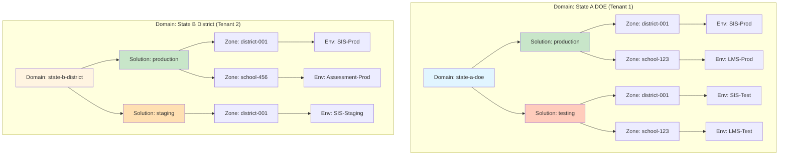
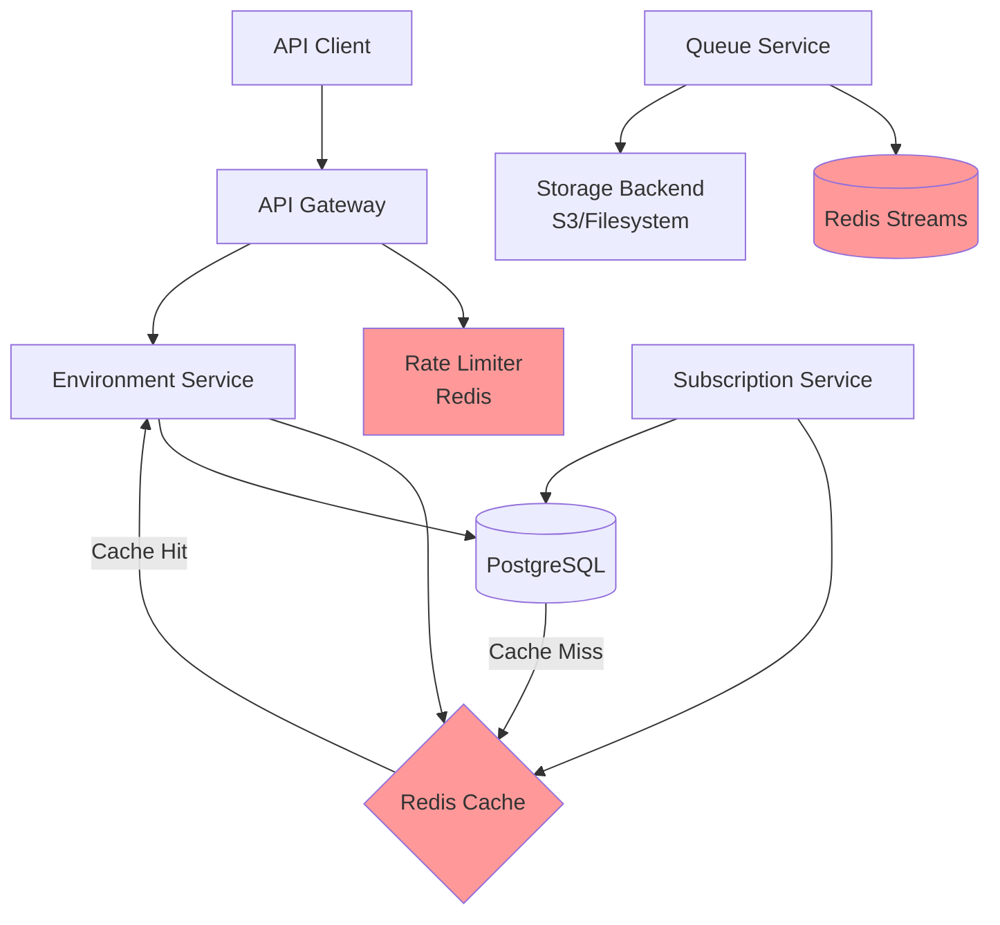
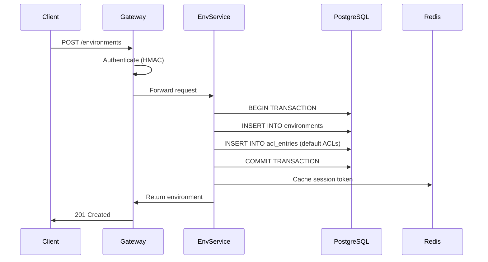
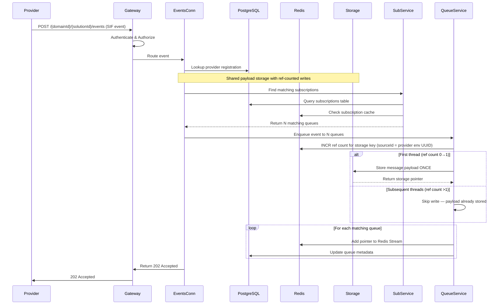
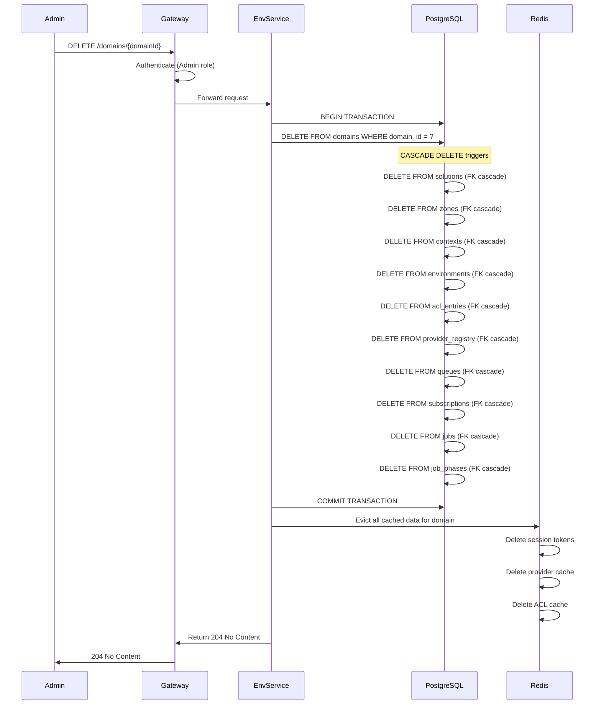
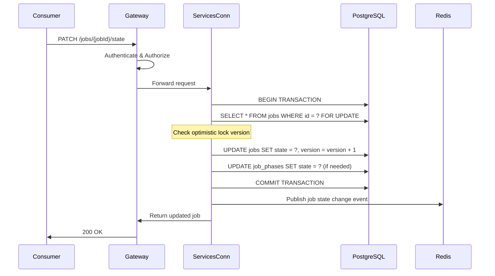
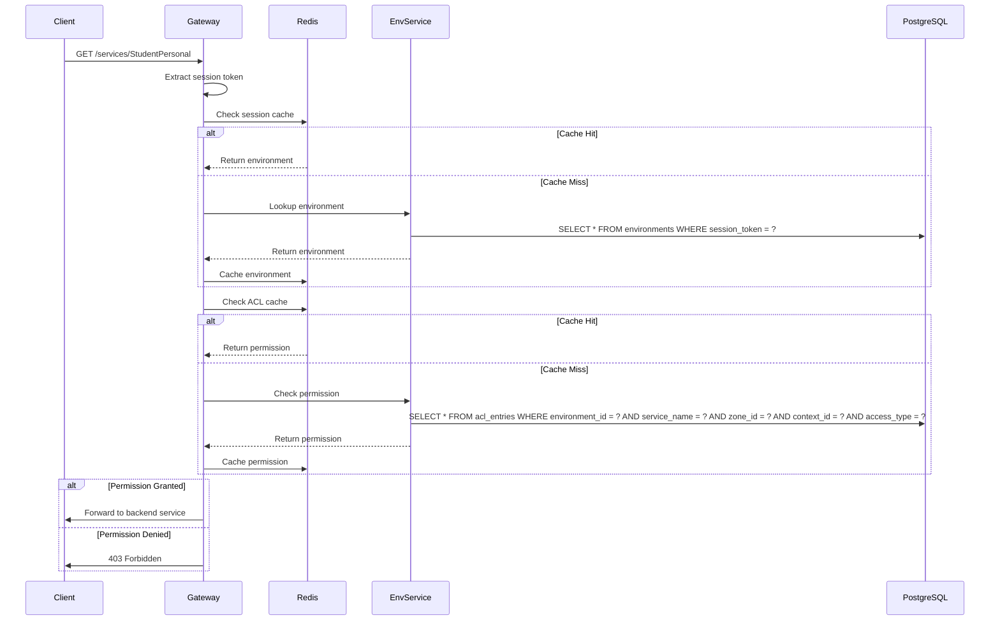

# SIF Unity Broker - Data Architecture

**Version:** 1.1  
**Date:** March 12, 2026  
**Status:** Active  
**Updated:** April 6, 2026 — Event distribution shared payload storage with ref-counted writes

## Table of Contents

1. [Database Overview](#database-overview)
2. [Entity Relationship Model](#entity-relationship-model)
3. [Multi-Tenancy Data Isolation](#multi-tenancy-data-isolation)
4. [Schema Design Patterns](#schema-design-patterns)
5. [Database Indexes](#database-indexes)
6. [Data Migration Strategy](#data-migration-strategy)
7. [Data Integrity](#data-integrity)
8. [Caching Strategy](#caching-strategy)
9. [Backup and Recovery](#backup-and-recovery)
10. [Data Retention Policies](#data-retention-policies)
11. [Data Flow Diagrams](#data-flow-diagrams)
12. [References](#references)

---

## Database Overview

### PostgreSQL Selection Rationale

The SIF Unity Broker uses **PostgreSQL 14+** as its primary relational database management system. This decision is based on several critical requirements for educational data interoperability:

**1. ACID Compliance for Data Integrity**

Educational data exchange requires strict transactional guarantees:
- **Atomicity**: Environment registration with ACL entries must succeed or fail as a unit
- **Consistency**: Foreign key constraints ensure referential integrity across multi-tenant boundaries
- **Isolation**: Concurrent environment registrations don't interfere with each other
- **Durability**: Committed data survives system failures

PostgreSQL's robust ACID compliance ensures that critical operations like provider registration, subscription management, and job state transitions maintain data integrity even under high load or failure conditions.

**2. Advanced Data Type Support**

PostgreSQL provides data types essential for the broker's functionality:
- **UUID**: Native UUID type for globally unique identifiers across distributed systems
- **JSONB**: Binary JSON storage for flexible metadata and configuration (job metadata, provider capabilities)
- **TIMESTAMP**: Precise timestamp handling with timezone support for audit trails
- **TEXT**: Unlimited text storage for descriptions and configuration
- **Arrays**: Native array support for multi-value fields (supported_patterns in provider_registry)

**3. Robust Foreign Key Constraints**

The broker's multi-tenant hierarchy (Domain → Solution → Zone → Context → Environment) requires cascading deletes and referential integrity:
- Deleting a domain cascades to all solutions, zones, and environments within that domain
- Deleting a solution cascades to all zones and environments within that solution
- Deleting an environment cascades to all ACL entries and provider registrations

PostgreSQL's foreign key constraints with `ON DELETE CASCADE` ensure data consistency across the tenant hierarchy without requiring application-level cleanup logic.

**4. Full-Text Search Capabilities**

PostgreSQL's built-in full-text search supports:
- Searching environments by application name
- Searching providers by service name
- Searching zones and contexts by description
- Future requirements for audit log searching

**5. Performance and Scalability**

PostgreSQL provides excellent performance characteristics:
- Efficient B-tree indexes for primary and foreign key lookups
- Composite indexes for multi-column queries (ACL permission checks, provider discovery)
- Query planner optimization for complex joins
- Connection pooling with HikariCP for high concurrency
- Read replicas for scaling read-heavy workloads (future)

**6. Open Source and Community Support**

- No licensing costs for educational institutions
- Large, active community for troubleshooting and best practices
- Extensive documentation and tooling ecosystem
- Long-term support and stability (PostgreSQL 14 supported until 2026)

**Alternatives Considered:**

- **MySQL**: Less feature-rich (weaker JSON support, less robust foreign keys), less suitable for complex hierarchical data
- **MongoDB**: Eventual consistency model unsuitable for ACID requirements, lack of foreign key constraints would require application-level integrity enforcement
- **Oracle**: Licensing costs prohibitive for educational institutions, overkill for broker requirements

### Database Naming Conventions

The broker follows consistent naming conventions aligned with the project structure (see [structure.md](../../.kiro/steering/structure.md)):

**Tables:**
- Plural, snake_case: `domains`, `solutions`, `zones`, `contexts`, `environments`
- Descriptive names reflecting business entities

**Columns:**
- snake_case: `domain_id`, `solution_id`, `created_at`, `session_token`
- Consistent naming across tables (e.g., all primary keys are `id`)

**Primary Keys:**
- Column name: `id`
- Type: `UUID` (universally unique identifiers)
- Generation: `gen_random_uuid()` or application-generated

**Foreign Keys:**
- Constraint name: `fk_{table}_{referenced_table}` (or `fk_{table}_{referenced_column}` for UUID FKs)
- Example: `fk_solutions_domain_uuid`, `fk_zones_solution_uuid`, `fk_contexts_zone_uuid`

**Indexes:**
- Naming: `idx_{table}_{column(s)}`
- Example: `idx_environments_session_token`, `idx_acl_lookup`

**Unique Constraints:**
- Naming: `uk_{columns}` or `uq_{columns}`
- Example: `uk_domain_uuid_solution`, `uk_solution_uuid_zone`, `uq_subscription`

**Check Constraints:**
- Naming: `chk_{column}` or descriptive name
- Example: `chk_type`, `chk_access_type`

### Schema Organization

The SIF Unity Broker uses a **single database with logical schema separation** by service:

- **environment-service schema**: domains, solutions, zones, contexts, environments, acl_entries, provider_registry
- **queue-service schema**: queues (message queue metadata)
- **job-service schema**: jobs, job_phases (SIF Functional Service Job state)
- **subscription-service schema**: subscriptions (event subscription routing)

The **environment-service** owns ALL Flyway migrations in a single unified migration path (`environment-service/src/main/resources/db/migration/`). The other services (queue-service, subscription-service, job-service) have Flyway disabled (`spring.flyway.enabled: false`) and rely on JPA `ddl-auto: validate` to confirm the expected tables exist at startup. The environment-service starts first and runs all migrations (V1–V21); other services connect after migrations are complete. Services do not directly access other services' tables; inter-service communication occurs via REST APIs.

**Rationale for Single Database:**

- **Simplified Operations**: Single database to backup, monitor, and maintain
- **Transactional Consistency**: Cross-service transactions possible when needed (rare but valuable)
- **Cost Efficiency**: Single database instance reduces infrastructure costs
- **Development Simplicity**: Single connection pool, single migration tool, single schema to understand

**Unified Migration Path Benefits:**

- **Single Source of Truth**: All migrations live in `environment-service/src/main/resources/db/migration/`
- **No Version Conflicts**: Sequential versioning (V1–V21) across all tables eliminates per-service version collisions
- **Simplified Operations**: One `flyway_schema_history` table tracks all migrations
- **Cross-Service Schema Evolution**: Schema changes spanning multiple services' tables are straightforward

---

## Entity Relationship Model

### Core Entities

The SIF Unity Broker's data model centers on a hierarchical multi-tenant structure with supporting entities for access control, provider registration, messaging, and job management. Entity attributes are derived from the SIF 3.7 XSD (`external_docs/3-7-SIF_Message.xsd`), with broker-specific extensions noted where applicable.

#### Multi-Tenant Hierarchy Entities

These entities are broker-specific extensions (not defined in the SIF 3.7 XSD) that provide multi-tenant isolation above the SIF environment level.

**1. Domain (Tenant Boundary)**
- **Purpose**: Top-level tenant isolation for independent organizations
- **Key Attributes**: domain_id (unique identifier), description, created_at
- **Relationships**: One domain has many solutions

**2. Solution (Environment Type)**
- **Purpose**: Separate production from non-production environments within a domain
- **Key Attributes**: solution_id (unique within domain), domain_uuid (UUID foreign key to domains.id), description, created_at
- **Relationships**: Belongs to one domain (via domain_uuid UUID FK), has many zones, environments, and solution services

**2a. Solution Service (Service Catalog per Solution, Broker Extension)**
- **Purpose**: Define which service name + type combinations are available within a solution. Used by administrators when provisioning zones, creating ACL entries, or registering providers — provides a selectable catalog of services.
- **Key Attributes**:
  - solution_id (foreign key to solutions)
  - service_name — name of the service (e.g., "StudentPersonal", "SchoolInfo")
  - service_type (UTILITY, OBJECT, FUNCTIONAL, SERVICEPATH, XQUERYTEMPLATE, SERVICE) — XSD `serviceTypeType`
  - created_at
- **Relationships**: Belongs to one solution
- **Constraints**: Unique constraint on (solution_id, service_name, service_type) — each service name + type pair appears at most once per solution

**2b. Entity Tag (Solution-Scoped Metadata, Broker Extension)**
- **Purpose**: Attach key-value tags to any entity within a solution, enabling business logic, feature flags, and operational metadata without schema changes. Tags are scoped by solution for tenant isolation.
- **Key Attributes**:
  - id (UUID, surrogate key)
  - solution_id (foreign key to solutions) — scoping boundary for tenant isolation
  - entity_type — discriminator for the tagged entity: `SOLUTION`, `ZONE`, `CONTEXT`, `ENVIRONMENT`, `QUEUE`
  - entity_id (UUID) — references the tagged entity's primary key
  - tag_key — tag name (e.g., `SDPC_ENABLED`, `HIGH_VOLUME_ALLOWED`, `RATE_LIMIT_TIER`)
  - tag_value — optional value (null = boolean flag, or a string value like `tier-3`)
  - created_at
- **Relationships**: Belongs to one solution. References one entity (polymorphic via entity_type + entity_id).
- **Constraints**: Unique constraint on (solution_id, entity_type, entity_id, tag_key) — each tag key appears at most once per entity within a solution
- **Design Notes**:
  - No foreign key on entity_id (polymorphic reference to multiple tables). Referential integrity enforced at the application layer; cascade deletion handled by solution FK and application-level cleanup.
  - When `entity_type = SOLUTION`, `entity_id` references the same solution as `solution_id` (self-tagging).
  - Tags are opaque to the broker core — interpretation is left to consuming services (gateway rate limiting, connector routing, admin tooling, etc.).
  - Redis caching recommended for hot-path tag lookups (e.g., gateway checking `HIGH_VOLUME_ALLOWED` during rate limiting).

**Example Use Cases:**
- `SDPC_ENABLED` on a Solution — indicates the solution participates in Student Data Privacy Consortium compliance
- `HIGH_VOLUME_ALLOWED` on an Environment — gateway applies relaxed rate limits
- `PRIORITY_ROUTING` on a Zone — connectors prioritize message delivery
- `RATE_LIMIT_TIER` = `enterprise` on an Environment — tiered rate limiting
- `MAINTENANCE_MODE` on a Zone — connectors queue messages instead of routing

**3. Zone (Organizational Unit)**
- **Purpose**: SIF organizational unit for logical grouping (district, school, region)
- **Key Attributes**: zone_id (unique within solution), solution_uuid (UUID foreign key to solutions.id), description, created_at
- **Relationships**: Belongs to one solution (via solution_uuid UUID FK), has many contexts

**4. Context (Sub-Unit)**
- **Purpose**: SIF sub-unit within a zone for additional routing granularity
- **Key Attributes**: context_id (unique within zone), zone_uuid (UUID foreign key to zones.id), description, created_at
- **Relationships**: Belongs to one zone (via zone_uuid UUID FK)

#### SIF 3.7 Infrastructure Entities

**5. Environment (SIF 3.7 `environmentType`)**
- **Purpose**: Individual application registration with credentials and provisioned access
- **XSD Source**: `environmentType` in SIF 3.7 XSD
- **Key Attributes**:
  - id (UUID, XSD attribute `@id`)
  - fingerprint — unique shareable identifier; must NOT match id, sessionToken, userToken, or applicationKey
  - session_token — authentication token issued at registration
  - solution_uuid — UUID foreign key to solutions.id; the solution the application participates in
  - default_zone_id, default_context_id — routing defaults (XSD `defaultZone` with `@id`, description, properties)
  - authentication_method — how the applicationKey enforces security (e.g., "Basic", "SIF_HMACSHA256")
  - instance_id — distinguishes multiple instances of the same application
  - user_token — opaque user-level token for delegated authentication
  - consumer_name — descriptive name identifiable to zone administrators
  - type (DIRECT, BROKERED, ADMIN) — XSD attribute `@type`, describes environment topology per SIF 3.7; ADMIN is a broker extension. Consumer/provider roles are expressed through ACL rights, not environment type
  - shared_secret — for HMAC signature computation (broker-specific, not in XSD)
  - created_at, expires_at — lifecycle timestamps (broker-specific)
- **Flattened Application Info** (XSD `applicationInfoType`, stored inline — 1:1 with environment, always read together):
  - appinfo_application_key — opaque consumer authentication element (XSD `applicationKey`)
  - appinfo_supported_infra_version — SIF infrastructure version the consumer supports (XSD `supportedInfrastructureVersion`)
  - appinfo_data_model_namespace — namespace of data payloads (XSD `dataModelNamespace`)
  - appinfo_transport — expected transport (XSD `transport`)
  - appinfo_app_vendor_name — application product vendor (XSD `applicationProduct/vendorName`)
  - appinfo_app_product_name — application product name (XSD `applicationProduct/productName`)
  - appinfo_app_product_version — application product version (XSD `applicationProduct/productVersion`)
  - appinfo_app_icon_uri — application product icon (XSD `applicationProduct/iconURI`)
  - appinfo_adapter_vendor_name — adapter product vendor (XSD `adapterProduct/vendorName`)
  - appinfo_adapter_product_name — adapter product name (XSD `adapterProduct/productName`)
  - appinfo_adapter_product_version — adapter product version (XSD `adapterProduct/productVersion`)
  - appinfo_adapter_icon_uri — adapter product icon (XSD `adapterProduct/iconURI`)
- **Related Entities**:
  - infrastructure_services — list of infrastructure service URLs (environment, provisionRequests, requestsConnector, eventsConnector, queues, subscriptions, servicesConnector, responsesConnector) — stored as separate table (1:N). URLs are now gateway-routed (e.g., `http://localhost:8080/{domainId}/{solutionId}/events`) rather than direct service URLs, constructed dynamically using the `sif.broker.infrastructure.gateway-base-url` property combined with the environment's domain/solution hierarchy.
  - provisioned_zones — zones with their services and rights (see ACL Entry below)
- **Relationships**: Belongs to one solution (optional), has many ACL entries, provider registrations, infrastructure services, queues, and jobs

**6. ACL Entry (SIF 3.7 `rightType` within `provisionedZone > service > rights`)**
- **Purpose**: Define fine-grained permissions for environments to access services within zones
- **XSD Source**: `rightType` nested within `provisionedZoneType > servicesType > serviceType > rightsType`
- **Key Attributes**:
  - environment_id (foreign key to environments)
  - zone_id — from the parent `provisionedZone/@id`
  - context_id — from the parent `service/@contextId`
  - service_name — from `service/@name`
  - service_type (UTILITY, OBJECT, FUNCTIONAL, SERVICEPATH, XQUERYTEMPLATE, SERVICE) — XSD `serviceTypeType`
  - service_sub_type — optional, XSD `serviceSubTypeType` (e.g., "adminDirective")
  - access_type (QUERY, CREATE, UPDATE, DELETE, SUBSCRIBE, PROVIDE) — XSD `rightTypeType`
  - access_level (APPROVED, SUPPORTED, REJECTED, UNSUPPORTED, REQUESTED) — XSD `rightValueType`
- **Relationships**: Belongs to one environment
- **Constraints**: Unique constraint on (environment_id, service_name, zone_id, context_id, access_type)

**7. Provider Registry (Broker Extension)**
- **Purpose**: Track which environments provide which services and their callback endpoints
- **Note**: This is a broker-specific entity. The SIF 3.7 XSD expresses provider capability through PROVIDE rights in the provisioned zones; the broker extends this with explicit endpoint registration.
- **Key Attributes**:
  - environment_id (foreign key to environments)
  - service_name (e.g., "StudentPersonal")
  - zone_id, context_id (service scope)
  - endpoint (provider callback URL)
  - supported_patterns (text[] array: IMMEDIATE, DELAYED, EVENT)
  - registered_at
- **Relationships**: Belongs to one environment
- **Constraints**: Unique constraint on (service_name, zone_id, context_id) — one provider per service per zone/context

#### Messaging Entities

**8. Queue (SIF 3.7 `queueType`)**
- **Purpose**: Message queue instance for asynchronous delivery
- **XSD Source**: `queueType` in SIF 3.7 XSD
- **Key Attributes**:
  - id (UUID, XSD attribute `@id`)
  - name — consumer-assigned name (not guaranteed unique, useful for reporting)
  - owner_id — environment ID of the owning consumer (XSD `ownerId`)
  - polling (IMMEDIATE, LONG) — whether consumer must poll at intervals or can long-poll
  - queue_uri — URI of the Messages Service endpoint for dequeuing
  - owner_uri — callback URL for async notification when new messages arrive
  - idle_timeout — max seconds the Messages Service waits before returning "no message"
  - min_wait_time — min seconds consumer should wait after "no message" before re-polling
  - max_concurrent_connections — number of concurrent connections supported
  - created_at (XSD `created`)
  - last_modified — last time a new message was enqueued
- **Broker Extensions**: max_retries, retry_delay_ms (not in XSD, broker-specific retry behavior)
- **Redis-Sourced Fields** (not stored in DB, populated at query time from Redis):
  - message_count — current number of messages in the queue (XSD `messageCount`)
  - last_accessed — last time a message was dequeued (XSD `lastAccessed`)
- **Relationships**: Owned by one environment, has many subscriptions
- **Constraints**: Unique constraint on (owner_id, name)

**9. Subscription (SIF 3.7 `subscriptionType`)**
- **Purpose**: Event and request subscription routing rules
- **XSD Source**: `subscriptionType` in SIF 3.7 XSD
- **Key Attributes**:
  - id (UUID, XSD attribute `@id`)
  - queue_id — which queue receives messages for this subscription (XSD `queueId`)
  - zone_id (mandatory in XSD)
  - context_id (defaults to DEFAULT if not specified)
  - service_type (UTILITY, OBJECT, FUNCTIONAL, SERVICEPATH, XQUERYTEMPLATE, SERVICE) — XSD `serviceTypeType`, mandatory
  - service_sub_type — optional, XSD `serviceSubTypeType`
  - message_type (EVENT, REQUEST) — optional, XSD `messageTypeType`
  - service_name — name of the subscribed service (mandatory)
  - type (EVENT, DELAYED_REQUEST) — broker-specific routing type
  - created_at
- **Relationships**: Belongs to one queue
- **Constraints**: Unique constraint on (queue_id, service_name, zone_id, context_id, type)

#### Job Management Entities

**10. Job (SIF 3.7 `jobType`)**
- **Purpose**: Track multi-phase Functional Service workflow state
- **XSD Source**: `jobType` in SIF 3.7 XSD
- **Key Attributes**:
  - id (UUID, XSD attribute `@id`)
  - name — job name (mandatory in XSD, e.g., "grading", "sre")
  - description — human-readable description (e.g., "Bowers Elementary School Final Marks")
  - state (NOTSTARTED, INPROGRESS, COMPLETED, FAILED) — XSD `jobStateType`
  - state_description — elaboration on current state (e.g., if FAILED: "Timeout occurred")
  - timeout — duration after creation before auto-deletion (XSD `xs:duration`)
  - created_at (XSD `created`)
  - last_modified (XSD `lastModified`)
  - initialization — optional startup payload (phaseName + payload)
- **Broker Extensions**: environment_id (job owner), service_name, zone_id, context_id (routing), current_phase, metadata (JSONB), version (optimistic locking), updated_at
- **Relationships**: Belongs to one environment, has many phases
- **Constraints**: State must be one of four valid values

**11. Job Phase (SIF 3.7 `phaseType`)**
- **Purpose**: Track individual phase state and access rights within a multi-phase job
- **XSD Source**: `phaseType` in SIF 3.7 XSD
- **Key Attributes**:
  - id (UUID primary key, broker-generated)
  - job_id (foreign key to jobs)
  - name — phase name, unique within the owning job (mandatory in XSD)
  - states — collection of state transitions the phase has been through (must initially contain NOTAPPLICABLE or NOTSTARTED)
  - required — boolean, whether this phase is required for job completion (mandatory in XSD)
  - rights — access rights granted to the consumer for this phase (XSD `rightsType`)
  - states_rights — access rights granted to the consumer for state operations (XSD `rightsType`)
- **Broker Extensions**: metadata (JSONB), created_at, updated_at
- **Relationships**: Belongs to one job
- **Constraints**: Unique constraint on (job_id, name)

### Complete Entity Relationship Diagram

Attributes are sourced from the SIF 3.7 XSD (`environmentType`, `queueType`, `subscriptionType`, `jobType`, `phaseType`) plus broker-specific extensions. Broker extensions are marked with `(B)`.

```mermaid
erDiagram
    domains ||--o{ solutions : "has many"
    solutions ||--o{ zones : "has many"
    solutions ||--o{ environments : "has many (optional)"
    solutions ||--o{ solution_services : "has many"
    solutions ||--o{ entity_tags : "has many"
    zones ||--o{ contexts : "has many"
    environments ||--o{ acl_entries : "has many"
    environments ||--o{ provider_registry : "has many"
    environments ||--o{ queues : "owns many"
    environments ||--o{ jobs : "has many"
    environments ||--o{ infrastructure_services : "has many"
    queues ||--o{ subscriptions : "has many"
    jobs ||--o{ job_phases : "has many"

    domains {
        uuid id PK "(B) Surrogate key"
        varchar domain_id UK "(B) Unique domain identifier"
        text description "(B)"
        timestamp created_at "(B)"
    }

    solutions {
        uuid id PK "(B) Surrogate key"
        uuid domain_uuid FK "(B) UUID FK to domains.id"
        varchar solution_id UK "(B) Unique solution identifier"
        text description "(B)"
        timestamp created_at "(B)"
    }

    solution_services {
        uuid id PK "(B) Surrogate key"
        uuid solution_id FK "(B) References solutions"
        varchar service_name "(B) e.g. StudentPersonal, SchoolInfo"
        varchar service_type "(B) UTILITY, OBJECT, FUNCTIONAL, etc."
        timestamp created_at "(B)"
    }

    entity_tags {
        uuid id PK "(B) Surrogate key"
        uuid solution_id FK "(B) Scoping boundary"
        varchar entity_type "(B) SOLUTION, ZONE, CONTEXT, ENVIRONMENT, QUEUE"
        uuid entity_id "(B) Polymorphic reference to tagged entity"
        varchar tag_key "(B) e.g. SDPC_ENABLED, HIGH_VOLUME_ALLOWED"
        varchar tag_value "(B) Optional value (null = boolean flag)"
        timestamp created_at "(B)"
    }

    zones {
        uuid id PK "(B) Surrogate key"
        varchar zone_id "Unique within solution"
        uuid solution_uuid FK "(B) UUID FK to solutions.id"
        text description
        timestamp created_at "(B)"
    }

    contexts {
        uuid id PK "(B) Surrogate key"
        uuid zone_uuid FK "UUID FK to zones.id"
        varchar context_id "Unique within zone"
        text description
        timestamp created_at "(B)"
    }

    environments {
        uuid id PK "XSD @id"
        varchar fingerprint UK "Shareable ID, must not match id/sessionToken/userToken/appKey"
        varchar session_token UK "XSD sessionToken"
        uuid solution_uuid FK "UUID FK to solutions.id (nullable)"
        varchar default_zone_id "XSD defaultZone/@id"
        varchar default_context_id "(B) Default context"
        varchar authentication_method "XSD authenticationMethod"
        varchar instance_id "XSD instanceId"
        varchar user_token "XSD userToken"
        varchar consumer_name "XSD consumerName"
        varchar type "XSD @type: DIRECT, BROKERED + (B) ADMIN"
        varchar shared_secret "(B) HMAC secret"
        varchar application_name UK "(B) Unique app name"
        varchar appinfo_application_key "XSD applicationKey"
        varchar appinfo_supported_infra_version "XSD supportedInfrastructureVersion"
        varchar appinfo_data_model_namespace "XSD dataModelNamespace"
        varchar appinfo_transport "XSD transport"
        varchar appinfo_app_vendor_name "XSD applicationProduct/vendorName"
        varchar appinfo_app_product_name "XSD applicationProduct/productName"
        varchar appinfo_app_product_version "XSD applicationProduct/productVersion"
        varchar appinfo_app_icon_uri "XSD applicationProduct/iconURI"
        varchar appinfo_adapter_vendor_name "XSD adapterProduct/vendorName"
        varchar appinfo_adapter_product_name "XSD adapterProduct/productName"
        varchar appinfo_adapter_product_version "XSD adapterProduct/productVersion"
        varchar appinfo_adapter_icon_uri "XSD adapterProduct/iconURI"
        timestamp created_at "(B)"
        timestamp expires_at "(B)"
    }

    infrastructure_services {
        uuid id PK "(B) Surrogate key"
        uuid environment_id FK "References environments"
        varchar service_name "XSD @name: environment, queues, subscriptions, etc."
        varchar service_url "XSD value: gateway-routed URL (e.g. http://gw:8080/{domainId}/{solutionId}/events)"
    }

    acl_entries {
        uuid id PK "(B) Surrogate key"
        uuid environment_id FK "References environments"
        varchar zone_id "XSD provisionedZone/@id"
        varchar context_id "XSD service/@contextId"
        varchar service_name "XSD service/@name"
        varchar service_type "XSD service/@type: UTILITY, OBJECT, FUNCTIONAL, etc."
        varchar service_sub_type "XSD service/@subType (optional)"
        varchar access_type "XSD right/@type: QUERY, CREATE, UPDATE, DELETE, SUBSCRIBE, PROVIDE"
        varchar access_level "XSD right value: APPROVED, SUPPORTED, REJECTED, UNSUPPORTED, REQUESTED"
    }

    provider_registry {
        uuid id PK "(B) Surrogate key"
        uuid environment_id FK "References environments"
        varchar service_name "(B) Service being provided"
        varchar zone_id "(B) Zone scope"
        varchar context_id "(B) Context scope"
        varchar endpoint "(B) Provider callback URL"
        text_array supported_patterns "(B) IMMEDIATE, DELAYED, EVENT"
        timestamp registered_at "(B)"
    }

    queues {
        uuid id PK "XSD @id"
        varchar name "XSD name (not guaranteed unique)"
        uuid owner_id "XSD ownerId"
        varchar polling "XSD polling: IMMEDIATE, LONG"
        varchar queue_uri "XSD queueUri: messages endpoint"
        varchar owner_uri "XSD ownerUri: async notification URL"
        integer idle_timeout "XSD idleTimeout (seconds)"
        integer min_wait_time "XSD minWaitTime (seconds)"
        integer max_concurrent_connections "XSD maxConcurrentConnections"
        timestamp created_at "XSD created"
        timestamp last_modified "XSD lastModified"
        integer max_retries "(B) Retry limit"
        bigint retry_delay_ms "(B) Retry delay"
    }

    subscriptions {
        uuid id PK "XSD @id"
        uuid queue_id FK "XSD queueId"
        varchar zone_id "XSD zoneId (mandatory)"
        varchar context_id "XSD contextId (defaults to DEFAULT)"
        varchar service_type "XSD serviceType: UTILITY, OBJECT, FUNCTIONAL, etc."
        varchar service_sub_type "XSD serviceSubType (optional)"
        varchar message_type "XSD messageType: EVENT, REQUEST (optional)"
        varchar service_name "XSD serviceName"
        varchar type "(B) EVENT, DELAYED_REQUEST"
        timestamp created_at "(B)"
    }

    jobs {
        uuid id PK "XSD @id"
        varchar name "XSD name (mandatory)"
        text description "XSD description"
        varchar state "XSD state: NOTSTARTED, INPROGRESS, COMPLETED, FAILED"
        text state_description "XSD stateDescription"
        varchar timeout "XSD timeout (xs:duration)"
        timestamp created_at "XSD created"
        timestamp last_modified "XSD lastModified"
        jsonb initialization "XSD initialization (phaseName + payload)"
        uuid environment_id FK "(B) Job owner"
        varchar service_name "(B) Functional service name"
        varchar zone_id "(B) Zone scope"
        varchar context_id "(B) Context scope"
        varchar current_phase "(B) Current phase name"
        jsonb metadata "(B) Flexible data"
        integer version "(B) Optimistic locking"
        timestamp updated_at "(B)"
    }

    job_phases {
        uuid id PK "(B) Surrogate key"
        uuid job_id FK "References jobs"
        varchar name "XSD name (unique within job)"
        jsonb states "XSD states (state history, must start with NOTAPPLICABLE or NOTSTARTED)"
        boolean required "XSD required"
        jsonb rights "XSD rights (consumer access rights for phase)"
        jsonb states_rights "XSD statesRights (consumer access rights for states)"
        jsonb metadata "(B) Phase-specific data"
        timestamp created_at "(B)"
        timestamp updated_at "(B)"
    }
```



### Entity Relationships and Cardinality

**Multi-Tenant Hierarchy (Broker Extensions):**
- Domain (1) → Solutions (N): One domain has many solutions
- Solution (1) → Zones (N): One solution has many zones
- Solution (1) → Environments (N): One solution has many environments (optional relationship)
- Solution (1) → Solution Services (N): Service catalog available within the solution
- Solution (1) → Entity Tags (N): Tags on any entity within the solution (polymorphic)
- Zone (1) → Contexts (N): One zone has many contexts

**Environment Structure (SIF 3.7 + Broker):**
- Environment (1) → Infrastructure Services (N): URLs for each infrastructure service
- Environment (1) → ACL Entries (N): Provisioned rights per service/zone/context
- Environment (1) → Provider Registrations (N): Broker-specific endpoint registrations

**Messaging (SIF 3.7):**
- Environment (1) → Queues (N): One environment owns many queues
- Queue (1) → Subscriptions (N): One queue has many subscriptions

**Job Management (SIF 3.7):**
- Environment (1) → Jobs (N): One environment has many jobs
- Job (1) → Job Phases (N): One job has many phases

### Cascade Deletion Rules

The broker implements cascading deletes to maintain referential integrity:

**Domain Deletion:**
```
DELETE Domain
  ↓ CASCADE
  DELETE Solutions (all solutions in domain)
    ↓ CASCADE
    DELETE Zones (all zones in solutions)
      ↓ CASCADE
      DELETE Contexts (all contexts in zones)
    ↓ CASCADE
    DELETE Solution Services (service catalog for solutions)
    ↓ CASCADE
    DELETE Entity Tags (all tags scoped to solutions)
    ↓ CASCADE
    DELETE Environments (all environments in solutions)
      ↓ CASCADE
      DELETE ACL Entries, Provider Registrations, Infrastructure Services, Queues, Jobs
```

**Solution Deletion:**
```
DELETE Solution
  ↓ CASCADE
  DELETE Zones (all zones in solution)
    ↓ CASCADE
    DELETE Contexts (all contexts in zones)
  ↓ CASCADE
  DELETE Solution Services (service catalog for solution)
  ↓ CASCADE
  DELETE Entity Tags (all tags scoped to solution)
  ↓ CASCADE
  DELETE Environments (all environments in solution)
    ↓ CASCADE
    DELETE ACL Entries, Provider Registrations, Infrastructure Services, Queues, Jobs
```

**Environment Deletion:**
```
DELETE Environment
  ↓ CASCADE
  DELETE Infrastructure Services (all infrastructure service URLs for environment)
  ↓ CASCADE
  DELETE ACL Entries (all ACL entries for environment)
  ↓ CASCADE
  DELETE Provider Registrations (all provider registrations for environment)
  ↓ CASCADE
  DELETE Queues (all queues owned by environment)
    ↓ CASCADE
    DELETE Subscriptions (all subscriptions for queues)
  ↓ CASCADE
  DELETE Jobs (all jobs for environment)
    ↓ CASCADE
    DELETE Job Phases (all phases for jobs)
```

**Zone Deletion:**
```
DELETE Zone
  ↓ CASCADE
  DELETE Contexts (all contexts in zone)
```

**Job Deletion:**
```
DELETE Job
  ↓ CASCADE
  DELETE Job Phases (all phases for job)
```

**Queue Deletion:**
```
DELETE Queue
  ↓ CASCADE
  DELETE Subscriptions (all subscriptions for queue)
```

These cascade rules ensure that deleting a tenant (domain) or organizational unit (solution, zone) automatically cleans up all dependent data without requiring application-level cleanup logic.

---

## Multi-Tenancy Data Isolation

### Tenant Isolation Strategy

The SIF Unity Broker implements **hierarchical multi-tenancy** with data isolation at the **domain level** and **solution level**. This approach provides complete data separation between independent organizations while allowing flexible environment separation within organizations.

### Domain-Level Isolation (Tenant Boundary)

**Domain** is the top-level tenant boundary. Each domain represents an independent organization:
- State A Department of Education
- State B School District
- State C Education Agency

**Isolation Guarantees:**
- No data sharing between domains
- Domain deletion removes all associated data (solutions, zones, environments, ACL entries, etc.)
- Domain IDs are globally unique across the entire system
- Queries are filtered by domain_id to prevent cross-tenant data leakage

**Implementation:**
```sql
-- All queries for domain-scoped data include domain_id filter
SELECT * FROM solutions s JOIN domains d ON s.domain_uuid = d.id WHERE d.domain_id = :domainId;
SELECT * FROM zones z 
  JOIN solutions s ON z.solution_uuid = s.id
  JOIN domains d ON s.domain_uuid = d.id
  WHERE d.domain_id = :domainId;
```

### Solution-Level Isolation (Environment Type)

**Solution** provides environment separation within a domain:
- production (live data)
- staging (pre-production testing)
- testing (QA environment)
- development (developer sandbox)

**Isolation Guarantees:**
- Production and non-production data are completely separated
- Same zone_id can exist in different solutions (e.g., "school-123" in both production and testing)
- Environments are scoped to solutions (optional for SIF 3.3 compatibility)
- Solution deletion removes all zones and environments within that solution

**Implementation:**
```sql
-- Zones are unique within solution, not globally
CREATE CONSTRAINT uk_solution_uuid_zone UNIQUE (solution_uuid, zone_id);

-- Environments are scoped to solutions via UUID FK
ALTER TABLE environments ADD CONSTRAINT fk_environments_solution_uuid 
  FOREIGN KEY (solution_uuid) REFERENCES solutions(id) ON DELETE CASCADE;
```

### Multi-Tenancy Data Isolation Diagram



**Key Isolation Points:**

1. **Domain Isolation**: State A DOE and State B District have completely separate data
2. **Solution Isolation**: Production and testing environments are separated within each domain
3. **Zone Reuse**: Same zone_id ("district-001") can exist in different solutions without conflict
4. **Environment Scoping**: Environments belong to solutions, ensuring production/test separation

### Query Filtering Patterns

**Domain-Scoped Queries:**
```sql
-- Get all solutions for a domain (service layer resolves domain_id string to domain UUID)
SELECT s.* FROM solutions s JOIN domains d ON s.domain_uuid = d.id WHERE d.domain_id = 'state-a-doe';

-- Get all zones for a domain (across all solutions)
SELECT z.* FROM zones z
  JOIN solutions s ON z.solution_uuid = s.id
  JOIN domains d ON s.domain_uuid = d.id
  WHERE d.domain_id = 'state-a-doe';

-- Get all environments for a domain
SELECT e.* FROM environments e
  JOIN solutions s ON e.solution_uuid = s.id
  JOIN domains d ON s.domain_uuid = d.id
  WHERE d.domain_id = 'state-a-doe';
```

**Solution-Scoped Queries:**
```sql
-- Get all zones for a solution (service layer resolves solution_id string to solution UUID)
SELECT * FROM zones WHERE solution_uuid = :solutionUuid;

-- Get all environments for a solution
SELECT * FROM environments WHERE solution_uuid = :solutionUuid;

-- Check if zone exists in specific solution
SELECT * FROM zones 
  WHERE solution_uuid = :solutionUuid 
  AND zone_id = 'district-001';
```

**Environment-Scoped Queries:**
```sql
-- Get ACL entries for an environment
SELECT * FROM acl_entries WHERE environment_id = :envId;

-- Get provider registrations for an environment
SELECT * FROM provider_registry WHERE environment_id = :envId;

-- Get queues owned by an environment
SELECT * FROM queues WHERE owner_id = :envId;
```

### Data Access Patterns

**1. Environment Registration (Multi-Tenant Aware)**
```java
// Application layer ensures domain/solution context
public Environment registerEnvironment(String domainId, String solutionId, 
                                       EnvironmentCreateRequest request) {
    // Verify domain exists
    Domain domain = domainRepository.findByDomainId(domainId)
        .orElseThrow(() -> new DomainNotFoundException(domainId));
    
    // Verify solution exists and belongs to domain (via UUID FK)
    Solution solution = solutionRepository.findBySolutionId(solutionId)
        .orElseThrow(() -> new SolutionNotFoundException(solutionId));
    
    if (!solution.getDomainUuid().equals(domain.getId())) {
        throw new UnauthorizedException("Solution does not belong to domain");
    }
    
    // Create environment scoped to solution via UUID FK
    Environment env = new Environment();
    env.setSolutionUuid(solution.getId());
    // ... set other fields
    return environmentRepository.save(env);
}
```

**2. ACL Permission Check (Multi-Tenant Aware)**
```java
// ACL check includes zone/context scope
public boolean hasPermission(UUID environmentId, String serviceName, 
                             String zoneId, String contextId, AccessType accessType) {
    return aclRepository.existsByEnvironmentIdAndServiceNameAndZoneIdAndContextIdAndAccessType(
        environmentId, serviceName, zoneId, contextId, accessType
    );
}
```

**3. Provider Discovery (Multi-Tenant Aware)**
```java
// Provider lookup scoped to zone/context
public Optional<ProviderRegistration> findProvider(String serviceName, 
                                                    String zoneId, String contextId) {
    return providerRepository.findByServiceNameAndZoneIdAndContextId(
        serviceName, zoneId, contextId
    );
}
```

### Preventing Cross-Tenant Data Leakage

**Application-Level Safeguards:**

1. **Domain Context Propagation**: All API requests include domain context (extracted from authenticated environment)
2. **Query Filtering**: All queries include domain_id or solution_id filters
3. **Authorization Checks**: ACL checks verify environment belongs to correct domain/solution
4. **Audit Logging**: All data access is logged with domain/solution context

**Database-Level Safeguards:**

1. **Foreign Key Constraints**: Prevent orphaned records and enforce referential integrity
2. **Unique Constraints**: Prevent duplicate identifiers within scope (e.g., zone_id within solution)
3. **Check Constraints**: Enforce valid enum values (environment type, access type, state)
4. **Cascade Deletes**: Ensure complete cleanup when tenant is deleted

---

## Schema Design Patterns

### UUID Primary Keys

**Pattern**: All tables use UUID primary keys named `id`.

**Rationale:**
- **Global Uniqueness**: UUIDs are globally unique, enabling distributed ID generation without coordination
- **Security**: UUIDs are non-sequential, preventing enumeration attacks
- **Merging**: Easy to merge data from multiple sources without ID conflicts
- **Scalability**: No central ID generator bottleneck

**Implementation:**
```sql
CREATE TABLE domains (
    id UUID PRIMARY KEY,
    domain_id VARCHAR(255) NOT NULL UNIQUE,
    -- ...
);
```

**Generation Strategy:**
- PostgreSQL: `gen_random_uuid()` function (default value)
- Application: `UUID.randomUUID()` in Java (for explicit control)

**Trade-offs:**
- **Pro**: Global uniqueness, security, scalability
- **Con**: Larger storage (16 bytes vs 4 bytes for integer), slightly slower joins
- **Verdict**: Benefits outweigh costs for multi-tenant distributed system

### Audit Timestamp Fields

**Pattern**: All tables include `created_at` timestamp field. Tables with mutable data include `updated_at`.

**Rationale:**
- **Audit Trail**: Track when records were created and last modified
- **Debugging**: Identify when data changes occurred
- **Compliance**: Meet audit requirements for educational data
- **Troubleshooting**: Correlate data changes with system events

**Implementation:**
```sql
CREATE TABLE environments (
    id UUID PRIMARY KEY,
    -- ... other fields
    created_at TIMESTAMP NOT NULL,
    expires_at TIMESTAMP,  -- Optional expiration
    -- No updated_at because environments are immutable after creation
);

CREATE TABLE jobs (
    id UUID PRIMARY KEY,
    -- ... other fields
    created_at TIMESTAMP NOT NULL,
    updated_at TIMESTAMP NOT NULL,  -- Jobs are mutable (state changes)
    -- ...
);
```

**Timestamp Handling:**
- **Storage**: Always store in UTC to avoid timezone confusion
- **Application**: Use `Instant` (Java Time API) for timestamp handling
- **Database**: PostgreSQL `TIMESTAMP` type (without timezone, assumes UTC)
- **Default Values**: `CURRENT_TIMESTAMP` for created_at in migrations

### Natural Key + Surrogate Key Pattern

**Pattern**: Tables use both natural keys (business identifiers) and surrogate keys (UUID primary keys).

**Rationale:**
- **Surrogate Key (UUID)**: Stable primary key for foreign key relationships
- **Natural Key**: Business-meaningful identifier for queries and display
- **Flexibility**: Natural key can change without breaking foreign key relationships

**Implementation:**
```sql
CREATE TABLE domains (
    id UUID PRIMARY KEY,                    -- Surrogate key
    domain_id VARCHAR(255) NOT NULL UNIQUE, -- Natural key
    -- ...
);

CREATE TABLE solutions (
    id UUID PRIMARY KEY,                     -- Surrogate key
    domain_uuid UUID NOT NULL,               -- UUID FK to parent's surrogate key
    solution_id VARCHAR(255) NOT NULL UNIQUE, -- Natural key
    -- ...
    CONSTRAINT fk_solutions_domain_uuid FOREIGN KEY (domain_uuid) 
        REFERENCES domains(id) ON DELETE CASCADE
);
```

**Why Foreign Keys Reference UUID Primary Keys:**
- **Referential Integrity**: UUID FKs point to the parent's immutable primary key, enabling database-enforced `ON DELETE CASCADE`
- **Performance**: UUID-to-UUID joins are efficient with B-tree indexes
- **Correctness**: Globally unique UUIDs prevent cross-tenant collisions that string-based FKs allowed
- **API Simplicity**: APIs still use natural keys (domain_id, solution_id) in URLs; the service layer resolves string IDs to UUIDs internally

### Composite Unique Constraints

**Pattern**: Use composite unique constraints to enforce uniqueness within a scope.

**Rationale:**
- **Scoped Uniqueness**: Allow same identifier in different scopes (e.g., zone_id in different solutions)
- **Data Integrity**: Prevent duplicate entries within scope
- **Multi-Tenancy**: Enable identifier reuse across tenants

**Implementation:**
```sql
-- Zone ID is unique within solution, not globally
CREATE TABLE zones (
    id UUID PRIMARY KEY,
    solution_uuid UUID NOT NULL,
    zone_id VARCHAR(255) NOT NULL,
    -- ...
    CONSTRAINT uk_solution_uuid_zone UNIQUE (solution_uuid, zone_id)
);

-- Context ID is unique within zone
CREATE TABLE contexts (
    id UUID PRIMARY KEY,
    zone_uuid UUID NOT NULL,
    context_id VARCHAR(255) NOT NULL,
    -- ...
    CONSTRAINT uk_zone_uuid_context UNIQUE (zone_uuid, context_id)
);

-- ACL entry is unique per environment, service, zone, context, access type
CREATE TABLE acl_entries (
    id UUID PRIMARY KEY,
    environment_id UUID NOT NULL,
    service_name VARCHAR(255) NOT NULL,
    zone_id VARCHAR(255) NOT NULL,
    context_id VARCHAR(255),
    access_type VARCHAR(50) NOT NULL,
    -- ...
    CONSTRAINT uk_acl_entry UNIQUE (environment_id, service_name, zone_id, context_id, access_type)
);

-- Entity tags: solution-scoped, polymorphic tagging
CREATE TABLE entity_tags (
    id UUID PRIMARY KEY DEFAULT gen_random_uuid(),
    solution_id UUID NOT NULL REFERENCES solutions(id) ON DELETE CASCADE,
    entity_type VARCHAR(50) NOT NULL,       -- SOLUTION, ZONE, CONTEXT, ENVIRONMENT, QUEUE
    entity_id UUID NOT NULL,                -- Polymorphic FK (no DB constraint)
    tag_key VARCHAR(255) NOT NULL,          -- e.g. SDPC_ENABLED, HIGH_VOLUME_ALLOWED
    tag_value VARCHAR(1024),                -- null = boolean flag
    created_at TIMESTAMP NOT NULL DEFAULT CURRENT_TIMESTAMP,
    CONSTRAINT uk_entity_tag UNIQUE (solution_id, entity_type, entity_id, tag_key)
);

CREATE INDEX idx_entity_tags_lookup ON entity_tags(solution_id, entity_type, entity_id);
CREATE INDEX idx_entity_tags_by_key ON entity_tags(solution_id, tag_key);
```

### Check Constraints for Enums

**Pattern**: Use check constraints to enforce valid enum values at the database level.

**Rationale:**
- **Data Integrity**: Prevent invalid values from being inserted
- **Database-Level Validation**: Validation occurs even if application validation is bypassed
- **Self-Documenting**: Schema clearly shows valid values
- **Migration Safety**: Changing valid values requires explicit migration

**Implementation:**
```sql
CREATE TABLE environments (
    id UUID PRIMARY KEY,
    type VARCHAR(50) NOT NULL,
    -- ...
    CONSTRAINT chk_type CHECK (type IN ('DIRECT', 'BROKERED', 'ADMIN'))
);

CREATE TABLE acl_entries (
    id UUID PRIMARY KEY,
    access_type VARCHAR(50) NOT NULL,
    access_level VARCHAR(50) NOT NULL,
    -- ...
    CONSTRAINT chk_access_type CHECK (access_type IN ('QUERY', 'CREATE', 'UPDATE', 'DELETE', 'SUBSCRIBE', 'PROVIDE')),
    CONSTRAINT chk_access_level CHECK (access_level IN ('APPROVED', 'SUPPORTED', 'REJECTED', 'UNSUPPORTED', 'REQUESTED'))
);

CREATE TABLE jobs (
    id UUID PRIMARY KEY,
    state VARCHAR(50) NOT NULL,
    -- ...
    CONSTRAINT chk_state CHECK (state IN ('NOTSTARTED', 'INPROGRESS', 'COMPLETED', 'FAILED'))
);
```

**Updating Enum Values:**
```sql
-- Migration to add new environment type
ALTER TABLE environments DROP CONSTRAINT chk_type;
ALTER TABLE environments ADD CONSTRAINT chk_type 
    CHECK (type IN ('DIRECT', 'BROKERED', 'ADMIN', 'UTILITY'));
```

### JSONB for Flexible Metadata

**Pattern**: Use JSONB columns for flexible, schema-less data that varies by use case.

**Rationale:**
- **Flexibility**: Store arbitrary metadata without schema changes
- **Queryability**: JSONB supports indexing and querying (unlike TEXT)
- **Performance**: Binary format is faster than JSON text
- **Validation**: Application validates structure, database stores flexibly

**Implementation:**
```sql
CREATE TABLE jobs (
    id UUID PRIMARY KEY,
    metadata JSONB,  -- Job-specific metadata (e.g., student ID, assessment ID)
    -- ...
);

CREATE TABLE job_phases (
    id UUID PRIMARY KEY,
    metadata JSONB,  -- Phase-specific metadata (e.g., validation results, processing status)
    -- ...
);
```

**Example Metadata:**
```json
{
  "studentId": "123456",
  "enrollmentType": "new",
  "requestedBy": "admin@school.edu",
  "priority": "high"
}
```

**Querying JSONB:**
```sql
-- Find jobs for specific student
SELECT * FROM jobs WHERE metadata->>'studentId' = '123456';

-- Find high-priority jobs
SELECT * FROM jobs WHERE metadata->>'priority' = 'high';

-- Create index on JSONB field
CREATE INDEX idx_jobs_metadata_student ON jobs ((metadata->>'studentId'));
```

### Optimistic Locking with Version Column

**Pattern**: Use integer version column for optimistic locking on mutable entities.

**Rationale:**
- **Concurrency Control**: Prevent lost updates when multiple clients modify same record
- **Performance**: No database locks, better scalability than pessimistic locking
- **Conflict Detection**: Application detects concurrent modifications and can retry or report error

**Implementation:**
```sql
CREATE TABLE jobs (
    id UUID PRIMARY KEY,
    version INTEGER NOT NULL DEFAULT 0,  -- Optimistic locking
    -- ...
);
```

**Application Logic:**
```java
@Version
private Integer version;  // JPA automatically handles optimistic locking

// Update job state
public void updateJobState(UUID jobId, JobState newState, Integer expectedVersion) {
    Job job = jobRepository.findById(jobId)
        .orElseThrow(() -> new JobNotFoundException(jobId));
    
    if (!job.getVersion().equals(expectedVersion)) {
        throw new OptimisticLockException("Job was modified by another process");
    }
    
    job.setState(newState);
    job.setUpdatedAt(Instant.now());
    jobRepository.save(job);  // Version automatically incremented
}
```

### Nullable Foreign Keys for Optional Relationships

**Pattern**: Use nullable foreign keys for optional relationships.

**Rationale:**
- **Backward Compatibility**: Support SIF 3.3 environments without solution_id
- **Flexibility**: Allow entities to exist without parent relationship
- **Migration Path**: Gradually migrate data to new structure

**Implementation:**
```sql
CREATE TABLE environments (
    id UUID PRIMARY KEY,
    solution_uuid UUID,  -- Nullable UUID FK for SIF 3.3 compatibility
    -- ...
    CONSTRAINT fk_environments_solution_uuid 
        FOREIGN KEY (solution_uuid) REFERENCES solutions(id) ON DELETE CASCADE
);

CREATE TABLE contexts (
    id UUID PRIMARY KEY,
    zone_uuid UUID NOT NULL,
    context_id VARCHAR(255) NOT NULL DEFAULT 'DEFAULT',  -- DEFAULT context assumed if not specified
    -- ...
);
```

**Application Handling:**
```java
// Check if environment is scoped to solution
if (environment.getSolutionUuid() != null) {
    // Solution-scoped environment (SIF 3.7)
    validateSolutionAccess(environment.getSolutionUuid());
} else {
    // Legacy environment (SIF 3.3)
    // Use default_zone_id for routing
}
```

---

## Database Indexes

### Index Strategy

The SIF Unity Broker uses a **strategic indexing approach** balancing query performance with write overhead and storage costs.

**Indexing Principles:**

1. **Primary Keys**: Automatically indexed (B-tree)
2. **Foreign Keys**: Always indexed for join performance
3. **Unique Constraints**: Automatically indexed
4. **Lookup Columns**: Index columns used in WHERE clauses
5. **Composite Indexes**: Index multi-column queries (ACL checks, provider discovery)
6. **Avoid Over-Indexing**: Each index adds write overhead and storage cost

### Index Inventory

| Table | Index Name | Columns | Type | Purpose |
|-------|-----------|---------|------|---------|
| **domains** | `idx_domains_domain_id` | domain_id | B-tree | Fast lookup by domain identifier |
| **solutions** | `idx_solutions_domain_uuid` | domain_uuid | B-tree | Find all solutions for a domain |
| **solutions** | `idx_solutions_solution_id` | solution_id | B-tree | Fast lookup by solution identifier |
| **zones** | `idx_zones_zone_id` | zone_id | B-tree | Fast lookup by zone identifier (deprecated after V8) |
| **zones** | `idx_zones_solution_uuid` | solution_uuid | B-tree | Find all zones for a solution |
| **contexts** | `idx_contexts_zone_uuid` | zone_uuid | B-tree | Find all contexts for a zone |
| **environments** | `idx_environments_session_token` | session_token | B-tree | Fast authentication lookup |
| **environments** | `idx_environments_type` | type | B-tree | Filter environments by type |
| **environments** | `idx_environments_solution_uuid` | solution_uuid | B-tree | Find all environments for a solution |
| **acl_entries** | `idx_acl_environment_id` | environment_id | B-tree | Find all ACL entries for environment |
| **acl_entries** | `idx_acl_lookup` | environment_id, service_name, zone_id, context_id, access_type | B-tree | Fast ACL permission checks |
| **provider_registry** | `idx_provider_environment_id` | environment_id | B-tree | Find all providers for environment |
| **provider_registry** | `idx_provider_lookup` | service_name, zone_id, context_id | B-tree | Fast provider discovery |
| **queues** | `idx_queues_owner_id` | owner_id | B-tree | Find all queues for environment |
| **queues** | `idx_queues_name` | name | B-tree | Lookup queue by name |
| **queues** | `idx_queues_owner_name` | owner_id, name | B-tree (Unique) | Ensure unique queue names per owner |
| **subscriptions** | `idx_service_zone_context_type` | service_name, zone_id, context_id, type | B-tree | Fast subscription matching |
| **subscriptions** | `idx_queue_id` | queue_id | B-tree | Find all subscriptions for queue |
| **jobs** | `idx_jobs_environment` | environment_id | B-tree | Find all jobs for environment |
| **jobs** | `idx_jobs_state` | state | B-tree | Find jobs by state |
| **jobs** | `idx_jobs_service` | service_name | B-tree | Find jobs by service |
| **jobs** | `idx_jobs_created` | created_at DESC | B-tree | Recent jobs first |
| **jobs** | `idx_jobs_env_state` | environment_id, state | B-tree | Find jobs for environment by state |
| **jobs** | `idx_jobs_env_service` | environment_id, service_name | B-tree | Find jobs for environment by service |
| **job_phases** | `idx_phases_job` | job_id | B-tree | Find all phases for job |
| **job_phases** | `idx_phases_created` | created_at | B-tree | Recent phases first |
| **job_phases** | `idx_phases_state` | state | B-tree | Find phases by state |
| **entity_tags** | `idx_entity_tags_lookup` | solution_id, entity_type, entity_id | B-tree | Find all tags for a specific entity |
| **entity_tags** | `idx_entity_tags_by_key` | solution_id, tag_key | B-tree | Find all entities with a specific tag within solution |

### Critical Performance Indexes

**1. Authentication Lookup (Hot Path)**
```sql
CREATE INDEX idx_environments_session_token ON environments(session_token);
```
- **Query**: `SELECT * FROM environments WHERE session_token = ?`
- **Frequency**: Every authenticated API request
- **Impact**: Sub-millisecond authentication lookup

**2. ACL Permission Check (Hot Path)**
```sql
CREATE INDEX idx_acl_lookup ON acl_entries(
    environment_id, service_name, zone_id, context_id, access_type
);
```
- **Query**: `SELECT * FROM acl_entries WHERE environment_id = ? AND service_name = ? AND zone_id = ? AND context_id = ? AND access_type = ?`
- **Frequency**: Every authorized API request
- **Impact**: Fast permission validation

**3. Provider Discovery (Hot Path)**
```sql
CREATE INDEX idx_provider_lookup ON provider_registry(
    service_name, zone_id, context_id
);
```
- **Query**: `SELECT * FROM provider_registry WHERE service_name = ? AND zone_id = ? AND context_id = ?`
- **Frequency**: Every message routing operation
- **Impact**: Fast provider endpoint lookup

**4. Subscription Matching (Hot Path)**
```sql
CREATE INDEX idx_service_zone_context_type ON subscriptions(
    service_name, zone_id, context_id, type
);
```
- **Query**: `SELECT * FROM subscriptions WHERE service_name = ? AND zone_id = ? AND context_id = ? AND type = ?`
- **Frequency**: Every event distribution
- **Impact**: Fast subscription matching for event routing

### Index Maintenance

**Monitoring:**
- Track index usage with `pg_stat_user_indexes`
- Identify unused indexes for removal
- Monitor index bloat with `pgstattuple`

**Rebuilding:**
```sql
-- Rebuild index to reduce bloat
REINDEX INDEX idx_environments_session_token;

-- Rebuild all indexes on table
REINDEX TABLE environments;
```

**Analyzing:**
```sql
-- Update statistics for query planner
ANALYZE environments;

-- Vacuum and analyze
VACUUM ANALYZE environments;
```

---

## Data Migration Strategy

### Flyway Migration Approach

The SIF Unity Broker uses **Flyway** for database schema versioning and migration management, with all migrations consolidated into a single unified path owned by the **environment-service** (`environment-service/src/main/resources/db/migration/`). The environment-service starts first and runs all migrations (V1–V21). The other services (queue-service, subscription-service, job-service) have Flyway disabled and rely on JPA `ddl-auto: validate`. A single `flyway_schema_history` table (default name) tracks all applied migrations. Flyway provides:
- **Version Control**: SQL migrations tracked in Git alongside code
- **Repeatable Migrations**: Views and functions can be recreated
- **Baseline Support**: Migrate existing databases
- **Rollback Support**: Manual rollback via reverse migrations

### Migration Versioning

**Versioned Migrations:**
- **Format**: `V{N}__{description}.sql`
- **Example**: `V6__create_domains_table.sql`
- **Execution**: Run once in order, never modified after deployment
- **Location**: `environment-service/src/main/resources/db/migration/` (unified migration path — all migrations for all services live here)

**Repeatable Migrations:**
- **Format**: `R__{description}.sql`
- **Example**: `R__create_views.sql`
- **Execution**: Run whenever checksum changes
- **Use Cases**: Views, stored procedures, functions

### Migration Inventory

| Service | Version | File | Description | Dependencies |
|---------|---------|------|-------------|--------------|
| environment-service | V1 | `V1__create_environments_table.sql` | Create environments table | None |
| environment-service | V2 | `V2__create_zones_and_contexts_tables.sql` | Create zones and contexts tables | None |
| environment-service | V3 | `V3__create_acl_entries_table.sql` | Create ACL entries table | V1 (environments) |
| environment-service | V4 | `V4__create_provider_registry_table.sql` | Create provider registry table | V1 (environments) |
| environment-service | V5 | `V5__add_admin_environment_type.sql` | Add ADMIN environment type | V1 (environments) |
| environment-service | V6 | `V6__create_domains_table.sql` | Create domains table | None |
| environment-service | V7 | `V7__create_solutions_table.sql` | Create solutions table | V6 (domains) |
| environment-service | V8 | `V8__add_solution_id_to_zones.sql` | Add solution_id to zones | V7 (solutions), V2 (zones) |
| environment-service | V9 | `V9__add_solution_id_to_environments.sql` | Add solution_id to environments | V7 (solutions), V1 (environments) |
| environment-service | V17 | `V17__create_queues_table.sql` | Create queues table (consolidated from queue-service) | None |
| environment-service | V18 | `V18__create_subscriptions_table.sql` | Create subscriptions table (consolidated from subscription-service) | None |
| environment-service | V19 | `V19__create_jobs_table.sql` | Create jobs table (consolidated from job-service) | None |
| environment-service | V20 | `V20__create_job_phases_table.sql` | Create job_phases table (consolidated from job-service) | V19 (jobs) |
| environment-service | V21 | `V21__uuid_foreign_key_hierarchy.sql` | Migrate entity hierarchy from string FKs to UUID FKs | V7 (solutions), V8 (zones), V2 (contexts), V9 (environments) |

> **Note:** V17–V20 use `CREATE TABLE IF NOT EXISTS` and `CREATE INDEX IF NOT EXISTS` for idempotent application on databases where these tables may already exist from the previous per-service migration setup. V21 migrates solutions, zones, contexts, and environments from string-based parent references to UUID foreign keys with `ON DELETE CASCADE`.

### Migration Best Practices

**1. Backward Compatibility**
- Add columns as nullable initially
- Populate data in separate migration
- Make column NOT NULL in subsequent migration

**Example:**
```sql
-- V8: Add column as nullable
ALTER TABLE zones ADD COLUMN solution_id VARCHAR(255);

-- V8: Add foreign key (originally string-based, later migrated to UUID FK in V21)
ALTER TABLE zones ADD CONSTRAINT fk_zones_solution 
    FOREIGN KEY (solution_id) REFERENCES solutions(solution_id) ON DELETE CASCADE;

-- V21: Migrate to UUID FK (add UUID column, populate, add FK, drop old string column)
ALTER TABLE zones ADD COLUMN solution_uuid UUID;
UPDATE zones SET solution_uuid = (SELECT s.id FROM solutions s WHERE s.solution_id = zones.solution_id);
ALTER TABLE zones ALTER COLUMN solution_uuid SET NOT NULL;
ALTER TABLE zones ADD CONSTRAINT fk_zones_solution_uuid 
    FOREIGN KEY (solution_uuid) REFERENCES solutions(id) ON DELETE CASCADE;
```

**2. Idempotent Migrations**
- Use `IF EXISTS` and `IF NOT EXISTS` for safety
- Migrations should be safe to re-run

**Example:**
```sql
-- Safe to re-run
ALTER TABLE environments DROP CONSTRAINT IF EXISTS chk_type;
ALTER TABLE environments ADD CONSTRAINT chk_type 
    CHECK (type IN ('DIRECT', 'BROKERED', 'ADMIN'));
```

**3. Data Migrations**
- Separate schema changes from data changes
- Use transactions for data integrity
- Test on production-like data volumes

**4. Rollback Strategy**
- Document rollback steps in migration comments
- Create reverse migration for critical changes
- Test rollback in staging environment

**Example:**
```sql
-- V8__add_solution_id_to_zones.sql
-- Rollback: DROP CONSTRAINT fk_zones_solution; ALTER TABLE zones DROP COLUMN solution_id;
-- Note: V21 later migrated solution_id to solution_uuid UUID FK

ALTER TABLE zones ADD COLUMN solution_id VARCHAR(255);
-- ...
```

### Migration Testing

**Local Testing:**
```bash
# Run migrations
mvn flyway:migrate

# Check migration status
mvn flyway:info

# Rollback (manual)
mvn flyway:clean  # WARNING: Drops all objects
mvn flyway:migrate
```

**Integration Testing:**
- Testcontainers runs migrations automatically
- Each test gets fresh database with all migrations applied
- Validates migrations work correctly

**Staging Testing:**
- Apply migrations to staging database
- Verify application functionality
- Monitor performance impact
- Test rollback procedure

---

## Data Integrity

### Foreign Key Constraints

The broker enforces referential integrity through foreign key constraints with cascade rules:

**1. Domain → Solutions**
```sql
ALTER TABLE solutions ADD CONSTRAINT fk_solutions_domain_uuid 
    FOREIGN KEY (domain_uuid) REFERENCES domains(id) ON DELETE CASCADE;
```
- Deleting a domain cascades to all solutions

**2. Solutions → Zones**
```sql
ALTER TABLE zones ADD CONSTRAINT fk_zones_solution_uuid 
    FOREIGN KEY (solution_uuid) REFERENCES solutions(id) ON DELETE CASCADE;
```
- Deleting a solution cascades to all zones

**3. Solutions → Environments**
```sql
ALTER TABLE environments ADD CONSTRAINT fk_environments_solution_uuid 
    FOREIGN KEY (solution_uuid) REFERENCES solutions(id) ON DELETE CASCADE;
```
- Deleting a solution cascades to all environments

**4. Zones → Contexts**
```sql
ALTER TABLE contexts ADD CONSTRAINT fk_contexts_zone_uuid 
    FOREIGN KEY (zone_uuid) REFERENCES zones(id) ON DELETE CASCADE;
```
- Deleting a zone cascades to all contexts

**5. Environments → ACL Entries**
```sql
ALTER TABLE acl_entries ADD CONSTRAINT fk_acl_environment 
    FOREIGN KEY (environment_id) REFERENCES environments(id) ON DELETE CASCADE;
```
- Deleting an environment cascades to all ACL entries

**6. Environments → Provider Registry**
```sql
ALTER TABLE provider_registry ADD CONSTRAINT fk_provider_environment 
    FOREIGN KEY (environment_id) REFERENCES environments(id) ON DELETE CASCADE;
```
- Deleting an environment cascades to all provider registrations

**7. Jobs → Job Phases**
```sql
ALTER TABLE job_phases ADD CONSTRAINT fk_phase_job 
    FOREIGN KEY (job_id) REFERENCES jobs(id) ON DELETE CASCADE;
```
- Deleting a job cascades to all phases

### Unique Constraints

**1. Domain Uniqueness**
```sql
ALTER TABLE domains ADD CONSTRAINT domains_domain_id_key UNIQUE (domain_id);
```
- Prevents duplicate domain identifiers

**2. Solution Uniqueness**
```sql
ALTER TABLE solutions ADD CONSTRAINT solutions_solution_id_key UNIQUE (solution_id);
ALTER TABLE solutions ADD CONSTRAINT uk_domain_uuid_solution UNIQUE (domain_uuid, solution_id);
```
- Solution ID is globally unique
- Solution ID is unique within domain (composite constraint using UUID FK)

**3. Zone Uniqueness Within Solution**
```sql
ALTER TABLE zones ADD CONSTRAINT uk_solution_uuid_zone UNIQUE (solution_uuid, zone_id);
```
- Zone ID is unique within solution (allows reuse across solutions)

**4. Context Uniqueness Within Zone**
```sql
ALTER TABLE contexts ADD CONSTRAINT uk_zone_uuid_context UNIQUE (zone_uuid, context_id);
```
- Context ID is unique within zone

**5. Environment Uniqueness**
```sql
ALTER TABLE environments ADD CONSTRAINT environments_application_name_key UNIQUE (application_name);
ALTER TABLE environments ADD CONSTRAINT environments_session_token_key UNIQUE (session_token);
```
- Application name is globally unique
- Session token is globally unique

**6. ACL Entry Uniqueness**
```sql
ALTER TABLE acl_entries ADD CONSTRAINT uk_acl_entry UNIQUE (
    environment_id, service_name, zone_id, context_id, access_type
);
```
- Prevents duplicate ACL entries for same permission

**7. Provider Registration Uniqueness**
```sql
ALTER TABLE provider_registry ADD CONSTRAINT uk_provider_service UNIQUE (
    service_name, zone_id, context_id
);
```
- Only one provider per service/zone/context combination

**8. Queue Uniqueness**
```sql
CREATE UNIQUE INDEX idx_queues_owner_name ON queues(owner_id, name);
```
- Queue name is unique per owner

**9. Subscription Uniqueness**
```sql
ALTER TABLE subscriptions ADD CONSTRAINT uq_subscription UNIQUE (
    queue_id, service_name, zone_id, context_id, type
);
```
- Prevents duplicate subscriptions

**10. Job Phase Uniqueness**
```sql
ALTER TABLE job_phases ADD CONSTRAINT uk_job_phase UNIQUE (job_id, phase_name);
```
- Phase name is unique within job

### Check Constraints

**1. Environment Type Validation**
```sql
ALTER TABLE environments ADD CONSTRAINT chk_type 
    CHECK (type IN ('DIRECT', 'BROKERED', 'ADMIN'));
```

**2. ACL Access Type Validation**
```sql
ALTER TABLE acl_entries ADD CONSTRAINT chk_access_type 
    CHECK (access_type IN ('QUERY', 'CREATE', 'UPDATE', 'DELETE', 'SUBSCRIBE', 'PROVIDE'));
```

**3. ACL Access Level Validation**
```sql
ALTER TABLE acl_entries ADD CONSTRAINT chk_access_level 
    CHECK (access_level IN ('APPROVED', 'SUPPORTED', 'REJECTED', 'UNSUPPORTED', 'REQUESTED'));
```

**4. Job State Validation**
```sql
ALTER TABLE jobs ADD CONSTRAINT chk_state 
    CHECK (state IN ('NOTSTARTED', 'INPROGRESS', 'COMPLETED', 'FAILED'));
```

**5. Job Phase State Validation**
```sql
ALTER TABLE job_phases ADD CONSTRAINT chk_phase_state 
    CHECK (state IN ('NOTSTARTED', 'INPROGRESS', 'COMPLETED', 'FAILED'));
```

**6. Queue Configuration Validation**
```sql
ALTER TABLE queues ADD CONSTRAINT queues_max_retries_positive 
    CHECK (max_retries >= 0);
ALTER TABLE queues ADD CONSTRAINT queues_retry_delay_positive 
    CHECK (retry_delay_ms >= 0);
```

**7. Subscription Type Validation**
```sql
ALTER TABLE subscriptions ADD CONSTRAINT subscriptions_type_check 
    CHECK (type IN ('EVENT', 'DELAYED_REQUEST'));
```

### Transaction Boundaries

**Application-Level Transactions:**

The broker uses Spring's `@Transactional` annotation to define transaction boundaries:

**1. Environment Registration (Multi-Entity Transaction)**
```java
@Transactional
public Environment registerEnvironment(EnvironmentCreateRequest request) {
    // Create environment
    Environment env = environmentRepository.save(environment);
    
    // Create default ACL entries
    List<AclEntry> aclEntries = createDefaultAclEntries(env);
    aclRepository.saveAll(aclEntries);
    
    // Both operations succeed or both fail
    return env;
}
```

**2. Domain Deletion (Cascade Transaction)**
```java
@Transactional
public void deleteDomain(String domainId) {
    Domain domain = domainRepository.findByDomainId(domainId)
        .orElseThrow(() -> new DomainNotFoundException(domainId));
    
    // Cascades to solutions, zones, contexts, environments, ACL entries, providers
    domainRepository.delete(domain);
}
```

**3. Job State Update (Optimistic Locking)**
```java
@Transactional
public void updateJobState(UUID jobId, JobState newState) {
    Job job = jobRepository.findById(jobId)
        .orElseThrow(() -> new JobNotFoundException(jobId));
    
    job.setState(newState);
    job.setUpdatedAt(Instant.now());
    
    // Optimistic locking via @Version field
    jobRepository.save(job);  // Throws OptimisticLockException if version mismatch
}
```

---

## Caching Strategy

### Redis Caching Architecture

The SIF Unity Broker uses **Redis 6.0+** for distributed caching to improve performance and reduce database load. Redis provides:
- **High Performance**: Sub-millisecond read/write operations
- **Distributed**: Shared cache across multiple service instances
- **Data Structures**: Native support for strings, hashes, sets, sorted sets
- **TTL Support**: Automatic expiration of cached data
- **Pub/Sub**: Event notification for cache invalidation

### Caching Architecture Diagram



### Cache Use Cases

**1. Provider Registry Caching**
- **Purpose**: Fast provider endpoint lookup for message routing
- **Key Pattern**: `provider:{serviceName}:{zoneId}:{contextId}`
- **TTL**: 5 minutes
- **Invalidation**: On provider registration/update/deletion

**Example:**
```java
@Cacheable(value = "providers", key = "#serviceName + ':' + #zoneId + ':' + #contextId")
public Optional<ProviderRegistration> findProvider(String serviceName, 
                                                    String zoneId, String contextId) {
    return providerRepository.findByServiceNameAndZoneIdAndContextId(
        serviceName, zoneId, contextId
    );
}

@CacheEvict(value = "providers", key = "#registration.serviceName + ':' + 
            #registration.zoneId + ':' + #registration.contextId")
public void updateProvider(ProviderRegistration registration) {
    providerRepository.save(registration);
}
```

**2. Rate Limiting Counters**
- **Purpose**: Distributed rate limiting across gateway instances
- **Key Pattern**: `ratelimit:{environmentId}:{window}`
- **TTL**: Window duration (e.g., 60 seconds)
- **Data Structure**: Redis counter with INCR command

**Example:**
```java
public boolean checkRateLimit(UUID environmentId, int maxRequests, Duration window) {
    String key = "ratelimit:" + environmentId + ":" + Instant.now().getEpochSecond() / window.getSeconds();
    Long count = redisTemplate.opsForValue().increment(key);
    
    if (count == 1) {
        redisTemplate.expire(key, window);
    }
    
    return count <= maxRequests;
}
```

**3. Session Token Validation**
- **Purpose**: Fast authentication without database lookup
- **Key Pattern**: `session:{sessionToken}`
- **TTL**: Session expiration time
- **Invalidation**: On environment deletion or session expiration

**Example:**
```java
@Cacheable(value = "sessions", key = "#sessionToken")
public Optional<Environment> findBySessionToken(String sessionToken) {
    return environmentRepository.findBySessionToken(sessionToken);
}

@CacheEvict(value = "sessions", key = "#environment.sessionToken")
public void deleteEnvironment(Environment environment) {
    environmentRepository.delete(environment);
}
```

**4. ACL Permission Caching**
- **Purpose**: Fast authorization checks
- **Key Pattern**: `acl:{environmentId}:{serviceName}:{zoneId}:{contextId}:{accessType}`
- **TTL**: 5 minutes
- **Invalidation**: On ACL entry creation/update/deletion

**Example:**
```java
@Cacheable(value = "acl", key = "#environmentId + ':' + #serviceName + ':' + 
           #zoneId + ':' + #contextId + ':' + #accessType")
public boolean hasPermission(UUID environmentId, String serviceName, 
                             String zoneId, String contextId, AccessType accessType) {
    return aclRepository.existsByEnvironmentIdAndServiceNameAndZoneIdAndContextIdAndAccessType(
        environmentId, serviceName, zoneId, contextId, accessType
    );
}
```

**5. Message Queue Metadata (Redis Streams)**
- **Purpose**: Message queue implementation for asynchronous delivery
- **Key Pattern**: Redis Streams (queue name as stream key)
- **TTL**: None (persistent until acknowledged)
- **Data Structure**: Redis Streams with consumer groups

**Example:**
```java
// Enqueue message (add to Redis Stream)
public void enqueueMessage(String queueName, Message message) {
    String messageId = redisTemplate.opsForStream()
        .add(queueName, Map.of(
            "messageId", message.getId(),
            "storagePointer", message.getStoragePointer(),
            "serviceName", message.getServiceName()
        ));
}

// Dequeue message (read from consumer group)
public List<Message> dequeueMessages(String queueName, String consumerGroup, int count) {
    return redisTemplate.opsForStream()
        .read(Consumer.from(consumerGroup, "consumer-1"),
              StreamReadOptions.empty().count(count),
              StreamOffset.create(queueName, ReadOffset.lastConsumed()));
}
```

### Cache Invalidation Strategy

**Write-Through Caching:**
- Update database first
- Evict cache entry
- Next read populates cache from database

**Cache-Aside Pattern:**
- Application checks cache first
- On cache miss, load from database and populate cache
- On write, update database and evict cache

**Time-Based Expiration:**
- All cache entries have TTL (default 5 minutes)
- Prevents stale data even if invalidation fails
- Balances freshness with performance

**Event-Based Invalidation:**
- Spring Cache annotations (`@CacheEvict`) on write operations
- Explicit cache eviction on entity updates/deletes
- Pub/Sub for cross-instance cache invalidation (future)

### Cache Configuration

**Spring Cache Configuration:**
```java
@Configuration
@EnableCaching
public class CacheConfig {
    
    @Bean
    public RedisCacheManager cacheManager(RedisConnectionFactory connectionFactory) {
        RedisCacheConfiguration config = RedisCacheConfiguration.defaultCacheConfig()
            .entryTtl(Duration.ofMinutes(5))  // 5-minute TTL
            .serializeKeysWith(RedisSerializationContext.SerializationPair
                .fromSerializer(new StringRedisSerializer()))
            .serializeValuesWith(RedisSerializationContext.SerializationPair
                .fromSerializer(new GenericJackson2JsonRedisSerializer()));
        
        return RedisCacheManager.builder(connectionFactory)
            .cacheDefaults(config)
            .build();
    }
}
```

### Cache Monitoring

**Metrics to Track:**
- Cache hit rate (target: >80%)
- Cache miss rate
- Cache eviction rate
- Cache memory usage
- Average cache lookup time

**Redis Monitoring Commands:**
```bash
# Check cache statistics
redis-cli INFO stats

# Monitor cache operations in real-time
redis-cli MONITOR

# Check memory usage
redis-cli INFO memory

# List all keys (development only)
redis-cli KEYS *
```

---

## Backup and Recovery

### Backup Strategy

The SIF Unity Broker implements a **comprehensive backup strategy** to ensure data durability and enable disaster recovery.

**Backup Frequency:**
- **Full Backups**: Daily at 2:00 AM UTC
- **Incremental Backups**: Every 6 hours
- **Transaction Log Backups**: Continuous (PostgreSQL WAL archiving)

**Backup Retention:**
- **Daily Backups**: 30 days
- **Weekly Backups**: 12 weeks (3 months)
- **Monthly Backups**: 12 months (1 year)
- **Yearly Backups**: 7 years (compliance requirement)

### PostgreSQL Backup Procedures

**1. Full Database Backup (pg_dump)**
```bash
# Backup entire database
pg_dump -h localhost -U postgres -d sif_broker -F c -f /backups/sif_broker_$(date +%Y%m%d).dump

# Backup with compression
pg_dump -h localhost -U postgres -d sif_broker -F c -Z 9 -f /backups/sif_broker_$(date +%Y%m%d).dump.gz
```

**2. Continuous Archiving (WAL Archiving)**
```bash
# Enable WAL archiving in postgresql.conf
wal_level = replica
archive_mode = on
archive_command = 'cp %p /backups/wal/%f'

# Or use pg_basebackup for streaming replication
pg_basebackup -h localhost -U replication -D /backups/base -Fp -Xs -P
```

**3. Point-in-Time Recovery (PITR)**
```bash
# Restore base backup
pg_restore -h localhost -U postgres -d sif_broker /backups/sif_broker_20260312.dump

# Apply WAL files to specific point in time
recovery_target_time = '2026-03-12 14:30:00'
```

### Redis Backup Procedures

**1. RDB Snapshots (Point-in-Time)**
```bash
# Manual snapshot
redis-cli BGSAVE

# Automatic snapshots (redis.conf)
save 900 1      # Save after 900 seconds if at least 1 key changed
save 300 10     # Save after 300 seconds if at least 10 keys changed
save 60 10000   # Save after 60 seconds if at least 10000 keys changed
```

**2. AOF (Append-Only File)**
```bash
# Enable AOF in redis.conf
appendonly yes
appendfilename "appendonly.aof"
appendfsync everysec  # Fsync every second (balance durability/performance)
```

**3. Redis Backup Script**
```bash
#!/bin/bash
# Backup Redis RDB and AOF files
BACKUP_DIR="/backups/redis/$(date +%Y%m%d)"
mkdir -p $BACKUP_DIR

# Trigger background save
redis-cli BGSAVE

# Wait for save to complete
while [ $(redis-cli LASTSAVE) -eq $LAST_SAVE ]; do
    sleep 1
done

# Copy RDB and AOF files
cp /var/lib/redis/dump.rdb $BACKUP_DIR/
cp /var/lib/redis/appendonly.aof $BACKUP_DIR/
```

### Backup Testing

**Regular Restore Testing:**
- Monthly restore test to staging environment
- Verify data integrity after restore
- Measure restore time (RTO - Recovery Time Objective)
- Document restore procedures

**Restore Test Procedure:**
```bash
# 1. Create test database
createdb sif_broker_restore_test

# 2. Restore backup
pg_restore -h localhost -U postgres -d sif_broker_restore_test /backups/sif_broker_20260312.dump

# 3. Verify data integrity
psql -h localhost -U postgres -d sif_broker_restore_test -c "SELECT COUNT(*) FROM domains;"
psql -h localhost -U postgres -d sif_broker_restore_test -c "SELECT COUNT(*) FROM environments;"

# 4. Run application tests against restored database
mvn test -Dspring.datasource.url=jdbc:postgresql://localhost:5432/sif_broker_restore_test

# 5. Clean up
dropdb sif_broker_restore_test
```

### Disaster Recovery

**Recovery Time Objective (RTO):** 4 hours
- Time to restore service after disaster

**Recovery Point Objective (RPO):** 15 minutes
- Maximum acceptable data loss

**Disaster Recovery Procedures:**

**1. Database Failure**
```bash
# Stop application services
kubectl scale deployment environment-service --replicas=0

# Restore database from latest backup
pg_restore -h localhost -U postgres -d sif_broker /backups/sif_broker_latest.dump

# Apply WAL files for PITR (if needed)
# Configure recovery.conf with recovery_target_time

# Restart PostgreSQL
systemctl restart postgresql

# Verify database integrity
psql -h localhost -U postgres -d sif_broker -c "SELECT COUNT(*) FROM domains;"

# Restart application services
kubectl scale deployment environment-service --replicas=3
```

**2. Redis Failure**
```bash
# Stop application services that depend on Redis
kubectl scale deployment gateway --replicas=0

# Restore Redis from RDB snapshot
cp /backups/redis/latest/dump.rdb /var/lib/redis/
systemctl restart redis

# Verify Redis data
redis-cli DBSIZE

# Restart application services
kubectl scale deployment gateway --replicas=3
```

**3. Complete System Failure**
```bash
# 1. Provision new infrastructure (Kubernetes cluster, PostgreSQL, Redis)
# 2. Restore PostgreSQL from backup
# 3. Restore Redis from backup
# 4. Deploy application services
# 5. Verify system functionality
# 6. Update DNS to point to new infrastructure
```

### Backup Monitoring

**Metrics to Track:**
- Backup success/failure rate
- Backup duration
- Backup size
- Time since last successful backup
- Restore test success rate

**Alerting:**
- Alert if backup fails
- Alert if backup duration exceeds threshold
- Alert if backup size changes significantly (potential data corruption)
- Alert if restore test fails

---

## Data Retention Policies

### Retention Requirements

The SIF Unity Broker implements data retention policies to balance operational needs, compliance requirements, and storage costs.

**Retention Drivers:**
- Applicable regulatory requirements (determined by deploying organization)
- Audit requirements: Retain audit logs for compliance verification
- Operational needs and storage cost management

### Entity Retention Policies

| Entity | Retention Period | Deletion Strategy | Rationale |
|--------|------------------|-------------------|-----------|
| **Domains** | Indefinite | Manual deletion only | Tenant data, critical for multi-tenancy |
| **Solutions** | Indefinite | Manual deletion only | Environment separation, critical for isolation |
| **Zones** | Indefinite | Manual deletion only | Organizational structure, referenced by messages |
| **Contexts** | Indefinite | Manual deletion only | Organizational structure, referenced by messages |
| **Environments** | Until expired or deleted | Soft delete, purge after 90 days | Application registrations, may be recreated |
| **ACL Entries** | Tied to environment | Cascade delete with environment | Access control, no independent retention |
| **Provider Registry** | Tied to environment | Cascade delete with environment | Service registrations, no independent retention |
| **Queues** | Until deleted by owner | Hard delete | Message queue metadata, owner-controlled |
| **Subscriptions** | Tied to queue | Cascade delete with queue | Routing rules, no independent retention |
| **Jobs** | 90 days after completion | Soft delete, purge after 90 days | Workflow state, needed for audit trail |
| **Job Phases** | Tied to job | Cascade delete with job | Phase state, no independent retention |
| **Audit Logs** | 7 years | Archive to cold storage after 1 year | Compliance requirement |
| **Message Payloads** | 30 days after delivery | Delete from storage backend | Large data, storage cost optimization |

### Soft Delete Pattern

**Implementation:**
```sql
-- Add deleted_at column to environments table (future migration)
ALTER TABLE environments ADD COLUMN deleted_at TIMESTAMP;

-- Soft delete query
UPDATE environments SET deleted_at = CURRENT_TIMESTAMP WHERE id = ?;

-- Query active environments only
SELECT * FROM environments WHERE deleted_at IS NULL;

-- Purge soft-deleted environments after 90 days
DELETE FROM environments WHERE deleted_at < CURRENT_TIMESTAMP - INTERVAL '90 days';
```

**Application Logic:**
```java
@Entity
@Where(clause = "deleted_at IS NULL")  // Hibernate filter
public class Environment {
    @Column(name = "deleted_at")
    private Instant deletedAt;
    
    public void softDelete() {
        this.deletedAt = Instant.now();
    }
    
    public boolean isDeleted() {
        return deletedAt != null;
    }
}

// Soft delete method
@Transactional
public void softDeleteEnvironment(UUID environmentId) {
    Environment env = environmentRepository.findById(environmentId)
        .orElseThrow(() -> new EnvironmentNotFoundException(environmentId));
    env.softDelete();
    environmentRepository.save(env);
}

// Purge job (scheduled)
@Scheduled(cron = "0 0 2 * * *")  // Daily at 2 AM
public void purgeDeletedEnvironments() {
    Instant cutoff = Instant.now().minus(90, ChronoUnit.DAYS);
    int purged = environmentRepository.deleteByDeletedAtBefore(cutoff);
    log.info("Purged {} soft-deleted environments", purged);
}
```

### Data Archiving Strategy

**Archive Workflow:**

1. **Identify Archive Candidates**
   - Jobs completed >90 days ago
   - Audit logs >1 year old
   - Message payloads >30 days old

2. **Export to Archive Storage**
   - Export to S3 Glacier or equivalent cold storage
   - Compress data (gzip)
   - Encrypt at rest

3. **Delete from Primary Database**
   - Remove archived data from PostgreSQL
   - Retain metadata for reference

4. **Archive Retrieval**
   - On-demand retrieval from cold storage
   - Restore to temporary database for analysis

**Archive Script Example:**
```bash
#!/bin/bash
# Archive completed jobs older than 90 days

CUTOFF_DATE=$(date -d '90 days ago' +%Y-%m-%d)
ARCHIVE_FILE="jobs_archive_$(date +%Y%m%d).sql.gz"

# Export jobs to archive
psql -h localhost -U postgres -d sif_broker -c \
  "COPY (SELECT * FROM jobs WHERE state IN ('COMPLETED', 'FAILED') AND updated_at < '$CUTOFF_DATE') TO STDOUT" | \
  gzip > /archives/$ARCHIVE_FILE

# Upload to S3 Glacier
aws s3 cp /archives/$ARCHIVE_FILE s3://sif-broker-archives/jobs/ --storage-class GLACIER

# Delete archived jobs from database
psql -h localhost -U postgres -d sif_broker -c \
  "DELETE FROM jobs WHERE state IN ('COMPLETED', 'FAILED') AND updated_at < '$CUTOFF_DATE'"

echo "Archived and deleted jobs older than $CUTOFF_DATE"
```

### Data Purging Procedures

**Automated Purging (Scheduled Jobs):**

```java
@Component
public class DataPurgeScheduler {
    
    @Scheduled(cron = "0 0 2 * * *")  // Daily at 2 AM
    public void purgeExpiredEnvironments() {
        Instant now = Instant.now();
        int purged = environmentRepository.deleteByExpiresAtBefore(now);
        log.info("Purged {} expired environments", purged);
    }
    
    @Scheduled(cron = "0 0 3 * * *")  // Daily at 3 AM
    public void purgeOldJobs() {
        Instant cutoff = Instant.now().minus(90, ChronoUnit.DAYS);
        int purged = jobRepository.deleteByStateInAndUpdatedAtBefore(
            List.of(JobState.COMPLETED, JobState.FAILED), cutoff
        );
        log.info("Purged {} old jobs", purged);
    }
    
    @Scheduled(cron = "0 0 4 * * SUN")  // Weekly on Sunday at 4 AM
    public void purgeOldMessagePayloads() {
        Instant cutoff = Instant.now().minus(30, ChronoUnit.DAYS);
        int purged = storageProvider.deletePayloadsOlderThan(cutoff);
        log.info("Purged {} old message payloads", purged);
    }
}
```

**Manual Purging (Admin Operations):**

```sql
-- Purge all data for a deleted domain (after soft delete period)
DELETE FROM domains WHERE domain_id = 'deleted-domain';
-- Cascades to all solutions, zones, contexts, environments, ACL entries, providers

-- Purge failed jobs older than 30 days
DELETE FROM jobs WHERE state = 'FAILED' AND updated_at < CURRENT_TIMESTAMP - INTERVAL '30 days';

-- Purge orphaned ACL entries (environments deleted)
DELETE FROM acl_entries WHERE environment_id NOT IN (SELECT id FROM environments);
```

---

## Data Flow Diagrams

### Environment Registration Data Flow



**Key Data Operations:**
1. **Transaction**: Environment and ACL entries created atomically
2. **Caching**: Session token cached for fast authentication
3. **Cascade Setup**: Foreign keys established for future cascade deletes

### Message Routing Data Flow



**Key Data Operations:**
1. **Provider Lookup**: Check provider_registry table (cached)
2. **Subscription Matching**: Query subscriptions table by service/zone/context
3. **Ref-Counted Payload Storage**: First thread to INCR ref count 0→1 stores the payload ONCE in S3/filesystem (keyed by provider's sourceId). Subsequent threads skip the write. On consumer ACK, ref count decrements; at 0, payload is deleted.
4. **Queue Enqueue**: Add message pointer to Redis Stream (each subscriber queue gets an entry pointing to the shared storage key)
5. **Metadata Update**: Update queue statistics in PostgreSQL

### Domain Deletion Data Flow



**Key Data Operations:**
1. **Cascade Delete**: Single DELETE statement cascades to all dependent tables
2. **Transaction**: All deletes occur atomically
3. **Cache Invalidation**: Evict all cached data for deleted domain
4. **Referential Integrity**: Foreign key constraints ensure no orphaned records

### Job State Transition Data Flow



**Key Data Operations:**
1. **Optimistic Locking**: Version column prevents lost updates
2. **Transaction**: Job and phase updates are atomic
3. **Row Locking**: SELECT FOR UPDATE prevents concurrent modifications
4. **Event Publishing**: Notify subscribers of state change (Redis Pub/Sub)

### ACL Permission Check Data Flow



**Key Data Operations:**
1. **Session Lookup**: Check Redis cache first, fallback to PostgreSQL
2. **ACL Check**: Check Redis cache first, fallback to PostgreSQL
3. **Cache Population**: Populate cache on miss for future requests
4. **Fast Path**: Both lookups hit cache (sub-millisecond response)

---

## References

### Internal Documentation
- [System Architecture](./SYSTEM-ARCHITECTURE.md) - Overall system design and component architecture
- [API Architecture](./API-ARCHITECTURE.md) - API design principles and authentication flows
- [Security Architecture](./SECURITY-ARCHITECTURE.md) - Security mechanisms and threat mitigation
- [Testing Architecture](./TESTING-ARCHITECTURE.md) - Testing strategy and property-based testing

### Steering Files
- [Technology Stack](../../.kiro/steering/tech.md) - Technology decisions and rationale
- [Project Structure](../../.kiro/steering/structure.md) - Project organization and naming conventions
- [Product Overview](../../.kiro/steering/product.md) - Product goals and features

### External Resources
- [PostgreSQL Documentation](https://www.postgresql.org/docs/14/) - PostgreSQL 14 reference
- [Redis Documentation](https://redis.io/docs/) - Redis 6.0+ reference
- [Flyway Documentation](https://flywaydb.org/documentation/) - Database migration tool
- [Spring Data JPA](https://docs.spring.io/spring-data/jpa/docs/current/reference/html/) - JPA and Hibernate reference
- [HikariCP](https://github.com/brettwooldridge/HikariCP) - Connection pooling library

### Database Schema Files
- `environment-service/src/main/resources/db/migration/` - Unified migration path for all services (V1–V21)

---

**Document History:**
- **Version 1.0** (March 12, 2026): Initial release covering database overview, ERD, multi-tenancy isolation, schema patterns, indexes, migrations, data integrity, caching, backup/recovery, retention policies, and data flow diagrams.

**Maintained By:** SIF Unity Broker Development Team  
**Last Updated:** March 12, 2026
