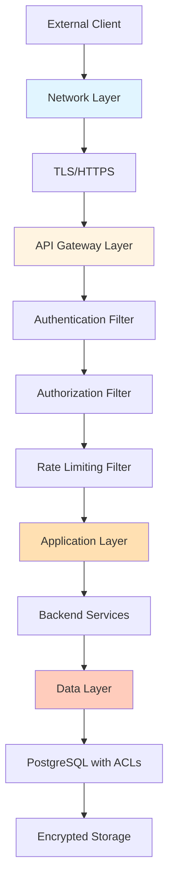
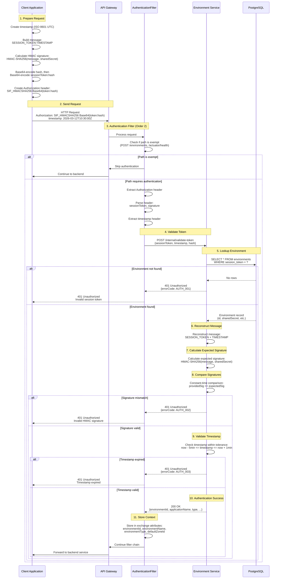
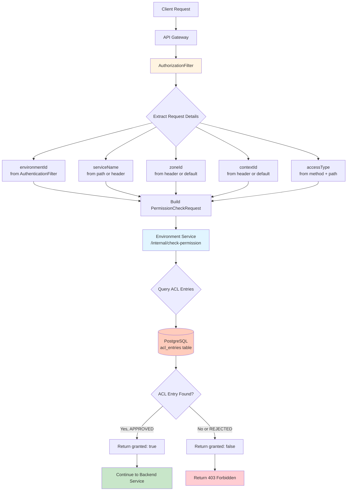
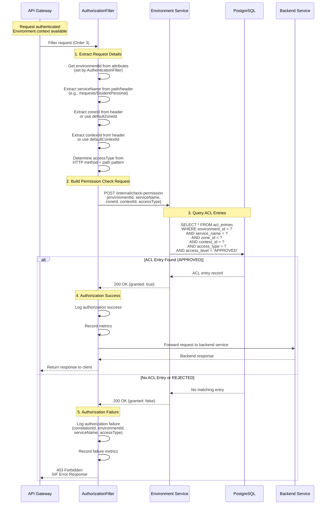
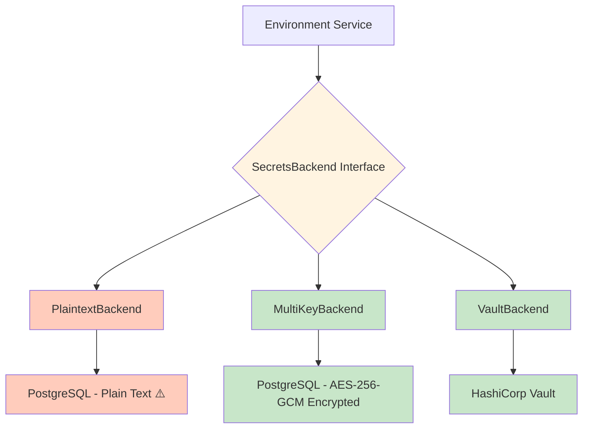
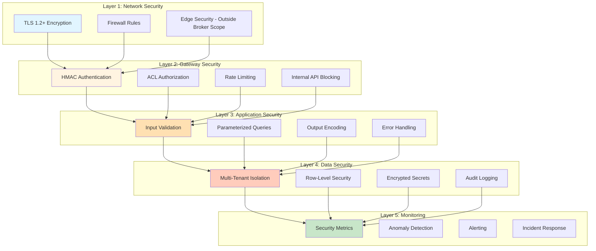

# SIF Unity Broker - Security Architecture

**Version:** 1.0  
**Date:** March 12, 2026  
**Status:** Active

## Table of Contents

1. [Security Overview](#security-overview)
2. [Authentication Mechanisms](#authentication-mechanisms)
3. [Authorization Model](#authorization-model)
4. [Secrets Management](#secrets-management)
5. [API Security](#api-security)
6. [Rate Limiting and Abuse Protection](#rate-limiting-and-abuse-protection)
7. [Audit Logging](#audit-logging)
8. [Data Protection](#data-protection)
9. [Security Monitoring](#security-monitoring)
10. [Compliance Considerations](#compliance-considerations)
11. [Threat Model](#threat-model)
12. [References](#references)

---

## Security Overview

### Security Goals

The SIF Unity Broker implements a comprehensive security architecture designed to protect sensitive educational data while enabling seamless interoperability between educational systems. The OSDB implements the SIF3 security model and builds an extra layer on top of that (integration with external Secrets Managers, Account Locking, etc.)

**Primary Security Goals:**

1. **Confidentiality**: Protect sensitive educational data from unauthorized access
2. **Integrity**: Ensure data cannot be tampered with during transmission or storage
3. **Availability**: Maintain system availability while protecting against abuse from misconfigured clients
4. **Authentication**: Verify the identity of all API clients
5. **Authorization**: Enforce fine-grained access control based on permissions
6. **Auditability**: Maintain comprehensive audit trails for compliance and forensics

### Security Principles

The security architecture is built on industry-standard security principles:

**1. Defense in Depth**

Multiple layers of security controls protect the system:
- Network security (TLS, firewalls)
- Application security (authentication, authorization)
- Data security (encryption, access control)
- Operational security (monitoring, audit logging)

**2. Least Privilege**


Each environment is granted only the minimum permissions required:
- ACL-based authorization with explicit permission grants
- No default permissions (deny by default)
- Service-specific, zone-specific, and context-specific access control
- Admin privileges restricted to trusted administrators

**3. Fail Secure**

Security failures result in denial of access, not bypass:
- Authentication failures return 401 Unauthorized
- Authorization failures return 403 Forbidden
- Invalid requests are rejected, not processed
- Errors do not leak sensitive information

**4. Complete Mediation**

Every request is authenticated and authorized:
- No bypass paths for security checks
- Internal APIs blocked from external access
- Consistent security enforcement across all services
- Gateway-level security before backend services

**5. Separation of Duties**

Security responsibilities are distributed:
- Authentication handled by Environment Service
- Authorization enforced by Gateway
- Secrets managed by pluggable backend (plaintext default for dev; multi-key or Vault for production)
- Audit logging independent of application logic

### Security Layers

The SIF Unity Broker implements security at multiple layers:



**Layer 1: Network Security**
- TLS 1.2+ for all external communication
- HTTPS enforcement (no HTTP)
- Firewall rules restricting access
- DDoS protection at network edge (external — outside broker scope)

**Layer 2: Gateway Security**
- HMAC-SHA256 authentication
- ACL-based authorization
- Rate limiting per environment
- Request validation and sanitization
- Internal API blocking

**Layer 3: Application Security**
- Input validation in all services
- Output encoding to prevent injection
- SQL injection prevention (parameterized queries)
- XSS prevention (JSON responses only)
- CSRF protection (stateless API)

**Layer 4: Data Security**
- Multi-tenant data isolation
- Row-level security via domain/solution filtering
- Pluggable secrets storage (plaintext for dev, AES-256-GCM or Vault for production)
- Audit logging of all data access

---

## Authentication Mechanisms


### HMAC-SHA256 Authentication

The SIF Unity Broker uses **HMAC-SHA256 (Hash-based Message Authentication Code with SHA-256)** for cryptographic authentication. This mechanism provides strong authentication, integrity verification, and replay attack prevention.

**Why HMAC-SHA256?**

1. **Cryptographic Strength**: SHA-256 provides 256-bit security, resistant to collision and preimage attacks
2. **Integrity Verification**: Any tampering with the request invalidates the signature
3. **Shared Secret Security**: Secret never transmitted over the network
4. **Industry Standard**: Widely used in APIs (AWS, Azure, OAuth 1.0a)
5. **SIF 3.7 Compliance**: Aligns with SIF specification authentication requirements

### HMAC Authentication Components

**1. Session Token (Public Identifier)**

- Unique identifier for each environment
- Stored in `environments.session_token` column
- Transmitted in Authorization header
- Used to look up the environment and retrieve shared secret
- Long lived token (environment-level credential)

**2. Shared Secret (Private Key)**

- Cryptographic key known only to environment and broker
- Stored via pluggable secrets backend (database column, HashiCorp Vault, or AWS Secrets Manager)
- Never transmitted over the network
- Used to calculate HMAC signature
- Rotatable via environment update API
- Minimum 32 characters recommended

**3. Timestamp (Replay Attack Prevention)**

- ISO 8601 timestamp included in every request
- Format: `YYYY-MM-DDTHH:mm:ss.SSSZ` (UTC)
- Validated within tolerance window (±5 minutes default)
- Prevents replay attacks by rejecting old requests
- Example: `2026-03-12T10:30:00.000Z`

**4. HMAC Signature (Integrity Proof)**

- Cryptographic hash of session token and timestamp using shared secret
- Calculated as: `HMAC-SHA256(sessionToken + ":" + timestamp, sharedSecret)`
- Base64-encoded, then the `sessionToken:hash` pair is Base64-encoded again for the Authorization header
- Verifies request authenticity
- Cannot be forged without knowing the shared secret

### HMAC Signature Calculation

**Message Format:**

The message to be signed consists of the session token and timestamp, separated by a colon:
```
SESSION_TOKEN:TIMESTAMP
```

**Example:**
```
abc123-session-token:2026-03-12T10:30:00.000Z
```

**Signature Calculation (Java):**

```java
// Step 1: Compute HMAC hash of sessionToken:timestamp
String data = sessionToken + ":" + timestamp;
Mac mac = Mac.getInstance("HmacSHA256");
SecretKeySpec secretKey = new SecretKeySpec(
    sharedSecret.getBytes(StandardCharsets.UTF_8), 
    "HmacSHA256"
);
mac.init(secretKey);
byte[] hmacBytes = mac.doFinal(data.getBytes(StandardCharsets.UTF_8));
String hash = Base64.getEncoder().encodeToString(hmacBytes);

// Step 2: Base64-encode the sessionToken:hash for the Authorization header
String credentials = sessionToken + ":" + hash;
String authHeaderValue = "SIF_HMACSHA256 " + Base64.getEncoder().encodeToString(
    credentials.getBytes(StandardCharsets.UTF_8)
);
```

### Authorization Header Format

The Authorization header value is the string `SIF_HMACSHA256` followed by a Base64-encoded `sessionToken:hash` pair:

```
Authorization: SIF_HMACSHA256 Base64(sessionToken:base64Hash)
timestamp: <ISO8601Timestamp>
```

**Example (before encoding):**
```
sessionToken:hash  →  admin-bootstrap-token:k7J9mP2xQ5vR8wT3nY6zL1aB4cD0eF
```

**Example (actual header, after Base64 encoding the above):**
```
Authorization: SIF_HMACSHA256 YWRtaW4tYm9vdHN0cmFwLXRva2VuOms3SjltUDJ4UTV2Ujh3VDNuWTZ6TDFhQjRjRDBlRg==
timestamp: 2026-03-12T10:30:00.000Z
```

### HMAC Authentication Flow




### Timestamp Validation and Replay Attack Prevention

**Purpose**: Prevent replay attacks where an attacker captures a valid request and retransmits it later.

**Validation Rules:**

1. **Format Validation**: Timestamp must be in ISO 8601 format with milliseconds and UTC timezone
   - Valid: `2026-03-12T10:30:00.000Z`
   - Invalid: `2026-03-12 10:30:00`, `2026-03-12T10:30:00-05:00`

2. **Tolerance Window**: Timestamp must be within acceptable time range
   - Past tolerance: 5 minutes (300 seconds) - allows for network delays
   - Future tolerance: 1 minute (60 seconds) - allows for clock skew
   - Formula: `currentTime - 5min <= requestTimestamp <= currentTime + 1min`

3. **Clock Skew Handling**: 1-minute future tolerance accommodates minor clock differences between client and server

**Replay Attack Prevention:**

- **Time-bound validity**: Requests are only valid for 5 minutes after creation
- **Signature uniqueness**: Each request has a unique timestamp, creating a unique signature
- **No nonce required**: Timestamp serves as implicit nonce (assuming client doesn't reuse timestamps)
- **Stateless validation**: No need to store used signatures (time-bound validity is sufficient)

**Configuration:**

```yaml
sif:
  broker:
    auth:
      timestamp-tolerance-seconds: 300  # 5 minutes past tolerance
      timestamp-future-tolerance-seconds: 60  # 1 minute future tolerance
```

**Error Responses:**

| Error Code | HTTP Status | Condition | Message |
|------------|-------------|-----------|---------|
| AUTH_003 | 401 | Timestamp too old | Timestamp expired (older than 5 minutes) |
| AUTH_003 | 401 | Timestamp too far in future | Timestamp too far in future (>1 minute) |
| AUTH_005 | 401 | Missing timestamp | Missing timestamp header |
| AUTH_004 | 401 | Invalid format | Malformed timestamp (not ISO 8601) |

### Session Token Management

**Token Generation:**

- Generated during environment registration
- Unique across all environments

**Token Storage:**

- Stored in `environments.session_token` column (VARCHAR(255))
- Indexed for fast lookup during authentication
- Not encrypted (public identifier)

**Token Lifecycle:**

- Created during environment registration (POST /environments)
- Long lived (environment-level credential)
- Can be rotated via environment update (PUT /environments/{id})
- Deleted when environment is deleted

**Token Security:**

- Not a secret (transmitted in Authorization header)
- Used only for environment lookup
- Cannot be used alone for authentication (requires HMAC signature)
- Should be treated as sensitive (don't log in plain text)

### Shared Secret Management

**Secret Generation:**

- Generated during environment registration
- Minimum 32 characters recommended
- Should be cryptographically random
- Example: `a1b2c3d4e5f6g7h8i9j0k1l2m3n4o5p6`

**Secret Storage:**

- Stored via pluggable secrets backend (see [Pluggable Secrets Backend Architecture](#pluggable-secrets-backend-architecture))
- Default backend (`plaintext`) stores secrets in plain text in `environments.shared_secret` — development only
- Production backends: `multi-key` (AES-256-GCM in database) or `vault` (HashiCorp Vault)
- Retrieved only during HMAC validation

**Secret Rotation:**

- Supported via environment update API
- Client must update their configuration with new secret
- By default, secrets do not expire (eternal lifetime)
- Secret expiry can be enabled per-solution via configuration:
  - `sif.broker.secrets.default-lifetime`: global default (`eternal` | duration like `90d`)
  - Per-solution override in solution settings
- When expiry is enabled, a configurable grace period allows the old secret to remain valid during transition
  - `sif.broker.secrets.grace-period`: duration (default: `24h`, only applies when expiry is enabled)

**Secret Security:**

- Never logged (even in debug mode)
- Never included in error messages
- Access restricted to Environment Service only

### Bootstrap Admin Credentials

**Initial Setup:**

The broker bootstraps a global admin domain and solution via Flyway migration `V15__remove_admin_type_and_bootstrap_global.sql`:

- **Domain**: `GLOBAL_DOMAIN`
- **Solution**: `GLOBAL_SOLUTION`
- **Environment Type**: `BROKERED` (same as all environments)
- **Admin detection**: An environment is considered admin if it belongs to `GLOBAL_DOMAIN` / `GLOBAL_SOLUTION` (see `GlobalAdminConstants.isGlobalAdmin()`)


**Security Recommendations:**

1. **Change immediately**: Update bootstrap credentials after deployment
2. **Create separate admins**: Create individual admin environments within `GLOBAL_DOMAIN` / `GLOBAL_SOLUTION`
3. **Rotate regularly**: Change admin secrets per your configured rotation policy
4. **Use secrets backend**: Store secrets in Vault or AWS Secrets Manager
5. **Audit admin access**: Monitor all admin operations via audit logs

**Changing Bootstrap Credentials:**

```bash
# 1. Create new admin environment (must target GLOBAL_DOMAIN / GLOBAL_SOLUTION)
curl -X POST http://localhost:8081/environments \
  -H "Content-Type: application/json" \
  -d '{
    "applicationName": "Production Admin",
    "type": "BROKERED",
    "solutionId": "GLOBAL_SOLUTION",
    "sessionToken": "prod-admin-token-new",
    "sharedSecret": "new-secure-secret-32-chars-min"
  }'

# 2. Delete bootstrap admin (after verifying new admin works)
curl -X DELETE http://localhost:8081/environments/{bootstrap-admin-id} \
  -H "Authorization: SIF_HMACSHA256 prod-admin-token-new:signature"
```

---

## Authorization Model


### ACL-Based Authorization

The SIF Unity Broker uses **Access Control List (ACL) based authorization** for fine-grained access control. Each environment must have explicit permissions to access specific services in specific zones and contexts.

**Why ACL-Based Authorization?**

1. **Fine-Grained Control**: Permissions at service, zone, and context level
2. **Explicit Grants**: No default permissions (deny by default)
3. **Flexible**: Supports complex organizational hierarchies
4. **Auditable**: Clear permission records for compliance
5. **SIF 3.7 Aligned**: Matches SIF zone/context security model

### ACL Components

**ACL Entry Structure:**

Each ACL entry grants a specific permission to an environment:

| Field | Type | Description | Example |
|-------|------|-------------|---------|
| `environment_id` | UUID | Environment being granted access | `550e8400-e29b-41d4-a716-446655440000` |
| `service_name` | String | SIF service name | `StudentPersonal` |
| `zone_id` | String | Zone scope | `district-001` |
| `context_id` | String | Context scope (default = DEFAULT) | `REALTIME` |
| `access_type` | Enum | Type of access | `QUERY`, `CREATE`, `UPDATE`, `DELETE`, `SUBSCRIBE`, `PROVIDE` |
| `access_level` | Enum | Permission status | `APPROVED`, `SUPPORTED`, `REJECTED`, `UNSUPPORTED`, `REQUESTED` |

**Access Types:**

- **PROVIDE**: Environment is the authoritative provider of a service
  - Used by data providers (SIS, LMS, assessment systems)
  - Receives consumer requests (immediate and delayed) routed by the broker for the given service/zone/context
  - Publishes events to notify subscribers of data changes
  - Submits responses to delayed requests
  - Manages functional service jobs
  - Allows POST to `/events`, `/responses`, `/services`
  - Example: SIS providing StudentPersonal — serves request queries from consumers and emits change events

- **QUERY**: Environment can query (retrieve) data for a service
  - Used by data consumers (reporting systems, analytics platforms)
  - Allows GET from `/requests`, `/services`
  - Example: LMS querying student roster data

- **CREATE**: Environment can create new data for a service
  - Allows POST to create new resources

- **UPDATE**: Environment can update existing data for a service
  - Allows PUT/PATCH to modify resources

- **DELETE**: Environment can delete data for a service
  - Allows DELETE to remove resources

- **SUBSCRIBE**: Environment can subscribe to events for a service
  - Used by event subscribers (notification systems, integrations)
  - Allows creating subscriptions for event delivery
  - Example: Attendance system subscribing to enrollment changes

**Access Levels:**

- **APPROVED**: Permission granted (access allowed)
- **SUPPORTED**: Permission supported by the provider (access allowed)
- **REJECTED**: Permission explicitly denied (access forbidden)
- **UNSUPPORTED**: Permission not supported by the provider (access forbidden)
- **REQUESTED**: Permission requested but not yet approved (access forbidden)

### ACL Architecture Diagram



### Authorization Flow




### Permission Types and Enforcement Points

**Access Type Determination Rules:**

The Gateway determines the required access type based on HTTP method and request path:

| HTTP Method | Path Pattern | Access Type | Use Case |
|-------------|--------------|-------------|----------|
| GET | `/requests/**` | QUERY | Retrieving request data |
| POST | `/requests/**` | CREATE | Creating new request data |
| PUT | `/requests/**` | UPDATE | Updating existing request data |
| DELETE | `/requests/**` | DELETE | Deleting request data |
| POST | `/responses/**` | PROVIDE | Provider submitting response data |
| POST | `/events/**` | PROVIDE | Provider publishing event |
| GET | `/services/**` | QUERY | Querying service job |
| POST/PUT/DELETE | `/services/**` | PROVIDE | Provider managing service job |
| POST | `/subscriptions/**` | SUBSCRIBE | Creating event subscription |
| Default | Any other path | QUERY | Default to query access |

**Enforcement Points:**

1. **Gateway AuthorizationFilter (Primary)**
   - Order 3 in filter chain (after authentication)
   - Enforces ACL checks for all requests
   - Returns 403 Forbidden for denied access
   - Logs all authorization decisions

2. **Backend Services (Defense in Depth)**
   - Services can perform additional authorization checks
   - Validate environment context from headers
   - Enforce business-specific access rules
   - Log authorization events

3. **Database Layer (Data Isolation)**
   - Row-level security via domain/solution filtering
   - Foreign key constraints enforce relationships
   - Audit triggers log data access

### Hierarchical Permission Scoping

**Zone and Context Scoping:**

ACL entries are scoped to specific zones and contexts within the organizational hierarchy:

```
Domain: state-doe
  └─ Solution: production
      └─ Zone: district-001
          ├─ Context: DEFAULT
          │   └─ Environment: SIS-Provider
          │       └─ ACL Entry: {
          │           serviceName: "StudentPersonal",
          │           zoneId: "district-001",
          │           contextId: "school-123",
          │           accessType: PROVIDE,
          │           accessLevel: APPROVED
          │         }
          └─ Context: REALTIME
              └─ Environment: LMS-Consumer
                  └─ ACL Entry: {
                      serviceName: "StudentPersonal",
                      zoneId: "district-001",
                      contextId: "school-456",
                      accessType: QUERY,
                      accessLevel: APPROVED
                    }
```

**Scoping Rules:**

1. **Exact Match Required**: ACL entry must match zone and context exactly
2. **No Implicit Inheritance**: Access to parent zone doesn't grant access to child contexts
3. **Default Context**: Every zone has a mandatory `DEFAULT` context. If no context is specified in a request, `DEFAULT` is assumed. ACL entries always reference a specific context.
4. **Wildcard Zones**: `zoneId: "*"` grants access to all zones (future, admin only)

### Admin Environment Privileges

**Global Admin Identification:**

Admin status is determined by membership in the well-known `GLOBAL_DOMAIN` / `GLOBAL_SOLUTION` pair, not by a special environment type. All environments (including admins) have `type = BROKERED`. Admin detection is performed at runtime via `GlobalAdminConstants.isGlobalAdmin(domainId, solutionId)`.

- **Bypass ACL Checks**: Admin environments skip authorization for administrative operations
- **Full Access**: Can access all services, zones, and contexts
- **Management Operations**: Can create/update/delete environments, ACLs, providers
- **System Monitoring**: Can access health checks, metrics, and audit logs

**Registration Guard:**

Self-registration into `GLOBAL_DOMAIN` / `GLOBAL_SOLUTION` is blocked for unauthenticated requests. The controller checks for a `requester` attribute (set by `AuthorizationFilter` for authenticated callers). If no authenticated requester is present, registration into the global admin domain/solution is rejected. An existing admin can create additional admin environments by making an authenticated `POST` to `/{GLOBAL_DOMAIN}/{GLOBAL_SOLUTION}/environments`.

Additionally, `solutionId` is required for all environment registrations — there is no default fallback.

**Admin Operations:**

| Operation | Endpoint | Admin Required | Purpose |
|-----------|----------|----------------|---------|
| Environment Registration | POST /environments | Yes | Create new environments (admin only) |
| Environment Management | PUT/DELETE /environments | Yes | Manage other environments |
| ACL Management | POST/PUT/DELETE /acl-entries | Yes | Grant/revoke permissions |
| Provider Management | POST/PUT/DELETE /providers | Yes | Register/manage providers |
| System Health | GET /actuator/health | No | Public health checks |
| System Metrics | GET /actuator/metrics | Yes | Sensitive metrics |

**Admin Security Best Practices:**

1. **Separate Admin Accounts**: Create individual admin environments within `GLOBAL_DOMAIN` / `GLOBAL_SOLUTION`
2. **Rotate Admin Secrets**: Per your configured secret rotation policy
3. **Audit Admin Actions**: Log all admin operations with user identification
4. **Restrict Admin Access**: Limit admin privileges to trusted personnel only
5. **Monitor Admin Activity**: Alert on unusual admin operations

### ACL Management API

**Create ACL Entry:**

```bash
POST /environments/{environmentId}/acl-entries
Authorization: SIF_HMACSHA256 admin-token:signature
Content-Type: application/json

{
  "serviceName": "StudentPersonal",
  "zoneId": "district-001",
  "contextId": "school-123",
  "accessType": "PROVIDE",
  "accessLevel": "APPROVED"
}
```

**List ACL Entries:**

```bash
GET /environments/{environmentId}/acl-entries
Authorization: SIF_HMACSHA256 admin-token:signature
```

**Delete ACL Entry:**

```bash
DELETE /acl-entries/{aclEntryId}
Authorization: SIF_HMACSHA256 admin-token:signature
```

---

## Secrets Management


### Pluggable Secrets Backend Architecture

The SIF Unity Broker implements a **pluggable secrets management architecture** via the `SecretsBackend` interface. The active backend is selected by the `secrets.backend.type` configuration property.

**Implemented Backends:**

| Backend | Config Value | Encryption | Use Case |
|---------|-------------|------------|----------|
| `PlaintextBackend` | `plaintext` | None | Development and testing only |
| `MultiKeyBackend` | `multi-key` (default) | AES-256-GCM | Production (self-managed encryption) |
| `VaultBackend` | `vault` | Vault-managed | Production (HashiCorp Vault) |

**⚠️ WARNING:** The `PlaintextBackend` stores secrets in plain text in the `environments.shared_secret` database column with zero encryption. It must be explicitly enabled via `secrets.backend.type: plaintext` and should only be used for development and testing. The default backend (when no type is configured) is `MultiKeyBackend`.

### Secrets Backend Architecture Diagram



### SecretsBackend Interface

**Interface Definition:**

```java
public interface SecretsBackend {
    void store(UUID environmentId, String secret);
    String retrieve(UUID environmentId);
    void delete(UUID environmentId);
    boolean isHealthy();
    String getBackendType();
}
```

### PlaintextBackend (Development Only)

**Configuration:**

```yaml
secrets:
  backend:
    type: plaintext   # Must be explicitly set; multi-key is the default
```

**Behavior:**

- Stores the shared secret directly in the `environments.shared_secret` column as plain text
- Logs a prominent warning on startup: `PlaintextBackend is active - secrets are stored in PLAIN TEXT`
- No encryption, no obfuscation
- Suitable only for local development, automated testing, and CI/CD pipelines

**⚠️ NOT suitable for production, staging with real data, or any environment handling sensitive information.**

### MultiKeyBackend (Production — Self-Managed Encryption)

**Configuration:**

```yaml
secrets:
  backend:
    type: multi-key
    multi-key:
      current-version: "20240115"
      keys:
        "20240115": "${ENCRYPTION_KEY_20240115}"   # Base64-encoded 256-bit key
        "20240101": "${ENCRYPTION_KEY_20240101}"   # Previous key (for decryption of old secrets)
```

**Encryption Details:**

- Algorithm: AES-256-GCM (authenticated encryption)
- Random 12-byte IV per encryption operation
- 128-bit authentication tag (tamper detection)
- Storage format: `YYYYMMDD:base64(IV + ciphertext + auth_tag)`

**Key Versioning:**

- Multiple key versions can be active simultaneously
- New secrets are always encrypted with `current-version`
- Old secrets can be decrypted using their original key version (identified by the `YYYYMMDD:` prefix)
- Legacy plaintext values (no colon prefix) are returned as-is with a warning log

**Encryption Key Rotation:**

To rotate the encryption key:

1. Generate a new 256-bit key and base64-encode it
2. Add the new key to the `keys` map with a new version (e.g., `"20240401"`)
3. Update `current-version` to the new version
4. Keep the old key in the `keys` map so existing secrets can still be decrypted
5. Run a migration job to re-encrypt all secrets under the new key (see below)
6. Once all secrets are migrated, the old key can be removed

**Encryption Key Migration Job (Future):**

A re-encryption migration job is needed to complete key rotation. The job would:
- Iterate over all environments
- Retrieve each secret (decrypting with the old key)
- Re-encrypt with the current key version
- Update the stored value

Without this job, key rotation requires keeping all historical keys in the configuration. Old keys cannot be safely removed until all secrets have been re-encrypted under the current key.

### VaultBackend (Production — HashiCorp Vault)

**Configuration:**

```yaml
secrets:
  backend:
    type: vault
    vault:
      address: https://vault.example.com:8200
      token: ${VAULT_TOKEN}
      namespace: sif-broker
      path: secret/data/environments
```

**Features:**

- Secrets encrypted at rest and in transit by Vault
- Audit logging via Vault's audit backend
- Access policies managed by Vault
- Rotation and lease management delegated to Vault

**AWS Secrets Manager:** A potential future backend. Not included in the current implementation.

### Secret Rotation Strategy

**Rotation Process:**

1. **Generate New Secret**: Create new cryptographically random secret
2. **Store New Secret**: Save to secrets backend
3. **Update Environment**: Update environment record with new secret
4. **Notify Client**: Client must update their configuration
5. **Verify New Secret**: Test authentication with new secret
6. **Delete Old Secret**: Remove old secret from backend

**Rotation Frequency:**

- By default, secrets are eternal and rotation is not required
- When secret expiry is enabled per-solution:
  - **Production**: Every 90 days (recommended)
  - **Staging**: Every 180 days
  - **Development**: As needed

**Automated Rotation (Future):**

- Scheduled rotation via Job Service
- Grace period for old secret (configurable, default: 24 hours, only when expiry is enabled)
- Automatic client notification
- Rollback on failure

### Secrets Security Best Practices

**Storage:**

- ✅ Use `multi-key` or `vault` backend in production — never `plaintext`
- ✅ Encrypt secrets at rest
- ✅ Use strong encryption (AES-256 or better)
- ❌ Never store secrets in code or configuration files
- ❌ Never commit secrets to version control

**Access:**

- ✅ Restrict secrets access to Environment Service only
- ✅ Use least privilege access policies
- ✅ Audit all secrets access
- ❌ Never log secrets (even in debug mode)
- ❌ Never return secrets in API responses

**Transmission:**

- ✅ Use TLS 1.2+ for all secrets transmission
- ✅ Validate TLS certificates
- ✅ Use mutual TLS for secrets backend (if supported)
- ❌ Never transmit secrets over unencrypted channels
- ❌ Never include secrets in URLs or query parameters

**Rotation:**

- ✅ Rotate secrets regularly (every 90 days)
- ✅ Rotate immediately if compromised
- ✅ Use cryptographically random secret generation
- ✅ Verify new secrets before deleting old ones
- ❌ Never reuse old secrets

---

## API Security


### HTTPS/TLS Enforcement

**TLS Configuration:**

- **Minimum Version**: TLS 1.2 (TLS 1.3 preferred)
- **Cipher Suites**: Strong ciphers only (AES-GCM, ChaCha20-Poly1305)
- **Certificate Validation**: Strict certificate validation
- **HSTS**: HTTP Strict Transport Security enabled

**Spring Boot TLS Configuration:**

```yaml
server:
  port: 8443
  ssl:
    enabled: true
    key-store: classpath:keystore.p12
    key-store-password: ${KEYSTORE_PASSWORD}
    key-store-type: PKCS12
    key-alias: sif-broker
    protocol: TLS
    enabled-protocols: TLSv1.2,TLSv1.3
    ciphers: 
      - TLS_AES_256_GCM_SHA384
      - TLS_AES_128_GCM_SHA256
      - TLS_CHACHA20_POLY1305_SHA256
      - TLS_ECDHE_RSA_WITH_AES_256_GCM_SHA384
      - TLS_ECDHE_RSA_WITH_AES_128_GCM_SHA256
```

**HTTP to HTTPS Redirect:**

All HTTP requests are automatically redirected to HTTPS:

```java
@Bean
public SecurityWebFilterChain securityWebFilterChain(ServerHttpSecurity http) {
    return http
        .redirectToHttps()
        .and()
        .build();
}
```

### Security Headers

**Standard Security Headers:**

The Gateway adds security headers to all responses:

| Header | Value | Purpose |
|--------|-------|---------|
| `Strict-Transport-Security` | `max-age=31536000; includeSubDomains` | Force HTTPS for 1 year |
| `X-Content-Type-Options` | `nosniff` | Prevent MIME type sniffing |
| `X-Frame-Options` | `DENY` | Prevent clickjacking |
| `X-XSS-Protection` | `1; mode=block` | Enable XSS filter |
| `Content-Security-Policy` | `default-src 'self'` | Restrict resource loading |
| `Referrer-Policy` | `strict-origin-when-cross-origin` | Control referrer information |
| `Permissions-Policy` | `geolocation=(), microphone=(), camera=()` | Disable unnecessary features |

**Implementation:**

```java
@Bean
public SecurityWebFilterChain securityHeaders(ServerHttpSecurity http) {
    return http
        .headers()
            .hsts().maxAge(Duration.ofDays(365))
            .and()
            .contentTypeOptions()
            .and()
            .frameOptions().deny()
            .and()
            .xssProtection()
            .and()
            .contentSecurityPolicy("default-src 'self'")
        .and()
        .build();
}
```

### CORS Configuration

**CORS Policy:**

Cross-Origin Resource Sharing (CORS) is configured to allow specific origins:

```yaml
sif:
  broker:
    gateway:
      cors:
        allowed-origins:
          - https://app.example.com
          - https://admin.example.com
        allowed-methods:
          - GET
          - POST
          - PUT
          - DELETE
        allowed-headers:
          - Authorization
          - timestamp
          - Content-Type
          - zoneId
          - contextId
          - serviceName
        exposed-headers:
          - X-Correlation-Id
          - Retry-After
        allow-credentials: true
        max-age: 3600
```

**CORS Configuration (Spring Cloud Gateway):**

```java
@Bean
public CorsWebFilter corsWebFilter() {
    CorsConfiguration config = new CorsConfiguration();
    config.setAllowedOrigins(allowedOrigins);
    config.setAllowedMethods(Arrays.asList("GET", "POST", "PUT", "DELETE"));
    config.setAllowedHeaders(Arrays.asList("Authorization", "timestamp", "Content-Type"));
    config.setExposedHeaders(Arrays.asList("X-Correlation-Id", "Retry-After"));
    config.setAllowCredentials(true);
    config.setMaxAge(3600L);
    
    UrlBasedCorsConfigurationSource source = new UrlBasedCorsConfigurationSource();
    source.registerCorsConfiguration("/**", config);
    
    return new CorsWebFilter(source);
}
```

### Input Validation

**Validation Layers:**

1. **Gateway Level**: Basic format validation
2. **Service Level**: Business rule validation
3. **Database Level**: Constraint validation

**Validation Rules:**

| Field | Validation | Example |
|-------|------------|---------|
| `applicationName` | 3-100 characters, alphanumeric + spaces | `Student Information System` |
| `sessionToken` | 3-255 characters, no whitespace | `sis-prod-token-123` |
| `sharedSecret` | 32-255 characters | `a1b2c3d4e5f6g7h8i9j0k1l2m3n4o5p6` |
| `zoneId` | 1-100 characters, alphanumeric + hyphens | `district-001` |
| `contextId` | 1-100 characters, alphanumeric + hyphens | `school-123` |
| `serviceName` | 1-100 characters, alphanumeric | `StudentPersonal` |

**Bean Validation (Jakarta Validation):**

```java
public record EnvironmentCreateRequest(
    @NotBlank(message = "Application name is required")
    @Size(min = 3, max = 100, message = "Application name must be 3-100 characters")
    String applicationName,
    
    @NotNull(message = "Environment type is required")
    EnvironmentType type,
    
    @NotBlank(message = "Session token is required")
    @Size(min = 3, max = 255, message = "Session token must be 3-255 characters")
    @Pattern(regexp = "^\\S+$", message = "Session token cannot contain whitespace")
    String sessionToken,
    
    @NotBlank(message = "Shared secret is required")
    @Size(min = 32, max = 255, message = "Shared secret must be 32-255 characters")
    String sharedSecret
) {}
```

### SQL Injection Prevention

**Parameterized Queries:**

All database queries use parameterized statements (Spring Data JPA):

```java
@Repository
public interface EnvironmentRepository extends JpaRepository<Environment, UUID> {
    // Safe: Uses parameterized query
    Optional<Environment> findBySessionToken(String sessionToken);
    
    // Safe: Uses parameterized query
    @Query("SELECT e FROM Environment e WHERE e.sessionToken = :token")
    Optional<Environment> findByToken(@Param("token") String token);
}
```

**Never Use String Concatenation:**

```java
// ❌ UNSAFE: SQL injection vulnerability
String query = "SELECT * FROM environments WHERE session_token = '" + token + "'";

// ✅ SAFE: Parameterized query
String query = "SELECT * FROM environments WHERE session_token = ?";
PreparedStatement stmt = connection.prepareStatement(query);
stmt.setString(1, token);
```

### XSS Prevention

**JSON-Only Responses:**

All API responses are JSON (no HTML rendering):

```java
@RestController
@RequestMapping(produces = MediaType.APPLICATION_JSON_VALUE)
public class EnvironmentController {
    // All responses are JSON, preventing XSS
}
```

**Content-Type Enforcement:**

```java
response.getHeaders().setContentType(MediaType.APPLICATION_JSON);
response.getHeaders().set("X-Content-Type-Options", "nosniff");
```

### CSRF Protection

**Stateless API (No CSRF Tokens Needed):**

The SIF Unity Broker API is stateless and does not use cookies for authentication, making it immune to CSRF attacks:

- **No Session Cookies**: Authentication via HMAC signature in Authorization header
- **No State**: Each request is self-contained
- **Origin Validation**: CORS policy restricts allowed origins
- **Custom Headers**: Requires custom headers (Authorization, timestamp) that browsers don't send automatically

**Why CSRF Protection is Not Needed:**

CSRF attacks rely on browsers automatically sending cookies with cross-origin requests. Since the broker uses:
1. Custom Authorization header (not sent automatically by browsers)
2. Timestamp header (not sent automatically by browsers)
3. HMAC signature calculation (requires JavaScript, not automatic)

Cross-origin requests cannot be forged without JavaScript access to the shared secret.

### Internal API Blocking

**Internal API Protection:**

Internal APIs (used for inter-service communication) are blocked from external access:

```java
@Component
public class InternalApiBlockingFilter implements GlobalFilter, Ordered {
    @Override
    public Mono<Void> filter(ServerWebExchange exchange, GatewayFilterChain chain) {
        String path = exchange.getRequest().getPath().value();
        
        if (path.startsWith("/internal")) {
            log.warn("Blocked external request to internal API: {}", path);
            ServerHttpResponse response = exchange.getResponse();
            response.setStatusCode(HttpStatus.FORBIDDEN);
            return response.setComplete();
        }
        
        return chain.filter(exchange);
    }
    
    @Override
    public int getOrder() {
        return 0; // First filter (before authentication)
    }
}
```

**Internal API Endpoints:**

| Endpoint | Purpose | Access |
|----------|---------|--------|
| `/internal/validate-token` | Token validation | Environment Service only |
| `/internal/check-permission` | Permission checking | Environment Service only |
| `/internal/health` | Internal health checks | Monitoring systems only |

---

## Rate Limiting and Abuse Protection


### Distributed Rate Limiting with Redis

The SIF Unity Broker implements **distributed rate limiting** using Redis to protect backend services from overload and ensure fair resource allocation across environments.

**Rate Limiting Goals:**

1. **Prevent Abuse**: Protect against misconfigured or poorly written clients generating excessive traffic
2. **Fair Resource Allocation**: Ensure no single environment monopolizes resources
3. **Service Stability**: Maintain system performance under load
4. **Cost Control**: Prevent excessive resource consumption

**Scope:** Rate limiting addresses application-level abuse from authenticated environments. Protection against coordinated DDoS attacks or network-level threats is outside the scope of this application and should be handled by a dedicated edge/cloud security layer.

### Rate Limiting Architecture

**Sliding Window Algorithm:**

The broker uses a sliding window counter algorithm for accurate rate limiting:

1. **Window Size**: 1 second (configurable)
2. **Counter Key**: `ratelimit:{environmentId}:{timestamp}`
3. **Increment**: Each request increments the counter
4. **Check**: Compare counter to limit before allowing request
5. **Expiry**: Counters expire after window duration

**Redis Implementation:**

```java
public class RedisRateLimiter {
    public Mono<RateLimitResponse> isAllowed(String environmentId, int requestsPerSecond) {
        String key = "ratelimit:" + environmentId + ":" + Instant.now().getEpochSecond();
        
        return redisTemplate.opsForValue()
            .increment(key)
            .flatMap(count -> {
                if (count == 1) {
                    // Set expiry on first increment
                    return redisTemplate.expire(key, Duration.ofSeconds(2))
                        .thenReturn(count);
                }
                return Mono.just(count);
            })
            .map(count -> {
                boolean allowed = count <= requestsPerSecond;
                long retryAfter = allowed ? 0 : 1;
                return new RateLimitResponse(allowed, retryAfter);
            });
    }
}
```

### Rate Limits

**Default Rate Limits:**

All environments are `BROKERED` type. Admin environments (identified by `GLOBAL_DOMAIN`/`GLOBAL_SOLUTION` membership) receive a higher default limit:

| Environment | Requests/Second | Use Case |
|-------------|-----------------|----------|
| Standard | 100 | All non-admin environments |
| Admin | 200 | Administrative operations |

**Configuration:**

```yaml
sif:
  broker:
    gateway:
      rate-limit:
        enabled: true
        default-requests-per-second: 100
        admin-requests-per-second: 200
```

**Custom Rate Limits (Future):**

Per-environment rate limits can be configured in the database:

```sql
ALTER TABLE environments ADD COLUMN rate_limit_override INTEGER;
```

### Rate Limit Response Headers

**Standard Headers:**

| Header | Description | Example |
|--------|-------------|---------|
| `X-RateLimit-Limit` | Requests allowed per second | `100` |
| `X-RateLimit-Remaining` | Requests remaining in current window | `75` |
| `X-RateLimit-Reset` | Timestamp when limit resets | `1678612800` |
| `Retry-After` | Seconds to wait before retry (429 only) | `1` |

**Example Response (429 Too Many Requests):**

```http
HTTP/1.1 429 Too Many Requests
Content-Type: application/json
Retry-After: 1
X-RateLimit-Limit: 100
X-RateLimit-Remaining: 0
X-RateLimit-Reset: 1678612800
X-Correlation-Id: 550e8400-e29b-41d4-a716-446655440000

{
  "errorCode": "RATE_001",
  "message": "Rate limit exceeded",
  "description": "Too many requests. Please retry after 1 seconds.",
  "scope": "BROKER",
  "timestamp": "2026-03-12T10:30:00.000Z",
  "correlationId": "550e8400-e29b-41d4-a716-446655440000"
}
```

### Abuse Protection Strategies

**1. Rate Limiting (Primary Defense)**

- Per-environment rate limits
- Distributed enforcement via Redis
- Automatic 429 responses
- Retry-After guidance

**2. Connection Limits**

- Maximum concurrent connections per IP
- Connection timeout enforcement
- Idle connection cleanup

**3. Request Size Limits**

```yaml
spring:
  codec:
    max-in-memory-size: 10MB  # Maximum request body size
```

**4. Timeout Configuration**

```yaml
spring:
  cloud:
    gateway:
      httpclient:
        connect-timeout: 5000  # 5 seconds
        response-timeout: 30s  # 30 seconds
```

**5. Circuit Breakers**

```yaml
resilience4j:
  circuitbreaker:
    instances:
      environment-service:
        failure-rate-threshold: 50
        wait-duration-in-open-state: 10s
        sliding-window-size: 10
```

**6. Network-Level Protection (External — Outside Broker Scope)**

The following protections should be provided by the deployment infrastructure, not by the broker itself:

- DDoS mitigation at the edge
- Firewall rules restricting access
- IP allowlisting for known clients (optional)
- Geographic restrictions (optional)

---

## Audit Logging

### Audit Logging Requirements

The SIF Unity Broker maintains comprehensive audit logs for security monitoring, compliance, and forensic analysis.

**Audit Goals:**

1. **Compliance**: Meet audit requirements
2. **Security Monitoring**: Detect suspicious activity
3. **Forensics**: Investigate security incidents
4. **Accountability**: Track who did what and when
5. **Troubleshooting**: Debug integration issues

### Audit Event Types

**Authentication Events:**

| Event Type | Description | Logged Data |
|------------|-------------|-------------|
| `AUTH_SUCCESS` | Successful authentication | environmentId, sessionToken, timestamp, IP |
| `AUTH_FAILURE` | Failed authentication | sessionToken, errorCode, timestamp, IP |
| `TOKEN_ROTATION` | Shared secret rotated | environmentId, adminId, timestamp |

**Authorization Events:**

| Event Type | Description | Logged Data |
|------------|-------------|-------------|
| `AUTHZ_SUCCESS` | Permission granted | environmentId, serviceName, zoneId, accessType |
| `AUTHZ_FAILURE` | Permission denied | environmentId, serviceName, zoneId, accessType, reason |
| `ACL_CREATED` | ACL entry created | environmentId, serviceName, accessType, adminId |
| `ACL_DELETED` | ACL entry deleted | environmentId, serviceName, accessType, adminId |

**Data Access Events:**

| Event Type | Description | Logged Data |
|------------|-------------|-------------|
| `DATA_READ` | Data retrieved | environmentId, serviceName, zoneId, recordCount |
| `DATA_WRITE` | Data created/updated | environmentId, serviceName, zoneId, recordCount |
| `DATA_DELETE` | Data deleted | environmentId, serviceName, zoneId, recordCount |

**Administrative Events:**

| Event Type | Description | Logged Data |
|------------|-------------|-------------|
| `ENV_CREATED` | Environment registered | environmentId, applicationName, type, adminId |
| `ENV_UPDATED` | Environment modified | environmentId, changes, adminId |
| `ENV_DELETED` | Environment deleted | environmentId, adminId |
| `ADMIN_LOGIN` | Admin authentication | adminId, timestamp, IP |

**Security Events:**

| Event Type | Description | Logged Data |
|------------|-------------|-------------|
| `RATE_LIMIT_EXCEEDED` | Rate limit hit | environmentId, limit, timestamp |
| `INVALID_SIGNATURE` | HMAC validation failed | sessionToken, timestamp, IP |
| `TIMESTAMP_EXPIRED` | Replay attack detected | sessionToken, timestamp, IP |
| `INTERNAL_API_BLOCKED` | Internal API access attempt | path, IP, timestamp |

### Audit Log Format

**Structured JSON Logging:**

```json
{
  "timestamp": "2026-03-12T10:30:00.000Z",
  "eventType": "AUTH_SUCCESS",
  "correlationId": "550e8400-e29b-41d4-a716-446655440000",
  "environmentId": "660f9511-f30c-52e5-b827-557766551111",
  "sessionToken": "sis-prod-token-123",
  "ipAddress": "192.168.1.100",
  "userAgent": "SIF-Client/1.0",
  "serviceName": "StudentPersonal",
  "zoneId": "district-001",
  "contextId": "school-123",
  "accessType": "PROVIDE",
  "result": "SUCCESS",
  "details": {
    "method": "POST",
    "path": "/events/StudentPersonal",
    "statusCode": 200
  }
}
```

### Audit Log Storage

**Logging Backend:**

- **Development**: Console output (stdout)
- **Production**: ELK Stack (Elasticsearch, Logstash, Kibana)
- **Compliance**: Immutable log storage (WORM)

**Log Retention:**

| Environment | Retention Period | Storage |
|-------------|------------------|---------|
| Development | 7 days | Local files |
| Staging | 30 days | Elasticsearch |
| Production | 1 year | Elasticsearch + Archive |
| Compliance | 7 years | Immutable storage |

**Log Rotation:**

```yaml
logging:
  file:
    name: /var/log/sif-broker/audit.log
    max-size: 100MB
    max-history: 30
    total-size-cap: 10GB
```

### Audit Log Implementation

**Logback Configuration:**

```xml
<appender name="AUDIT" class="ch.qos.logback.core.rolling.RollingFileAppender">
    <file>/var/log/sif-broker/audit.log</file>
    <encoder class="net.logstash.logback.encoder.LogstashEncoder">
        <includeMdcKeyName>correlationId</includeMdcKeyName>
        <includeMdcKeyName>environmentId</includeMdcKeyName>
        <includeMdcKeyName>eventType</includeMdcKeyName>
    </encoder>
    <rollingPolicy class="ch.qos.logback.core.rolling.TimeBasedRollingPolicy">
        <fileNamePattern>/var/log/sif-broker/audit-%d{yyyy-MM-dd}.log.gz</fileNamePattern>
        <maxHistory>365</maxHistory>
        <totalSizeCap>10GB</totalSizeCap>
    </rollingPolicy>
</appender>

<logger name="AUDIT" level="INFO" additivity="false">
    <appender-ref ref="AUDIT" />
</logger>
```

**Audit Logging Service:**

```java
@Service
public class AuditService {
    private static final Logger auditLog = LoggerFactory.getLogger("AUDIT");
    
    public void logAuthenticationSuccess(UUID environmentId, String sessionToken, String ipAddress) {
        MDC.put("eventType", "AUTH_SUCCESS");
        MDC.put("environmentId", environmentId.toString());
        MDC.put("sessionToken", sessionToken);
        MDC.put("ipAddress", ipAddress);
        
        auditLog.info("Authentication successful");
        
        MDC.clear();
    }
    
    public void logAuthorizationFailure(UUID environmentId, String serviceName, 
                                        String zoneId, AccessType accessType, String reason) {
        MDC.put("eventType", "AUTHZ_FAILURE");
        MDC.put("environmentId", environmentId.toString());
        MDC.put("serviceName", serviceName);
        MDC.put("zoneId", zoneId);
        MDC.put("accessType", accessType.toString());
        MDC.put("reason", reason);
        
        auditLog.warn("Authorization denied");
        
        MDC.clear();
    }
}
```

---

## Data Protection


### Data Encryption

**Encryption in Transit:**

- **TLS 1.2+**: All external communication encrypted
- **Strong Ciphers**: AES-GCM, ChaCha20-Poly1305
- **Certificate Validation**: Strict certificate checking
- **Perfect Forward Secrecy**: Ephemeral key exchange (ECDHE)

**Encryption at Rest (Future):**

- **Database Encryption**: PostgreSQL transparent data encryption (TDE)
- **Backup Encryption**: Encrypted database backups
- **Secrets Encryption**: Vault/AWS Secrets Manager encryption
- **Message Payload Encryption**: S3 server-side encryption (SSE-KMS)

### Multi-Tenant Data Isolation

**Domain-Level Isolation:**

Each domain (tenant) has complete data isolation:

```sql
-- All queries filtered by domain_id
SELECT * FROM environments 
WHERE domain_id = :currentDomainId;

-- Foreign keys enforce domain boundaries
ALTER TABLE solutions 
ADD CONSTRAINT fk_solutions_domain_uuid 
FOREIGN KEY (domain_uuid) REFERENCES domains(id);
```

**Solution-Level Isolation:**

Within a domain, solutions (prod/staging/test) are isolated:

```sql
-- Queries filtered by solution_uuid (resolved from solution_id string at the service layer)
SELECT * FROM zones 
WHERE solution_uuid = :currentSolutionUuid;
```

**Row-Level Security (Future):**

PostgreSQL row-level security policies:

```sql
CREATE POLICY domain_isolation ON environments
FOR ALL
TO application_user
USING (domain_id = current_setting('app.current_domain_id')::UUID);
```

### Sensitive Data Handling

**PII (Personally Identifiable Information):**

The broker itself does not store PII (student names, addresses, etc.):
- **Opaque Message Routing**: Connectors route messages without inspecting content
- **Metadata Only**: Broker stores message metadata, not payloads
- **Pluggable Storage**: Message payloads stored in S3/filesystem, not database

**Sensitive Fields:**

| Field | Sensitivity | Protection |
|-------|-------------|------------|
| `shared_secret` | High | Stored via pluggable secrets backend, never logged, never returned in API |
| `session_token` | Medium | Not encrypted, but treated as sensitive |
| `ip_address` | Low | Logged for audit, retained per policy |
| `message_payload` | High | Stored in S3 with encryption, not in database |

**Data Masking (Logs):**

```java
public class SensitiveDataMasker {
    public static String maskSessionToken(String token) {
        if (token == null || token.length() < 8) {
            return "***";
        }
        return token.substring(0, 4) + "***" + token.substring(token.length() - 4);
    }
    
    public static String maskSharedSecret(String secret) {
        return "***REDACTED***";
    }
}
```

### Data Retention and Deletion

**Retention Policies:**

| Data Type | Retention Period | Deletion Method |
|-----------|------------------|-----------------|
| Audit Logs | 1 year (prod), 7 years (compliance) | Automatic purge |
| Message Metadata | 90 days | Soft delete, then purge |
| Message Payloads | 30 days | S3 lifecycle policy |
| Environment Records | Until deleted | Soft delete, then hard delete |
| ACL Entries | Until deleted | Hard delete |

**Soft Delete Pattern:**

```sql
ALTER TABLE environments ADD COLUMN deleted_at TIMESTAMP;

-- Soft delete
UPDATE environments SET deleted_at = NOW() WHERE id = :id;

-- Query excludes soft-deleted
SELECT * FROM environments WHERE deleted_at IS NULL;

-- Hard delete (after retention period)
DELETE FROM environments WHERE deleted_at < NOW() - INTERVAL '90 days';
```

**Data Deletion Support:**

Support for data deletion requests:

1. **Identify Data**: Locate all data for environment/domain
2. **Soft Delete**: Mark records as deleted
3. **Purge Logs**: Remove from audit logs (if required by policy)
4. **Delete Payloads**: Remove message payloads from S3
5. **Hard Delete**: Permanently delete after retention period

---

## Security Monitoring

### Implemented Metrics

The gateway records the following metrics via Micrometer (exposed at `/actuator/prometheus`):

**Authentication Metrics:**

- `gateway.authentication.success` — Successful authentications (tagged by environment_id)
- `gateway.authentication.failure` — Failed authentications (tagged by error_code)

**Authorization Metrics:**

- `gateway.authorization.success` — Successful authorizations (tagged by environment_id, service_name, access_type)
- `gateway.authorization.failure` — Failed authorizations (tagged by environment_id, service_name, access_type)

**Rate Limiting Metrics:**

- `gateway.ratelimit.exceeded` — Rate limit violations (tagged by environment_id)

**Request Metrics:**

- `gateway.requests` — Total requests (tagged by route, method, status)
- `gateway.request.duration` — Request duration (tagged by route, method)

These metrics are recorded by `GatewayMetricsService` and can be scraped by Prometheus or any Micrometer-compatible monitoring system.

### Alerting, Dashboards, and Advanced Detection

Alert channels (email, Slack, PagerDuty), SIEM integration, anomaly detection, behavioral analysis, and Grafana dashboards are not part of the broker application. These are deployment-level concerns that should be configured by the operations team using the metrics the broker exposes.

The broker provides the raw metrics. What you build on top of them (alerting rules, dashboards, anomaly detection) depends on your monitoring stack.

---

## Compliance Considerations

The SIF Unity Broker provides security infrastructure that helps organizations meet their regulatory obligations. Specific regulatory compliance (e.g., data privacy laws, educational data protection requirements, data residency mandates) is the responsibility of the deploying organization and the applications that use the broker.

### How the Broker Supports Regulatory Requirements

The following capabilities help organizations work toward compliance with applicable regulations:

**Access Control:**
- ACL-based authorization enforces fine-grained access control
- Environment-level permissions restrict data access
- Zone/context scoping limits data visibility

**Audit Logging:**
- Comprehensive audit logs of all data access and administrative operations
- Configurable retention periods
- Immutable log storage available

**Data Security:**
- HMAC-SHA256 authentication for all API requests
- TLS encryption in transit
- Multi-tenant data isolation
- Pluggable secrets backend with encryption support

**Data Minimization:**
- Broker stores minimal metadata (no PII in the broker database)
- Message payloads stored separately (S3/filesystem)
- Opaque message routing (no content inspection)

**Data Deletion:**
- Soft delete support
- Hard delete after configurable retention period
- S3 lifecycle policies for payload deletion

**Responsibilities Outside Broker Scope:**
- Consent management
- Data processing agreements
- Incident response plans
- Data export / portability for end users
- Determining applicable regulations and ensuring full compliance

### Data Residency

**Geographic Data Storage:**

- **Database**: PostgreSQL can be deployed in specific regions
- **Message Storage**: S3 buckets can be region-specific
- **Secrets**: Vault/AWS Secrets Manager support regional deployment

**Configuration:**

```yaml
sif:
  broker:
    data-residency:
      region: us-east-1
      allowed-regions:
        - us-east-1
        - us-west-2
      storage:
        s3-region: us-east-1
```

---

## Threat Model


### Identified Threats and Mitigations

The SIF Unity Broker threat model identifies potential security threats and documents mitigation strategies for each.

### Threat Model Diagram

```mermaid
graph TD
    A[Threat: Unauthorized Access] --> B[Mitigation: HMAC Authentication]
    A --> C[Mitigation: ACL Authorization]
    
    D[Threat: Man-in-the-Middle] --> E[Mitigation: TLS 1.2+]
    D --> F[Mitigation: Certificate Validation]
    
    G[Threat: Replay Attacks] --> H[Mitigation: Timestamp Validation]
    G --> I[Mitigation: 5-minute window]
    
    J[Threat: Credential Theft] --> K[Mitigation: Secrets Backend]
    J --> L[Mitigation: Secret Rotation]
    J --> M[Mitigation: Never Log Secrets]
    
    N[Threat: Abuse / Overload] --> O[Mitigation: Rate Limiting]
    N --> P[Mitigation: Connection Limits]
    N --> Q[Mitigation: Circuit Breakers]
    
    R[Threat: SQL Injection] --> S[Mitigation: Parameterized Queries]
    R --> T[Mitigation: Input Validation]
    
    U[Threat: Data Breach] --> V[Mitigation: Multi-Tenant Isolation]
    U --> W[Mitigation: Encryption]
    U --> X[Mitigation: Audit Logging]
    
    Y[Threat: Privilege Escalation] --> Z[Mitigation: Least Privilege]
    Y --> AA[Mitigation: Admin Restrictions]
    
    style B fill:#c8e6c9
    style C fill:#c8e6c9
    style E fill:#c8e6c9
    style H fill:#c8e6c9
    style K fill:#c8e6c9
    style O fill:#c8e6c9
    style S fill:#c8e6c9
    style V fill:#c8e6c9
    style Z fill:#c8e6c9
```



### Threat Categories

#### 1. Authentication Threats

**Threat: Credential Theft**

- **Description**: Attacker steals session token and shared secret
- **Impact**: Unauthorized access to environment's data
- **Likelihood**: Medium
- **Severity**: High

**Mitigations:**
- ✅ Secrets stored in Vault/AWS Secrets Manager (encrypted)
- ✅ Secrets never transmitted over network
- ✅ Secrets never logged (even in debug mode)
- ✅ TLS encryption for all communication
- ✅ Regular secret rotation (90 days recommended)

**Threat: Brute Force Attacks**

- **Description**: Attacker attempts to guess shared secrets
- **Impact**: Unauthorized access if successful
- **Likelihood**: Low (secrets are 32+ characters)
- **Severity**: High

**Mitigations:**
- ✅ Rate limiting (100-200 requests/second)
- ✅ Account lockout after repeated failures (future)
- ✅ Audit logging of failed attempts
- ✅ Alerting on suspicious patterns
- ✅ Strong secret requirements (32+ characters)

**Threat: Session Token Enumeration**

- **Description**: Attacker tries to guess valid session tokens
- **Impact**: Identify valid environments
- **Likelihood**: Low
- **Severity**: Low

**Mitigations:**
- ✅ UUIDs or long random tokens (high entropy)
- ✅ Rate limiting prevents enumeration
- ✅ Failed authentication logged
- ✅ No information leakage in error messages

#### 2. Authorization Threats

**Threat: Privilege Escalation**

- **Description**: Environment gains unauthorized access to services/zones
- **Impact**: Access to data outside permitted scope
- **Likelihood**: Low
- **Severity**: High

**Mitigations:**
- ✅ ACL-based authorization (explicit grants only)
- ✅ No default permissions (deny by default)
- ✅ Service/zone/context scoping
- ✅ Admin privileges restricted
- ✅ Authorization failures logged and alerted

**Threat: ACL Manipulation**

- **Description**: Attacker modifies ACL entries to gain access
- **Impact**: Unauthorized access to services
- **Likelihood**: Low
- **Severity**: High

**Mitigations:**
- ✅ ACL management requires ADMIN privileges
- ✅ All ACL changes logged with admin ID
- ✅ Audit trail of permission changes
- ✅ Database constraints prevent invalid ACLs

#### 3. Network Threats

**Threat: Man-in-the-Middle (MITM)**

- **Description**: Attacker intercepts communication between client and broker
- **Impact**: Credential theft, data exposure
- **Likelihood**: Low (with TLS)
- **Severity**: Critical

**Mitigations:**
- ✅ TLS 1.2+ required for all communication
- ✅ Strong cipher suites (AES-GCM, ChaCha20)
- ✅ Certificate validation enforced
- ✅ HSTS header (force HTTPS)
- ✅ Perfect forward secrecy (ECDHE)

**Threat: Replay Attacks**

- **Description**: Attacker captures valid request and retransmits it
- **Impact**: Duplicate operations, unauthorized access
- **Likelihood**: Medium (without timestamp validation)
- **Severity**: Medium

**Mitigations:**
- ✅ Timestamp validation (5-minute window)
- ✅ Timestamp included in HMAC signature
- ✅ Expired requests rejected (401)
- ✅ Audit logging of timestamp violations

**Threat: Abuse / Overload**

- **Description**: Misconfigured or poorly written client generates excessive traffic
- **Impact**: Service degradation, resource exhaustion for other tenants
- **Likelihood**: Medium
- **Severity**: Medium

**Mitigations (broker-level):**
- ✅ Rate limiting (100-200 req/s per environment)
- ✅ Connection limits
- ✅ Request size limits (10MB)
- ✅ Timeout enforcement (30s)
- ✅ Circuit breakers

**Mitigations (infrastructure-level, outside broker scope):**
- Network-level DDoS protection (AWS Shield, WAF, etc.)
- Firewall rules and IP filtering

#### 4. Application Threats

**Threat: SQL Injection**

- **Description**: Attacker injects SQL code via input fields
- **Impact**: Database compromise, data breach
- **Likelihood**: Low (with parameterized queries)
- **Severity**: Critical

**Mitigations:**
- ✅ Parameterized queries (Spring Data JPA)
- ✅ Input validation (Bean Validation)
- ✅ No string concatenation in queries
- ✅ Database user has minimal privileges

**Threat: Cross-Site Scripting (XSS)**

- **Description**: Attacker injects malicious scripts
- **Impact**: Client-side code execution
- **Likelihood**: Very Low (JSON API only)
- **Severity**: Medium

**Mitigations:**
- ✅ JSON-only responses (no HTML)
- ✅ Content-Type: application/json
- ✅ X-Content-Type-Options: nosniff
- ✅ Content-Security-Policy header

**Threat: Internal API Exposure**

- **Description**: External access to internal APIs
- **Impact**: Bypass authentication/authorization
- **Likelihood**: Low
- **Severity**: Critical

**Mitigations:**
- ✅ InternalApiBlockingFilter (Order 0)
- ✅ 403 Forbidden for /internal/** paths
- ✅ Defense in depth (also checked in AuthenticationFilter)
- ✅ Network-level restrictions (firewall)

#### 5. Data Threats

**Threat: Data Breach**

- **Description**: Unauthorized access to sensitive data
- **Impact**: Exposure of student/educational data
- **Likelihood**: Low
- **Severity**: Critical

**Mitigations:**
- ✅ Multi-tenant data isolation (domain/solution)
- ✅ ACL-based access control
- ✅ Encryption in transit (TLS)
- ✅ Audit logging of all data access
- ✅ Encryption at rest (future)

**Threat: Data Tampering**

- **Description**: Unauthorized modification of data
- **Impact**: Data integrity compromise
- **Likelihood**: Low
- **Severity**: High

**Mitigations:**
- ✅ HMAC signature validates request integrity
- ✅ Database constraints enforce data integrity
- ✅ Audit logging tracks all modifications
- ✅ Foreign key constraints prevent orphaned data

**Threat: Data Leakage**

- **Description**: Sensitive data exposed in logs/errors
- **Impact**: Credential exposure, privacy violation
- **Likelihood**: Medium (without proper masking)
- **Severity**: High

**Mitigations:**
- ✅ Secrets never logged
- ✅ Session tokens masked in logs
- ✅ Error messages don't leak sensitive info
- ✅ Audit logs have restricted access

#### 6. Operational Threats

**Threat: Insider Threat**

- **Description**: Malicious or negligent insider access
- **Impact**: Data breach, system compromise
- **Likelihood**: Low
- **Severity**: High

**Mitigations:**
- ✅ Audit logging of all admin operations
- ✅ Separate admin accounts per person
- ✅ Least privilege access
- ✅ Regular access reviews
- ✅ Alerting on suspicious admin activity

**Threat: Misconfiguration**

- **Description**: Insecure configuration settings
- **Impact**: Security vulnerabilities
- **Likelihood**: Medium
- **Severity**: Medium to High

**Mitigations:**
- ✅ Secure defaults (rate limiting enabled, TLS required)
- ✅ Configuration validation on startup
- ✅ Infrastructure as Code (IaC) for consistency
- ✅ Security scanning of configurations
- ✅ Regular security audits

### Security Layers Diagram



### Security Testing

**Testing Strategies:**

1. **Unit Tests**: Test individual security components
   - HMAC signature calculation
   - Timestamp validation
   - ACL permission checking

2. **Integration Tests**: Test security workflows
   - Authentication flow end-to-end
   - Authorization with ACL entries
   - Rate limiting enforcement

3. **Property-Based Tests**: Test security properties
   - Invalid signatures always rejected
   - Expired timestamps always rejected
   - Unauthorized access always denied

4. **Penetration Testing**: Simulate attacks
   - SQL injection attempts
   - XSS attempts
   - Brute force attacks
   - Abuse patterns (excessive requests from single environment)

5. **Security Scanning**: Automated vulnerability detection
   - OWASP Dependency Check
   - Snyk vulnerability scanning
   - SonarQube security rules
   - Container image scanning

---

## References

### Internal Documentation

- [System Architecture](./SYSTEM-ARCHITECTURE.md) - Overall system design
- [API Architecture](./API-ARCHITECTURE.md) - API design and authentication details
- [Data Architecture](./DATA-ARCHITECTURE.md) - Database schema and data isolation
- [API Authentication Guide](../../API-AUTHENTICATION-GUIDE.md) - HMAC authentication examples

### External Standards

- **SIF 3.7 Specification**: `external_docs/` directory
- **OWASP Top 10**: https://owasp.org/www-project-top-ten/
- **NIST Cybersecurity Framework**: https://www.nist.gov/cyberframework
- **CIS Controls**: https://www.cisecurity.org/controls

### Security Tools

- **HashiCorp Vault**: https://www.vaultproject.io/
- **AWS Secrets Manager**: https://aws.amazon.com/secrets-manager/
- **OWASP Dependency Check**: https://owasp.org/www-project-dependency-check/
- **Snyk**: https://snyk.io/

---

**Document History:**

| Version | Date | Author | Changes |
|---------|------|--------|---------|
| 1.0 | 2026-03-12 | SIF Unity Broker Team | Initial security architecture documentation |

