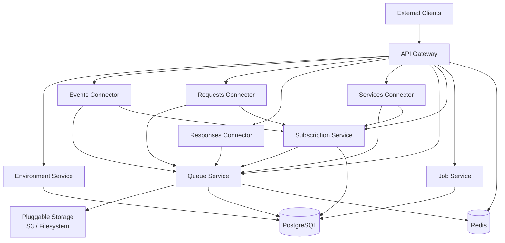
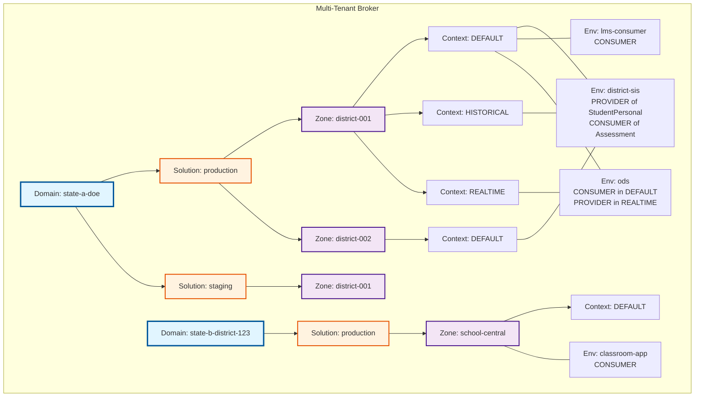
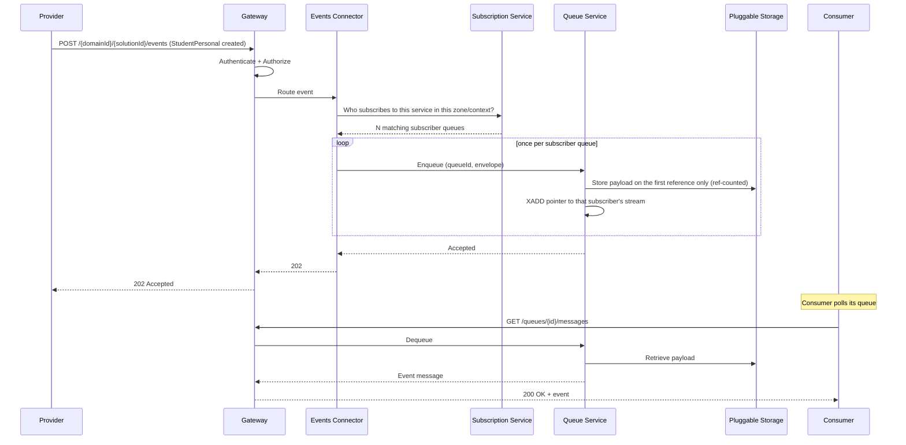
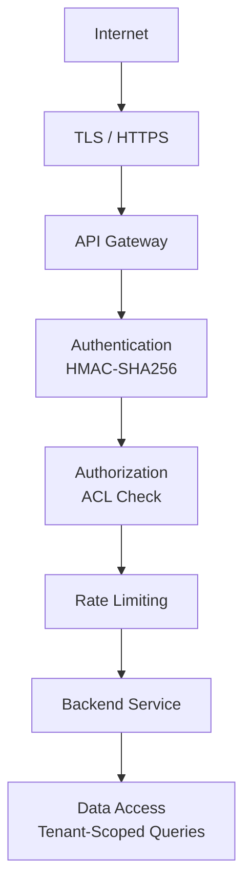

# OSDB - System Architecture Overview

**Version:** 1.2  
**Date:** March 20, 2026  
**Status:** Active  
**Updated:** September 23, 2026 — Re-verified against the implementation  
**Companion to:** [SYSTEM-ARCHITECTURE.md](SYSTEM-ARCHITECTURE.md) (detailed reference)

---

## What is OSDB?

The Open Source SIF Data Broker (OSDB) is a broker that implements the SIF 3.7 specification for K-12 educational data interoperability. It sits between educational software systems - student information systems, learning management systems, assessment platforms, state reporting - and gives them a common protocol to exchange data through.

Think of it as a central post office for educational data: applications register, authenticate, and then publish or consume messages through the broker without needing to know anything about each other.

---

## Architecture Approach

OSDB uses a hybrid modular architecture - a single Maven multi-module repository where each module is a self-contained Spring Boot application with an embedded server.

This gives us the best of both worlds:

- **Monolith-like development**: one repo, one build (`mvn clean install`), shared code in a common library, easy local setup with Docker Compose.
- **Microservice-like deployment**: each module produces an independent JAR, can be scaled and deployed separately, and has clear boundaries aligned to SIF 3.7 domains.

The deployment model can evolve without architectural changes - run everything on one box for a small district, or scale individual services independently for a state agency.

---

## System Components

The broker is composed of nine deployable services plus two libraries:



Every connector also calls the Environment Service to resolve zones, contexts and
provider registrations; those lookups are left off the diagram to keep it readable.
The Requests and Services Connectors additionally use Redis for their provider caches.

| Module | Role |
|--------|------|
| **API Gateway** | Single entry point. Handles authentication (HMAC-SHA256), authorization (ACLs), rate limiting, and request routing. Reactive (Spring Cloud Gateway). |
| **Environment Service** | Manages the organizational hierarchy: Domains, Solutions, Zones, Contexts, Environments. The "phone book" of the broker. |
| **Queue Service** | Message queue management via Redis Streams. Stores message payloads in a pluggable storage backend (S3 or filesystem). Handles dead-letter queues and retry. |
| **Job Service** | SIF Functional Service Job state management. Tracks job phases and state transitions (NOTSTARTED → INPROGRESS → COMPLETED/FAILED). |
| **Subscription Service** | Manages event subscriptions and delayed provider registrations. Determines which consumers receive which events (zone, context, service type filters), and registers providers that choose to receive requests via queue polling rather than direct HTTP delivery. |
| **Events Connector** | Routes SIF event messages (CREATE/UPDATE/DELETE notifications) from providers to subscriber queues. |
| **Requests Connector** | Routes SIF request messages (CRUD operations) from consumers to providers. For immediate requests, proxies to the provider and returns the response. For delayed requests, deposits the response (or the request itself, for delayed providers) into the appropriate queue. |
| **Responses Connector** | Routes DELAYED SIF response messages back from providers to consumer queues. |
| **Services Connector** | Routes SIF Functional Service Job operations to their providers, resolving provider registrations and delayed-provider subscriptions. Job state itself lives in the Job Service, which the gateway routes to directly. |
| **sif-broker-common** | Shared library. DTOs, exceptions, utilities, constants, and the extension SPI. Not a running service - compiled into every other module. |
| **extensions** | Drop-in extension library, shipped as an auto-configured JAR rather than a service. Contains the message-sequencing filter. See [SPOTLIGHT-EXTENSIBILITY.md](SPOTLIGHT-EXTENSIBILITY.md). |

---

## Multi-Tenancy Hierarchy

The broker supports multiple independent organizations on shared infrastructure. Data isolation is enforced at every layer - database queries, API authorization, and cache boundaries.

The organizational model is a four-level hierarchy aligned with SIF 3.7:

```
Domain (Tenant)
  └─ Solution (e.g., Production, Staging)
      └─ Zone (Organizational Unit, e.g., a district)
          └─ Context (Sub-Unit, e.g., current vs. historical data)
```

Environments (application instances) belong to exactly one domain and one solution, but can participate in multiple zones and contexts within that domain.

Key constraints:
- One environment → one domain, one solution, many zones/contexts
- An environment can be both a consumer and a provider - even within the same zone/context. The role is per service type, not per environment. For example, a SIS in district-001/DEFAULT can be a provider of StudentPersonal data and a consumer of Assessment data simultaneously.
- One provider per service per zone/context (e.g., only one SIS provider for StudentPersonal in district-001/DEFAULT)
- The same environment can provide services across multiple zones (e.g., a state SIS serving district-A, district-B, and district-C with the same credentials)
- Different contexts within a zone can have different providers for the same service



In this example, `district-sis` participates in district-001/DEFAULT, district-001/HISTORICAL, and district-002/DEFAULT - all with the same session token and shared secret. But each zone/context can only have one provider for a given service type.

A common point of confusion: an environment is not simply "a consumer" or "a provider." The role is per service type, and an environment can be both within the same zone/context. In the diagram above, `district-sis` is a PROVIDER of StudentPersonal data and a CONSUMER of Assessment data, both in district-001/DEFAULT. Similarly, `ods` is a CONSUMER in DEFAULT (ingesting all data) and a PROVIDER in REALTIME (serving that data to other applications). Same environment, same credentials, different roles depending on service type and context.

Each **Domain** is a hard tenant boundary. An environment in one domain can never see or interact with data in another domain.

---

## How Data Flows

There are two primary data flow patterns:

### Event Publishing (Push)

A provider publishes an event → the broker fans it out to all matching subscriber queues.



### Request/Response

From the consumer's perspective, a request is either **immediate** or **delayed**:

- **Immediate**: The broker proxies the request to the provider's endpoint and returns the response synchronously to the consumer. Simple HTTP round-trip.
- **Delayed**: The consumer supplies a `queueId` and gets back a `202 Accepted`. The response shows up in the consumer's queue. The consumer polls the queue to retrieve it.

Behind the scenes, delayed requests have two variants - but they're transparent to the consumer:

1. If the provider supports immediate requests, the broker still proxies the request to the provider synchronously, but instead of returning the response to the consumer, it deposits the response into the consumer's queue.
2. If the provider supports delayed requests (registered via Subscription Service), the broker deposits the request into the provider's queue. The provider polls its queue, processes the request, and sends the response to the Responses Connector, which deposits it into the consumer's queue.

Either way, the consumer experience is the same: submit request, poll queue, get response.

---

## Security Model

Security is layered - every request passes through multiple checkpoints before reaching a backend service.



Key security mechanisms:

| Layer | Mechanism | Purpose |
|-------|-----------|---------|
| Transport | TLS 1.3 | Encryption in transit |
| Authentication | HMAC-SHA256 signing | Verify request origin. Signature = HMAC(secret, `{sessionToken}:{timestamp}`) |
| Replay Prevention | Timestamp validation | Reject requests outside a configurable time window |
| Authorization | ACL-based | Fine-grained, per-resource access control |
| Rate Limiting | Redis-backed distributed counters | Protect against abuse from misconfigured clients; per-environment limits |
| Data Access | Tenant-scoped queries | Every DB query is scoped to the authenticated domain |
| Secrets | Pluggable (Vault, Multi-Key AES-256-GCM, Plaintext for dev) | Shared secrets never logged or exposed |

---

## Caching Strategy

Caching is in place across the broker, and it is deliberately not uniform — each service
uses the tier that suits its data.

**In-process (Caffeine, via `SimpleCacheManager`)** — per-replica, TTL-bounded:

| Service | Caches |
|---------|--------|
| Environment Service | `acl-permissions`, `acl-any-grant`, `auth-environment`, `auth-domain`, `auth-solution`, `auth-shared-secret` |
| Events Connector | `context-uuid`, `subscription-query` |
| Subscription Service | `subscriptions` (event and delayed-request lookups) |
| Queue Service | `queue-metadata` (routing lookups) |

**Redis-backed** — shared across replicas:

| Service | Caches |
|---------|--------|
| Requests Connector | `ProviderRegistryCache` and `QueueOwnerCache`, through a `RedisCacheManager` |
| Services Connector | provider registrations, through `RedisTemplate` directly |

The authorization caches in the Environment Service carry the most load: they keep the ACL
and session lookups off the database on every gateway request.

There is no Pub/Sub invalidation layer. Entries leave a cache by TTL expiry or by explicit
eviction on the corresponding write path, so an in-process cache on one replica can briefly
serve a value another replica has already changed. TTLs are chosen with that window in mind.

New caches are added by annotating a method with `@Cacheable`, registering the cache name in
that service's `CacheConfig`, and adding eviction to the matching write path.

---

## Extensibility

OSDB is designed as an open-source broker that implementors can extend without forking. The architecture uses Spring's IoC container to define extension points where custom logic can be plugged in at runtime - just add a JAR to the classpath.

This matters because implementors will want to add value on top of the base broker: custom payload validation, data enrichment, audit logging, analytics, or proprietary business rules. They should be able to do this by registering their own Spring beans, not by modifying core broker code.

The extension model has three layers, all wired through Spring's IoC container:

| Extension Point | Mechanism | Example Use Case |
|----------------|-----------|-----------------|
| Gateway filters | Spring Cloud Gateway `GlobalFilter` (+ `Ordered`) | Custom authentication, header enrichment, request logging, rate limiting |
| Drop-in extension modules | Spring Boot auto-config JAR on a connector classpath — an inbound Jakarta servlet `Filter` or an outbound WebClient `ExchangeFilterFunction`, activated per-solution via entity tags, fail-open | Header injection (message sequencing), outbound transport translation (non-SIF REST/JSON provider) |
| Pluggable backends | Interface + `@ConditionalOnProperty` | Storage (S3/filesystem), secrets (Vault / AWS SM / AES-256-GCM DB) |

An implementor packages their extension as a Spring Boot auto-configured JAR, adds it as a Maven dependency (or drops it on the classpath), and Spring auto-discovers the beans. The core broker code is untouched. Extensions are ordered via `@Order` and enabled/disabled via configuration properties, and per-solution activation is driven by entity tags. See [`SPOTLIGHT-EXTENSIBILITY.md`](SPOTLIGHT-EXTENSIBILITY.md) for the end-to-end pattern and worked examples.

---

## Technology Stack

| Category | Technology | Why |
|----------|-----------|-----|
| Language | Java 17 (LTS) | Modern features (records, pattern matching), LTS until 2029, mature ecosystem |
| Framework | Spring Boot 3.x | Industry standard for Java microservices. MVC for CRUD services, WebFlux for Gateway. Events Connector and Responses Connector use synchronous RestClient (JdkClientHttpRequestFactory). |
| Database | PostgreSQL 14+ | ACID, UUID, JSONB, transactional DDL, open source |
| Cache & Queue | Redis 6.0+ | Sub-ms caching, Streams for message queues, Pub/Sub for invalidation, atomic rate limiting |
| Message Storage | Pluggable (S3 / Filesystem) | Queue stores pointers; payloads live in S3 or filesystem |
| Schema Migrations | Flyway | Version-controlled, sequential SQL migrations (unified path in environment-service) |
| API Gateway | Spring Cloud Gateway | Reactive routing, filter chains, rate limiting |
| Auth | HMAC-SHA256 | SIF 3.7 compliant cryptographic request signing |
| Secrets | Pluggable (Vault / Multi-Key AES-256-GCM / Plaintext for dev) | Configuration-driven backend selection |
| Testing | JUnit 5 + jqwik + Testcontainers | Unit, property-based, and integration tests against real PostgreSQL |
| Containers | Docker (amazoncorretto:17-alpine) | Minimal images; connectors load extension JARs via PropertiesLauncher |
| Orchestration | Kubernetes | Deployments, HPA, ConfigMaps, Secrets, rolling updates |
| Observability | Micrometer + Prometheus | Metrics exposed at /actuator/prometheus; dashboards and alerting are deployment concerns |
| Logging | SLF4J + Logback | Structured JSON logging in production |

---

## Deployment Model

The broker is containerized and Kubernetes-ready. Each module produces a Docker image with an embedded server - no external application server needed.

```
┌─────────────────────────────────────────────────┐
│  Kubernetes Cluster                             │
│                                                 │
│  ┌──────────┐  ┌──────────┐  ┌──────────┐       │
│  │ Gateway  │  │ Gateway  │  │ Gateway  │       │
│  │ (replica)│  │ (replica)│  │ (replica)│       │
│  └────┬─────┘  └────┬─────┘  └────┬─────┘       │
│       └──────────────┼──────────────┘           │
│                      │                          │
│  ┌─────────┐ ┌──────┴──────┐ ┌──────────┐       │
│  │Env Svc  │ │Queue Svc    │ │Connectors│       │
│  └────┬────┘ └──────┬──────┘ └────┬─────┘       │
│       │              │             │            │
│  ┌────┴──────────────┴─────────────┴────┐       │
│  │         PostgreSQL + Redis           │       │
│  └──────────────────────────────────────┘       │
└─────────────────────────────────────────────────┘
```

Key operational features:
- Rolling updates with zero downtime
- Liveness and readiness probes via Spring Boot Actuator
- Horizontal Pod Autoscaling based on CPU/memory
- Circuit breakers (Resilience4j) on the gateway's and the Events Connector's outbound service calls, to prevent cascading failures
- Graceful shutdown with in-flight request draining
- Externalized configuration via ConfigMaps and Secrets

For local development, `docker-compose.yml` brings up all services with PostgreSQL and Redis - one command to run the full stack.

---

## What's Next

For detailed coverage of any topic - component interfaces, database schemas, deployment manifests, scaling strategies, failure modes - see the full [System Architecture](SYSTEM-ARCHITECTURE.md) document.

Related architecture documents:
- [API Architecture](API-ARCHITECTURE.md) - REST conventions, versioning, error handling
- [Data Architecture](DATA-ARCHITECTURE.md) - Database schemas, migrations, data flow
- [Security Architecture](SECURITY-ARCHITECTURE.md) - Authentication, authorization, secrets management
- [Testing Architecture](TESTING-ARCHITECTURE.md) - Testing strategy, property-based testing, coverage
