# OSDB - System Architecture

**Version:** 1.1  
**Date:** March 12, 2026  
**Status:** Active  
**Updated:** April 6, 2026 — Port layout, HTTP client technology, controller URL paths, infrastructure service URLs, event distribution shared payload storage, startup script, logback, auth filter, queue service updates

## Table of Contents

1. [System Overview](#system-overview)
   - [Purpose](#purpose)
   - [Goals](#goals)
   - [High-Level Capabilities](#high-level-capabilities)
   - [Target Users](#target-users)
   - [Use Cases](#use-cases)
2. [Architecture Style](#architecture-style)
   - [Hybrid Modular Architecture](#hybrid-modular-architecture)
   - [Architectural Decision: Microservices vs Modular Monolith](#architectural-decision-microservices-vs-modular-monolith)
   - [Service Boundaries and Responsibilities](#service-boundaries-and-responsibilities)
   - [Inter-Service Communication Patterns](#inter-service-communication-patterns)
3. [Component Architecture](#component-architecture)
   - [High-Level Component Diagram](#high-level-component-diagram)
   - [Component Responsibilities](#component-responsibilities)
   - [Component Interfaces](#component-interfaces)
   - [Component Communication Patterns](#component-communication-patterns)
   - [Component Dependencies](#component-dependencies)
   - [Component Scalability Characteristics](#component-scalability-characteristics)
   - [Component Failure Modes and Resilience](#component-failure-modes-and-resilience)
   - [Migration Path: Microservices ? Modular Monolith](#migration-path-microservices--modular-monolith)
   - [Data Flow Between Components](#data-flow-between-components)
4. [Technology Stack](#technology-stack)
   - [Core Technologies](#core-technologies)
   - [Database Technologies](#database-technologies)
   - [Testing Technologies](#testing-technologies)
   - [Security Technologies](#security-technologies)
   - [Observability Technologies](#observability-technologies)
   - [Containerization Technologies](#containerization-technologies)
5. [Deployment Architecture](#deployment-architecture)
   - [Deployment Environments](#deployment-environments)
   - [Container Orchestration](#container-orchestration)
   - [Configuration Management](#configuration-management)
   - [Scaling Strategies](#scaling-strategies)
6. [Multi-Tenancy Architecture](#multi-tenancy-architecture)
   - [Multi-Tenancy Overview](#multi-tenancy-overview)
   - [Organizational Hierarchy](#organizational-hierarchy)
   - [Data Isolation Strategies](#data-isolation-strategies)
   - [Tenant Routing and Identification](#tenant-routing-and-identification)
   - [Multi-Tenancy Testing Strategy](#multi-tenancy-testing-strategy)
   - [Multi-Tenancy Performance Considerations](#multi-tenancy-performance-considerations)
   - [Future Enhancements](#future-enhancements)
7. [Integration Points](#integration-points)
   - [External System Integration](#external-system-integration)
   - [SIF 3.7 Compliance Points](#sif-37-compliance-points)
   - [API Gateway as Integration Hub](#api-gateway-as-integration-hub)
   - [Integration Testing](#integration-testing)
   - [Integration Best Practices](#integration-best-practices)
   - [Future Integration Enhancements](#future-integration-enhancements)
8. [Scalability Considerations](#scalability-considerations)
   - [Horizontal Scaling Strategy](#horizontal-scaling-strategy)
   - [Database Scaling](#database-scaling)
   - [Caching Strategy](#caching-strategy)
   - [Message Queue Scaling](#message-queue-scaling)
   - [Load Balancing](#load-balancing)
   - [Performance Optimization](#performance-optimization)
9. [Security Architecture Overview](#security-architecture-overview)
10. [References](#references)
    - [Related Architecture Documents](#related-architecture-documents)
    - [External References](#external-references)

---

## System Overview

### Purpose

The Open Source SIF Data Broker (OSDB) is a comprehensive, production-grade broker system that implements the Schools Interoperability Framework (SIF) 3.7 specification. It enables secure, standardized data exchange between educational software systems, facilitating seamless interoperability across K-12 education technology platforms.

The broker serves as a central hub for educational data exchange, allowing disparate systems�such as student information systems (SIS), learning management systems (LMS), assessment platforms, and state reporting systems�to communicate using a common protocol. By implementing the SIF 3.7 standard, the broker eliminates the need for point-to-point integrations and provides a centrally managed, scalable, maintainable approach to educational data interoperability.

### Goals

#### Primary Goals

1. **SIF 3.7 Compliance**: Full implementation of mandatory elements for the SIF 3.7 specification for educational data interoperability, ensuring compatibility with all SIF-compliant systems
2. **Multi-Tenancy**: Support multiple independent organizations (domains) with complete data isolation, enabling shared infrastructure while maintaining strict tenant boundaries
3. **Production-Ready**: Enterprise-grade reliability, security, and performance suitable for production deployment in educational institutions
4. **Scalability**: Handle high-volume data exchanges across multiple environments and solutions, supporting districts of all sizes from small schools to large state agencies
5. **Developer-Friendly**: Clear APIs, comprehensive documentation, and easy local development setup to accelerate integration development

#### Technical Goals

1. **Hybrid Modular Monolith/Microservices Architecture**: Supports both simple deployments and modular, independently deployable services that can scale based on specific workload requirements
2. **High Test Coverage**: Minimum 80% code coverage with property-based testing to ensure correctness and reliability
3. **Security First**: HMAC-SHA256 authentication, ACL-based authorization, and pluggable secrets management to protect sensitive data
4. **Observability**: Comprehensive logging, metrics, tracing, and monitoring to enable proactive operations and troubleshooting
5. **Cloud-Native + Consistent Deployments**: Containerized deployment with Kubernetes support for modern cloud infrastructure

### High-Level Capabilities

The OSDB provides the following core capabilities:

1. **Multi-Tenant Data Exchange**
   - Support for multiple independent organizations (domains) with complete data isolation
   - Hierarchical organizational structure: Domain ? Solution ? Zone/Context ? Environment
   - Tenant-specific configuration and access control

2. **SIF 3.7 Compliance**
   - Full implementation of SIF 3.7 specification for educational data interoperability
   - Support for all SIF message types: Events, Requests, Responses, and Functional Services
   - Compliant authentication and authorization mechanisms
   - Zone and Context support for organizational hierarchy

3. **Secure Communication**
   - HMAC-SHA256 cryptographic request signing for authentication
   - ACL-based authorization for fine-grained access control
   - Session token management with timestamp validation
   - Replay attack prevention through timestamp validation
   - Pluggable secrets management (DB Encryption, HashiCorp Vault, AWS Secrets Manager)

4. **Asynchronous Messaging**
   - Queue-based message delivery with Redis Streams
   - Pluggable storage backend for message payloads (AWS S3, local filesystem)
   - Retry mechanisms with exponential backoff
   - Dead-letter queue handling for failed messages
   - Message routing based on subscriptions

5. **Event Subscription**
   - Targeted event delivery based on subscription criteria
   - Zone and Context-based filtering
   - Event type filtering
   - Subscription management API

6. **API Gateway**
   - Centralized authentication and authorization
   - Distributed rate limiting with Redis
   - Request routing to backend services
   - Security header management
   - CORS configuration

7. **Scalable Architecture**
   - Horizontal scaling support for high-volume data exchanges
   - Independent scaling of individual services
   - Database connection pooling with HikariCP
   - Redis caching for performance optimization
   - Kubernetes-ready deployment

8. **Functional Services Support**
   - SIF Functional Service Job state management
   - Multi-phase workflow support (e.g., student enrollment, assessment grading)
   - Job state transitions (NOTSTARTED ? INPROGRESS ? COMPLETED/FAILED)
   - Provider discovery and routing

### Target Users

The OSDB is designed to serve multiple user personas in the K-12 education technology ecosystem:

#### 1. School Districts
**Role**: K-12 educational institutions needing to integrate multiple software systems

**Needs**:
- Easy setup and configuration
- Reliable operation with minimal downtime
- Clear troubleshooting and error messages
- Support for multiple vendors and applications

**Goals**:
- Integrate student information systems, learning management systems, and assessment platforms
- Automate data synchronization between systems
- Reduce manual data entry and errors
- Ensure data privacy and security compliance

**Pain Points**:
- Complex configurations across multiple systems
- Unclear error messages when integrations fail
- Difficult debugging of data flow issues
- Vendor lock-in with proprietary integrations

#### 2. Education Software Vendors
**Role**: Companies building SIF-compliant educational applications

**Needs**:
- Clear API documentation with examples
- Testing tools and sandbox environments
- Reliable broker implementation
- Standards compliance

**Goals**:
- Build SIF-compliant integrations quickly and correctly
- Reduce integration development time
- Support multiple districts with a single integration
- Ensure data quality and reliability

**Pain Points**:
- Incomplete or unclear SIF specifications
- Inconsistent broker implementations across districts
- Lack of testing tools and environments
- Difficulty debugging integration issues

#### 3. State Education Agencies
**Role**: State-level organizations managing data exchange across districts

**Needs**:
- Multi-district support with data isolation
- Scalability for statewide deployments
- Compliance reporting and audit trails
- Performance monitoring and analytics

**Goals**:
- Aggregate data from multiple districts for state reporting
- Ensure data quality and consistency across districts
- Meet federal and state reporting requirements
- Provide districts with reliable data exchange infrastructure

**Pain Points**:
- Managing multiple district configurations
- Ensuring data privacy across district boundaries
- Scaling infrastructure for statewide use
- Monitoring and troubleshooting across many districts

#### 4. System Integrators
**Role**: Technical teams implementing and maintaining educational data integrations

**Needs**:
- Deployment guides and best practices
- Monitoring and alerting tools
- Performance tuning guidance
- Troubleshooting documentation

**Goals**:
- Deploy and maintain broker in production environments
- Ensure high availability and performance
- Quickly diagnose and resolve issues
- Optimize infrastructure resource usage

**Pain Points**:
- Unclear deployment requirements
- Insufficient monitoring and alerting
- Performance bottlenecks
- Complex troubleshooting across microservices

### Use Cases

The OSDB supports a wide range of educational data exchange scenarios:

#### Core Use Cases

1. **CEDS Data Transport**
   - Transport Common Education Data Standards (CEDS) formatted data between educational systems
   - Ensure standardized data elements and definitions across state and district boundaries
   - Support federal and state reporting requirements
   - Enable longitudinal data analysis

2. **Statewide Longitudinal Data System (SLDS) Population**
   - Aggregate and transmit student data from multiple districts to state-level longitudinal data systems
   - Support reporting, analytics, and compliance requirements
   - Track student progress across years and districts
   - Enable evidence-based policy decisions

3. **Student Information System Integration**
   - Synchronize student demographic and enrollment data between SIS and learning platforms
   - Automate roster updates across multiple applications
   - Ensure data consistency across systems
   - Reduce manual data entry and errors

4. **Assessment Data Exchange**
   - Share assessment results between testing platforms and SIS
   - Enable real-time grade updates
   - Support formative and summative assessment workflows
   - Provide teachers with timely student performance data

5. **Attendance Tracking**
   - Real-time attendance updates across multiple systems
   - Synchronize attendance data between SIS and state reporting systems
   - Enable early warning systems for chronic absenteeism
   - Support compliance reporting

6. **Grade Book Synchronization**
   - Automatic grade updates from LMS to SIS
   - Bidirectional synchronization of assignment and grade data
   - Support multiple grading periods and scales
   - Enable parent and student portals with current grades

7. **Rostering**
   - Automated class roster updates across educational applications
   - Synchronize teacher assignments and student enrollments
   - Support schedule changes and mid-year adjustments
   - Enable single sign-on with current roster data

8. **State Reporting/Data Collections**
   - Statewide collection of objects required for State Reporting
   - Realtime events for validation error corrections
   - Multiple data contexts and zones to seperate "Live" data from "Snapshot" data
   - Standard SIF objects alongside "Composite"/reporting objects


#### Advanced Use Cases

8. **Multi-Phase Functional Services**
   - Student enrollment workflows with multiple approval phases
   - Assessment grading workflows with scoring and review phases
   - Data validation workflows with correction and resubmission
   - Complex business processes spanning multiple systems

9. **Event-Driven Integrations**
   - Real-time notifications of student demographic changes
   - Immediate updates when grades are posted
   - Attendance alerts for intervention systems
   - Behavior incident notifications

10. **Delayed Request Processing**
    - Large data exports processed asynchronously
    - Batch reporting requests with queue-based delivery
    - Long-running queries that exceed HTTP timeouts
    - Scheduled data synchronization jobs

---

## Architecture Style

### Hybrid Modular Architecture

The OSDB uses a **hybrid modular architecture** that combines the simplicity of a modular monolith with the flexibility of independent deployment. This approach leverages Maven multi-module structure and Spring Boot to provide the best characteristics of both architectural patterns.

#### Core Architectural Principles

1. **Maven Multi-Module Organization**
   - Single repository with all modules clearly defined
   - Unified build process: `mvn clean install` builds everything
   - Shared dependencies managed in parent POM
   - Development experience similar to a traditional monolith
   - Easy to navigate and refactor across modules

2. **Spring Boot Embedded Servers**
   - Each module is a self-contained JAR with embedded Tomcat/Netty
   - Simple `java -jar service.jar` execution
   - No separate application server deployment
   - Consistent runtime environment across all modules

3. **Shared Common Library (sif-broker-common)**
   - Common DTOs, exceptions, utilities in shared module
   - Eliminates code duplication
   - Ensures consistency across all modules
   - Single source of truth for shared logic

4. **Flexible Deployment Model**
   - Modules can be deployed independently when needed
   - Modules can be deployed together for simpler operations
   - Deployment strategy can evolve based on operational needs
   - No architectural changes required to adjust deployment model

#### Key Advantages of This Approach

1. **Monolith-Like Simplicity**:
   - Single repository to clone and navigate
   - Unified build and test process
   - Shared code in common module
   - Easy local development with Docker Compose
   - Straightforward debugging across module boundaries

2. **Microservices-Like Flexibility**:
   - Clear module boundaries aligned with SIF 3.7 domains
   - Independent scaling when needed (Gateway, Queue Service, Connectors)
   - Fault isolation capabilities
   - Technology optimization per module (reactive vs blocking)
   - Independent deployment for critical updates

3. **Operational Benefits**:
   - Spring Boot Actuator for health checks and metrics
   - Testcontainers for realistic integration testing
   - Docker Compose for local development
   - Kubernetes-ready for production deployment
   - Flexible scaling based on actual load patterns

#### Module Organization

The system is organized into focused modules:

1. **environment-service**: Organizational hierarchy management
2. **gateway**: API gateway with pluggable authentication
3. **queue-service**: Message queue with pluggable storage
4. **job-service**: SIF Functional Service Job state management
5. **subscription-service**: Event and Delayed Provider subscription management
6. **events-connector**: SIF event message routing
7. **requests-connector**: SIF request message routing
8. **responses-connector**: SIF response message routing
9. **services-connector**: SIF Functional Service Job routing
10. **sif-broker-common**: Shared library

Each module has clear responsibilities and well-defined interfaces, making the system maintainable regardless of deployment strategy.

### Architectural Decision: Microservices vs Modular Monolith

#### The Decision

The OSDB adopts a **microservices architecture** with independent deployment capabilities for each service module. While the Maven multi-module structure provides monolith-like development simplicity, the system is designed and deployed as discrete microservices.

#### Rationale for Microservices

**1. Independent Deployment and Scaling**

Different services have vastly different load characteristics:
- **Gateway**: High request volume, CPU-intensive (HMAC validation, rate limiting)
- **Queue Service**: High throughput, I/O-intensive (Redis operations, storage backend)
- **Connectors**: Variable load based on message type distribution
- **Environment Service**: Low request volume, read-heavy with caching

Microservices enable:
- Horizontal scaling of Gateway independently during peak authentication loads
- Queue Service scaling based on message volume without affecting other services
- Connector scaling based on specific message type patterns (e.g., events vs requests)
- Efficient resource utilization by scaling only what's needed

**2. Clear Service Boundaries Aligned with SIF 3.7**

The SIF 3.7 specification naturally defines service boundaries:
- **Events Connector**: SIF event messages (CREATE, UPDATE, DELETE notifications)
- **Requests Connector**: SIF request messages (CRUD operations)
- **Responses Connector**: SIF response messages (CRUD results)
- **Services Connector**: SIF Functional Service Jobs (multi-phase workflows)

Each connector is an independent domain with distinct responsibilities, making microservices a natural architectural fit.

**3. Team Autonomy and Parallel Development**

Microservices enable:
- Independent development cycles per service
- Parallel feature development across teams
- Service-specific technology optimizations (reactive vs blocking)
- Isolated testing and deployment pipelines

**4. Fault Isolation**

Microservices provide failure containment:
- Events Connector failure doesn't affect Requests Connector
- Queue Service issues don't bring down Environment Service
- Gateway can continue routing to healthy services
- Circuit breakers prevent cascade failures

**5. Technology Optimization**

Different services benefit from different patterns:
- **Gateway**: Reactive (Spring Cloud Gateway with WebFlux) for high concurrency
- **Environment Service**: Blocking (Spring Web MVC) for simpler CRUD operations
- **Queue Service**: Standard Spring Web MVC (no reactive)
- **Connectors**: Blocking for straightforward message routing. Events Connector and Responses Connector use Spring's synchronous RestClient with JdkClientHttpRequestFactory for outbound HTTP calls (migrated from WebClient/Reactor Netty to eliminate non-daemon thread issues)

#### Complexity Mitigation Strategies

**Concern**: Microservices add operational complexity compared to monoliths.

**Mitigation**: Modern tooling makes microservices complexity negligible.

**1. Spring Boot 3.x Eliminates Deployment Complexity**

Traditional microservices require:
- Separate application servers (Tomcat, JBoss)
- Complex deployment descriptors (WAR files)
- Server configuration management
- Version compatibility management

Spring Boot provides:
- **Embedded servers**: Each service is a self-contained JAR with Tomcat/Netty embedded
- **Simple execution**: `java -jar service.jar` - no separate server needed
- **Consistent runtime**: Same embedded server version across all services
- **Configuration externalization**: Environment variables and config files, no server config

**Result**: Deployment is as simple as running a Java process. No application server complexity.

**2. Maven Multi-Module Provides Monolith-Like Development**

Traditional microservices require:
- Multiple repositories to clone and manage
- Complex dependency version coordination
- Difficult cross-service refactoring
- Fragmented build processes

Maven multi-module provides:
- **Single repository**: Clone once, see everything
- **Unified build**: `mvn clean install` builds all services
- **Shared dependency management**: Parent POM controls versions
- **Easy refactoring**: IDE refactoring works across modules
- **Consistent tooling**: Same build commands for all services

**Result**: Development experience is identical to a monolith. No multi-repo complexity.

**3. Shared Common Module Eliminates Code Duplication**

Traditional microservices suffer from:
- Duplicated DTOs across services
- Inconsistent error handling
- Repeated utility code
- Version drift in shared logic

sif-broker-common module provides:
- **Shared DTOs**: EnvironmentDTO, ErrorResponseDTO used by all services
- **Common exceptions**: SifBrokerException, ValidationException hierarchy
- **Utility classes**: HmacUtil, DateTimeUtil, JsonUtil
- **Shared constants**: HttpHeaders, ErrorCodes, SifConstants

**Result**: Zero code duplication. Single source of truth for shared logic.

**4. Spring Cloud Simplifies Service Communication**

Traditional microservices require:
- Manual service discovery implementation
- Custom load balancing logic
- Circuit breaker implementation
- Distributed tracing setup

Spring Cloud provides:
- **Service discovery**: Automatic service registration and discovery
- **Load balancing**: Built-in client-side load balancing
- **Circuit breakers**: Resilience4j integration for fault tolerance
- **Distributed tracing**: Spring Cloud Sleuth for request correlation

**Result**: Service communication is declarative. No custom infrastructure code.

**5. Testcontainers Enables Realistic Integration Testing**

Traditional microservices testing requires:
- Complex test environment setup
- Shared test databases causing conflicts
- Difficult test isolation
- Slow test execution

Testcontainers provides:
- **Isolated databases**: Each test gets a fresh PostgreSQL container
- **Realistic testing**: Real database, not mocks or H2
- **Automatic cleanup**: Containers destroyed after tests
- **Parallel execution**: Tests run in isolation

**Result**: Integration tests are fast, reliable, and realistic. No shared test environment complexity.

**6. Docker Compose Simplifies Local Development**

Traditional microservices require:
- Manual service startup in correct order
- Complex local environment configuration
- Port conflict management
- Service dependency coordination

Docker Compose provides:
- **Single command startup**: `docker-compose up` starts everything
- **Automatic dependency ordering**: Services start in correct order
- **Network isolation**: Services communicate via Docker network
- **Consistent environment**: Same setup for all developers

**Result**: Local development is one command. No manual service orchestration.

#### Trade-Offs and Why They're Acceptable

**Trade-Off 1: Operational Complexity**

**Trade-Off**: Multiple deployments instead of one monolith deployment.

**Why Acceptable**:
- Kubernetes handles deployment orchestration automatically
- CI/CD pipelines automate deployment process
- Spring Boot Actuator provides health checks for orchestration
- Benefits (independent scaling, fault isolation) far outweigh deployment overhead

**Trade-Off 2: Network Latency**

**Trade-Off**: Inter-service calls have network overhead vs in-process method calls.

**Why Acceptable**:
- Most operations are asynchronous (queue-based), so latency is not user-facing
- Synchronous calls are minimized (Gateway ? backend services only)
- Redis caching reduces repeated service calls
- Network latency (1-5ms) is negligible compared to database queries (10-50ms)

**Trade-Off 3: Distributed Transactions**

**Trade-Off**: No ACID transactions across services.

**Why Acceptable**:
- Service boundaries designed to avoid distributed transactions
- Each service owns its data and enforces consistency locally
- Eventual consistency is acceptable for our use cases (message routing, event distribution)
- Compensating transactions handle rare cross-service failures

**Trade-Off 4: Increased Memory Footprint**

**Trade-Off**: Each service runs a separate JVM with its own memory overhead.

**Why Acceptable**:
- Modern servers have abundant memory (64GB+ standard)
- Memory overhead is minimal compared to operational benefits
- Independent scaling means we only run instances we need
- JVM memory tuning optimizes footprint per service

#### Benefits Realized

**1. Independent Deployment**

- Security patches to Gateway don't require redeploying all services
- Bug fixes in one connector don't risk other connectors
- Feature releases can be staggered per service
- Rollback is per-service, not all-or-nothing

**2. Independent Scaling**

- Gateway scales horizontally during peak authentication loads
- Queue Service scales based on message volume
- Environment Service remains at minimal scale (low request volume)
- Efficient resource utilization: scale only what's needed

**3. Fault Isolation**

- Events Connector failure doesn't affect Requests Connector
- Queue Service issues don't bring down Environment Service
- Circuit breakers prevent cascade failures
- System degrades gracefully, not catastrophically

**4. Technology Optimization**

- Gateway uses reactive programming (WebFlux) for high concurrency
- Environment Service uses blocking I/O (Spring MVC) for simplicity
- Queue Service and Subscription Service use standard Spring Web MVC (no reactive)
- Events Connector and Responses Connector use synchronous RestClient with JdkClientHttpRequestFactory
- Each service optimized for its specific workload
- No compromise on technology choices

**5. Team Autonomy**

- Teams can work on different services in parallel
- Service-specific expertise can develop
- Independent testing and deployment pipelines
- Reduced coordination overhead

#### Why Complexity is Negligible

The combination of modern tooling makes microservices complexity minimal:

1. **Spring Boot**: Eliminates application server complexity
2. **Maven Multi-Module**: Provides monolith-like development experience
3. **sif-broker-common**: Eliminates code duplication
4. **Spring Cloud**: Simplifies service communication
5. **Testcontainers**: Makes integration testing easy
6. **Docker Compose**: Makes local development one command
7. **Kubernetes**: Handles deployment orchestration

**Result**: We get microservices benefits (scaling, fault isolation, independent deployment) with minimal added complexity. The development experience is nearly identical to a monolith, while operational benefits are substantial.

#### Conclusion

The microservices architecture is the right choice for the OSDB because:
- Service boundaries align naturally with SIF 3.7 specification
- Different services have different scaling needs
- Fault isolation is critical for production reliability
- Modern tooling (Spring Boot, Maven, Docker) makes complexity negligible
- Benefits (independent deployment, scaling, fault isolation) far outweigh minimal added complexity

The hybrid approach (Maven multi-module + Spring Boot microservices) provides the best of both worlds: monolith-like development simplicity with microservices operational flexibility.

### Service Boundaries and Responsibilities

The system is divided into the following microservices:

1. **environment-service**: Manages organizational hierarchy (domains, solutions, zones, contexts, environments)
2. **gateway**: API gateway providing pluggable authentication, authorization, and rate limiting
3. **queue-service**: Message queue management with pluggable storage backend (S3/filesystem) for raw message payloads
4. **job-service**: SIF Functional Service Job state management
5. **subscription-service**: Event subscription and Delayed Provider Request subscription
6. **events-connector**: Routes SIF event messages
7. **requests-connector**: Routes SIF request messages
8. **responses-connector**: Routes SIF response messages
9. **services-connector**: Manages SIF Functional Service Jobs (multi-phase workflows like student enrollment, assessment grading, and "refresh from source" true-ups)
10. **sif-broker-common**: Shared library with common DTOs, exceptions, and utilities

### Inter-Service Communication Patterns

1. **Synchronous REST**: Gateway to backend services for real-time operations
2. **Asynchronous Messaging**: Queue-based communication for event distribution
3. **Shared Database**: Each service has its own database schema (logical separation)
4. **Service Discovery**: Spring Cloud or Kubernetes service discovery
5. **Circuit Breakers**: Resilience4j for fault tolerance

---

## Component Architecture

The OSDB is composed of 10 distinct modules organized as a Maven multi-module project. Each module represents a focused microservice with clear responsibilities aligned to the SIF 3.7 specification. This section provides a comprehensive view of all components, their responsibilities, interfaces, and data flow patterns.

### High-Level Component Diagram

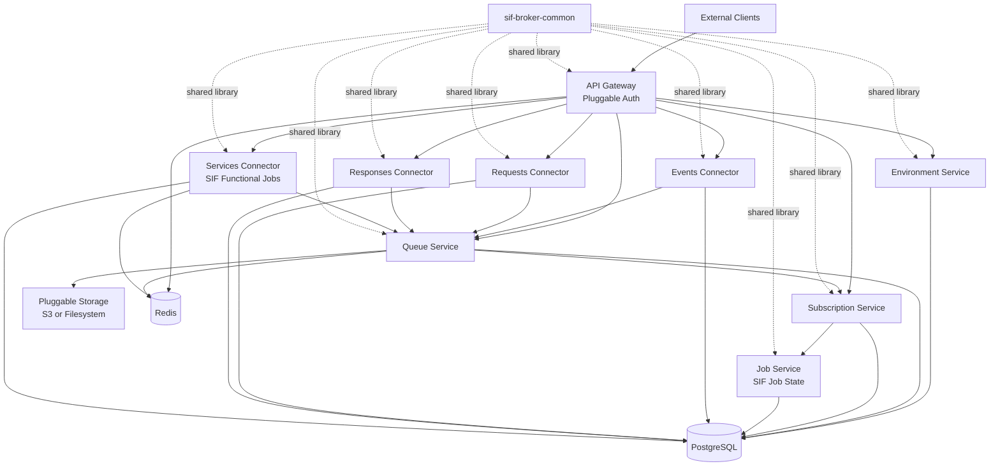

### Component Responsibilities

#### API Gateway
- **Purpose**: Single entry point for all external API requests
- **Responsibilities**:
  - Pluggable authentication (HMAC-SHA256 default, extensible for OAuth2, JWT, etc.)
  - ACL-based authorization enforcement
  - Rate limiting (distributed via Redis)
  - Request routing to backend services
  - Security header management
  - CORS configuration
- **Technology**: Spring Cloud Gateway (reactive)
- **Dependencies**: Redis (rate limiting, caching), Environment Service (authentication)

#### Environment Service
- **Purpose**: Manages organizational hierarchy and environment registration
- **Responsibilities**:
  - Domain (tenant) management
  - Solution (e.g. Prod/State/Test) management
  - Zone and Context management
  - Environment registration and credentials
  - Provider registration
  - ACL management
  - Infrastructure service URL generation (gateway-routed URLs constructed dynamically using `sif.broker.infrastructure.gateway-base-url` + domain/solution hierarchy)
- **Technology**: Spring Boot 3.x, Spring Data JPA
- **Dependencies**: PostgreSQL (primary data store)
- **Auth Filter Note**: Zone/context listing paths (`*/zones/*/contexts*`) are exempt from authentication in the `AuthorizationFilter`, allowing internal service-to-service calls (e.g., events-connector resolving context UUIDs) without auth headers

#### Queue Service
- **Purpose**: Message queue management for asynchronous data exchange
- **Responsibilities**:
  - Queue creation and management
  - Message enqueueing and dequeueing
  - Message payload storage via pluggable backend (AWS S3 or local filesystem)
  - Dead-letter queue handling
  - Message routing based on subscriptions
  - Queue monitoring and metrics
- **Technology**: Spring Boot 3.x, Spring Web MVC (no reactive), Redis Streams (queue metadata), Pluggable Storage Provider (message payloads)
- **Dependencies**: Redis (queue pointers/metadata), PostgreSQL (queue configuration), S3 or Filesystem (raw message storage)
- **Note**: `EnqueueMessageRequest` accepts both legacy field names and `SifMessageEnvelope` field names via `@JsonAlias`. MessageController path changed from `/{domainId}/{solutionId}/api` to `/{domainId}/{solutionId}`. `spring.web.resources.add-mappings: false` prevents static resource handler interference.

#### Job Service
- **Purpose**: Manages SIF Functional Service Job state objects (phases, states, transitions per SIF 3.7 spec)
- **Responsibilities**:
  - Job state persistence and CRUD operations
  - Job state transition management (NOTSTARTED ? INPROGRESS ? COMPLETED/FAILED)
  - Phase tracking and lifecycle management
  - Job querying and filtering by environment, state, and service name
  - Optimistic locking for concurrent update safety
  - Cascade deletion for referential integrity
- **Technology**: Spring Boot 3.x, Spring Data JPA
- **Dependencies**: PostgreSQL (job and phase state storage)
- **Note**: This service provides the state management layer for SIF Functional Service Jobs. The Services Connector acts as the routing layer that calls Job Service APIs and coordinates communication between consumers and providers

#### Subscription Service
- **Purpose**: Event subscription, delayed provider registration, and notification management
- **Responsibilities**:
  - Subscription CRUD operations
  - Event filtering based on subscription criteria (zone, context, event type)
  - Delayed provider registration (registers providers that elect to receive requests via queue polling rather than direct HTTP delivery)
  - Provider routing resolution for delayed request flows
- **Technology**: Spring Boot 3.x, Spring Data JPA
- **Dependencies**: PostgreSQL (subscription data), Queue Service (event delivery)

#### Events Connector
- **Purpose**: Handles SIF event messages
- **Responsibilities**:
  - Accept SIF event messages from authenticated clients
  - Route events to queue service
  - Track event metadata (sender, timestamp, routing info)
  - Event persistence for audit trail
- **Technology**: Spring Boot 3.x, Spring Web, RestClient with JdkClientHttpRequestFactory (synchronous HTTP client — migrated from WebClient/Reactor Netty to eliminate non-daemon thread issues causing test hangs and JVM exit problems)
- **Dependencies**: Queue Service, Environment Service (zone/context resolution)

#### Requests Connector
- **Purpose**: Handles SIF request messages
- **Responsibilities**:
  - Accept SIF request messages from authenticated clients
  - For immediate requests: proxy to provider and return response synchronously
  - For delayed requests to immediate providers: proxy to provider, deposit response to consumer's queue
  - For delayed requests to delayed providers: deposit request to provider's queue (provider polls, processes, and sends response via Responses Connector)
  - Track request metadata (sender, timestamp, routing info)
  - Request persistence for audit trail
- **Technology**: Spring Boot 3.x, Spring Web
- **Dependencies**: Queue Service, Subscription Service (for delayed provider lookup), PostgreSQL

#### Responses Connector
- **Purpose**: Handles SIF response messages
- **Responsibilities**:
  - Accept SIF response messages from authenticated clients
  - Route responses to queue service
  - Track response metadata (sender, timestamp, routing info)
  - Response persistence for audit trail
- **Technology**: Spring Boot 3.x, Spring Web, RestClient with JdkClientHttpRequestFactory (synchronous HTTP client — migrated from WebClient/Reactor Netty to eliminate non-daemon thread issues causing test hangs and JVM exit problems)
- **Dependencies**: Queue Service, PostgreSQL

> **Note**: The broker treats all message payloads as opaque data. Connectors route messages based on metadata (sender, zone, context, subscription criteria) without validating or transforming message bodies.

#### Services Connector
- **Purpose**: Routes SIF Functional Service Job requests between consumers, providers, and Job Service
- **Responsibilities**:
  - Accept SIF Functional Service Job requests from consumers (e.g., student enrollment, assessment grading)
  - Route job creation requests to Job Service and notify providers
  - Route job state updates from providers to Job Service
  - Route phase management requests to Job Service
  - Query Job Service for job details and lists
  - Discover providers via Environment Service provider registry
  - Cache provider registry lookups for performance
- **Technology**: Spring Boot 3.x, Spring WebClient (reactive HTTP client)
- **Dependencies**: Job Service (REST API calls), Environment Service (provider registry), Redis (caching), Queue Service (message routing)
- **Note**: This is a stateless routing layer with NO direct database access. All job state persistence is handled by Job Service via REST API calls. Services Connector coordinates communication between consumers, providers, and Job Service per SIF 3.7 Functional Services specification

#### sif-broker-common
- **Purpose**: Shared library for common code across all services
- **Responsibilities**:
  - Common DTOs (EnvironmentDTO, ErrorResponseDTO, etc.)
  - Base exceptions (SifBrokerException, ValidationException, etc.)
  - Utility classes (DateTimeUtil, HmacUtil, JsonUtil, etc.)
  - Shared constants (HttpHeaders, ErrorCodes, SifConstants, etc.)
  - Common configuration (JacksonConfiguration, ValidationConfiguration, etc.)
- **Technology**: Java 17, Spring Boot 3.x
- **Dependencies**: None (pure library)

### Component Interfaces

Each component exposes well-defined interfaces for inter-service communication. The following table summarizes the primary interfaces:

| Component | Interface Type | Port | Protocol | Purpose |
|-----------|---------------|------|----------|---------|
| Gateway | HTTP REST | 8080 | HTTP/HTTPS | External API entry point |
| Environment Service | HTTP REST | 8081 | HTTP | Organizational hierarchy management |
| Queue Service | HTTP REST | 8082 | HTTP | Message queue operations |
| Subscription Service | HTTP REST | 8083 | HTTP | Event subscription management |
| Events Connector | HTTP REST | 8084 | HTTP | SIF event message routing |
| Requests Connector | HTTP REST | 8085 | HTTP | SIF request message routing |
| Services Connector | HTTP REST | 8087 | HTTP | SIF Functional Service Job routing |
| Responses Connector | HTTP REST | 8088 | HTTP | SIF response message routing |

**Interface Design Principles:**

1. **RESTful APIs**: All services expose RESTful HTTP APIs following standard conventions
2. **JSON Payloads**: Request and response bodies use JSON format with consistent structure
3. **Standard Headers**: All services accept and return standard HTTP headers (Content-Type, Authorization, etc.)
4. **Error Responses**: Consistent error response format across all services (see API Architecture document)
5. **Health Checks**: All services expose `/actuator/health` endpoint for orchestration
6. **Metrics**: All services expose `/actuator/metrics` endpoint for monitoring

**Internal vs External Interfaces:**

- **External Interfaces**: Only the Gateway is exposed to external clients. All external traffic flows through the Gateway.
- **Internal Interfaces**: Backend services (Environment Service, Queue Service, etc.) are only accessible within the internal network. The Gateway routes authenticated requests to backend services.

### Component Communication Patterns

The system uses multiple communication patterns based on operational requirements:

#### 1. Synchronous REST Communication

**Used For**: Real-time operations requiring immediate responses

**Pattern**: HTTP request/response with blocking I/O

**Examples**:
- Gateway ? Environment Service (authentication, ACL checks)
- Gateway ? Backend Services (request routing)
- Services Connector ? Job Service (job state queries)
- Services Connector ? Environment Service (provider discovery)

**Characteristics**:
- Low latency (1-10ms for internal calls)
- Simple error handling (HTTP status codes)
- Request timeout enforcement (30 seconds default)
- Circuit breakers for fault tolerance (Resilience4j)

#### 2. Asynchronous Queue-Based Communication

**Used For**: Event distribution, delayed request processing, high-volume message routing

**Pattern**: Message enqueueing with Redis Streams, consumer polling

**Examples**:
- Events Connector ? Queue Service ? Subscribers (event distribution)
- Requests Connector ? Queue Service ? Provider (delayed requests)
- Provider ? Queue Service ? Consumer (delayed responses)

**Characteristics**:
- High throughput (1000+ messages/second)
- Decoupled producers and consumers
- Retry mechanisms with exponential backoff
- Dead-letter queue for failed messages
- Message persistence via pluggable storage backend

#### 3. Shared Database Access

**Used For**: Data persistence and querying within service boundaries

**Pattern**: Each service accesses its own logical schema within shared PostgreSQL database

**Examples**:
- Environment Service ? domains, solutions, zones, contexts, environments tables
- Queue Service ? queues, messages tables
- Job Service ? jobs, phases tables
- Subscription Service ? subscriptions table

**Characteristics**:
- ACID transactions within service boundaries
- Foreign key constraints for referential integrity
- No cross-service database queries (services use APIs)
- Flyway migrations for schema versioning (unified path in environment-service)
- Connection pooling with HikariCP

#### 4. Caching Layer

**Used For**: Performance optimization, rate limiting, session management

**Pattern**: Redis as distributed cache with TTL-based expiration

**Examples**:
- Gateway ? Redis (rate limit counters, session tokens)
- Queue Service ? Redis (queue metadata, message pointers)
- Services Connector ? Redis (provider registry cache)

**Characteristics**:
- 5-minute TTL for cached data (configurable)
- Cache-aside pattern (check cache, fallback to database)
- Distributed caching across multiple service instances
- Automatic expiration and eviction

### Component Dependencies

The following diagram shows the dependency relationships between components:

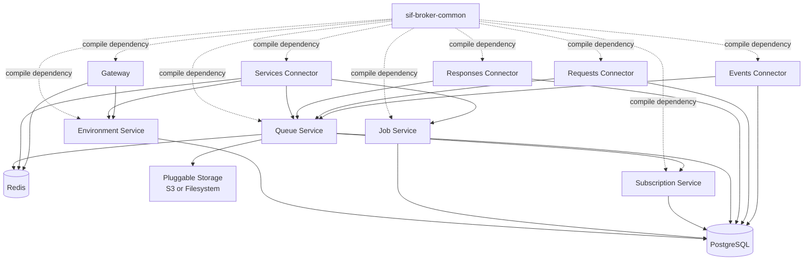

**Dependency Principles:**

1. **Acyclic Dependencies**: No circular dependencies between services
2. **Shared Library**: All services depend on `sif-broker-common` for shared code
3. **Database Isolation**: Each service owns its database tables (logical schema separation). Migrations are centralized in the environment-service.
4. **External Dependencies**: Services depend on external infrastructure (PostgreSQL, Redis, S3)
5. **Loose Coupling**: Services communicate via well-defined APIs, not direct code dependencies

### Component Scalability Characteristics

Different components have different scaling requirements based on their workload patterns:

| Component | Scaling Strategy | Scaling Trigger | Typical Instances |
|-----------|-----------------|-----------------|-------------------|
| Gateway | Horizontal | CPU > 70% (HMAC validation) | 3-5 |
| Environment Service | Horizontal | Request rate > 100/sec | 2-3 |
| Queue Service | Horizontal | Message throughput > 500/sec | 3-5 |
| Job Service | Horizontal | Request rate > 50/sec | 2-3 |
| Subscription Service | Horizontal | Request rate > 50/sec | 2-3 |
| Events Connector | Horizontal | Message rate > 200/sec | 2-4 |
| Requests Connector | Horizontal | Message rate > 200/sec | 2-4 |
| Responses Connector | Horizontal | Message rate > 200/sec | 2-4 |
| Services Connector | Horizontal | Job request rate > 100/sec | 2-3 |

**Scaling Considerations:**

1. **Gateway**: CPU-intensive due to HMAC signature validation. Scales horizontally with load balancer.
2. **Queue Service**: I/O-intensive due to Redis and storage operations. Scales horizontally with Redis cluster.
3. **Connectors**: Stateless routing layers. Scale horizontally based on message volume.
4. **Environment Service**: Read-heavy with caching. Scales horizontally with Redis cache.
5. **Job Service**: Write-heavy for job state updates. Scales horizontally with database connection pooling.

### Component Failure Modes and Resilience

Each component has specific failure modes and resilience strategies:

#### Gateway Failure
- **Impact**: External clients cannot access the system
- **Mitigation**: Multiple Gateway instances behind load balancer, health checks, automatic failover
- **Recovery**: Kubernetes restarts failed pods automatically

#### Environment Service Failure
- **Impact**: Authentication fails, new environment registration unavailable
- **Mitigation**: Redis caching of authentication data, multiple service instances, circuit breakers
- **Recovery**: Cached authentication continues working, service restarts automatically

#### Queue Service Failure
- **Impact**: Message enqueueing/dequeueing unavailable
- **Mitigation**: Redis persistence, multiple service instances, message retry logic
- **Recovery**: Messages persist in Redis, service restarts and resumes processing

#### Connector Failure
- **Impact**: Specific message type routing unavailable (e.g., events)
- **Mitigation**: Independent connectors (events failure doesn't affect requests), multiple instances
- **Recovery**: Service restarts, queued messages processed when service recovers

#### Database Failure
- **Impact**: All services lose persistence capability
- **Mitigation**: PostgreSQL replication, automated backups, connection retry logic
- **Recovery**: Failover to replica, restore from backup if needed

#### Redis Failure
- **Impact**: Rate limiting, caching, queue metadata unavailable
- **Mitigation**: Redis persistence (RDB + AOF), Redis Sentinel for failover, graceful degradation
- **Recovery**: Redis restarts with persisted data, services reconnect automatically

### Migration Path: Microservices ? Modular Monolith

**Question**: How difficult would it be to transition from microservices to a modular monolith (or vice versa)?

**Answer**: The current architecture makes this transition **relatively straightforward** compared to typical microservices systems.

#### Current Architecture Advantages for Migration

1. **Maven Multi-Module Structure**: Already organized as a single repository with clear module boundaries. Each service is a Maven module with defined dependencies. Shared code centralized in `sif-broker-common`. No need to merge multiple repositories.

2. **Clear Package Boundaries**: Each service has its own package namespace. No circular dependencies between services. Clean separation of concerns already enforced.

3. **Shared Database Schema**: All services use the same PostgreSQL database (logical schema separation). No distributed transactions to consolidate. Database migrations are centralized in the environment-service via Flyway (unified migration path V1–V21). Other services have Flyway disabled and rely on JPA `ddl-auto: validate`.

4. **Spring Boot Foundation**: All services use the same framework and patterns. Consistent configuration approach. Same dependency versions managed by parent POM.

#### Migration to Modular Monolith

**Difficulty**: **Low**

**Key Steps**:
- Create single `@SpringBootApplication` entry point with component scanning
- Replace HTTP calls with direct method injection
- Consolidate configurations into single `application.yml`
- Update tests to use full Spring context
- Create single Docker image and simplified Kubernetes deployment

**What Stays the Same**: All business logic, property-based tests, database schema, external APIs, authentication logic

**What Changes**: Deployment model (1 process vs 10), inter-service communication (method calls vs HTTP), scaling model (monolith vs individual services)

#### Migration from Modular Monolith to Microservices

**Difficulty**: **Medium**

**Key Steps**:
- Extract separate `@SpringBootApplication` for each module
- Add REST controllers for internal APIs
- Implement HTTP clients with circuit breakers
- Create service-specific configurations
- Build separate Docker images and Kubernetes deployments

#### Key Factors Making Migration Easy

- **No Distributed Transactions**: Single database, no complex coordination
- **Clear Boundaries**: Well-defined service responsibilities
- **Shared Code**: Centralized in `sif-broker-common`
- **Consistent Technology**: Same stack across all services
- **Single Repository**: No repo merging/splitting needed
- **Comprehensive Tests**: Property-based tests work regardless of deployment model

#### Key Factors Making Migration Harder

- **Gateway Complexity**: Spring Cloud Gateway is reactive, needs special handling
- **Redis Dependencies**: Caching/rate limiting requires proper isolation
- **Deployment Rollback**: Losing independent deployment capability
- **Scaling Granularity**: Monolith scales as unit, not per-service

#### Recommendation

The current microservices architecture is well-justified because:
- Different scaling needs (Gateway, Queue Service, Connectors have different load patterns)
- Independent deployment (security fixes don't require full redeployment)
- Technology optimization (reactive vs blocking patterns as needed)
- Fault isolation (connector failures don't affect core services)

However, migration to modular monolith is **achievable** if:
- Operational complexity becomes too high
- Independent scaling isn't needed
- Deployment frequency is low
- Team size is small (< 5 developers)

**Conclusion**: The Maven multi-module structure with Spring Boot provides **architectural flexibility**. You're not locked into microservices - migration to modular monolith is feasible with focused effort. This flexibility is a significant architectural advantage.

### Data Flow Between Components

#### Authentication Flow
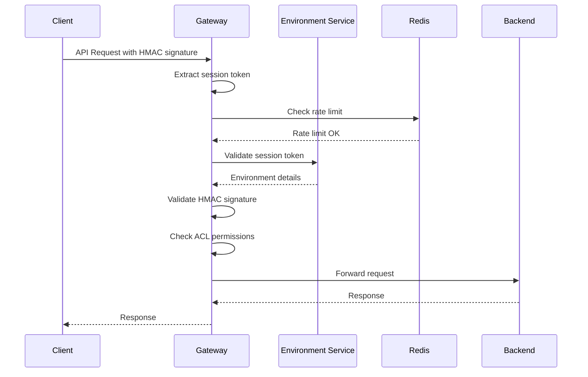

#### Request/Response Flows

From the consumer's perspective, a request is either **immediate** or **delayed**:

- **Immediate**: The broker proxies the request to the provider and returns the response synchronously. No queues involved on the consumer side.
- **Delayed**: The consumer supplies a `queueId` and receives a `202 Accepted`. The response is deposited into the consumer's queue. The consumer polls the queue to retrieve it.

Delayed requests have two variants behind the scenes, but they are transparent to the consumer:

1. **Delayed request, immediate provider**: The broker proxies the request to the provider synchronously, but instead of returning the response to the consumer, it deposits the response into the consumer's queue.
2. **Delayed request, delayed provider**: The broker deposits the request into the provider's queue. The provider polls its queue, processes the request, and sends the response to the Responses Connector, which deposits it into the consumer's queue.

##### Flow 1: Immediate Request

Consumer sends request and receives synchronous response within HTTP timeout.

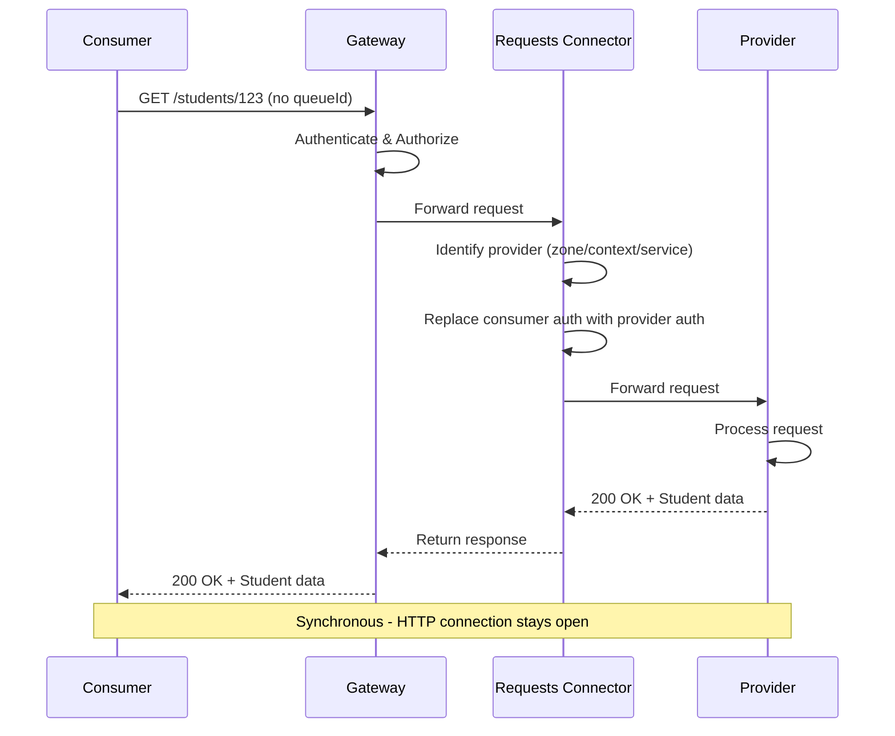

##### Flow 2: Delayed Request to Immediate Provider

Consumer requests asynchronously. The broker still proxies to the provider synchronously, but deposits the response into the consumer's queue instead of returning it directly.

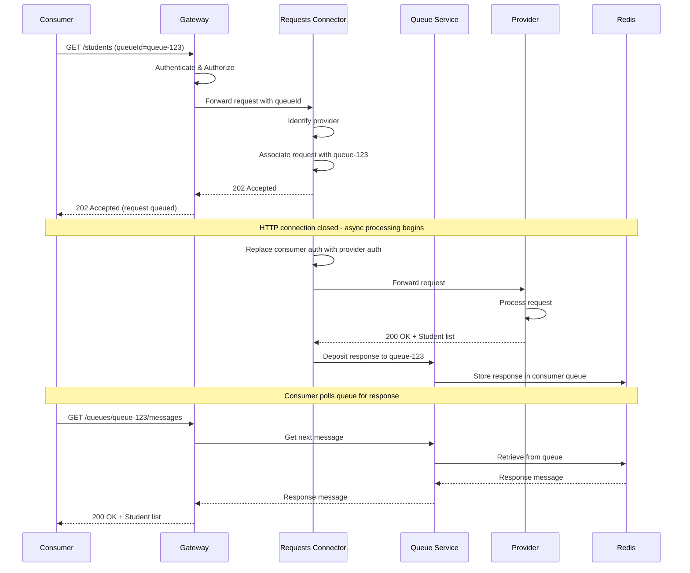

##### Flow 3: Delayed Request to Delayed Provider

The provider has registered as a delayed provider (via Subscription Service), electing to receive requests via queue polling. Both request and response are fully asynchronous.

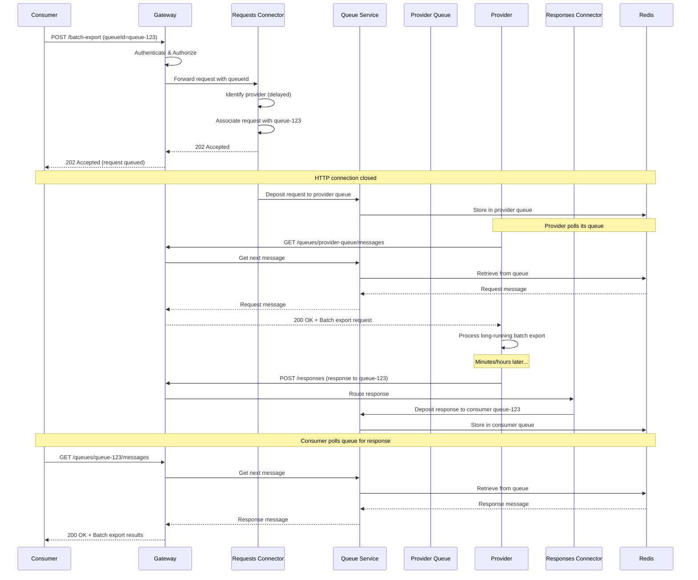

#### Event Publishing Flow

Provider publishes events that are distributed to subscribed consumers via queues.

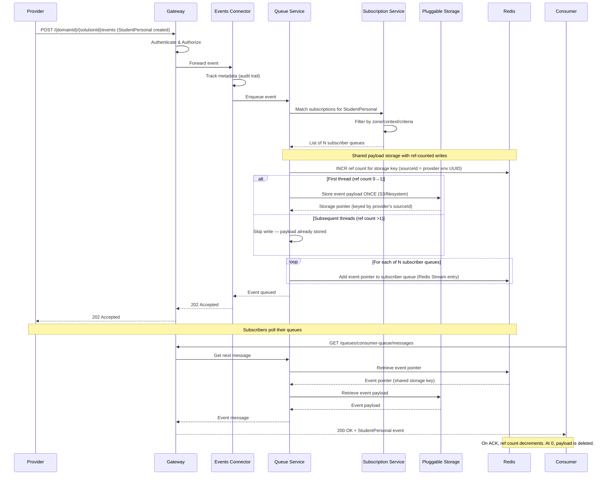

> **Shared Payload Storage**: When an event is distributed to N subscriber queues, the payload is stored ONCE on the filesystem/S3. The storage key uses the provider's environment UUID (`sourceId`), not the consumer's. Each consumer queue gets a Redis Stream entry pointing to the same storage key. A Redis ref count (atomic `INCR`) coordinates which thread writes the payload: the first thread to increment 0→1 writes it; subsequent threads skip the write. When consumers ACK messages, the ref count decrements; at 0, the payload is deleted. The `StorageKeyGenerator` accepts `messageType` case-insensitively (EVENT, event, Event all work).

---

## Technology Stack

The OSDB is built on a carefully selected technology stack that prioritizes production readiness, developer productivity, and long-term maintainability. This section documents the core technologies, supporting tools, and the rationale behind each selection.

### Core Technologies

#### Java 17 (LTS)

**Purpose**: Primary programming language and runtime environment

**Key Features**:
- Long-Term Support (LTS) until September 2029
- Modern language features: records, pattern matching, text blocks, sealed classes
- Enhanced performance with improved garbage collection (G1GC, ZGC)
- Strong type safety and compile-time error detection
- Mature ecosystem with extensive libraries and frameworks

**Selection Rationale**:

1. **Long-Term Support**: Java 17 is an LTS release with support until 2029, providing stability and security updates for the lifetime of this project. This eliminates the need for frequent major version upgrades and ensures compatibility with enterprise environments.

2. **Modern Language Features**: Java 17 includes significant language improvements that enhance code quality and developer productivity:
   - **Records**: Immutable data carriers reduce boilerplate for DTOs (e.g., `record DomainDTO(UUID id, String domainId, String name)`)
   - **Pattern Matching**: Simplifies type checking and casting (e.g., `if (obj instanceof String s) { ... }`)
   - **Text Blocks**: Multi-line strings improve readability for SQL queries and JSON templates
   - **Sealed Classes**: Restrict inheritance for better domain modeling and exhaustive pattern matching

3. **Enterprise Adoption**: Java 17 is widely adopted in enterprise environments, ensuring compatibility with organizational standards, security policies, and deployment infrastructure.

4. **Strong Ecosystem**: Java's mature ecosystem provides battle-tested libraries for every need: Spring Framework, Hibernate, Jackson, Apache Commons, and thousands more. This reduces development time and increases reliability.

**Alternatives Considered**:
- **Java 11**: Previous LTS, but lacks modern language features and performance improvements
- **Java 21**: Newer LTS (September 2023), but too recent for conservative enterprise adoption
- **Kotlin**: Excellent language, but adds learning curve and reduces available talent pool
- **Go**: Great for microservices, but lacks mature ORM and Spring ecosystem
- **C# (.NET 6+)**: Strong language and framework, but:
  - Primarily Windows-centric ecosystem (though .NET Core improved cross-platform support)
  - Entity Framework less mature than Hibernate for complex queries
  - Microsoft ecosystem lock-in concerns for public education
- **Node.js (TypeScript)**: Popular for web services, but:
  - Less mature ecosystem for enterprise features (JPA equivalent, transaction management)
  - Memory management and garbage collection less predictable under high load
  - Smaller pool of senior developers with enterprise microservices experience

**Conclusion**: Java 17 provides the optimal balance of stability (LTS), productivity (modern features), performance (GC improvements), and ecosystem maturity for an enterprise educational data broker.

#### Spring Boot 3.x

**Purpose**: Application framework for building production-ready microservices

**Key Components**:
- **Spring Web MVC**: RESTful API development with blocking I/O
- **Spring WebFlux**: Reactive programming for high-concurrency scenarios (Gateway)
- **Spring Data JPA**: Database access with Hibernate ORM
- **Spring Security**: Authentication and authorization framework
- **Spring Cloud Gateway**: API gateway with reactive routing
- **Spring Boot Actuator**: Production-ready health checks, metrics, and monitoring

**Selection Rationale**:

1. **Comprehensive Feature Set**: Spring Boot provides everything needed for production microservices out of the box:
   - Embedded web servers (Tomcat, Netty) eliminate application server complexity
   - Auto-configuration reduces boilerplate configuration by 80-90%
   - Starter dependencies simplify dependency management
   - Production-ready features (health checks, metrics, externalized configuration)
   - Extensive documentation and community support

2. **Developer Productivity**: Spring Boot dramatically accelerates development:
   - **Convention over Configuration**: Sensible defaults eliminate configuration for common scenarios
   - **Auto-Configuration**: Automatically configures beans based on classpath dependencies
   - **Spring Initializr**: Generate project structure in seconds
   - **DevTools**: Hot reload during development
   - **Embedded Servers**: Run with `java -jar` - no separate server setup

3. **Production-Ready from Day One**: Spring Boot Actuator provides essential operational features:
   - `/actuator/health`: Health checks for Kubernetes liveness/readiness probes
   - `/actuator/metrics`: Prometheus-compatible metrics for monitoring
   - `/actuator/info`: Application metadata for operations teams
   - `/actuator/loggers`: Dynamic log level adjustment without restart
   - Custom health indicators for database, Redis, external services

4. **Microservices Ecosystem**: Spring Cloud extends Spring Boot for microservices:
   - **Spring Cloud Gateway**: Reactive API gateway with routing, filtering, rate limiting
   - **Spring Cloud Sleuth**: Distributed tracing with correlation IDs
   - **Resilience4j Integration**: Circuit breakers, retry, rate limiting
   - **Service Discovery**: Kubernetes or Consul integration

5. **Flexible Programming Models**: Spring Boot supports both blocking and reactive patterns:
   - **Spring Web MVC**: Traditional blocking I/O for CRUD operations (Environment Service, Queue Service, Subscription Service, Connectors)
   - **Spring WebFlux**: Reactive programming for high-concurrency scenarios (Gateway)
   - Events Connector and Responses Connector use Spring's synchronous `RestClient` with `JdkClientHttpRequestFactory` for outbound HTTP calls (migrated from WebClient/Reactor Netty to eliminate non-daemon thread issues)
   - Choose the right model per service based on workload characteristics

6. **Testing Support**: Spring Boot Test provides comprehensive testing capabilities:
   - `@SpringBootTest`: Full application context for integration tests
   - `@WebMvcTest`: Focused controller tests with mocked services
   - `@DataJpaTest`: Repository tests with embedded database
   - Test slices reduce test startup time by 70-80%
   - Testcontainers integration for realistic database testing

7. **Industry Standard**: Spring Boot is the de facto standard for Java microservices:
   - Used by 70%+ of Java microservices projects
   - Extensive community support (Stack Overflow, GitHub, forums)
   - Regular releases with security patches and feature updates

**Alternatives Considered**:
- **Quarkus**: Excellent for native compilation, but smaller ecosystem and less mature
- **Micronaut**: Good compile-time dependency injection, but smaller community
- **Jakarta EE**: Traditional enterprise Java, but requires application server and more complex deployment
- **Vert.x**: High-performance reactive framework, but steeper learning curve and less comprehensive

**Conclusion**: Spring Boot 3.x provides unmatched productivity, comprehensive features, and production readiness. Its ecosystem maturity, industry adoption, and operational capabilities make it the clear choice for enterprise microservices.

#### PostgreSQL 14+

**Purpose**: Primary relational database for all persistent data

**Key Features**:
- ACID compliance for data integrity
- UUID support for primary keys
- JSON/JSONB for flexible data structures
- Full-text search capabilities
- Robust foreign key constraints and referential integrity
- Advanced indexing (B-tree, Hash, GiST, GIN)
- Transactional DDL (schema changes in transactions)

**Selection Rationale**:

1. **ACID Compliance**: PostgreSQL provides full ACID guarantees essential for educational data integrity:
   - **Atomicity**: Multi-table operations succeed or fail as a unit (e.g., domain creation with initial solution)
   - **Consistency**: Foreign key constraints enforce referential integrity (e.g., solutions must reference valid domains)
   - **Isolation**: Concurrent transactions don't interfere (e.g., multiple environment registrations)
   - **Durability**: Committed data survives crashes (critical for educational records)

2. **Rich Data Type Support**: PostgreSQL's advanced data types simplify application logic:
   - **UUID**: Native UUID type for primary keys eliminates collision risk across distributed systems
   - **JSONB**: Binary JSON storage for flexible data (e.g., SIF message metadata, ACL rules)
   - **Arrays**: Native array support for multi-valued attributes (e.g., subscription filters)
   - **Enums**: Type-safe enumeration types (e.g., environment types: PRODUCTION, STAGING, TESTING)
   - **Timestamps with Time Zone**: Proper time zone handling for multi-district deployments

3. **Advanced Querying**: PostgreSQL provides powerful query capabilities:
   - **Full-Text Search**: Built-in text search for message content without external search engine
   - **JSON Queries**: Query and index JSONB data with GIN indexes
   - **Window Functions**: Complex analytics queries (e.g., message volume trends)
   - **CTEs (Common Table Expressions)**: Recursive queries for hierarchical data (domain ? solution ? zone ? context)
   - **Lateral Joins**: Correlated subqueries for complex filtering

4. **Reliability and Performance**: PostgreSQL is battle-tested for production workloads:
   - **Write-Ahead Logging (WAL)**: Crash recovery and point-in-time recovery
   - **Streaming Replication**: High availability with automatic failover
   - **Connection Pooling**: PgBouncer for efficient connection management
   - **Query Planner**: Sophisticated optimizer for complex queries
   - **Vacuum and Autovacuum**: Automatic space reclamation and statistics updates

5. **Operational Excellence**: PostgreSQL provides excellent operational tools:
   - **pg_stat_statements**: Query performance monitoring
   - **EXPLAIN ANALYZE**: Detailed query execution plans
   - **Logical Replication**: Selective replication for reporting databases
   - **Transactional DDL**: Schema migrations in transactions (rollback on failure)
   - **Extensive Monitoring**: Built-in statistics views for performance tuning

6. **Open Source**: PostgreSQL is truly open source with permissive licensing:
   - PostgreSQL License (similar to MIT/BSD) - no restrictions
   - No enterprise edition with paywalled features
   - No per-core or per-user licensing
   - Community-driven development with transparent roadmap

7. **Ecosystem Maturity**: PostgreSQL has excellent tooling and library support:
   - **Flyway**: Database migration tool with first-class PostgreSQL support
   - **Spring Data JPA**: Seamless integration with Hibernate
   - **Testcontainers**: PostgreSQL containers for integration testing
   - **pgAdmin**: Comprehensive GUI administration tool
   - **Extensive Extensions**: PostGIS (geospatial), pg_trgm (fuzzy matching), etc.

**Alternatives Considered**:
- **MySQL**: Popular but lacks advanced features (no transactional DDL, weaker JSON support, less robust constraints)
- **Oracle**: Excellent database but prohibitively expensive licensing for K-12 education
- **SQL Server**: Good database but Windows-centric and expensive licensing
- **MongoDB**: NoSQL flexibility but lacks relational integrity

**Conclusion**: PostgreSQL 14+ provides the optimal combination of ACID compliance, advanced features (UUID, JSONB, full-text search), reliability, and permissive open source licensing. Its maturity, performance, and operational excellence make it the ideal choice for educational data management.

#### Redis 6.0+

**Purpose**: Distributed caching, session management, rate limiting, and message queue metadata

**Key Features**:
- In-memory data store with sub-millisecond latency
- Redis Streams for message queue implementation
- Pub/Sub for real-time notifications
- Atomic operations for rate limiting counters
- TTL-based expiration for cache management
- Persistence options (RDB snapshots, AOF logs)

**Selection Rationale**:

1. **High-Performance Caching**: Redis provides blazing-fast caching for frequently accessed data:
   - **Sub-millisecond Latency**: In-memory storage delivers <1ms read/write latency
   - **Provider Registry Cache**: Cache provider lookups to reduce database queries by 90%
   - **Session Token Cache**: Store session tokens for fast authentication
   - **Rate Limit Counters**: Track request counts per environment with atomic increments
   - **Cache-Aside Pattern**: Check cache first, fallback to database, populate cache on miss

2. **Distributed Rate Limiting**: Redis enables consistent rate limiting across multiple Gateway instances:
   - **Atomic Counters**: `INCR` command provides thread-safe counter increments
   - **TTL Expiration**: Automatic counter reset after time window (e.g., 1 minute)
   - **Sliding Window**: Implement sophisticated rate limiting algorithms
   - **Per-Environment Limits**: Separate counters per environment for fair resource allocation
   - **Distributed Consistency**: All Gateway instances share the same rate limit state

3. **Message Queue Metadata**: Redis Streams provide reliable message queue implementation:
   - **Consumer Groups**: Multiple consumers process messages in parallel
   - **Acknowledgment**: Explicit message acknowledgment prevents message loss
   - **Pending Messages**: Track unacknowledged messages for retry
   - **Dead-Letter Queue**: Move failed messages after max retries
   - **Message Ordering**: Guaranteed order within a stream
   - **Pointer Storage**: Store pointers to message payloads in S3/filesystem (actual payloads stored externally)

4. **Session Management**: Redis stores session tokens for stateless authentication:
   - **Fast Lookup**: Validate session tokens in <1ms
   - **Automatic Expiration**: TTL-based session timeout (configurable, default 30 minutes)
   - **Distributed Sessions**: All Gateway instances share session state
   - **Session Invalidation**: Immediate logout across all instances

5. **Operational Simplicity**: Redis is easy to deploy and manage:
   - **Simple Setup**: Single binary, minimal configuration
   - **Persistence Options**: RDB snapshots for backups, AOF logs for durability
   - **Monitoring**: Built-in `INFO` command provides comprehensive metrics
   - **Lettuce Client**: Reactive, non-blocking Java client with connection pooling

6. **Proven Scalability**: Redis handles high-throughput workloads:
   - **100,000+ ops/sec**: Single instance handles massive throughput
   - **Redis Cluster**: Horizontal scaling for even higher loads
   - **Pipelining**: Batch multiple commands for efficiency
   - **Lua Scripting**: Atomic multi-step operations

**Use Cases in OSDB**:

| Use Case | Redis Data Structure | TTL | Purpose |
|----------|---------------------|-----|---------|
| Rate Limiting | String (counter) | 1 minute | Track requests per environment |
| Session Tokens | String (token ? environment ID) | 30 minutes | Fast authentication |
| Provider Registry | Hash (service ? provider) | 5 minutes | Cache provider lookups |
| Message Queue | Streams | None | Queue metadata and pointers |
| Cache Invalidation | Pub/Sub | N/A | Notify instances of cache changes |

**Alternatives Considered**:
- **Memcached**: Simpler but lacks data structures (streams, hashes), persistence, and pub/sub
- **Hazelcast**: Java-native distributed cache but heavier weight and more complex
- **Apache Kafka**: Excellent for event streaming but overkill for simple queues and caching
- **RabbitMQ**: Good message queue but doesn't provide caching and rate limiting

**Conclusion**: Redis 6.0+ provides a unified solution for caching, rate limiting, session management, and message queue metadata. Its sub-millisecond performance, rich data structures, and operational simplicity make it indispensable for high-performance microservices.

### Supporting Technologies

#### Docker

**Purpose**: Containerization for consistent deployment across environments

**Key Features**:
- Lightweight containers with minimal overhead
- Multi-stage builds for optimized image size
- Layer caching for fast builds
- Docker Compose for local development
- Health check support for orchestration

**Selection Rationale**:

1. **Consistent Environments**: Docker eliminates "works on my machine" problems:
   - Same container runs identically in development, staging, and production
   - Eliminates environment-specific configuration issues
   - Simplifies onboarding (new developers run `docker-compose up`)

2. **Simplified Deployment**: Docker simplifies application deployment:
   - Single artifact (Docker image) contains application and all dependencies
   - No need to install Java, configure environment variables, or manage dependencies
   - Immutable infrastructure: deploy new image, not configuration changes

3. **Resource Efficiency**: Docker containers are lightweight:
   - Containers share host OS kernel (unlike VMs)
   - Start in seconds (vs minutes for VMs)
   - Minimal memory overhead (10-20MB vs 500MB+ for VMs)

4. **Local Development**: Docker Compose enables realistic local development:
   - Start all services (PostgreSQL, Redis, all microservices) with one command
   - Automatic dependency ordering and network configuration
   - Consistent development environment across team

**Base Image**: `eclipse-temurin:17-jre` (official OpenJDK distribution with minimal JRE)

#### Kubernetes

**Purpose**: Container orchestration for production deployment

**Key Features**:
- Automated deployment and scaling
- Self-healing (automatic restart of failed pods)
- Service discovery and load balancing
- Rolling updates and rollbacks
- ConfigMaps and Secrets for configuration management
- Horizontal Pod Autoscaling (HPA)

**Selection Rationale**:

1. **Production-Grade Orchestration**: Kubernetes provides enterprise-level container management:
   - **Self-Healing**: Automatically restarts failed containers
   - **Load Balancing**: Distributes traffic across healthy pods
   - **Rolling Updates**: Zero-downtime deployments with gradual rollout
   - **Rollback**: Instant rollback to previous version on failure

2. **Scalability**: Kubernetes enables automatic scaling:
   - **Horizontal Pod Autoscaling**: Scale pods based on CPU, memory, or custom metrics
   - **Cluster Autoscaling**: Add nodes when cluster capacity is insufficient
   - **Independent Scaling**: Scale each service based on its specific load

3. **Cloud-Native Standard**: Kubernetes is the industry standard for container orchestration:
   - Supported by all major cloud providers (AWS EKS, Azure AKS, Google GKE)
   - Large ecosystem of tools and extensions
   - Extensive documentation and community support

4. **Operational Benefits**: Kubernetes simplifies operations:
   - **Declarative Configuration**: Define desired state, Kubernetes maintains it
   - **Health Checks**: Liveness and readiness probes for automatic recovery
   - **Resource Management**: CPU and memory limits prevent resource exhaustion
   - **Secrets Management**: Secure storage and injection of sensitive data

**Deployment Strategy**: Each microservice has its own Kubernetes Deployment, Service, ConfigMap, and HPA manifest in `<service>/k8s/` directory.

#### jqwik

**Purpose**: Property-based testing framework for correctness verification

**Key Features**:
- Automatic test case generation from arbitraries
- Shrinking for minimal failing examples
- Property verification across thousands of inputs
- JUnit 5 integration
- Custom generators for domain-specific data

**Selection Rationale**:

1. **Better Bug Detection**: Property-based testing finds bugs that example-based tests miss:
   - **Exhaustive Testing**: Tests properties across thousands of generated inputs
   - **Edge Cases**: Automatically discovers edge cases developers don't think of
   - **Regression Prevention**: Once a bug is found, the failing example becomes a regression test

2. **Correctness Properties**: jqwik verifies universal properties that must always hold:
   - **Round-Trip Properties**: Create domain ? retrieve domain ? verify equality
   - **Idempotence**: Calling operation twice produces same result as calling once
   - **Invariants**: System constraints that must never be violated (e.g., unique domain IDs)
   - **Metamorphic Properties**: Relationship between inputs and outputs (e.g., adding then deleting returns to original state)

3. **Shrinking**: jqwik automatically finds minimal failing examples:
   - When a test fails, jqwik reduces the input to the smallest case that still fails
   - Makes debugging easier by eliminating irrelevant complexity
   - Example: Failing test with 100-character string shrinks to 3-character string that still fails

4. **JUnit 5 Integration**: jqwik works seamlessly with existing test infrastructure:
   - Uses `@Property` annotation alongside `@Test`
   - Runs in same test suite as unit and integration tests
   - IDE support (IntelliJ IDEA, VS Code) works out of the box
   - Maven Surefire plugin runs property tests automatically

5. **Domain-Specific Generators**: jqwik allows custom generators for realistic test data:
   - Generate valid domain IDs (alphanumeric, 3-50 characters)
   - Generate valid environment types (PRODUCTION, STAGING, TESTING)
   - Generate realistic SIF messages with proper structure
   - Constrain generators to valid input space (avoid testing invalid inputs)

**Example Property Test**:
```java
@Property
void domainCreationRoundTrip(@ForAll("validDomainIds") String domainId) {
    // Create domain
    DomainDTO created = domainService.createDomain(domainId, "Test Domain");
    
    // Retrieve domain
    DomainDTO retrieved = domainService.getDomain(created.id());
    
    // Verify equality (round-trip property)
    assertThat(retrieved).isEqualTo(created);
}

@Provide
Arbitrary<String> validDomainIds() {
    return Arbitraries.strings()
        .withCharRange('a', 'z')
        .ofMinLength(3)
        .ofMaxLength(50);
}
```

**Alternatives Considered**:
- **JUnit-Quickcheck**: Java port of QuickCheck, but less active development and fewer features
- **Example-Based Tests Only**: Traditional approach, but misses edge cases and provides weaker correctness guarantees

**Conclusion**: jqwik provides superior bug detection through property-based testing. Its automatic test case generation, shrinking, and JUnit 5 integration make it essential for ensuring correctness in a production educational data broker.

#### Testcontainers

**Purpose**: Docker-based integration testing with real databases

**Key Features**:
- PostgreSQL containers for integration tests
- Automatic container lifecycle management
- Isolated test databases (no shared state)
- Realistic testing with production database
- Parallel test execution support

**Selection Rationale**:

1. **Realistic Testing**: Testcontainers uses real PostgreSQL, not mocks or in-memory databases:
   - **Production Parity**: Tests run against same database as production
   - **SQL Dialect**: Tests use actual PostgreSQL SQL, not H2 compatibility mode
   - **Database Features**: Tests verify UUID, JSONB, full-text search, and other PostgreSQL-specific features
   - **Flyway Migrations**: Tests run actual Flyway migrations, catching migration errors early

2. **Test Isolation**: Each test gets a fresh database container:
   - **No Shared State**: Tests don't interfere with each other
   - **Parallel Execution**: Tests run in parallel without conflicts
   - **Automatic Cleanup**: Containers destroyed after tests, no manual cleanup needed
   - **Reproducible**: Tests produce same results every time

3. **Developer Productivity**: Testcontainers simplifies integration testing:
   - **No Manual Setup**: No need to install and configure PostgreSQL locally
   - **Automatic Lifecycle**: Containers start before tests, stop after tests
   - **Docker-Based**: Works anywhere Docker runs (Linux, macOS, Windows)
   - **Fast Startup**: PostgreSQL container starts in 2-3 seconds

4. **CI/CD Integration**: Testcontainers works seamlessly in CI pipelines:
   - **GitLab CI**: Runs in Docker-in-Docker (DinD) mode
   - **GitHub Actions**: Native Docker support
   - **Jenkins**: Works with Docker plugin
   - **No External Dependencies**: No need for shared test database

5. **Spring Boot Integration**: Testcontainers integrates with Spring Boot Test:
   ```java
   @SpringBootTest
   @Testcontainers
   class DomainServiceIntegrationTest {
       @Container
       static PostgreSQLContainer<?> postgres = new PostgreSQLContainer<>("postgres:14")
           .withDatabaseName("testdb")
           .withUsername("test")
           .withPassword("test");
       
       @DynamicPropertySource
       static void configureProperties(DynamicPropertyRegistry registry) {
           registry.add("spring.datasource.url", postgres::getJdbcUrl);
           registry.add("spring.datasource.username", postgres::getUsername);
           registry.add("spring.datasource.password", postgres::getPassword);
       }
       
       @Test
       void testDomainCreation() {
           // Test runs against real PostgreSQL container
       }
   }
   ```

**Alternatives Considered**:
- **H2 In-Memory Database**: Fast but not production-like (different SQL dialect, missing features)
- **Shared Test Database**: Requires manual setup, tests interfere with each other, slow
- **Mocked Repositories**: Fast but doesn't test actual database interactions
- **Manual Docker Containers**: Requires manual lifecycle management, error-prone

**Conclusion**: Testcontainers provides the best integration testing experience by combining realistic testing (real PostgreSQL) with developer productivity (automatic lifecycle management). It's essential for ensuring database interactions work correctly in production.

### Build and Development Tools

#### Maven 3.9+

**Purpose**: Build tool and dependency management

**Key Features**:
- Multi-module project structure
- Dependency management via parent POM
- Build lifecycle (compile, test, package, install)
- Plugin ecosystem (Surefire, Failsafe, Flyway, Checkstyle)
- Maven wrapper (`mvnw`) for version consistency

**Selection Rationale**:
- Industry standard for Java projects
- Excellent multi-module support for microservices
- Comprehensive plugin ecosystem
- IDE integration (IntelliJ IDEA, VS Code)
- Reproducible builds with Maven wrapper

#### Flyway

**Purpose**: Database schema migration and versioning

**Key Features**:
- Version-controlled SQL migrations
- Sequential versioning (`V1__`, `V2__`, etc.)
- Repeatable migrations for views/functions
- Baseline migration support
- Migration validation and checksums
- Unified migration path: all migrations (V1–V21) owned by environment-service

**Selection Rationale**:
- Simple SQL-based migrations (no DSL to learn)
- Excellent PostgreSQL support
- Spring Boot auto-configuration
- Transactional migrations (rollback on failure)
- Clear migration history in single `flyway_schema_history` table
- Non-owner services (queue-service, subscription-service, job-service) have Flyway disabled and use JPA `ddl-auto: validate`

#### HikariCP

**Purpose**: JDBC connection pooling

**Key Features**:
- Fast, reliable connection pooling
- Automatic connection leak detection
- Configurable pool size and timeout
- JMX monitoring support
- Zero-overhead JDBC proxy

**Selection Rationale**:
- Default connection pool in Spring Boot (no configuration needed)
- Fastest connection pool in Java ecosystem
- Excellent reliability and leak detection
- Minimal memory overhead
- Production-proven in high-load environments

### Testing Stack Summary

| Testing Type | Framework | Purpose |
|--------------|-----------|---------|
| Unit Tests | JUnit 5 | Test individual classes and methods |
| Property-Based Tests | jqwik | Verify correctness properties across many inputs |
| Integration Tests | Spring Boot Test + Testcontainers | Test service interactions with real database |
| API Tests | Bruno | Test REST APIs with realistic scenarios |
| Performance Tests | JMeter (planned) | Load testing and performance benchmarking |

### Technology Decision Summary

| Technology | Primary Reason | Key Benefit |
|------------|---------------|-------------|
| Java 17 | LTS + Modern Features | Stability + Productivity |
| Spring Boot 3.x | Comprehensive Ecosystem | Production-Ready from Day One |
| PostgreSQL 14+ | ACID + Advanced Features | Data Integrity + Rich Querying |
| Redis 6.0+ | High Performance | Sub-millisecond Caching + Rate Limiting |
| Docker | Consistent Environments | "Works on My Machine" ? "Works Everywhere" |
| Kubernetes | Production Orchestration | Self-Healing + Auto-Scaling |
| jqwik | Property-Based Testing | Better Bug Detection |
| Testcontainers | Realistic Integration Testing | Production Parity + Test Isolation |

### Version Requirements

#### Minimum Versions

- **Java**: 17.0.0
- **Maven**: 3.9.0
- **PostgreSQL**: 14.0
- **Redis**: 6.0
- **Docker**: 20.10
- **Kubernetes**: 1.24 (for production)

#### Recommended Versions

- **Java**: 17.0.8+ (latest patch release)
- **Maven**: 3.9.13
- **PostgreSQL**: 14.9+
- **Redis**: 6.2+
- **Docker**: 24.0+
- **Kubernetes**: 1.28+

### Technology References

- **Spring Boot Documentation**: https://docs.spring.io/spring-boot/docs/current/reference/html/
- **Spring Data JPA**: https://docs.spring.io/spring-data/jpa/docs/current/reference/html/
- **jqwik User Guide**: https://jqwik.net/docs/current/user-guide.html
- **PostgreSQL Documentation**: https://www.postgresql.org/docs/14/
- **Testcontainers**: https://www.testcontainers.org/
- **Redis Documentation**: https://redis.io/documentation
- **Docker Documentation**: https://docs.docker.com/
- **Kubernetes Documentation**: https://kubernetes.io/docs/

---

## Deployment Architecture

The OSDB supports multiple deployment models optimized for different environments and use cases. This section describes deployment strategies for local development, staging, and production environments, along with scalability and high availability considerations.

### Deployment Overview

The broker's deployment architecture follows a progressive complexity model:

1. **Local Development**: Docker Compose for simplicity and rapid iteration
2. **Staging**: Docker Compose or lightweight Kubernetes for pre-production testing
3. **Production**: Kubernetes for enterprise-grade orchestration, scaling, and high availability

All environments use the same Docker container images, ensuring consistency across the deployment pipeline. The only differences are configuration (environment variables, resource limits) and orchestration platform.

### Deployment Principles

**1. Immutable Infrastructure**
- Deploy new container images, not configuration changes
- No SSH into containers to modify files
- Configuration via environment variables and ConfigMaps
- Rollback = deploy previous image version

**2. Environment Parity**
- Same Docker images in development, staging, and production
- Same database schema (Flyway migrations)
- Same technology stack (PostgreSQL, Redis)
- Only configuration differs (connection strings, resource limits)

**3. Declarative Configuration**
- Infrastructure as Code (IaC) for all environments
- Docker Compose files for local development
- Kubernetes manifests for production
- Version-controlled configuration

**4. Health-Check Driven**
- All services expose `/actuator/health` endpoint
- Orchestration platforms use health checks for lifecycle management
- Automatic restart of unhealthy services
- Traffic routing only to healthy instances

### Local Development Deployment

#### Overview

Local development uses **Docker Compose** to run all services on a developer's workstation. This provides a realistic multi-service environment without the complexity of Kubernetes.

#### Architecture Diagram

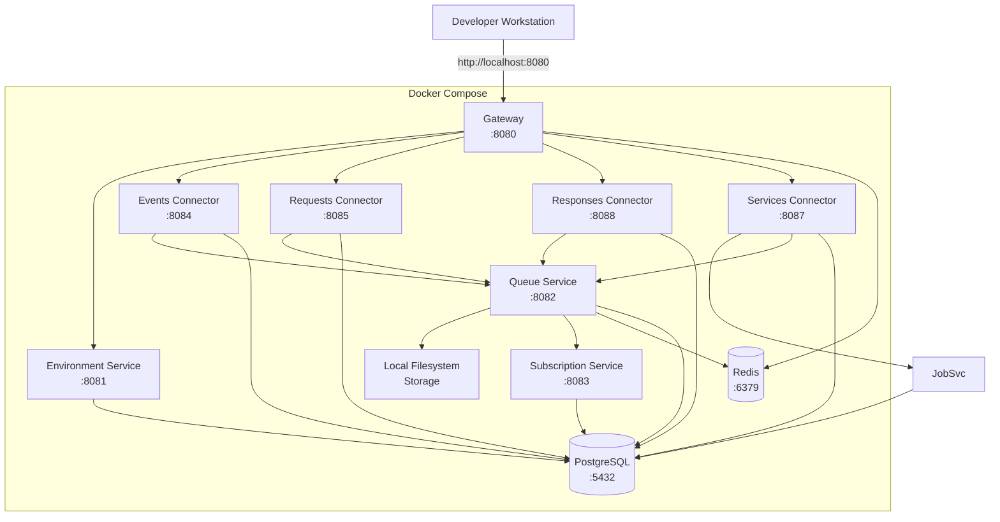

#### Docker Compose Configuration

**File**: `docker-compose.yml` (root directory)

```yaml
version: '3.8'

services:
  postgres:
    image: postgres:14
    environment:
      POSTGRES_DB: sifbroker
      POSTGRES_USER: sifbroker
      POSTGRES_PASSWORD: dev_password
    ports:
      - "5432:5432"
    volumes:
      - postgres_data:/var/lib/postgresql/data
    healthcheck:
      test: ["CMD-SHELL", "pg_isready -U sifbroker"]
      interval: 10s
      timeout: 5s
      retries: 5

  redis:
    image: redis:6
    ports:
      - "6379:6379"
    volumes:
      - redis_data:/data
    healthcheck:
      test: ["CMD", "redis-cli", "ping"]
      interval: 10s
      timeout: 5s
      retries: 5

  gateway:
    build: ./gateway
    ports:
      - "8080:8080"
    environment:
      SPRING_PROFILES_ACTIVE: dev
      SPRING_DATASOURCE_URL: jdbc:postgresql://postgres:5432/sifbroker
      SPRING_REDIS_HOST: redis
      ENVIRONMENT_SERVICE_URL: http://environment-service:8081
    depends_on:
      postgres:
        condition: service_healthy
      redis:
        condition: service_healthy
      environment-service:
        condition: service_started

  environment-service:
    build: ./environment-service
    ports:
      - "8081:8081"
    environment:
      SPRING_PROFILES_ACTIVE: dev
      SPRING_DATASOURCE_URL: jdbc:postgresql://postgres:5432/sifbroker
    depends_on:
      postgres:
        condition: service_healthy

  # Additional services follow same pattern...

volumes:
  postgres_data:
  redis_data:
```

#### Startup Process

**Single Command Startup**:
```bash
docker-compose up
```

**Startup Sequence**:
1. PostgreSQL starts and runs health checks
2. Redis starts and runs health checks
3. Environment Service starts (depends on PostgreSQL)
4. Gateway starts (depends on PostgreSQL, Redis, Environment Service)
5. Queue Service starts (depends on PostgreSQL, Redis)
6. Job Service starts (depends on PostgreSQL)
7. Subscription Service starts (depends on PostgreSQL)
8. All connectors start (depend on PostgreSQL, Queue Service)

**Startup Time**: ~30-45 seconds for all services

**PowerShell Startup Script (`startBrokerCurrentWork.ps1`)**:

For local development outside Docker Compose, the `startBrokerCurrentWork.ps1` script builds all modules (`mvn install`) before starting services. It starts 5 services: Environment Service, Queue Service, Subscription Service, Events Connector, and Gateway.

#### Local Development Features

**1. Hot Reload**
- Spring Boot DevTools enabled in development profile
- Code changes trigger automatic restart (5-10 seconds)
- No need to rebuild Docker images during development

**2. Local Filesystem Storage**
- Queue Service uses local filesystem for message payloads
- Storage directory: `./storage/messages/`
- No AWS S3 credentials needed for local development

**3. Debug Ports**
- Each service exposes debug port for remote debugging
- IntelliJ IDEA and VS Code can attach to running containers
- Breakpoints work across all services

**4. Log Aggregation**
- All service logs visible in single terminal: `docker-compose logs -f`
- Filter by service: `docker-compose logs -f gateway`
- JSON log format disabled in development for readability

**5. Database Access**
- PostgreSQL accessible at `localhost:5432`
- Connect with pgAdmin, DBeaver, or psql
- Flyway migrations run automatically on startup

#### Resource Requirements (Local Development)

| Resource | Minimum | Recommended |
|----------|---------|-------------|
| CPU | 4 cores | 8 cores |
| RAM | 8 GB | 16 GB |
| Disk | 20 GB | 50 GB |
| Docker | 20.10+ | 24.0+ |

**Memory Allocation per Service**:
- PostgreSQL: 512 MB
- Redis: 256 MB
- Gateway: 512 MB (reactive, lower memory)
- Environment Service: 512 MB
- Queue Service: 512 MB
- Job Service: 512 MB
- Subscription Service: 512 MB
- Each Connector: 512 MB

**Total Memory**: ~5 GB for all services

#### Configuration Management

**Development Profile**: `application-dev.yml`

```yaml
spring:
  datasource:
    url: jdbc:postgresql://postgres:5432/sifbroker
    username: sifbroker
    password: dev_password
  redis:
    host: redis
    port: 6379
  jpa:
    show-sql: true  # Show SQL in logs
    hibernate:
      ddl-auto: validate  # Flyway manages schema

storage:
  type: filesystem  # Use local filesystem, not S3
  filesystem:
    base-path: ./storage/messages

logging:
  level:
    org.sifunity.broker: DEBUG  # Verbose logging
    org.springframework.web: INFO
  pattern:
    console: "%d{HH:mm:ss.SSS} [%thread] %-5level %logger{36} - %msg%n"
```

#### Advantages of Docker Compose for Local Development

**1. Simplicity**
- Single command to start entire system
- No Kubernetes complexity
- Easy to understand and debug

**2. Fast Iteration**
- Quick startup (30-45 seconds)
- Hot reload with DevTools
- Immediate feedback on changes

**3. Realistic Environment**
- Same PostgreSQL and Redis as production
- Same service architecture
- Same network communication patterns

**4. Team Consistency**
- All developers use identical environment
- No "works on my machine" issues
- Easy onboarding for new team members

**5. Offline Development**
- No cloud dependencies
- No Kubernetes cluster needed
- Works without internet connection

#### Service-Specific Configuration Notes

**Events Connector Logback**: The events-connector's `logback-spring.xml` includes a `local` profile for console logging, enabling readable log output during local development.

**Environment Service Auth Filter**: Zone/context listing paths (`*/zones/*/contexts*`) are exempt from authentication in the environment-service's `AuthorizationFilter`. This allows internal service-to-service calls (e.g., events-connector resolving context UUIDs) without auth headers.

**Queue Service**: `EnqueueMessageRequest` accepts both legacy field names and `SifMessageEnvelope` field names via `@JsonAlias` for backward compatibility. `spring.web.resources.add-mappings: false` is set to prevent static resource handler interference. The responses-connector's `GlobalExceptionHandler` includes a `MissingRequestHeaderException` handler.

### Staging Deployment

#### Overview

Staging provides a pre-production environment for testing before production deployment. It mirrors production configuration but with reduced scale and relaxed resource limits.

#### Deployment Options

**Option 1: Docker Compose (Simpler)**
- Same Docker Compose setup as local development
- Different configuration (staging profile)
- Deployed on single VM or bare metal server
- Suitable for small-scale staging

**Option 2: Kubernetes (Production-Like)**
- Lightweight Kubernetes cluster (k3s, minikube, or managed cluster)
- Same Kubernetes manifests as production
- Reduced replica counts and resource limits
- Suitable for realistic production testing

#### Staging Architecture (Kubernetes)

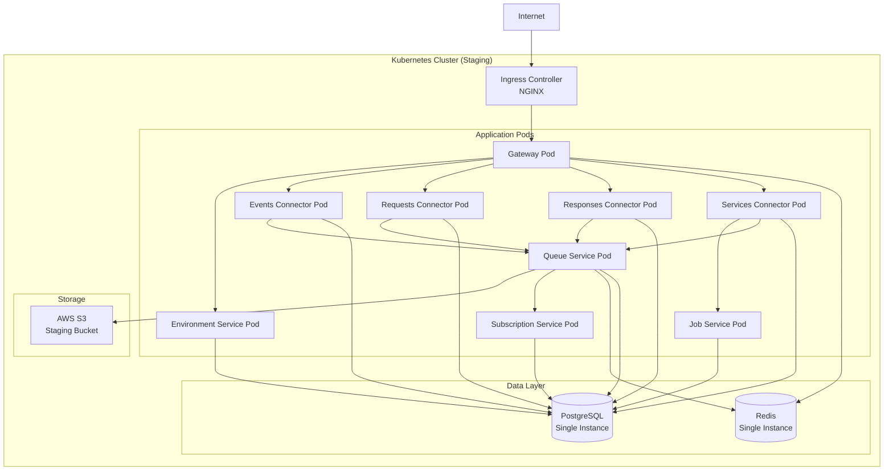

#### Staging Configuration

**Staging Profile**: `application-staging.yml`

```yaml
spring:
  datasource:
    url: jdbc:postgresql://postgres-staging.example.com:5432/sifbroker
    username: ${DB_USERNAME}  # From Kubernetes Secret
    password: ${DB_PASSWORD}  # From Kubernetes Secret
  redis:
    host: redis-staging.example.com
    port: 6379
  jpa:
    show-sql: false  # Disable SQL logging
    hibernate:
      ddl-auto: validate

storage:
  type: s3  # Use AWS S3
  s3:
    bucket: sif-broker-staging-messages
    region: us-east-1

logging:
  level:
    org.sifunity.broker: INFO
    org.springframework.web: WARN
  pattern:
    console: "%d{ISO8601} [%thread] %-5level %logger{36} - %msg%n"
```

#### Resource Allocation (Staging)

**Single Replica per Service** (no high availability):

| Service | CPU Request | CPU Limit | Memory Request | Memory Limit |
|---------|-------------|-----------|----------------|--------------|
| Gateway | 250m | 500m | 512 Mi | 1 Gi |
| Environment Service | 100m | 250m | 512 Mi | 1 Gi |
| Queue Service | 250m | 500m | 512 Mi | 1 Gi |
| Job Service | 100m | 250m | 512 Mi | 1 Gi |
| Subscription Service | 100m | 250m | 512 Mi | 1 Gi |
| Events Connector | 100m | 250m | 512 Mi | 1 Gi |
| Requests Connector | 100m | 250m | 512 Mi | 1 Gi |
| Responses Connector | 100m | 250m | 512 Mi | 1 Gi |
| Services Connector | 100m | 250m | 512 Mi | 1 Gi |

**Total Cluster Resources**: ~1.5 CPU cores, ~5 GB RAM

**Database and Redis**:
- PostgreSQL: Single instance, 2 CPU, 4 GB RAM
- Redis: Single instance, 1 CPU, 2 GB RAM

#### Staging Characteristics

**1. Production-Like Configuration**
- Same Kubernetes manifests as production
- Same Docker images as production
- Same database schema (Flyway migrations)
- Same authentication and authorization

**2. Reduced Scale**
- Single replica per service (no HA)
- Smaller resource limits
- Single database instance (no replication)
- Single Redis instance (no Sentinel)

**3. Testing Focus**
- Integration testing across services
- End-to-end workflow testing
- Performance testing under load
- Security testing (penetration testing)
- Deployment process validation

**4. Data Isolation**
- Separate database from production
- Separate S3 bucket from production
- Separate Redis instance from production
- Test data only (no real student data)

### Production Deployment

#### Overview

Production deployment uses **Kubernetes** for enterprise-grade orchestration, high availability, and automatic scaling. The architecture is designed for 99.9% uptime with automatic failover and self-healing capabilities.

#### Production Architecture

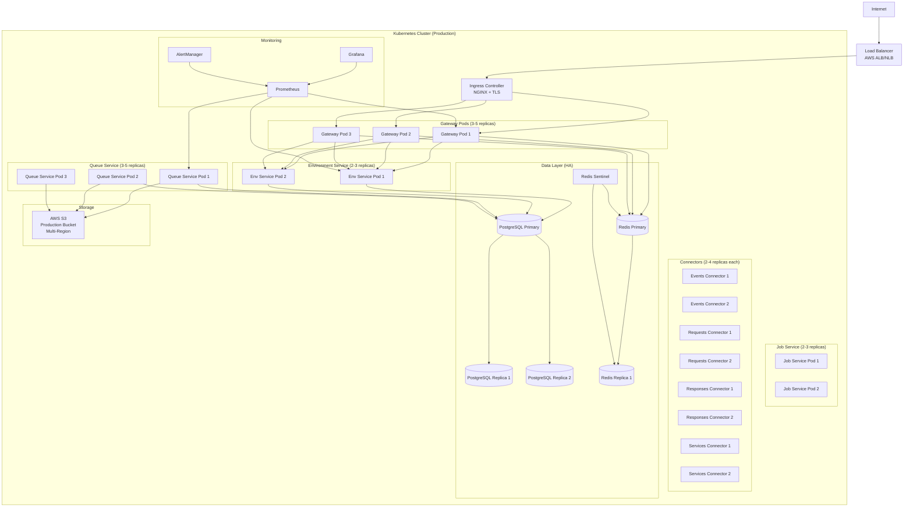

#### Kubernetes Deployment Manifests

Each service has Kubernetes manifests in `<service>/k8s/` directory:

**1. Deployment** (`deployment.yaml`)

```yaml
apiVersion: apps/v1
kind: Deployment
metadata:
  name: gateway
  namespace: sif-broker
spec:
  replicas: 3
  selector:
    matchLabels:
      app: gateway
  template:
    metadata:
      labels:
        app: gateway
        version: v1.0.0
    spec:
      containers:
      - name: gateway
        image: sif-broker/gateway:1.0.0
        ports:
        - containerPort: 8080
          name: http
        env:
        - name: SPRING_PROFILES_ACTIVE
          value: "prod"
        - name: SPRING_DATASOURCE_URL
          valueFrom:
            configMapKeyRef:
              name: database-config
              key: url
        - name: SPRING_DATASOURCE_USERNAME
          valueFrom:
            secretKeyRef:
              name: database-credentials
              key: username
        - name: SPRING_DATASOURCE_PASSWORD
          valueFrom:
            secretKeyRef:
              name: database-credentials
              key: password
        resources:
          requests:
            cpu: 500m
            memory: 1Gi
          limits:
            cpu: 1000m
            memory: 2Gi
        livenessProbe:
          httpGet:
            path: /actuator/health/liveness
            port: 8080
          initialDelaySeconds: 60
          periodSeconds: 10
          timeoutSeconds: 5
          failureThreshold: 3
        readinessProbe:
          httpGet:
            path: /actuator/health/readiness
            port: 8080
          initialDelaySeconds: 30
          periodSeconds: 5
          timeoutSeconds: 3
          failureThreshold: 3
```

**2. Service** (`service.yaml`)

```yaml
apiVersion: v1
kind: Service
metadata:
  name: gateway
  namespace: sif-broker
spec:
  selector:
    app: gateway
  ports:
  - name: http
    port: 8080
    targetPort: 8080
  type: ClusterIP
```

**3. ConfigMap** (`configmap.yaml`)

```yaml
apiVersion: v1
kind: ConfigMap
metadata:
  name: gateway-config
  namespace: sif-broker
data:
  application.yml: |
    spring:
      redis:
        host: redis-primary
        port: 6379
    environment-service:
      url: http://environment-service:8081
```

**4. Horizontal Pod Autoscaler** (`hpa.yaml`)

```yaml
apiVersion: autoscaling/v2
kind: HorizontalPodAutoscaler
metadata:
  name: gateway-hpa
  namespace: sif-broker
spec:
  scaleTargetRef:
    apiVersion: apps/v1
    kind: Deployment
    name: gateway
  minReplicas: 3
  maxReplicas: 10
  metrics:
  - type: Resource
    resource:
      name: cpu
      target:
        type: Utilization
        averageUtilization: 70
  - type: Resource
    resource:
      name: memory
      target:
        type: Utilization
        averageUtilization: 80
  behavior:
    scaleUp:
      stabilizationWindowSeconds: 60
      policies:
      - type: Percent
        value: 50
        periodSeconds: 60
    scaleDown:
      stabilizationWindowSeconds: 300
      policies:
      - type: Percent
        value: 25
        periodSeconds: 60
```

#### Production Resource Allocation

**Application Pods** (per replica):

| Service | Replicas | CPU Request | CPU Limit | Memory Request | Memory Limit |
|---------|----------|-------------|-----------|----------------|--------------|
| Gateway | 3-10 | 500m | 1000m | 1 Gi | 2 Gi |
| Environment Service | 2-5 | 250m | 500m | 1 Gi | 2 Gi |
| Queue Service | 3-10 | 500m | 1000m | 1 Gi | 2 Gi |
| Job Service | 2-5 | 250m | 500m | 1 Gi | 2 Gi |
| Subscription Service | 2-5 | 250m | 500m | 1 Gi | 2 Gi |
| Events Connector | 2-8 | 250m | 500m | 1 Gi | 2 Gi |
| Requests Connector | 2-8 | 250m | 500m | 1 Gi | 2 Gi |
| Responses Connector | 2-8 | 250m | 500m | 1 Gi | 2 Gi |
| Services Connector | 2-6 | 250m | 500m | 1 Gi | 2 Gi |

**Minimum Cluster Resources** (baseline):
- **CPU**: 10-15 cores
- **Memory**: 30-40 GB
- **Nodes**: 3-5 worker nodes (for high availability)

**Maximum Cluster Resources** (peak load with autoscaling):
- **CPU**: 40-50 cores
- **Memory**: 100-120 GB
- **Nodes**: 10-15 worker nodes

**Database Resources**:
- **PostgreSQL Primary**: 8 CPU, 32 GB RAM, 500 GB SSD
- **PostgreSQL Replicas**: 4 CPU, 16 GB RAM, 500 GB SSD (2 replicas)
- **Connection Pool**: 100 connections per service instance

**Redis Resources**:
- **Redis Primary**: 4 CPU, 16 GB RAM
- **Redis Replica**: 2 CPU, 8 GB RAM
- **Redis Sentinel**: 1 CPU, 2 GB RAM (3 instances for quorum)

#### Production Configuration

**Production Profile**: `application-prod.yml`

```yaml
spring:
  datasource:
    url: ${DB_URL}  # From Kubernetes Secret
    username: ${DB_USERNAME}
    password: ${DB_PASSWORD}
    hikari:
      maximum-pool-size: 20
      minimum-idle: 5
      connection-timeout: 30000
      idle-timeout: 600000
      max-lifetime: 1800000
  redis:
    host: ${REDIS_HOST}
    port: 6379
    password: ${REDIS_PASSWORD}
    lettuce:
      pool:
        max-active: 20
        max-idle: 10
        min-idle: 5
  jpa:
    show-sql: false
    hibernate:
      ddl-auto: validate
    properties:
      hibernate:
        jdbc:
          batch_size: 20
        order_inserts: true
        order_updates: true

storage:
  type: s3
  s3:
    bucket: ${S3_BUCKET}
    region: ${AWS_REGION}
    access-key: ${AWS_ACCESS_KEY}
    secret-key: ${AWS_SECRET_KEY}

logging:
  level:
    org.sifunity.broker: INFO
    org.springframework: WARN
  pattern:
    console: '{"timestamp":"%d{ISO8601}","level":"%level","thread":"%thread","logger":"%logger{36}","message":"%msg"}%n'

management:
  endpoints:
    web:
      exposure:
        include: health,metrics,prometheus
  metrics:
    export:
      prometheus:
        enabled: true
```

### Scalability Strategies

#### Horizontal Scaling

**Stateless Services** (scale freely):
- Gateway
- Environment Service
- Queue Service
- Job Service
- Subscription Service
- All Connectors

**Scaling Triggers**:

| Service | Primary Metric | Scale Up Threshold | Scale Down Threshold |
|---------|---------------|-------------------|---------------------|
| Gateway | CPU Utilization | >70% | <30% |
| Queue Service | Message Throughput | >500 msg/sec | <100 msg/sec |
| Connectors | Request Rate | >200 req/sec | <50 req/sec |
| Environment Service | Request Rate | >100 req/sec | <20 req/sec |
| Job Service | Request Rate | >50 req/sec | <10 req/sec |

**Autoscaling Configuration**:
- **Scale Up**: Add 50% more pods when threshold exceeded for 60 seconds
- **Scale Down**: Remove 25% of pods when below threshold for 5 minutes
- **Cooldown**: 60 seconds between scale-up events, 300 seconds between scale-down events
- **Min Replicas**: 2-3 (high availability)
- **Max Replicas**: 5-10 (resource management)

#### Vertical Scaling

**When to Use**:
- Database performance bottlenecks (increase CPU/RAM)
- Redis memory pressure (increase RAM)
- Individual pod CPU/memory limits reached consistently

**Database Scaling**:
- **Read Replicas**: Add PostgreSQL read replicas for read-heavy workloads
- **Connection Pooling**: Increase HikariCP pool size before scaling database
- **Query Optimization**: Analyze slow queries with `pg_stat_statements` before scaling

**Redis Scaling**:
- **Memory Increase**: Scale Redis vertically for larger cache
- **Redis Cluster**: Horizontal scaling for >100GB cache (future)
- **Eviction Policy**: Configure `allkeys-lru` for automatic eviction

#### Load Balancing

**Kubernetes Service Load Balancing**:
- **Algorithm**: Round-robin by default
- **Session Affinity**: None (stateless services)
- **Health Checks**: Only route to healthy pods
- **Connection Draining**: 30-second grace period during pod termination

**External Load Balancer**:
- **AWS ALB/NLB**: Distributes traffic across Kubernetes nodes
- **TLS Termination**: Load balancer handles HTTPS, internal traffic HTTP
- **Health Checks**: ALB checks Ingress Controller health
- **Cross-Zone**: Distribute traffic across availability zones

### High Availability Strategies

#### Multi-Zone Deployment

**Kubernetes Node Distribution**:
- Deploy worker nodes across 3 availability zones (AZs)
- Ensure pod replicas distributed across zones
- Use pod anti-affinity rules to prevent co-location

**Pod Anti-Affinity Configuration**:
```yaml
affinity:
  podAntiAffinity:
    preferredDuringSchedulingIgnoredDuringExecution:
    - weight: 100
      podAffinityTerm:
        labelSelector:
          matchExpressions:
          - key: app
            operator: In
            values:
            - gateway
        topologyKey: topology.kubernetes.io/zone
```

**Benefits**:
- Survive entire availability zone failure
- Maintain service availability during zone outage
- Automatic traffic rerouting to healthy zones

#### Database High Availability

**PostgreSQL Replication**:
- **Primary-Replica Architecture**: 1 primary + 2 replicas
- **Streaming Replication**: Asynchronous replication for read replicas
- **Automatic Failover**: Patroni or similar for automatic primary promotion
- **Read-Write Split**: Write to primary, read from replicas (future optimization)

**Backup Strategy**:
- **Continuous Archiving**: WAL (Write-Ahead Log) archiving to S3
- **Daily Snapshots**: Full database backup daily at 2 AM UTC
- **Point-in-Time Recovery**: Restore to any point in last 30 days
- **Backup Retention**: 30 days for daily backups, 90 days for monthly backups

**Recovery Time Objective (RTO)**: <5 minutes
**Recovery Point Objective (RPO)**: <1 minute (WAL archiving)

#### Redis High Availability

**Redis Sentinel Configuration**:
- **Topology**: 1 primary + 1 replica + 3 Sentinel instances
- **Automatic Failover**: Sentinel promotes replica to primary on failure
- **Quorum**: 2 Sentinels must agree for failover (majority)
- **Failover Time**: <30 seconds

**Redis Persistence**:
- **RDB Snapshots**: Every 5 minutes if >100 keys changed
- **AOF (Append-Only File)**: Enabled with `everysec` fsync policy
- **Hybrid Persistence**: RDB for fast restarts, AOF for durability

**Data Loss Tolerance**: <1 second (AOF with everysec)

#### Service Resilience Patterns

**1. Health Checks**

All services implement Spring Boot Actuator health checks:

**Liveness Probe**: Determines if pod should be restarted
- Endpoint: `/actuator/health/liveness`
- Checks: Application is running (not deadlocked)
- Failure Action: Kubernetes restarts pod

**Readiness Probe**: Determines if pod should receive traffic
- Endpoint: `/actuator/health/readiness`
- Checks: Database connectivity, Redis connectivity, dependencies healthy
- Failure Action: Kubernetes removes pod from service load balancer

**Health Check Configuration**:
```yaml
livenessProbe:
  httpGet:
    path: /actuator/health/liveness
    port: 8080
  initialDelaySeconds: 60  # Wait for startup
  periodSeconds: 10        # Check every 10 seconds
  timeoutSeconds: 5        # 5-second timeout
  failureThreshold: 3      # Restart after 3 failures

readinessProbe:
  httpGet:
    path: /actuator/health/readiness
    port: 8080
  initialDelaySeconds: 30  # Wait for dependencies
  periodSeconds: 5         # Check every 5 seconds
  timeoutSeconds: 3        # 3-second timeout
  failureThreshold: 3      # Remove from LB after 3 failures
```

**2. Circuit Breakers**

Resilience4j circuit breakers protect against cascading failures:

**Configuration**:
```yaml
resilience4j:
  circuitbreaker:
    instances:
      environmentService:
        slidingWindowSize: 100
        failureRateThreshold: 50
        waitDurationInOpenState: 10s
        permittedNumberOfCallsInHalfOpenState: 10
        automaticTransitionFromOpenToHalfOpenEnabled: true
```

**States**:
- **Closed**: Normal operation, requests pass through
- **Open**: Too many failures, requests fail immediately
- **Half-Open**: Testing if service recovered, limited requests allowed

**3. Graceful Shutdown**

Kubernetes sends SIGTERM before killing pods:

**Shutdown Sequence**:
1. Kubernetes sends SIGTERM to pod
2. Pod stops accepting new requests (readiness probe fails)
3. Pod finishes processing in-flight requests (30-second grace period)
4. Pod shuts down cleanly
5. Kubernetes sends SIGKILL if not terminated after grace period

**Configuration**:
```yaml
spec:
  terminationGracePeriodSeconds: 30
```

**4. Rolling Updates**

Zero-downtime deployments with rolling updates:

**Update Strategy**:
```yaml
strategy:
  type: RollingUpdate
  rollingUpdate:
    maxUnavailable: 1      # Max 1 pod down during update
    maxSurge: 1            # Max 1 extra pod during update
```

**Update Process**:
1. Create new pod with updated image
2. Wait for new pod to pass readiness probe
3. Terminate old pod (graceful shutdown)
4. Repeat for remaining pods

**Rollback**: Instant rollback to previous version if update fails
```bash
kubectl rollout undo deployment/gateway -n sif-broker
```

### Deployment Best Practices

#### 1. Configuration Management

**Externalized Configuration**:
- **ConfigMaps**: Non-sensitive configuration (URLs, feature flags)
- **Secrets**: Sensitive data (database passwords, API keys)
- **Environment Variables**: Injected from ConfigMaps and Secrets

**Configuration Hierarchy**:
1. Default configuration in `application.yml` (baked into image)
2. Profile-specific configuration in `application-{profile}.yml`
3. ConfigMap overrides (Kubernetes-specific)
4. Environment variable overrides (highest priority)

**Example**:
```yaml
# ConfigMap
apiVersion: v1
kind: ConfigMap
metadata:
  name: database-config
data:
  url: "jdbc:postgresql://postgres-primary:5432/sifbroker"
  pool-size: "20"

---
# Secret
apiVersion: v1
kind: Secret
metadata:
  name: database-credentials
type: Opaque
data:
  username: c2lmYnJva2Vy  # base64 encoded
  password: cHJvZF9wYXNzd29yZA==  # base64 encoded
```

**Secret Management**:
- **Development**: Plain environment variables in docker-compose.yml
- **Staging/Production**: Kubernetes Secrets or external secrets manager
- **Rotation**: Automated secret rotation with HashiCorp Vault or AWS Secrets Manager
- **Encryption**: Secrets encrypted at rest in etcd (Kubernetes)

#### 2. Image Management

**Image Naming Convention**:
```
<registry>/<organization>/<service>:<version>
sif-broker-registry.example.com/sif-broker/gateway:1.2.3
```

**Image Tagging Strategy**:
- **Semantic Versioning**: `1.2.3` for releases
- **Git SHA**: `git-abc123f` for commit-specific builds
- **Environment Tags**: `latest-staging`, `latest-prod`
- **Never use `latest` in production**: Always pin specific versions

**Multi-Stage Docker Build**:
```dockerfile
# Stage 1: Build
FROM maven:3.9-eclipse-temurin-17 AS build
WORKDIR /app
COPY pom.xml .
COPY src ./src
RUN mvn clean package -DskipTests

# Stage 2: Runtime
FROM eclipse-temurin:17-jre
WORKDIR /app
COPY --from=build /app/target/*.jar app.jar
EXPOSE 8080
ENTRYPOINT ["java", "-jar", "app.jar"]
```

**Image Optimization**:
- Use multi-stage builds to minimize image size
- Use JRE instead of JDK (smaller footprint)
- Layer caching: Copy dependencies before source code
- Security scanning: Scan images for vulnerabilities before deployment

#### 3. Resource Management

**Resource Requests vs Limits**:
- **Requests**: Guaranteed resources (used for scheduling)
- **Limits**: Maximum resources (prevents resource exhaustion)

**Best Practices**:
- Set requests = 50-70% of typical usage
- Set limits = 150-200% of typical usage
- Monitor actual usage and adjust
- Use Vertical Pod Autoscaler (VPA) for recommendations

**Quality of Service (QoS) Classes**:
- **Guaranteed**: requests = limits (critical services)
- **Burstable**: requests < limits (most services)
- **BestEffort**: no requests/limits (non-critical)

**Example**:
```yaml
resources:
  requests:
    cpu: 500m      # 0.5 CPU cores
    memory: 1Gi    # 1 GB RAM
  limits:
    cpu: 1000m     # 1 CPU core
    memory: 2Gi    # 2 GB RAM
```

#### 4. Monitoring and Observability

**Metrics Collection**:
- **Prometheus**: Scrapes `/actuator/prometheus` endpoint from all pods
- **Metrics Exported**: JVM metrics, HTTP metrics, custom business metrics
- **Scrape Interval**: 15 seconds
- **Retention**: 15 days in Prometheus, long-term in Thanos/Cortex

**Key Metrics to Monitor**:

| Metric | Alert Threshold | Action |
|--------|----------------|--------|
| Pod CPU Usage | >80% for 5 min | Scale up or investigate |
| Pod Memory Usage | >85% for 5 min | Scale up or check for leaks |
| HTTP Error Rate | >1% for 2 min | Investigate errors |
| HTTP Response Time (p95) | >500ms for 5 min | Investigate performance |
| Database Connection Pool | >90% utilized | Increase pool size |
| Redis Memory Usage | >80% | Scale Redis or adjust eviction |
| Pod Restart Count | >3 in 10 min | Investigate crash cause |

**Logging**:
- **Format**: JSON in production for structured logging
- **Aggregation**: Fluentd/Fluent Bit ? Elasticsearch ? Kibana (ELK stack)
- **Log Levels**: INFO in production, DEBUG in development
- **Retention**: 30 days in Elasticsearch, 90 days in S3 archive

**Distributed Tracing** (Future):
- **Spring Cloud Sleuth**: Automatic trace ID injection
- **Zipkin/Jaeger**: Trace visualization
- **Correlation IDs**: Track requests across services

**Dashboards**:
- **System Overview**: Cluster health, pod status, resource usage
- **Service Dashboards**: Per-service metrics (Gateway, Queue Service, etc.)
- **Business Metrics**: Message throughput, authentication rate, error rates
- **Database Dashboard**: Query performance, connection pool, replication lag

#### 5. Security Hardening

**Network Policies**:
```yaml
apiVersion: networking.k8s.io/v1
kind: NetworkPolicy
metadata:
  name: gateway-network-policy
spec:
  podSelector:
    matchLabels:
      app: gateway
  policyTypes:
  - Ingress
  - Egress
  ingress:
  - from:
    - podSelector:
        matchLabels:
          app: ingress-controller
    ports:
    - protocol: TCP
      port: 8080
  egress:
  - to:
    - podSelector:
        matchLabels:
          app: environment-service
    ports:
    - protocol: TCP
      port: 8081
```

**Pod Security Standards**:
- **Restricted**: Most secure, recommended for all services
- **Non-root user**: Run containers as non-root (UID 1000)
- **Read-only root filesystem**: Prevent container modification
- **Drop capabilities**: Remove unnecessary Linux capabilities

**Security Context**:
```yaml
securityContext:
  runAsNonRoot: true
  runAsUser: 1000
  readOnlyRootFilesystem: true
  allowPrivilegeEscalation: false
  capabilities:
    drop:
    - ALL
```

**TLS/HTTPS**:
- **Ingress TLS**: Terminate TLS at Ingress Controller
- **Certificate Management**: cert-manager for automatic certificate renewal
- **Internal Traffic**: HTTP within cluster (mTLS future enhancement)

#### 6. Disaster Recovery

**Backup Strategy**:
- **Database**: Daily full backup + continuous WAL archiving
- **Redis**: RDB snapshots every 5 minutes
- **Configuration**: All Kubernetes manifests in Git (Infrastructure as Code)
- **Secrets**: Backed up in HashiCorp Vault or AWS Secrets Manager

**Recovery Procedures**:

**Scenario 1: Single Pod Failure**
- **Detection**: Health check failure
- **Action**: Kubernetes automatically restarts pod
- **RTO**: <1 minute
- **Impact**: None (other replicas handle traffic)

**Scenario 2: Service Degradation**
- **Detection**: High error rate or latency
- **Action**: Scale up pods, investigate root cause
- **RTO**: <5 minutes
- **Impact**: Reduced performance, no data loss

**Scenario 3: Database Failure**
- **Detection**: Database health check failure
- **Action**: Automatic failover to replica (Patroni)
- **RTO**: <5 minutes
- **Impact**: Brief connection errors, automatic retry

**Scenario 4: Complete Cluster Failure**
- **Detection**: All nodes unreachable
- **Action**: Restore cluster from IaC, restore database from backup
- **RTO**: <30 minutes
- **Impact**: Service outage, potential data loss (up to RPO)

**Scenario 5: Data Corruption**
- **Detection**: Application errors, data inconsistencies
- **Action**: Point-in-time recovery from WAL archive
- **RTO**: <1 hour
- **Impact**: Service outage during recovery, data loss up to corruption point

### Deployment Comparison

| Aspect | Local Development | Staging | Production |
|--------|------------------|---------|------------|
| **Orchestration** | Docker Compose | Docker Compose or Kubernetes | Kubernetes |
| **Replicas per Service** | 1 | 1 | 2-10 (autoscaling) |
| **Database** | PostgreSQL single instance | PostgreSQL single instance | PostgreSQL primary + 2 replicas |
| **Redis** | Redis single instance | Redis single instance | Redis primary + replica + Sentinel |
| **Storage Backend** | Local filesystem | AWS S3 (staging bucket) | AWS S3 (production bucket) |
| **TLS/HTTPS** | HTTP only | HTTPS (self-signed cert) | HTTPS (valid cert) |
| **Resource Limits** | None | Moderate | Strict |
| **High Availability** | No | No | Yes (multi-zone) |
| **Monitoring** | Logs only | Basic metrics | Full observability stack |
| **Backup** | None | Daily database backup | Continuous WAL + daily backup |
| **Startup Time** | 30-45 seconds | 1-2 minutes | 2-3 minutes |
| **Suitable For** | Development, testing | Pre-production testing | Production workloads |

### Deployment Workflow

#### CI/CD Pipeline

**Pipeline Stages**:

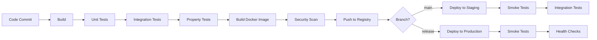

**Stage Details**:

1. **Build** (2-3 minutes)
   - Maven clean install
   - Compile all modules
   - Package JARs

2. **Unit Tests** (3-5 minutes)
   - JUnit 5 tests
   - Mockito-based tests
   - Fast, isolated tests

3. **Integration Tests** (5-10 minutes)
   - Testcontainers with PostgreSQL
   - Spring Boot Test with full context
   - Database interaction tests

4. **Property Tests** (10-15 minutes)
   - jqwik property-based tests
   - 1000+ generated test cases per property
   - Shrinking for minimal failing examples

5. **Build Docker Image** (2-3 minutes)
   - Multi-stage Docker build
   - Layer caching for speed
   - Tag with version and git SHA

6. **Security Scan** (2-3 minutes)
   - Trivy or Snyk image scanning
   - Check for CVEs in dependencies
   - Fail build on critical vulnerabilities

7. **Push to Registry** (1-2 minutes)
   - Push to container registry
   - Tag with version, git SHA, environment

8. **Deploy to Staging** (3-5 minutes)
   - Update Kubernetes deployment
   - Rolling update strategy
   - Wait for readiness probes

9. **Smoke Tests** (2-3 minutes)
   - Basic API health checks
   - Authentication flow test
   - Database connectivity test

10. **Deploy to Production** (5-10 minutes)
    - Manual approval required
    - Blue-green or canary deployment
    - Gradual rollout with monitoring

**Total Pipeline Time**: 30-60 minutes (commit to production)

#### Deployment Commands

**Local Development**:
```bash
# Start all services
docker-compose up

# Start specific service
docker-compose up gateway

# Rebuild and start
docker-compose up --build

# View logs
docker-compose logs -f gateway

# Stop all services
docker-compose down

# Clean up volumes
docker-compose down -v
```

**Staging/Production (Kubernetes)**:
```bash
# Apply all manifests
kubectl apply -f gateway/k8s/

# Update deployment with new image
kubectl set image deployment/gateway \
  gateway=sif-broker/gateway:1.2.3 \
  -n sif-broker

# Check rollout status
kubectl rollout status deployment/gateway -n sif-broker

# View pod logs
kubectl logs -f deployment/gateway -n sif-broker

# Scale deployment
kubectl scale deployment/gateway --replicas=5 -n sif-broker

# Rollback deployment
kubectl rollout undo deployment/gateway -n sif-broker

# Port forward for debugging
kubectl port-forward deployment/gateway 8080:8080 -n sif-broker
```

### Performance Benchmarks

#### Expected Performance (Production)

**API Response Times** (p95):
- Authentication: <50ms
- Environment CRUD: <100ms
- Message enqueueing: <150ms
- Message dequeueing: <100ms
- Event publishing: <200ms

**Throughput**:
- Gateway: 1000-2000 requests/second
- Queue Service: 500-1000 messages/second
- Database: 5000-10000 queries/second
- Redis: 50000-100000 operations/second

**Resource Utilization** (typical):
- CPU: 30-50% average, 70% peak
- Memory: 50-70% average, 85% peak
- Database connections: 40-60% of pool
- Redis memory: 40-60% of allocated

**Scalability Limits**:
- **Horizontal**: 10-20 pods per service before diminishing returns
- **Vertical**: 4 CPU, 8 GB RAM per pod optimal
- **Database**: 100-200 connections per service type
- **Redis**: 16 GB memory supports ~10M cached entries

### Deployment Checklist

#### Pre-Deployment

- [ ] All tests passing (unit, integration, property)
- [ ] Code review completed and approved
- [ ] Security scan passed (no critical vulnerabilities)
- [ ] Database migrations tested
- [ ] Configuration reviewed (staging/production)
- [ ] Secrets rotated (if needed)
- [ ] Backup verified (database, Redis)
- [ ] Rollback plan documented
- [ ] Stakeholders notified (maintenance window)

#### Deployment

- [ ] Deploy to staging first
- [ ] Run smoke tests in staging
- [ ] Monitor staging for 24 hours
- [ ] Get approval for production deployment
- [ ] Deploy to production (rolling update)
- [ ] Monitor health checks during rollout
- [ ] Verify all pods healthy
- [ ] Run smoke tests in production
- [ ] Monitor metrics for anomalies

#### Post-Deployment

- [ ] Verify all services responding
- [ ] Check error rates and latency
- [ ] Review logs for errors
- [ ] Verify database connectivity
- [ ] Verify Redis connectivity
- [ ] Test authentication flow
- [ ] Test message enqueueing/dequeueing
- [ ] Monitor for 1 hour post-deployment
- [ ] Document any issues encountered
- [ ] Update runbooks if needed

### Troubleshooting Common Deployment Issues

#### Issue: Pod CrashLoopBackOff

**Symptoms**: Pod repeatedly crashes and restarts

**Causes**:
- Application startup failure
- Database connection failure
- Missing environment variables
- Resource limits too low

**Diagnosis**:
```bash
kubectl describe pod <pod-name> -n sif-broker
kubectl logs <pod-name> -n sif-broker --previous
```

**Solutions**:
- Check application logs for startup errors
- Verify database connectivity
- Verify all required environment variables set
- Increase resource limits if OOMKilled

#### Issue: Pod Not Ready

**Symptoms**: Pod running but not receiving traffic

**Causes**:
- Readiness probe failing
- Database not accessible
- Redis not accessible
- Slow startup

**Diagnosis**:
```bash
kubectl describe pod <pod-name> -n sif-broker
kubectl logs <pod-name> -n sif-broker
curl http://<pod-ip>:8080/actuator/health/readiness
```

**Solutions**:
- Check readiness probe endpoint
- Verify database and Redis connectivity
- Increase initialDelaySeconds if slow startup
- Check for application errors in logs

#### Issue: High Memory Usage

**Symptoms**: Pods using >80% memory, OOMKilled

**Causes**:
- Memory leak
- Insufficient memory limits
- Large object caching
- Connection pool too large

**Diagnosis**:
```bash
kubectl top pod <pod-name> -n sif-broker
# Heap dump analysis with JVM tools
```

**Solutions**:
- Increase memory limits
- Analyze heap dump for leaks
- Reduce cache size
- Reduce connection pool size
- Enable JVM memory tuning flags

#### Issue: Database Connection Pool Exhausted

**Symptoms**: "Connection pool exhausted" errors

**Causes**:
- Too many concurrent requests
- Connection leaks
- Pool size too small
- Long-running queries

**Diagnosis**:
```bash
# Check pool metrics in Prometheus
# Check database active connections
SELECT count(*) FROM pg_stat_activity WHERE state = 'active';
```

**Solutions**:
- Increase HikariCP pool size
- Check for connection leaks (enable leak detection)
- Optimize slow queries
- Scale up service replicas

## References

### Related Architecture Documents

This System Architecture document provides a high-level overview of the OSDB. For detailed information on specific architectural domains, refer to these companion documents:

- **[API Architecture](API-ARCHITECTURE.md)**: RESTful API design principles, authentication flows (HMAC-SHA256), authorization model (ACLs), error handling standards, rate limiting strategy, and SIF 3.7 compliance mapping
- **[Data Architecture](DATA-ARCHITECTURE.md)**: Database schema, entity relationships, multi-tenancy data isolation, migration strategy (Flyway), caching strategy (Redis), and data management policies
- **[Security Architecture](SECURITY-ARCHITECTURE.md)**: Authentication mechanisms, authorization model, secrets management, API security, audit logging, and threat model
- **[Testing Architecture](TESTING-ARCHITECTURE.md)**: Testing pyramid, property-based testing with jqwik, integration testing patterns (TestContainers), API testing (Bruno), performance testing, and continuous integration testing

### Project Documentation

- **[Project Roadmap](../../PROJECT-ROADMAP.md)**: Implementation phases, milestones, and deliverables
- **[API Authentication Guide](../../API-AUTHENTICATION-GUIDE.md)**: HMAC-SHA256 authentication implementation guide for integrators
- **[Build Commands](../../BUILD-COMMANDS.md)**: Maven build commands and development workflow

### Steering Files

- **[Technology Stack](../../.kiro/steering/tech.md)**: Detailed technology decisions and rationale
- **[Project Structure](../../.kiro/steering/structure.md)**: Repository organization and naming conventions
- **[Product Overview](../../.kiro/steering/product.md)**: Product goals, target users, and key features

### External Documentation

- **[SIF 3.7 Specification](../../external_docs/)**: Official SIF 3.7 specification documents
- **[SIF Infrastructure Specification](../../external_docs/SIF_3-3_Infrastructure_3-3.pdf)**: SIF 3.3 infrastructure specification (reference)
- **[SIF Functional Services](../../external_docs/FunctionalServices_3-3.pdf)**: SIF 3.3 functional services specification

### Technology References

#### Core Technologies

- **Java 17 Documentation**: https://docs.oracle.com/en/java/javase/17/
- **Spring Boot 3.x Documentation**: https://docs.spring.io/spring-boot/docs/current/reference/html/
- **Spring Cloud Gateway**: https://docs.spring.io/spring-cloud-gateway/docs/current/reference/html/
- **Spring Data JPA**: https://docs.spring.io/spring-data/jpa/docs/current/reference/html/
- **PostgreSQL 14 Documentation**: https://www.postgresql.org/docs/14/
- **Redis Documentation**: https://redis.io/docs/

#### Testing Frameworks

- **jqwik User Guide**: https://jqwik.net/docs/current/user-guide.html
- **JUnit 5 User Guide**: https://junit.org/junit5/docs/current/user-guide/
- **Testcontainers**: https://www.testcontainers.org/
- **Bruno API Testing**: https://www.usebruno.com/

#### Infrastructure and Deployment

- **Docker Documentation**: https://docs.docker.com/
- **Kubernetes Documentation**: https://kubernetes.io/docs/
- **Helm Charts**: https://helm.sh/docs/
- **Flyway Migrations**: https://flywaydb.org/documentation/

#### Observability

- **Spring Boot Actuator**: https://docs.spring.io/spring-boot/docs/current/reference/html/actuator.html
- **Micrometer Metrics**: https://micrometer.io/docs
- **Prometheus**: https://prometheus.io/docs/
- **Grafana**: https://grafana.com/docs/

#### Resilience and Performance

- **HikariCP Configuration**: https://github.com/brettwooldridge/HikariCP#configuration-knobs-baby
- **Resilience4j**: https://resilience4j.readme.io/docs
- **Redis Sentinel**: https://redis.io/docs/management/sentinel/
- **PostgreSQL High Availability**: https://www.postgresql.org/docs/14/high-availability.html

#### Security

- **HashiCorp Vault**: https://www.vaultproject.io/docs
- **AWS Secrets Manager**: https://docs.aws.amazon.com/secretsmanager/
- **OWASP Top 10**: https://owasp.org/www-project-top-ten/
- **HMAC Authentication**: https://datatracker.ietf.org/doc/html/rfc2104

### Standards

- **SIF Association**: https://www.sifassociation.org/

### Additional Resources

- **Maven Multi-Module Projects**: https://maven.apache.org/guides/mini/guide-multiple-modules.html
- **Package by Feature**: https://phauer.com/2020/package-by-feature/
- **Microservices Patterns**: https://microservices.io/patterns/
- **Domain-Driven Design**: https://martinfowler.com/bliki/DomainDrivenDesign.html

---

**Document Version**: 1.0  
**Last Updated**: March 12, 2026  
**Status**: Active  
**Maintained By**: OSDB Architecture Team

---

## Multi-Tenancy Architecture

The OSDB is designed as a multi-tenant system that supports multiple independent organizations (domains) with complete data isolation. This section describes the hierarchical organizational structure, data isolation strategies, tenant routing mechanisms, and security boundaries that enable safe multi-tenant operation.

### Multi-Tenancy Overview

**Definition**: Multi-tenancy is an architectural pattern where a single instance of the software serves multiple independent customers (tenants), with each tenant's data completely isolated from other tenants.

**Key Principles**:

1. **Complete Data Isolation**: Each domain's data is logically separated and inaccessible to other domains
2. **Shared Infrastructure**: All domains share the same application instances, database, and infrastructure
3. **Tenant Identification**: Every request is associated with a specific domain through authentication
4. **Resource Fairness**: Rate limiting and resource quotas prevent one tenant from impacting others
5. **Security Boundaries**: ACLs enforce strict access control at domain boundaries

**Benefits**:

- **Resource Efficiency**: Shared infrastructure optimizes resource utilization compared to separate deployments per tenant
- **Simplified Operations**: Single deployment to maintain, monitor, and upgrade
- **Scalability**: Add new tenants without deploying new infrastructure
- **Consistency**: All tenants run the same version with identical features
- **Resource Optimization**: Shared resources (database connections, cache) used efficiently

**Trade-Offs**:

- **Noisy Neighbor**: One tenant's high load can impact others (mitigated by rate limiting)
- **Security Risk**: Data isolation bugs could expose tenant data (mitigated by comprehensive testing)
- **Customization Limits**: All tenants share same features (acceptable for SIF 3.7 compliance)
- **Blast Radius**: System-wide issues affect all tenants (mitigated by high availability)

### Organizational Hierarchy

The OSDB implements a hierarchical organizational structure aligned with the SIF 3.7 specification. The ownership hierarchy (Domain ? Solution ? Zone ? Context) is a strict tree, while environments participate in zones and contexts via a many-to-many relationship:

```
Domain (Tenant)
  +- Solution (Environment Type)
      +- Zone (Organizational Unit)
          +- Context (Sub-Unit)

Environment --belongs to--? one Domain, one Solution
Environment --participates in--? many Zones and Contexts
```

#### Multi-Tenancy Hierarchy Diagram

The following diagram illustrates the organizational hierarchy. Note that environments belong to exactly one domain and one solution, but can participate in multiple zones and contexts within that domain. The relationship between environments and zones/contexts is many-to-many.

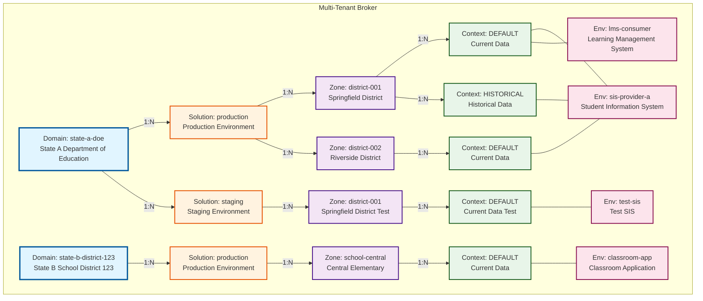

**Diagram Key**:

- **Blue nodes**: Domain level (tenant boundary)
- **Orange nodes**: Solution level (environment type: production, staging, testing)
- **Purple nodes**: Zone level (SIF organizational unit: district, school)
- **Green nodes**: Context level (SIF sub-unit: current vs. historical data)
- **Pink nodes**: Environment level (application instance with credentials)
- **Arrows (?)**: Ownership (one-to-many, parent owns children)
- **Lines (�)**: Participation (many-to-many, environment participates in zone/context)

**Key Observations from Diagram**:

1. **Complete Tenant Isolation**: State A DOE and State B District are completely separate domains with no data sharing
2. **Solution Reuse**: Both domains have a "production" solution (solution_id can be reused across domains)
3. **Zone Reuse Across Solutions**: "district-001" exists in both State A DOE production and staging (same zone_id, different solutions)
4. **Multi-Zone Participation**: `sis-provider-a` participates in district-001/DEFAULT, district-001/HISTORICAL, and district-002/DEFAULT � all with the same session token and shared secret
5. **Per-Service Roles**: An environment can be both a consumer and a provider within the same zone/context. The role is per service type (e.g., a SIS provides StudentPersonal but consumes Assessment in the same zone/context).
6. **Provider Uniqueness**: Only one provider per service per zone/context (e.g., only one SIS provider for StudentPersonal in district-001/DEFAULT), but different contexts can have different providers for the same service
7. **Cascade Deletion**: Deleting State A DOE domain would cascade delete all its solutions, zones, contexts, and environment participations

**Cardinality Summary**:

| Relationship | Cardinality | Description |
|--------------|-------------|-------------|
| Domain ? Solution | 1:N | Each domain can have multiple solutions (production, staging, testing) |
| Solution ? Zone | 1:N | Each solution can have multiple zones (districts, schools) |
| Zone ? Context | 1:N | Each zone can have multiple contexts (DEFAULT, HISTORICAL, etc.) |
| Domain ? Environment | 1:N | Each environment belongs to exactly one domain |
| Solution ? Environment | 1:N | Each environment belongs to exactly one solution |
| Environment ? Zone/Context | M:N | An environment can participate in multiple zones and contexts within its domain |

#### Level 1: Domain (Tenant Boundary)

**Purpose**: Top-level tenant boundary representing an independent organization

**Characteristics**:
- **Unique Identifier**: `domain_id` (e.g., "state-a-doe", "state-b-district-123")
- **Data Isolation**: Complete separation from other domains
- **Independent Administration**: Each domain has its own admin users
- **Billing Boundary**: Usage tracking and billing per domain (future)
- **Compliance Boundary**: Data residency and compliance policies per domain

**Examples**:
- "State A Department of Education" (state-level agency)
- "State B School Administrative District 123" (district-level)
- "Springfield Public Schools" (district-level)
- "Acme Education Software Vendor" (vendor testing environment)

**Database Representation**:
```sql
CREATE TABLE domains (
    id UUID PRIMARY KEY DEFAULT gen_random_uuid(),
    domain_id VARCHAR(255) UNIQUE NOT NULL,  -- Tenant identifier
    name VARCHAR(255) NOT NULL,
    description TEXT,
    created_at TIMESTAMP NOT NULL DEFAULT CURRENT_TIMESTAMP,
    updated_at TIMESTAMP NOT NULL DEFAULT CURRENT_TIMESTAMP
);

CREATE INDEX idx_domains_domain_id ON domains(domain_id);
```

**Key Properties**:
- Domain IDs are globally unique across the entire broker
- Domain IDs are immutable once created (cannot be changed)
- Deleting a domain cascades to all child entities (solutions, zones, environments)
- Domain names can be updated without affecting child entities


#### Level 2: Solution (Environment Type)

**Purpose**: Operating environment within a domain (production vs. non-production)

**Characteristics**:
- **Unique Within Domain**: `solution_id` unique within a domain, but can be reused across domains
- **Environment Classification**: Typically "production", "staging", "testing", "development"
- **Data Segregation**: Production and non-production data separated
- **Access Control**: Different ACLs for production vs. non-production
- **SIF Compliance**: Not part of SIF 3.7 spec, but essential for operational separation

**Examples**:
- "production" (live student data)
- "staging" (pre-production testing)
- "testing" (QA and integration testing)
- "development" (developer sandboxes)
- "demo" (sales demonstrations)

**Database Representation**:
```sql
CREATE TABLE solutions (
    id UUID PRIMARY KEY DEFAULT gen_random_uuid(),
    domain_uuid UUID NOT NULL REFERENCES domains(id) ON DELETE CASCADE,
    solution_id VARCHAR(255) NOT NULL,  -- e.g., "production", "staging"
    name VARCHAR(255) NOT NULL,
    description TEXT,
    created_at TIMESTAMP NOT NULL DEFAULT CURRENT_TIMESTAMP,
    updated_at TIMESTAMP NOT NULL DEFAULT CURRENT_TIMESTAMP,
    CONSTRAINT uk_domain_uuid_solution UNIQUE (domain_uuid, solution_id)
);

CREATE INDEX idx_solutions_domain_uuid ON solutions(domain_uuid);
CREATE INDEX idx_solutions_solution_id ON solutions(solution_id);
```

**Key Properties**:
- Solution IDs are unique within a domain (e.g., State A DOE can have "production", State B District can also have "production")
- Solution IDs are immutable once created
- Deleting a solution cascades to all child entities (zones, contexts, environments)
- Multiple domains can use the same solution_id (e.g., all domains have "production")

**Use Cases**:
1. **Production/Non-Production Separation**: Keep live student data separate from test data
2. **Multi-Stage Deployment**: Test integrations in staging before promoting to production
3. **Vendor Testing**: Vendors can test against "testing" solution without affecting production
4. **Data Lifecycle**: Archive old data by moving to "archived" solution


#### Level 3: Zone (SIF Organizational Unit)

**Purpose**: SIF 3.7 organizational unit representing a district, school, or other administrative boundary

**Characteristics**:
- **SIF 3.7 Concept**: Defined in SIF specification as organizational boundary
- **Unique Within Solution**: `zone_id` unique within a solution, can be reused across solutions
- **Hierarchical**: Zones can represent districts, schools, departments, etc.
- **Data Filtering**: Events and requests can be filtered by zone
- **Access Control**: Environments can be restricted to specific zones

**Examples**:
- "district-001" (school district)
- "school-central" (individual school)
- "central-office" (district administrative office)
- "transportation-dept" (department within district)

**Database Representation**:
```sql
CREATE TABLE zones (
    id UUID PRIMARY KEY DEFAULT gen_random_uuid(),
    solution_uuid UUID NOT NULL REFERENCES solutions(id) ON DELETE CASCADE,
    zone_id VARCHAR(255) NOT NULL,  -- SIF zone identifier
    name VARCHAR(255) NOT NULL,
    description TEXT,
    created_at TIMESTAMP NOT NULL DEFAULT CURRENT_TIMESTAMP,
    updated_at TIMESTAMP NOT NULL DEFAULT CURRENT_TIMESTAMP,
    CONSTRAINT uk_solution_uuid_zone UNIQUE (solution_uuid, zone_id)
);

CREATE INDEX idx_zones_solution_uuid ON zones(solution_uuid);
CREATE INDEX idx_zones_zone_id ON zones(zone_id);
```

**Key Properties**:
- Zone IDs are unique within a solution (e.g., State A DOE production can have "district-001", State A DOE staging can also have "district-001")
- Zone IDs can be reused across different solutions within the same domain
- Zone IDs can be reused across different domains (e.g., multiple states can have "district-001")
- Deleting a zone cascades to all child entities (contexts, environments)

**SIF 3.7 Alignment**:
- Zones map directly to SIF 3.7 Zone concept
- Zone-based routing: Events published to a zone are only delivered to subscribers in that zone
- Zone-based filtering: Requests can be scoped to a specific zone
- Zone-based access control: Environments can be restricted to operate within specific zones


#### Level 4: Context (SIF Sub-Unit)

**Purpose**: SIF 3.7 sub-unit within a zone for finer-grained organizational boundaries

**Characteristics**:
- **SIF 3.7 Concept**: Defined in SIF specification as sub-unit within a zone
- **Optional**: Not all zones require contexts
- **Unique Within Zone**: `context_id` unique within a zone
- **Fine-Grained Filtering**: Events and requests can be filtered by context
- **Flexible Hierarchy**: Can represent classrooms, grade levels, programs, etc.

**Examples**:
- "DEFAULT" (current/active data)
- "HISTORICAL" (archived data)
- "AUDIT" (audit trail data)

**Database Representation**:
```sql
CREATE TABLE contexts (
    id UUID PRIMARY KEY DEFAULT gen_random_uuid(),
    zone_uuid UUID NOT NULL REFERENCES zones(id) ON DELETE CASCADE,
    context_id VARCHAR(255) NOT NULL,  -- SIF context identifier
    name VARCHAR(255) NOT NULL,
    description TEXT,
    created_at TIMESTAMP NOT NULL DEFAULT CURRENT_TIMESTAMP,
    updated_at TIMESTAMP NOT NULL DEFAULT CURRENT_TIMESTAMP,
    CONSTRAINT uk_zone_uuid_context UNIQUE (zone_uuid, context_id)
);

CREATE INDEX idx_contexts_zone_uuid ON contexts(zone_uuid);
CREATE INDEX idx_contexts_context_id ON contexts(context_id);
```

**Key Properties**:
- Context IDs are unique within a zone
- Context IDs can be reused across different zones (e.g., multiple zones can have "DEFAULT")
- Deleting a context cascades to all child entities (environments)
- Every zone must have a mandatory `DEFAULT` context. If no context is specified in a request, `DEFAULT` is assumed.

**SIF 3.7 Alignment**:
- Contexts map directly to SIF 3.7 Context concept
- Context-based routing: Events can be scoped to specific contexts within a zone
- Context-based filtering: Requests can be scoped to a specific context
- Context-based access control: Environments can be restricted to specific contexts


#### Level 5: Environment (Application Instance)

**Purpose**: Individual application instance with credentials for API access

**Characteristics**:
- **Authentication Unit**: Each environment has unique session token and shared secret
- **Application Instance**: Represents a specific SIS, LMS, assessment platform, etc.
- **Per-Service Roles**: An environment can be both a consumer and a provider � even within the same zone/context. The role is per service type, not per environment. For example, a SIS can be a provider of StudentPersonal data and a consumer of Assessment data in the same zone/context.
- **Multi-Zone Participation**: An environment belongs to exactly one domain and one solution, but can participate in multiple zones and contexts within that domain � all with the same session token and shared secret.
- **Provider Uniqueness**: Only one provider per service type per zone/context. Different contexts within a zone can have different providers for the same service.
- **Access Control**: ACLs define what operations the environment can perform
- **Unique Identifier**: `environment_id` (UUID) globally unique across entire broker

**Examples**:
- "district-sis" (student information system)
- "district-lms" (learning management system)
- "district-assessment" (assessment platform)
- "state-reporting-system" (state data warehouse)

**Database Representation**:

Environments have a many-to-many relationship with zones and contexts, modeled via a join table:

```sql
-- Core environment record (belongs to one domain via solution)
CREATE TABLE environments (
    id UUID PRIMARY KEY DEFAULT gen_random_uuid(),  -- Globally unique
    solution_uuid UUID NOT NULL REFERENCES solutions(id) ON DELETE CASCADE,
    application_key VARCHAR(255) UNIQUE NOT NULL,  -- For authentication
    session_token VARCHAR(255) UNIQUE NOT NULL,    -- For authentication
    shared_secret VARCHAR(255) NOT NULL,           -- For HMAC signing
    name VARCHAR(255) NOT NULL,
    description TEXT,
    created_at TIMESTAMP NOT NULL DEFAULT CURRENT_TIMESTAMP,
    updated_at TIMESTAMP NOT NULL DEFAULT CURRENT_TIMESTAMP
);

CREATE INDEX idx_environments_solution_uuid ON environments(solution_uuid);
CREATE INDEX idx_environments_session_token ON environments(session_token);

-- Environment participation in zones/contexts (many-to-many)
CREATE TABLE environment_zone_context (
    id UUID PRIMARY KEY DEFAULT gen_random_uuid(),
    environment_id UUID NOT NULL REFERENCES environments(id) ON DELETE CASCADE,
    zone_id UUID NOT NULL REFERENCES zones(id) ON DELETE CASCADE,
    context_id UUID NOT NULL REFERENCES contexts(id) ON DELETE CASCADE,  -- DEFAULT context assumed if not specified
    role VARCHAR(50) NOT NULL,  -- PROVIDER or CONSUMER (per service type, not per environment)
    service_type VARCHAR(255),  -- SIF service type (for provider uniqueness constraint)
    created_at TIMESTAMP NOT NULL DEFAULT CURRENT_TIMESTAMP,
    CONSTRAINT uk_env_zone_context UNIQUE (environment_id, zone_id, context_id),
    CONSTRAINT uk_provider_per_service UNIQUE (zone_id, context_id, service_type, role)
        -- Enforces: one provider per service per zone/context
);

CREATE INDEX idx_ezc_environment_id ON environment_zone_context(environment_id);
CREATE INDEX idx_ezc_zone_id ON environment_zone_context(zone_id);
CREATE INDEX idx_ezc_context_id ON environment_zone_context(context_id);
```

**Key Properties**:
- Environment IDs (UUID) are globally unique across the entire broker
- Each environment has unique session token for authentication
- Each environment has unique shared secret for HMAC signature generation
- Environments belong to exactly one domain (via solution) and one solution
- Environments can participate in multiple zones and contexts within their domain
- An environment's role (provider/consumer) is per service type � an environment can be both provider and consumer within the same zone/context
- Only one provider per service type per zone/context (enforced by unique constraint)
- Deleting an environment cascades to its zone/context participations

**Authentication Flow**:
1. Environment includes session token in `Authorization` header
2. Gateway looks up environment by session token
3. Gateway retrieves shared secret for HMAC validation
4. Gateway validates HMAC signature using shared secret
5. Gateway extracts domain, solution, zone, context from environment
6. Gateway enforces ACLs based on environment permissions


### Hierarchical Relationships

The organizational hierarchy has two distinct relationship types: ownership (tree) and participation (many-to-many).

**Ownership hierarchy** (strict tree � each child has exactly one parent):

```
Domain (1)
  +- Solution (1..N)
      +- Zone (1..N)
          +- Context (0..N)  [Optional]
```

**Environment participation** (many-to-many with zones/contexts):

```
Environment --belongs to--? one Domain, one Solution
Environment --participates in--? many Zones and Contexts (within its domain)
```


**Cardinality Rules**:

| Relationship | Cardinality | Constraint |
|--------------|-------------|------------|
| Domain ? Solution | 1:N | A domain can have multiple solutions |
| Solution ? Zone | 1:N | A solution can have multiple zones |
| Zone ? Context | 1:N | A zone can have multiple contexts (optional) |
| Domain ? Environment | 1:N | Each environment belongs to exactly one domain |
| Solution ? Environment | 1:N | Each environment belongs to exactly one solution |
| Environment ? Zone/Context | M:N | An environment can participate in multiple zones and contexts within its domain |

**Role and Provider Constraints**:

- An environment can be both a consumer and a provider � even within the same zone/context. The role is per service type (e.g., a SIS provides StudentPersonal but consumes Assessment in district-001/DEFAULT).
- Only one provider per service type per zone/context
- Different contexts within a zone can have different providers for the same service
- The same environment can provide services across multiple zones with the same credentials

**Cascade Deletion Rules**:

- **Delete Domain**: Cascades to all solutions, zones, contexts, environments, and participations
- **Delete Solution**: Cascades to all zones, contexts, environments, and participations within that solution
- **Delete Zone**: Cascades to all contexts and environment participations within that zone
- **Delete Context**: Cascades to all environment participations within that context
- **Delete Environment**: Cascades to its zone/context participations

**Example Hierarchy**:

```
State A Department of Education (Domain)
  +- production (Solution)
  �   +- district-001 (Zone)
  �   �   +- DEFAULT (Context)
  �   �   �   +- sis-provider-a (PROVIDER)  ?-- same environment
  �   �   �   +- lms-consumer (CONSUMER)        participates in
  �   �   +- HISTORICAL (Context)               multiple zone/contexts
  �   �       +- sis-provider-a (PROVIDER)  ?--
  �   +- district-002 (Zone)
  �       +- DEFAULT (Context)
  �           +- sis-provider-a (PROVIDER)  ?--
  +- staging (Solution)
      +- district-001 (Zone)  [Same zone_id as production, different solution]
          +- DEFAULT (Context)
              +- test-sis (PROVIDER)
```

**Key Observations**:

1. **Same zone_id across solutions**: "district-001" exists in both production and staging solutions
2. **Multi-zone participation**: `sis-provider-a` participates in district-001/DEFAULT, district-001/HISTORICAL, and district-002/DEFAULT � all with the same session token and shared secret
3. **Per-service roles**: An environment can be both a consumer and a provider within the same zone/context � the role is per service type (e.g., a SIS provides StudentPersonal but consumes Assessment)
4. **Multiple environments per context**: DEFAULT context has both a SIS provider and an LMS consumer
5. **Complete isolation**: Production and staging data are completely separate

### Data Isolation Strategies

Complete data isolation at the domain level is critical for multi-tenant security. The OSDB implements multiple layers of data isolation to ensure tenant data never leaks across domain boundaries.

#### Database-Level Isolation

**Strategy**: Logical separation using foreign key constraints and query filtering

**Implementation**:

1. **Domain Foreign Keys**: All tenant-specific tables have a foreign key chain back to the `domains` table
2. **Query Filtering**: All queries include domain-based WHERE clauses
3. **Row-Level Security**: PostgreSQL Row-Level Security (RLS) policies enforce domain boundaries (future enhancement)
4. **Cascade Deletion**: Deleting a domain automatically deletes all child data

**Example Query Pattern**:
```sql
-- BAD: No domain filtering (security vulnerability)
SELECT * FROM environments WHERE id = ?;

-- GOOD: Domain filtering enforced
SELECT e.* 
FROM environments e
JOIN solutions s ON e.solution_uuid = s.id
JOIN domains d ON s.domain_uuid = d.id
WHERE e.id = ? AND d.domain_id = ?;
```

**Foreign Key Chain**:
```
environments.solution_uuid → solutions.id
solutions.domain_uuid → domains.id
```

Every query for environment data must traverse this chain to verify domain ownership.

**Database Constraints**:
```sql
-- Ensure every solution belongs to a domain
ALTER TABLE solutions 
ADD CONSTRAINT fk_solutions_domain_uuid 
FOREIGN KEY (domain_uuid) REFERENCES domains(id) ON DELETE CASCADE;

-- Ensure every zone belongs to a solution
ALTER TABLE zones 
ADD CONSTRAINT fk_zones_solution_uuid 
FOREIGN KEY (solution_uuid) REFERENCES solutions(id) ON DELETE CASCADE;

-- Ensure every environment belongs to a solution
ALTER TABLE environments 
ADD CONSTRAINT fk_environments_solution_uuid 
FOREIGN KEY (solution_uuid) REFERENCES solutions(id) ON DELETE CASCADE;
```

**Isolation Verification**:

Property-based tests verify data isolation:

```java
@Property
void environmentsAreIsolatedByDomain(
    @ForAll("validDomainIds") String domain1,
    @ForAll("validDomainIds") String domain2
) {
    assumeThat(domain1).isNotEqualTo(domain2);
    
    // Create environments in different domains
    var env1 = createEnvironmentInDomain(domain1);
    var env2 = createEnvironmentInDomain(domain2);
    
    // Verify domain1 cannot access env2
    assertThatThrownBy(() -> 
        getEnvironmentAsDomain(env2.id(), domain1)
    ).isInstanceOf(NotFoundException.class);
    
    // Verify domain2 cannot access env1
    assertThatThrownBy(() -> 
        getEnvironmentAsDomain(env1.id(), domain2)
    ).isInstanceOf(NotFoundException.class);
}
```


#### Application-Level Isolation

**Strategy**: Tenant context propagation through request lifecycle

**Implementation**:

1. **Authentication Extracts Domain**: Gateway extracts domain from session token
2. **Tenant Context Propagation**: Domain ID passed to all backend services
3. **Service-Level Filtering**: Each service filters data by domain
4. **ACL Enforcement**: Access Control Lists enforce domain boundaries

**Request Flow with Tenant Context**:

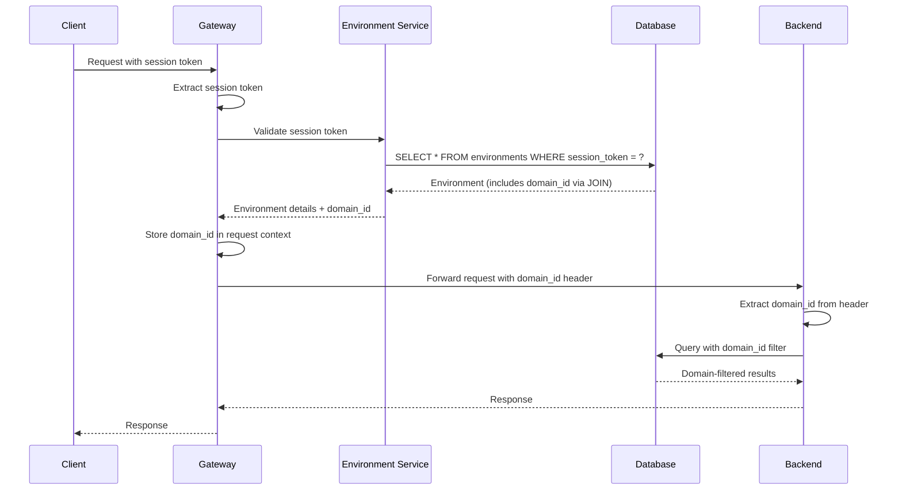

**Tenant Context Headers**:

The Gateway adds tenant context headers to all backend requests:

```
X-Domain-Id: state-a-doe
X-Solution-Id: production
X-Zone-Id: district-001
X-Context-Id: DEFAULT
X-Environment-Id: 550e8400-e29b-41d4-a716-446655440000
```

Backend services extract these headers and use them for query filtering.

**Service-Level Filtering Example**:

```java
@Service
public class DomainService {
    
    @Autowired
    private DomainRepository domainRepository;
    
    public DomainDTO getDomain(UUID id, String requestingDomainId) {
        // Query with domain filtering
        Domain domain = domainRepository.findById(id)
            .orElseThrow(() -> new NotFoundException("Domain not found"));
        
        // Verify requesting domain matches
        if (!domain.getDomainId().equals(requestingDomainId)) {
            throw new ForbiddenException("Access denied to domain");
        }
        
        return DomainMapper.toDTO(domain);
    }
    
    public List<DomainDTO> listDomains(String requestingDomainId) {
        // Only return domains the requester owns
        // In practice, a domain can only see itself (no cross-domain visibility)
        return domainRepository.findByDomainId(requestingDomainId)
            .stream()
            .map(DomainMapper::toDTO)
            .collect(Collectors.toList());
    }
}
```


#### Cache Isolation

**Strategy**: Domain-scoped cache keys to prevent cross-tenant cache pollution

**Implementation**:

1. **Namespaced Keys**: All Redis keys include domain ID prefix
2. **Cache Invalidation**: Invalidate only keys for affected domain
3. **Rate Limit Isolation**: Rate limits tracked per domain
4. **Session Isolation**: Session tokens scoped to domain

**Redis Key Naming Convention**:

```
{domain_id}:{resource_type}:{resource_id}

Examples:
state-a-doe:environment:550e8400-e29b-41d4-a716-446655440000
state-b-district:rate-limit:production:district-001
acme-vendor:session:abc123def456
```

**Cache Key Generation**:

```java
public class CacheKeyGenerator {
    
    public static String environmentKey(String domainId, UUID environmentId) {
        return String.format("%s:environment:%s", domainId, environmentId);
    }
    
    public static String rateLimitKey(String domainId, String solutionId, String zoneId) {
        return String.format("%s:rate-limit:%s:%s", domainId, solutionId, zoneId);
    }
    
    public static String sessionKey(String domainId, String sessionToken) {
        return String.format("%s:session:%s", domainId, sessionToken);
    }
}
```

**Cache Isolation Benefits**:

1. **No Cross-Tenant Leakage**: Domain A cannot access Domain B's cached data
2. **Efficient Invalidation**: Invalidate all keys for a domain using pattern matching
3. **Rate Limit Fairness**: Each domain has independent rate limit counters
4. **Session Security**: Session tokens cannot be reused across domains

**Cache Invalidation Example**:

```java
public void invalidateDomainCaches(String domainId) {
    // Invalidate all cache keys scoped to this domain
    String pattern = domainId + ":*";
    redisTemplate.delete(redisTemplate.keys(pattern));
}
```


#### Message Queue Isolation

**Strategy**: Domain-scoped queues and message routing

**Implementation**:

1. **Queue Naming**: Queues include domain and solution in name
2. **Message Filtering**: Messages routed only to queues within same domain
3. **Subscription Isolation**: Subscriptions scoped to domain/solution/zone
4. **Storage Isolation**: Message payloads stored with domain prefix in S3

**Queue Naming Convention**:

```
{domain_id}:{solution_id}:{queue_type}:{queue_id}

Examples:
state-a-doe:production:events:district-001
state-b-district:staging:requests:DEFAULT
acme-vendor:testing:responses:test-queue-1
```

**Message Routing Rules**:

1. **Event Publishing**: Events published to a zone are only delivered to subscribers in the same domain/solution/zone
2. **Request Routing**: Requests routed to providers in the same domain/solution/zone
3. **Response Routing**: Responses routed back to the requesting environment's queue
4. **Cross-Domain Blocking**: Messages cannot cross domain boundaries

**Message Routing Example**:

```java
public void routeEvent(Event event, String publisherDomainId, String publisherSolutionId, String publisherZoneId) {
    // Find subscriptions in the same domain/solution/zone
    List<Subscription> subscriptions = subscriptionRepository
        .findByDomainAndSolutionAndZone(publisherDomainId, publisherSolutionId, publisherZoneId);
    
    // Route event to each subscriber's queue
    for (Subscription subscription : subscriptions) {
        String queueName = String.format("%s:%s:events:%s", 
            publisherDomainId, 
            publisherSolutionId, 
            subscription.getQueueId());
        
        queueService.enqueue(queueName, event);
    }
}
```

**Storage Isolation**:

Message payloads stored in S3 with domain prefix:

```
s3://sif-broker-messages/{domain_id}/{solution_id}/{message_id}

Examples:
s3://sif-broker-messages/state-a-doe/production/550e8400-e29b-41d4-a716-446655440000
s3://sif-broker-messages/state-b-district/staging/660e8400-e29b-41d4-a716-446655440001
```

This ensures:
- Domain A cannot access Domain B's message payloads
- S3 bucket policies can enforce domain-level access control
- Message cleanup can be scoped to domain


### Tenant Routing and Identification

Tenant routing is the process of identifying which domain a request belongs to and ensuring all operations are scoped to that domain. The OSDB uses session token-based authentication for tenant identification.

#### Authentication-Based Tenant Identification

**Flow**:

1. **Environment Registration**: Admin creates environment with unique session token
2. **Client Authentication**: Client includes session token in `Authorization` header
3. **Token Lookup**: Gateway looks up environment by session token
4. **Domain Extraction**: Gateway extracts domain from environment's foreign key chain
5. **Context Propagation**: Gateway adds domain context to request headers
6. **Backend Filtering**: Backend services filter data by domain

**Session Token Format**:

```
Authorization: SIF_HMACSHA256 <session_token>
```

Example:
```
Authorization: SIF_HMACSHA256 550e8400-e29b-41d4-a716-446655440000
```

**Token Lookup Process**:

```java
public class AuthenticationService {
    
    public TenantContext authenticateRequest(String sessionToken) {
        // Look up environment by session token
        Environment environment = environmentRepository
            .findBySessionToken(sessionToken)
            .orElseThrow(() -> new UnauthorizedException("Invalid session token"));
        
        // Extract domain via foreign key chain
        Solution solution = environment.getSolution();
        Domain domain = solution.getDomain();
        Zone zone = environment.getZone();
        Context context = environment.getContext();
        
        // Build tenant context
        return TenantContext.builder()
            .domainId(domain.getDomainId())
            .solutionId(solution.getSolutionId())
            .zoneId(zone != null ? zone.getZoneId() : null)
            .contextId(context.getContextId())  // Always present; DEFAULT if not specified
            .environmentId(environment.getId())
            .build();
    }
}
```

**Tenant Context Object**:

```java
@Value
@Builder
public class TenantContext {
    String domainId;        // e.g., "state-a-doe"
    String solutionId;      // e.g., "production"
    String zoneId;          // e.g., "district-001" (optional)
    String contextId;       // e.g., "DEFAULT" (optional)
    UUID environmentId;     // e.g., 550e8400-e29b-41d4-a716-446655440000
}
```

This context is propagated through the entire request lifecycle.


#### Gateway Routing Logic

The Gateway is responsible for tenant identification and routing. It performs the following steps for every request:

**Step 1: Extract Session Token**

```java
String authHeader = request.getHeaders().getFirst("Authorization");
if (authHeader == null || !authHeader.startsWith("SIF_HMACSHA256 ")) {
    throw new UnauthorizedException("Missing or invalid Authorization header");
}

String sessionToken = authHeader.substring("SIF_HMACSHA256 ".length());
```

**Step 2: Validate Session Token and Extract Tenant Context**

```java
// Call Environment Service to validate token
TenantContext tenantContext = environmentServiceClient.validateSessionToken(sessionToken);

// Cache tenant context in Redis for performance
String cacheKey = "session:" + sessionToken;
redisTemplate.opsForValue().set(cacheKey, tenantContext, Duration.ofMinutes(5));
```

**Step 3: Validate HMAC Signature**

```java
// Extract timestamp and signature from headers
String timestamp = request.getHeaders().getFirst("timestamp");
String signature = request.getHeaders().getFirst("authorization");

// Retrieve shared secret for this environment
String sharedSecret = environmentServiceClient.getSharedSecret(tenantContext.getEnvironmentId());

// Validate HMAC signature
boolean valid = HmacUtil.validateSignature(
    request.getMethod(),
    request.getPath(),
    request.getBody(),
    timestamp,
    signature,
    sharedSecret
);

if (!valid) {
    throw new UnauthorizedException("Invalid HMAC signature");
}
```

**Step 4: Check Rate Limits**

```java
// Rate limit key scoped to domain/solution/zone
String rateLimitKey = String.format("rate-limit:%s:%s:%s",
    tenantContext.getDomainId(),
    tenantContext.getSolutionId(),
    tenantContext.getZoneId()
);

// Increment counter and check limit
Long requestCount = redisTemplate.opsForValue().increment(rateLimitKey);
if (requestCount == 1) {
    redisTemplate.expire(rateLimitKey, Duration.ofMinutes(1));
}

if (requestCount > RATE_LIMIT_PER_MINUTE) {
    throw new RateLimitExceededException("Rate limit exceeded");
}
```

**Step 5: Add Tenant Context Headers**

```java
// Add tenant context to request headers for backend services
request.getHeaders().set("X-Domain-Id", tenantContext.getDomainId());
request.getHeaders().set("X-Solution-Id", tenantContext.getSolutionId());
request.getHeaders().set("X-Zone-Id", tenantContext.getZoneId());
request.getHeaders().set("X-Context-Id", tenantContext.getContextId());
request.getHeaders().set("X-Environment-Id", tenantContext.getEnvironmentId().toString());
```

**Step 6: Route to Backend Service**

```java
// Route based on request path (after extracting domainId/solutionId from path)
// Connector paths: /{domainId}/{solutionId}/events, /{domainId}/{solutionId}/requests, etc.
String relativePath = extractRelativePath(request); // path after /{domainId}/{solutionId}/
if (relativePath.startsWith("events")) {
    return routeToEventsConnector(request);
} else if (relativePath.startsWith("requests")) {
    return routeToRequestsConnector(request);
} else if (relativePath.startsWith("responses")) {
    return routeToResponsesConnector(request);
} else if (relativePath.startsWith("services")) {
    return routeToServicesConnector(request);
} else {
    throw new NotFoundException("Unknown endpoint");
}
```


#### Backend Service Tenant Filtering

Backend services extract tenant context from headers and filter all operations:

**Extract Tenant Context from Headers**:

```java
@Component
public class TenantContextInterceptor implements HandlerInterceptor {
    
    private static final ThreadLocal<TenantContext> TENANT_CONTEXT = new ThreadLocal<>();
    
    @Override
    public boolean preHandle(HttpServletRequest request, HttpServletResponse response, Object handler) {
        // Extract tenant context from headers
        String domainId = request.getHeader("X-Domain-Id");
        String solutionId = request.getHeader("X-Solution-Id");
        String zoneId = request.getHeader("X-Zone-Id");
        String contextId = request.getHeader("X-Context-Id");
        String environmentId = request.getHeader("X-Environment-Id");
        
        if (domainId == null) {
            throw new UnauthorizedException("Missing tenant context");
        }
        
        // Store in thread-local for access by services
        TenantContext context = TenantContext.builder()
            .domainId(domainId)
            .solutionId(solutionId)
            .zoneId(zoneId)
            .contextId(contextId)
            .environmentId(UUID.fromString(environmentId))
            .build();
        
        TENANT_CONTEXT.set(context);
        return true;
    }
    
    @Override
    public void afterCompletion(HttpServletRequest request, HttpServletResponse response, Object handler, Exception ex) {
        // Clean up thread-local
        TENANT_CONTEXT.remove();
    }
    
    public static TenantContext getCurrentTenant() {
        return TENANT_CONTEXT.get();
    }
}
```

**Use Tenant Context in Services**:

```java
@Service
public class EnvironmentService {
    
    public List<EnvironmentDTO> listEnvironments() {
        // Get current tenant context
        TenantContext tenant = TenantContextInterceptor.getCurrentTenant();
        
        // Query filtered by domain
        return environmentRepository
            .findByDomainId(tenant.getDomainId())
            .stream()
            .map(EnvironmentMapper::toDTO)
            .collect(Collectors.toList());
    }
    
    public EnvironmentDTO getEnvironment(UUID id) {
        TenantContext tenant = TenantContextInterceptor.getCurrentTenant();
        
        // Query with domain verification
        Environment environment = environmentRepository.findById(id)
            .orElseThrow(() -> new NotFoundException("Environment not found"));
        
        // Verify environment belongs to requesting domain
        if (!environment.getSolution().getDomain().getDomainId().equals(tenant.getDomainId())) {
            throw new ForbiddenException("Access denied to environment");
        }
        
        return EnvironmentMapper.toDTO(environment);
    }
}
```


### Security Boundaries and Access Control

Multi-tenancy requires strict security boundaries to prevent unauthorized access across tenant boundaries. The OSDB implements multiple layers of security controls.

#### Domain-Level Security Boundaries

**Principle**: Domains are completely isolated security boundaries. No cross-domain access is permitted.

**Enforcement Mechanisms**:

1. **Authentication**: Session tokens are unique per environment, which belongs to exactly one domain
2. **Authorization**: ACLs enforce permissions within domain boundaries
3. **Data Filtering**: All queries filtered by domain ID
4. **Audit Logging**: All operations logged with domain context

**Security Boundary Rules**:

| Operation | Allowed | Blocked |
|-----------|---------|---------|
| Domain A reads Domain A data | ✓ | |
| Domain A writes Domain A data | ✓ | |
| Domain A reads Domain B data | | ✗ |
| Domain A writes Domain B data | | ✗ |
| Domain A lists all domains | | ✗ |
| Admin lists all domains | ✓ | |

**Admin vs. Tenant Access**:

- **Admin Users**: Can access all domains (for system administration)
- **Tenant Users**: Can only access their own domain
- **Admin Authentication**: Separate authentication mechanism (not session tokens)
- **Admin Audit**: All admin operations logged with admin user ID

#### Solution-Level Isolation

**Principle**: Production and non-production data must be separated within a domain.

**Enforcement Mechanisms**:

1. **Solution Filtering**: All queries include solution ID filter
2. **Environment Scoping**: Environments belong to exactly one solution
3. **Queue Isolation**: Queues scoped to domain + solution
4. **ACL Enforcement**: Permissions can be restricted to specific solutions

**Solution Boundary Rules**:

| Operation | Allowed | Blocked |
|-----------|---------|---------|
| Production env reads production data | ✓ | |
| Production env reads staging data | | ✗ |
| Staging env reads staging data | ✓ | |
| Staging env reads production data | | ✗ |
| Admin reads all solutions | ✓ | |

**Use Case**: Prevent test data from contaminating production, and prevent production credentials from being used in test environments.


#### Zone and Context-Level Access Control

**Principle**: Environments can be restricted to operate within specific zones and contexts.

**Enforcement Mechanisms**:

1. **Environment Association**: Environments are associated with a zone or context
2. **Message Routing**: Events and requests routed based on zone/context
3. **Subscription Filtering**: Subscriptions scoped to zone/context
4. **ACL Enforcement**: Permissions can be restricted to specific zones/contexts

**Zone/Context Boundary Rules**:

| Operation | Allowed | Blocked |
|-----------|---------|---------|
| Zone A env publishes event to Zone A | ✓ | |
| Zone A env publishes event to Zone B | | ✗ |
| Zone A env subscribes to Zone A events | ✓ | |
| Zone A env subscribes to Zone B events | | ✗ |
| Context A env reads Context A data | ✓ | |
| Context A env reads Context B data | | ✗ |

**Use Case**: School A's SIS should not receive events from School B, even though both are in the same district (domain).

#### Access Control Lists (ACLs)

**Purpose**: Fine-grained permissions for environments

**ACL Structure**:

```java
@Entity
@Table(name = "acls")
public class ACL {
    @Id
    private UUID id;
    
    @ManyToOne
    private Environment environment;  // Which environment has this permission
    
    private String resource;          // e.g., "events", "requests", "zones"
    private String action;            // e.g., "read", "write", "publish", "subscribe"
    private String scope;             // e.g., "zone:district-001", "context:DEFAULT"
    
    private Instant createdAt;
}
```

**ACL Examples**:

```sql
-- SIS provider can publish events to district-001
INSERT INTO acls (environment_id, resource, action, scope)
VALUES ('550e8400-...', 'events', 'publish', 'zone:district-001');

-- LMS consumer can subscribe to events from DEFAULT context
INSERT INTO acls (environment_id, resource, action, scope)
VALUES ('660e8400-...', 'events', 'subscribe', 'context:DEFAULT');

-- State reporting system can read all zones in production solution
INSERT INTO acls (environment_id, resource, action, scope)
VALUES ('770e8400-...', 'zones', 'read', 'solution:production');
```

**ACL Enforcement**:

```java
public class ACLService {
    
    public boolean hasPermission(UUID environmentId, String resource, String action, String scope) {
        return aclRepository.existsByEnvironmentIdAndResourceAndActionAndScope(
            environmentId, resource, action, scope
        );
    }
    
    public void enforcePermission(UUID environmentId, String resource, String action, String scope) {
        if (!hasPermission(environmentId, resource, action, scope)) {
            throw new ForbiddenException(
                String.format("Environment %s does not have permission to %s %s in scope %s",
                    environmentId, action, resource, scope)
            );
        }
    }
}
```

**ACL Check in Event Publishing**:

```java
public void publishEvent(Event event, UUID publisherEnvironmentId) {
    // Get publisher environment
    Environment publisher = environmentRepository.findById(publisherEnvironmentId)
        .orElseThrow(() -> new NotFoundException("Environment not found"));
    
    // Check ACL permission
    String scope = "zone:" + publisher.getZone().getZoneId();
    aclService.enforcePermission(publisherEnvironmentId, "events", "publish", scope);
    
    // Publish event
    eventService.publish(event);
}
```


### Multi-Tenancy Best Practices

The OSDB follows industry best practices for multi-tenant systems:

#### 1. Defense in Depth

**Principle**: Multiple layers of security, not relying on a single mechanism

**Implementation**:
- **Layer 1**: Authentication (session token validation)
- **Layer 2**: Authorization (ACL enforcement)
- **Layer 3**: Data filtering (domain-scoped queries)
- **Layer 4**: Database constraints (foreign keys, unique constraints)
- **Layer 5**: Audit logging (all operations logged with tenant context)

**Benefit**: If one layer fails, other layers prevent data leakage.

#### 2. Fail-Safe Defaults

**Principle**: Default to denying access, explicitly grant permissions

**Implementation**:
- No default ACLs (environments start with zero permissions)
- Queries default to filtering by domain (never return all data)
- Session tokens expire after inactivity
- Rate limits default to conservative values

**Benefit**: Misconfigurations result in access denial, not data exposure.

#### 3. Principle of Least Privilege

**Principle**: Grant minimum permissions necessary for operation

**Implementation**:
- Environments granted only specific ACLs they need
- Read-only environments cannot publish events
- Consumer environments cannot access provider APIs
- Zone-scoped environments cannot access other zones

**Benefit**: Compromised credentials have limited blast radius.

#### 4. Audit Everything

**Principle**: Log all operations with full tenant context

**Implementation**:
- Every API request logged with domain, solution, zone, context, environment
- All data modifications logged (create, update, delete)
- Authentication failures logged
- ACL violations logged
- Logs include timestamp, IP address, user agent

**Benefit**: Security incidents can be investigated and traced to specific tenants.

#### 5. Test Data Isolation

**Principle**: Verify data isolation through comprehensive testing

**Implementation**:
- Property-based tests verify cross-domain access is blocked
- Integration tests verify query filtering works correctly
- Security tests attempt to bypass isolation mechanisms
- Penetration testing by external security auditors

**Benefit**: High confidence that data isolation works correctly.


### Operational Considerations

Multi-tenant systems require careful operational practices to ensure fair resource allocation and prevent one tenant from impacting others.

#### Resource Fairness and Rate Limiting

**Problem**: One tenant's high request volume can degrade performance for other tenants (noisy neighbor problem).

**Solution**: Per-tenant rate limiting with Redis-based counters

**Implementation**:

```java
public class RateLimitService {
    
    private static final int REQUESTS_PER_MINUTE = 1000;
    
    public void checkRateLimit(String domainId, String solutionId, String zoneId) {
        // Rate limit key scoped to domain/solution/zone
        String key = String.format("rate-limit:%s:%s:%s", domainId, solutionId, zoneId);
        
        // Increment counter
        Long count = redisTemplate.opsForValue().increment(key);
        
        // Set expiration on first request
        if (count == 1) {
            redisTemplate.expire(key, Duration.ofMinutes(1));
        }
        
        // Check limit
        if (count > REQUESTS_PER_MINUTE) {
            throw new RateLimitExceededException(
                String.format("Rate limit exceeded for %s:%s:%s", domainId, solutionId, zoneId)
            );
        }
    }
}
```

**Rate Limiting Configuration**:

The broker implements configurable rate limiting at multiple levels to ensure fair resource allocation and system stability. Rate limits are enforced per environment and can be customized based on operational requirements.

**Rate Limit Scope**:
- **Domain-Level**: Total requests across all solutions/zones in a domain
- **Solution-Level**: Separate limits for production vs. non-production
- **Zone-Level**: Separate limits per zone (prevents one school from impacting others)

**Benefits**:
- Fair resource allocation across tenants
- Protection against accidental or misconfigured overload
- Predictable performance for all tenants
- Foundation for usage-based billing (future)


#### Database Connection Pooling

**Problem**: Each tenant's queries consume database connections from a shared pool.

**Solution**: Connection pool sizing and monitoring

**HikariCP Configuration**:

```yaml
spring:
  datasource:
    hikari:
      maximum-pool-size: 20      # Max connections per service instance
      minimum-idle: 5            # Min idle connections
      connection-timeout: 30000  # 30 seconds
      idle-timeout: 600000       # 10 minutes
      max-lifetime: 1800000      # 30 minutes
```

**Connection Pool Sizing**:

```
Total Connections = (Service Instances) × (Connections per Instance)

Example:
- Gateway: 3 instances × 20 connections = 60 connections
- Environment Service: 2 instances × 20 connections = 40 connections
- Queue Service: 3 instances × 20 connections = 60 connections
- Total: 160 connections

PostgreSQL max_connections should be set to 200+ to allow headroom.
```

**Connection Leak Detection**:

```yaml
spring:
  datasource:
    hikari:
      leak-detection-threshold: 60000  # 60 seconds
```

If a connection is held for more than 60 seconds, HikariCP logs a warning with stack trace.

**Monitoring**:
- Track active connections per service
- Alert if connection pool exhaustion occurs
- Monitor slow queries that hold connections


#### Tenant Onboarding and Provisioning

**Process**: Adding a new tenant (domain) to the broker

**Steps**:

1. **Create Domain**
   ```bash
   POST /api/domains
   {
     "domain_id": "new-district",
     "name": "New School District",
     "description": "New district onboarding"
   }
   ```

2. **Create Solutions**
   ```bash
   POST /api/domains/{domain_id}/solutions
   {
     "solution_id": "production",
     "name": "Production Environment"
   }
   
   POST /api/domains/{domain_id}/solutions
   {
     "solution_id": "staging",
     "name": "Staging Environment"
   }
   ```

3. **Create Zones**
   ```bash
   POST /api/solutions/{solution_id}/zones
   {
     "zone_id": "district-office",
     "name": "District Office"
   }
   
   POST /api/solutions/{solution_id}/zones
   {
     "zone_id": "school-001",
     "name": "Elementary School 001"
   }
   ```

4. **Create Environments**
   ```bash
   POST /api/zones/{zone_id}/environments
   {
     "name": "District SIS",
     "type": "BROKERED",
     "application_key": "district-sis-prod"
   }
   
   Response:
   {
     "id": "550e8400-e29b-41d4-a716-446655440000",
     "session_token": "abc123def456...",
     "shared_secret": "secret789xyz...",
     ...
   }
   ```

5. **Configure ACLs**
   ```bash
   POST /api/environments/{environment_id}/acls
   {
     "resource": "events",
     "action": "publish",
     "scope": "zone:district-office"
   }
   ```

6. **Provide Credentials to Tenant**
   - Session token
   - Shared secret
   - API endpoint URLs
   - Documentation links

**Automation**: Onboarding can be automated via Terraform or Ansible scripts.

**Time to Onboard**: ~15 minutes manual, ~2 minutes automated


#### Tenant Offboarding and Data Deletion

**Process**: Removing a tenant and all associated data

**Steps**:

1. **Disable Access**
   - Revoke all ACLs for tenant's environments
   - Invalidate session tokens
   - Block API access at Gateway

2. **Export Data (Optional)**
   - Export tenant's data for archival
   - Provide data export to tenant if required by policy

3. **Delete Domain**
   ```bash
   DELETE /api/domains/{domain_id}
   ```
   
   This cascades to:
   - All solutions in the domain
   - All zones in those solutions
   - All contexts in those zones
   - All environments in those zones/contexts
   - All ACLs for those environments
   - All queues for those environments
   - All messages in those queues
   - All subscriptions for those environments

4. **Clean Up Storage**
   - Delete message payloads from S3: `s3://bucket/{domain_id}/*`
   - Delete cached data from Redis: `{domain_id}:*`

5. **Verify Deletion**
   - Confirm no data remains in database
   - Confirm no data remains in S3
   - Confirm no data remains in Redis

**Data Retention Policy**:
- **Active Tenants**: Data retained indefinitely
- **Inactive Tenants**: Data retained for 90 days after last activity
- **Deleted Tenants**: Data deleted immediately (with optional export)
- **Backups**: Deleted tenant data removed from backups after 30 days

**Data Deletion Support**:
- Tenant can request complete data deletion
- Data portability: Tenant can export all data before deletion
- Audit trail: All deletion operations logged


#### Monitoring and Observability

**Per-Tenant Metrics**:

Track metrics separately for each tenant to identify issues and usage patterns:

```
# Request rate per domain
sif_broker_requests_total{domain="state-a-doe", solution="production"} 1500

# Error rate per domain
sif_broker_errors_total{domain="state-b-district", solution="production"} 5

# Response time per domain (p95)
sif_broker_response_time_p95{domain="state-a-doe", solution="production"} 150ms

# Rate limit hits per domain
sif_broker_rate_limit_exceeded{domain="acme-vendor", solution="testing"} 10

# Database query time per domain
sif_broker_db_query_time_p95{domain="state-a-doe"} 45ms
```

**Tenant Dashboard**:

Grafana dashboard showing per-tenant metrics:
- Request volume over time
- Error rate over time
- Response time percentiles (p50, p95, p99)
- Rate limit utilization
- Database query performance
- Queue depth and processing time

**Alerting**:

Per-tenant alerts for operational issues:

```yaml
# Alert if tenant error rate exceeds 5%
- alert: HighTenantErrorRate
  expr: rate(sif_broker_errors_total[5m]) / rate(sif_broker_requests_total[5m]) > 0.05
  labels:
    severity: warning
  annotations:
    summary: "High error rate for domain {{ $labels.domain }}"
    description: "Domain {{ $labels.domain }} has {{ $value }}% error rate"

# Alert if tenant response time exceeds 500ms
- alert: SlowTenantResponses
  expr: sif_broker_response_time_p95 > 500
  labels:
    severity: warning
  annotations:
    summary: "Slow responses for domain {{ $labels.domain }}"
    description: "Domain {{ $labels.domain }} p95 response time is {{ $value }}ms"
```

**Audit Logging**:

All operations logged with tenant context:

```json
{
  "timestamp": "2026-03-12T10:30:45.123Z",
  "level": "INFO",
  "domain_id": "state-a-doe",
  "solution_id": "production",
  "zone_id": "district-001",
  "environment_id": "550e8400-e29b-41d4-a716-446655440000",
  "operation": "publish_event",
  "resource": "StudentPersonal",
  "action": "CREATE",
  "result": "success",
  "duration_ms": 45,
  "ip_address": "203.0.113.42",
  "user_agent": "DistrictSIS/8.0"
}
```

**Log Aggregation**:

Logs aggregated by domain for tenant-specific troubleshooting:
- Filter logs by domain_id to see all operations for a tenant
- Filter logs by environment_id to see operations for a specific application
- Filter logs by operation to see all event publishes, request routing, etc.


### Multi-Tenancy Testing Strategy

Comprehensive testing ensures data isolation and security boundaries work correctly.

#### Property-Based Tests for Data Isolation

**Test 1: Cross-Domain Access Blocked**

```java
@Property
void environmentsCannotAccessOtherDomains(
    @ForAll("validDomainIds") String domain1,
    @ForAll("validDomainIds") String domain2
) {
    assumeThat(domain1).isNotEqualTo(domain2);
    
    // Create environment in domain1
    var env1 = createEnvironmentInDomain(domain1);
    
    // Create environment in domain2
    var env2 = createEnvironmentInDomain(domain2);
    
    // Verify domain1 cannot access domain2's environment
    assertThatThrownBy(() -> 
        getEnvironmentAsDomain(env2.id(), domain1)
    ).isInstanceOf(ForbiddenException.class);
    
    // Verify domain2 cannot access domain1's environment
    assertThatThrownBy(() -> 
        getEnvironmentAsDomain(env1.id(), domain2)
    ).isInstanceOf(ForbiddenException.class);
}
```

**Test 2: Solution Isolation Within Domain**

```java
@Property
void productionAndStagingDataIsolated(
    @ForAll("validDomainIds") String domainId
) {
    // Create production and staging solutions
    var prodSolution = createSolution(domainId, "production");
    var stagingSolution = createSolution(domainId, "staging");
    
    // Create environments in each solution
    var prodEnv = createEnvironmentInSolution(prodSolution.id());
    var stagingEnv = createEnvironmentInSolution(stagingSolution.id());
    
    // Verify production env cannot access staging data
    assertThatThrownBy(() -> 
        getEnvironmentAsEnvironment(stagingEnv.id(), prodEnv.sessionToken())
    ).isInstanceOf(ForbiddenException.class);
    
    // Verify staging env cannot access production data
    assertThatThrownBy(() -> 
        getEnvironmentAsEnvironment(prodEnv.id(), stagingEnv.sessionToken())
    ).isInstanceOf(ForbiddenException.class);
}
```

**Test 3: Zone Isolation Within Solution**

```java
@Property
void zonesAreIsolatedWithinSolution(
    @ForAll("validDomainIds") String domainId,
    @ForAll("validZoneIds") String zone1,
    @ForAll("validZoneIds") String zone2
) {
    assumeThat(zone1).isNotEqualTo(zone2);
    
    // Create solution with two zones
    var solution = createSolution(domainId, "production");
    var zoneA = createZone(solution.id(), zone1);
    var zoneB = createZone(solution.id(), zone2);
    
    // Create environments in each zone
    var envA = createEnvironmentInZone(zoneA.id());
    var envB = createEnvironmentInZone(zoneB.id());
    
    // Publish event in zone A
    var event = publishEvent(envA.sessionToken(), "StudentPersonal", "CREATE");
    
    // Verify zone B does not receive zone A's event
    var messagesInZoneB = getQueueMessages(envB.sessionToken());
    assertThat(messagesInZoneB).doesNotContain(event);
}
```


#### Integration Tests for Multi-Tenancy

**Test 1: Complete Domain Isolation**

```java
@Test
void completeDomainIsolation() {
    // Create two domains
    var stateA = createDomain("state-a-doe", "State A Department of Education");
    var stateB = createDomain("state-b-district", "State B School District");
    
    // Create solutions in each domain
    var stateAProd = createSolution(stateA.id(), "production");
    var stateBProd = createSolution(stateB.id(), "production");
    
    // Create zones in each solution
    var stateAZone = createZone(stateAProd.id(), "district-001");
    var stateBZone = createZone(stateBProd.id(), "district-001");  // Same zone_id, different domain
    
    // Create environments
    var stateAEnv = createEnvironment(stateAZone.id(), "state-a-sis");
    var stateBEnv = createEnvironment(stateBZone.id(), "state-b-sis");
    
    // State A publishes event
    var stateAEvent = publishEvent(stateAEnv.sessionToken(), "StudentPersonal", "CREATE");
    
    // Verify State A receives its own event
    var stateAMessages = getQueueMessages(stateAEnv.sessionToken());
    assertThat(stateAMessages).contains(stateAEvent);
    
    // Verify State B does NOT receive State A's event
    var stateBMessages = getQueueMessages(stateBEnv.sessionToken());
    assertThat(stateBMessages).doesNotContain(stateAEvent);
    
    // State B publishes event
    var stateBEvent = publishEvent(stateBEnv.sessionToken(), "StudentPersonal", "CREATE");
    
    // Verify State B receives its own event
    stateBMessages = getQueueMessages(stateBEnv.sessionToken());
    assertThat(stateBMessages).contains(stateBEvent);
    
    // Verify State A does NOT receive State B's event
    stateAMessages = getQueueMessages(stateAEnv.sessionToken());
    assertThat(stateAMessages).doesNotContain(stateBEvent);
}
```

**Test 2: Cascade Deletion**

```java
@Test
void domainDeletionCascadesToAllChildren() {
    // Create domain with full hierarchy
    var domain = createDomain("test-domain", "Test Domain");
    var solution = createSolution(domain.id(), "production");
    var zone = createZone(solution.id(), "zone-001");
    var context = createContext(zone.id(), "context-001");
    var environment = createEnvironment(context.id(), "test-env");
    
    // Create ACL for environment
    var acl = createACL(environment.id(), "events", "publish", "zone:zone-001");
    
    // Publish event
    var event = publishEvent(environment.sessionToken(), "StudentPersonal", "CREATE");
    
    // Delete domain
    deleteDomain(domain.id());
    
    // Verify all children deleted
    assertThat(solutionRepository.findById(solution.id())).isEmpty();
    assertThat(zoneRepository.findById(zone.id())).isEmpty();
    assertThat(contextRepository.findById(context.id())).isEmpty();
    assertThat(environmentRepository.findById(environment.id())).isEmpty();
    assertThat(aclRepository.findById(acl.id())).isEmpty();
    
    // Verify session token no longer works
    assertThatThrownBy(() -> 
        publishEvent(environment.sessionToken(), "StudentPersonal", "CREATE")
    ).isInstanceOf(UnauthorizedException.class);
}
```

**Test 3: Rate Limiting Per Domain**

```java
@Test
void rateLimitingIsolatedPerDomain() {
    // Create two domains
    var domain1 = createDomain("domain-1", "Domain 1");
    var domain2 = createDomain("domain-2", "Domain 2");
    
    // Create environments
    var env1 = createEnvironmentInDomain(domain1.id());
    var env2 = createEnvironmentInDomain(domain2.id());
    
    // Domain 1 hits rate limit
    for (int i = 0; i < RATE_LIMIT + 1; i++) {
        if (i < RATE_LIMIT) {
            publishEvent(env1.sessionToken(), "StudentPersonal", "CREATE");
        } else {
            assertThatThrownBy(() -> 
                publishEvent(env1.sessionToken(), "StudentPersonal", "CREATE")
            ).isInstanceOf(RateLimitExceededException.class);
        }
    }
    
    // Domain 2 should still be able to publish (not affected by domain 1's rate limit)
    assertThatCode(() -> 
        publishEvent(env2.sessionToken(), "StudentPersonal", "CREATE")
    ).doesNotThrowAnyException();
}
```


### Multi-Tenancy Performance Considerations

Multi-tenant systems must maintain consistent performance across all tenants.

#### Query Performance with Domain Filtering

**Challenge**: Every query includes domain filtering, which adds overhead.

**Optimization Strategies**:

1. **Indexed Foreign Keys**: All foreign key columns indexed for fast joins
   ```sql
   CREATE INDEX idx_solutions_domain_uuid ON solutions(domain_uuid);
   CREATE INDEX idx_zones_solution_uuid ON zones(solution_uuid);
   CREATE INDEX idx_environments_solution_uuid ON environments(solution_uuid);
   ```

2. **Covering Indexes**: Include frequently queried columns in indexes
   ```sql
   CREATE INDEX idx_environments_lookup ON environments(session_token, solution_uuid);
   ```

3. **Query Plan Analysis**: Use `EXPLAIN ANALYZE` to verify indexes are used
   ```sql
   EXPLAIN ANALYZE
   SELECT e.* 
   FROM environments e
   JOIN solutions s ON e.solution_uuid = s.id
   JOIN domains d ON s.domain_uuid = d.id
   WHERE e.session_token = ? AND d.domain_id = ?;
   ```

4. **Connection Pooling**: Reuse database connections across requests
   - HikariCP with 20 connections per service instance
   - Connection validation on borrow
   - Leak detection enabled

**Performance Targets**:
- Session token lookup: <10ms (p95)
- Domain-filtered query: <50ms (p95)
- Multi-table join (environment → solution → domain): <20ms (p95)

#### Caching Strategy

**Challenge**: Repeated lookups for the same tenant data waste database resources.

**Caching Layers**:

1. **Session Token Cache**: Cache session token → tenant context mapping
   - TTL: 5 minutes
   - Invalidation: On environment update/delete
   - Hit rate target: >95%

2. **Environment Cache**: Cache environment details
   - TTL: 5 minutes
   - Invalidation: On environment update
   - Hit rate target: >90%

3. **ACL Cache**: Cache ACL permissions
   - TTL: 5 minutes
   - Invalidation: On ACL create/update/delete
   - Hit rate target: >95%

**Cache Warming**:
- Pre-populate cache with frequently accessed tenants on startup
- Background job refreshes cache before expiration

**Cache Metrics**:
```
# Cache hit rate per cache type
sif_broker_cache_hit_rate{cache="session_token"} 0.97
sif_broker_cache_hit_rate{cache="environment"} 0.92
sif_broker_cache_hit_rate{cache="acl"} 0.96

# Cache size per domain
sif_broker_cache_size{domain="state-a-doe", cache="session_token"} 150
```


### Future Enhancements

The multi-tenancy architecture is designed to support future enhancements:

#### 1. Row-Level Security (RLS)

**Current**: Application-level filtering in service code

**Future**: PostgreSQL Row-Level Security policies

**Benefits**:
- Database-enforced isolation (defense in depth)
- Impossible to bypass with SQL injection
- Simplified application code (no manual filtering)

**Implementation**:
```sql
-- Enable RLS on environments table
ALTER TABLE environments ENABLE ROW LEVEL SECURITY;

-- Policy: Users can only see environments in their domain
CREATE POLICY domain_isolation ON environments
FOR ALL
USING (
    solution_id IN (
        SELECT id FROM solutions WHERE domain_id = current_setting('app.current_domain_id')::UUID
    )
);

-- Set domain context in application
SET app.current_domain_id = '550e8400-e29b-41d4-a716-446655440000';
```

#### 2. Tenant-Specific Databases

**Current**: Shared database with logical separation

**Future**: Option for dedicated database per tenant

**Benefits**:
- Complete physical isolation
- Independent scaling per tenant
- Tenant-specific backup/restore
- Regulatory requirements (data residency)

**Trade-Offs**:
- Increased operational complexity
- Higher infrastructure resource requirements
- More complex schema migrations

**Use Case**: Large state agencies or districts with strict data residency requirements

#### 3. Usage-Based Billing

**Current**: No billing system

**Future**: Track usage metrics for billing

**Metrics to Track**:
- API requests per month
- Message volume per month
- Storage usage (S3)
- Data transfer (egress)

**Implementation**:
```java
@Component
public class UsageTracker {
    
    public void trackAPIRequest(String domainId, String endpoint) {
        String key = String.format("usage:%s:api_requests:%s", domainId, getCurrentMonth());
        redisTemplate.opsForValue().increment(key);
    }
    
    public void trackMessagePublished(String domainId, long messageSize) {
        String key = String.format("usage:%s:messages:%s", domainId, getCurrentMonth());
        redisTemplate.opsForValue().increment(key);
        
        String sizeKey = String.format("usage:%s:message_bytes:%s", domainId, getCurrentMonth());
        redisTemplate.opsForValue().increment(sizeKey, messageSize);
    }
}
```

#### 4. Tenant-Specific Configuration

**Current**: Global configuration for all tenants

**Future**: Per-tenant configuration overrides

**Examples**:
- Custom rate limits per tenant
- Custom message retention policies
- Custom webhook endpoints
- Custom authentication methods (OAuth2, SAML)

**Implementation**:
```java
@Entity
@Table(name = "tenant_config")
public class TenantConfig {
    @Id
    private UUID id;
    
    @ManyToOne
    private Domain domain;
    
    private String configKey;    // e.g., "rate_limit_per_minute"
    private String configValue;  // e.g., "5000"
    
    private Instant createdAt;
    private Instant updatedAt;
}
```

#### 5. Multi-Region Deployment

**Current**: Single-region deployment

**Future**: Multi-region deployment with data residency

**Benefits**:
- Lower latency for geographically distributed tenants
- Data residency compliance (EU, US, etc.)
- Disaster recovery across regions

**Implementation**:
- Deploy broker in multiple AWS regions
- Route tenants to nearest region based on configuration
- Replicate tenant data to home region only
- Cross-region replication for disaster recovery (optional)

**Example**:
- State A DOE → US-East-1 (Virginia)
- State B DOE → US-West-1 (Oregon)
- EU School District → EU-West-1 (Ireland)

### Summary

The OSDB's multi-tenancy architecture provides:

1. **Complete Data Isolation**: Domain-level boundaries enforced at database, application, cache, and queue layers
2. **Hierarchical Organization**: Five-level hierarchy (Domain → Solution → Zone → Context → Environment) aligned with SIF 3.7
3. **Secure Tenant Routing**: Session token-based authentication with tenant context propagation
4. **Resource Fairness**: Per-tenant rate limiting and connection pooling
5. **Operational Excellence**: Comprehensive monitoring, audit logging, and testing
6. **Future-Proof Design**: Extensible architecture supporting future enhancements

This architecture enables the broker to serve multiple independent organizations (school districts, state agencies, vendors) on shared infrastructure while maintaining strict security boundaries and fair resource allocation.

---

## Integration Points

The OSDB serves as a central integration hub for educational data exchange, connecting multiple external systems through standardized interfaces. This section describes how external systems integrate with the broker, the SIF 3.7 compliance points, and the role of the API Gateway as the integration hub.

### External System Integration

The broker integrates with three primary categories of external systems:

#### 1. SIF Providers

**Definition**: Systems that publish data and respond to data requests (e.g., Student Information Systems, Learning Management Systems)

**Integration Pattern**: REST API with HMAC-SHA256 authentication

**Provider Capabilities**:
- **Event Publishing**: Publish CREATE, UPDATE, DELETE events when data changes
- **Request Handling**: Respond to data queries from consumers
- **Functional Services**: Implement multi-phase workflows (e.g., student enrollment, assessment grading)

**Example Provider Systems**:
- Student Information Systems (student demographics, enrollment, grades)
- Learning Management Systems (course rosters, assignments, grades)
- Assessment Platforms (assessment results, item analysis)
- State Reporting Systems (aggregate data collection)

**Integration Steps**:

1. **Register as Provider**:
   ```bash
   POST /api/zones/{zone_id}/environments
   {
     "name": "District SIS",
     "type": "BROKERED",
     "application_key": "district-sis-prod"
   }
   
   Response:
   {
     "session_token": "abc123...",
     "shared_secret": "secret789...",
     ...
   }
   ```

2. **Configure ACLs**:
   ```bash
   POST /api/environments/{environment_id}/acls
   {
     "resource": "events",
     "action": "publish",
     "scope": "zone:district-office"
   }
   ```

3. **Publish Events**:
   ```bash
   POST /api/events
   Headers:
     Authorization: SIF_HMAC session_token signature timestamp
   Body:
     {
       "eventAction": "CREATE",
       "objectType": "StudentPersonal",
       "objectData": { ... }
     }
   ```

4. **Handle Requests**:
   ```bash
   # Provider polls its queue for incoming requests
   GET /api/queues/{provider_queue_id}/messages
   
   # Provider processes request and sends response
   POST /api/responses
   Body:
     {
       "requestId": "req-123",
       "responseData": { ... }
     }
   ```

#### 2. SIF Consumers

**Definition**: Systems that subscribe to events and send data requests (e.g., analytics platforms, reporting systems)

**Integration Pattern**: REST API with HMAC-SHA256 authentication

**Consumer Capabilities**:
- **Event Subscription**: Subscribe to specific event types and zones
- **Request Sending**: Query providers for data
- **Response Handling**: Receive and process responses from providers

**Example Consumer Systems**:
- Tableau Analytics (data visualization)
- State Longitudinal Data Systems (SLDS)
- Early Warning Systems (attendance, behavior alerts)
- Parent Portals (student progress, grades)

**Integration Steps**:

1. **Register as Consumer**:
   ```bash
   POST /api/zones/{zone_id}/environments
   {
     "name": "Analytics Platform",
     "type": "BROKERED",
     "application_key": "analytics-prod"
   }
   ```

2. **Create Subscription**:
   ```bash
   POST /api/subscriptions
   {
     "environmentId": "env-123",
     "eventType": "StudentPersonal",
     "eventAction": "CREATE",
     "zoneId": "district-office"
   }
   ```

3. **Poll Queue for Events**:
   ```bash
   GET /api/queues/{consumer_queue_id}/messages
   
   Response:
   {
     "messages": [
       {
         "eventAction": "CREATE",
         "objectType": "StudentPersonal",
         "objectData": { ... }
       }
     ]
   }
   ```

4. **Send Requests**:
   ```bash
   POST /api/requests
   {
     "serviceType": "StudentPersonal",
     "queryParams": { "grade": "9" },
     "queueId": "consumer-queue-123"  // For delayed response
   }
   ```

#### 3. Infrastructure Systems

**Definition**: Supporting systems that provide infrastructure services

**Integration Points**:

**PostgreSQL Database**:
- **Purpose**: Primary data store for all services
- **Connection**: JDBC connection string with SSL
- **Authentication**: Username/password (from secrets backend)
- **Schema Management**: Flyway migrations (unified path in environment-service)
- **Backup**: Automated daily backups to S3

**Redis Cache/Queue**:
- **Purpose**: Distributed caching, rate limiting, queue metadata
- **Connection**: Redis protocol with Lettuce client
- **Authentication**: Redis password (from secrets backend)
- **Persistence**: RDB + AOF for durability
- **Clustering**: Redis Sentinel for high availability

**AWS S3 (or Filesystem)**:
- **Purpose**: Message payload storage
- **Connection**: AWS SDK with IAM credentials
- **Authentication**: IAM role or access keys
- **Bucket Structure**: `s3://bucket/{domain_id}/{solution_id}/{message_id}`
- **Lifecycle**: 90-day retention policy

**HashiCorp Vault (or AWS Secrets Manager)**:
- **Purpose**: Secrets management
- **Connection**: HTTP API with token authentication
- **Secrets Stored**: Database passwords, Redis passwords, HMAC shared secrets
- **Rotation**: Automatic secret rotation every 90 days

**Kubernetes**:
- **Purpose**: Container orchestration
- **Integration**: Kubernetes API for service discovery, health checks
- **ConfigMaps**: External configuration
- **Secrets**: Kubernetes secrets for sensitive data

**Prometheus/Grafana**:
- **Purpose**: Metrics collection and visualization
- **Integration**: Spring Boot Actuator metrics endpoint
- **Metrics Format**: Prometheus exposition format
- **Dashboards**: Pre-built Grafana dashboards

### SIF 3.7 Compliance Points

The broker implements the SIF 3.7 specification at multiple integration points:

#### 1. Authentication Compliance

**SIF 3.7 Requirement**: HMAC-SHA256 cryptographic request signing

**Broker Implementation**:
- Session token identifies the environment (application instance)
- Shared secret used for HMAC signature generation
- Timestamp validation prevents replay attacks (5-minute window)
- Signature validation ensures request integrity

**Compliance Verification**:
```java
// SIF 3.7 compliant HMAC signature generation
String signature = HmacUtil.generateSignature(
    sessionToken,
    sharedSecret,
    timestamp
);

// Authorization header format per SIF 3.7
String authHeader = String.format("SIF_HMAC %s:%s:%s", 
    sessionToken, signature, timestamp);
```

**Reference**: SIF 3.7 Infrastructure Specification, Section 5.2 "Authentication"

#### 2. Zone and Context Compliance

**SIF 3.7 Requirement**: Hierarchical organizational structure with zones and contexts

**Broker Implementation**:
- Domain ? Solution ? Zone ? Context ? Environment hierarchy
- Zone represents organizational unit (district, school)
- Context represents sub-unit within zone (department, grade level)
- Environment scoped to specific zone or context

**Compliance Verification**:
- Zone IDs follow SIF naming conventions
- Context IDs follow SIF naming conventions
- Requests include zone/context headers for routing

**Reference**: SIF 3.7 Infrastructure Specification, Section 3.1 "Zones and Contexts"

#### 3. Message Type Compliance

**SIF 3.7 Requirement**: Support for Events, Requests, Responses, and Functional Services

**Broker Implementation**:
- **Events Connector**: Routes SIF event messages (CREATE, UPDATE, DELETE)
- **Requests Connector**: Routes SIF request messages (queries)
- **Responses Connector**: Routes SIF response messages (query results)
- **Services Connector**: Manages SIF Functional Service Jobs (multi-phase workflows)

**Message Format Compliance**:
- Opaque message routing (no body inspection)
- Metadata tracking (sender, timestamp, routing info)
- Message persistence for audit trail

**Reference**: SIF 3.7 Infrastructure Specification, Section 4 "Message Types"

#### 4. Queue-Based Messaging Compliance

**SIF 3.7 Requirement**: Support for delayed request/response patterns

**Broker Implementation**:
- Queue creation per environment
- Message enqueueing with Redis Streams
- Message payload storage in pluggable backend (S3/filesystem)
- Consumer polling for messages
- Dead-letter queue for failed messages

**Compliance Verification**:
```bash
# Consumer requests delayed response
POST /api/requests
{
  "serviceType": "StudentPersonal",
  "queueId": "consumer-queue-123"
}

Response: 202 Accepted

# Consumer polls queue for response
GET /api/queues/consumer-queue-123/messages
```

**Reference**: SIF 3.7 Infrastructure Specification, Section 6 "Queues"

#### 5. Functional Services Compliance

**SIF 3.7 Requirement**: Support for multi-phase workflows with job state management

**Broker Implementation**:
- Job Service manages job state objects
- Job states: NOTSTARTED, INPROGRESS, COMPLETED, FAILED
- Phase tracking for multi-phase workflows
- Services Connector routes job requests between consumers and providers

**Compliance Verification**:
```bash
# Consumer creates job
POST /api/services/jobs
{
  "serviceName": "StudentEnrollment",
  "phases": ["Validation", "Approval", "Enrollment"]
}

Response:
{
  "jobId": "job-123",
  "state": "NOTSTARTED",
  "phases": [
    { "name": "Validation", "state": "NOTSTARTED" },
    { "name": "Approval", "state": "NOTSTARTED" },
    { "name": "Enrollment", "state": "NOTSTARTED" }
  ]
}

# Provider updates job state
PUT /api/services/jobs/job-123
{
  "state": "INPROGRESS",
  "phases": [
    { "name": "Validation", "state": "COMPLETED" }
  ]
}
```

**Reference**: SIF 3.7 Infrastructure Specification, Section 7 "Functional Services"

#### 6. Provider Registry Compliance

**SIF 3.7 Requirement**: Provider discovery and routing

**Broker Implementation**:
- Environment Service maintains provider registry
- Providers register with service types and zones
- Services Connector queries registry for provider discovery
- Redis caching for performance

**Compliance Verification**:
```bash
# Register provider
POST /api/zones/{zone_id}/environments
{
  "name": "District SIS",
  "type": "BROKERED",
  "serviceTypes": ["StudentPersonal", "StudentEnrollment"]
}

# Discover provider
GET /api/providers?serviceType=StudentPersonal&zoneId=district-office

Response:
{
  "providers": [
    {
      "environmentId": "env-123",
      "name": "District SIS",
      "serviceTypes": ["StudentPersonal", "StudentEnrollment"]
    }
  ]
}
```

**Reference**: SIF 3.7 Infrastructure Specification, Section 8 "Provider Registry"

### API Gateway as Integration Hub

The API Gateway serves as the single entry point for all external integrations, providing a unified interface and centralized cross-cutting concerns.

#### Gateway Responsibilities

**1. Authentication**:
- Validate HMAC-SHA256 signatures for all requests
- Extract session token and identify environment
- Verify timestamp to prevent replay attacks
- Cache authentication results for performance

**2. Authorization**:
- Check ACL permissions for requested operation
- Enforce zone/context boundaries
- Verify resource access permissions
- Cache ACL results for performance

**3. Rate Limiting**:
- Enforce per-tenant rate limits
- Distributed rate limiting with Redis
- Return 429 Too Many Requests when limit exceeded
- Include rate limit headers in responses

**4. Request Routing**:
- Route requests to appropriate backend service
- Load balance across service instances
- Circuit breaker for fault tolerance
- Timeout enforcement (30 seconds default)

**5. Security Headers**:
- Add security headers to all responses
- CORS configuration for browser clients
- Content-Type validation
- Request size limits

**6. Observability**:
- Log all requests with tenant context
- Track metrics per tenant and endpoint
- Distributed tracing with correlation IDs
- Error tracking and alerting

#### Gateway Integration Flow

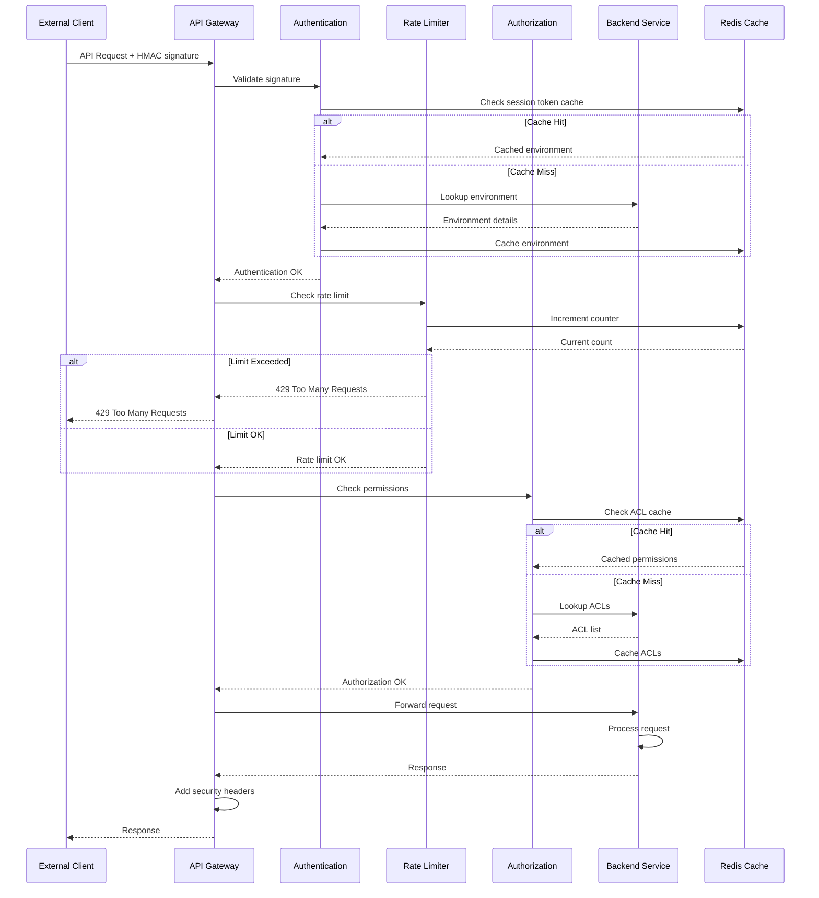

#### Gateway Configuration

**Route Configuration**:
```yaml
spring:
  cloud:
    gateway:
      routes:
        - id: environment-service
          uri: http://environment-service:8081
          predicates:
            - Path=/api/domains/**, /api/solutions/**, /api/zones/**, /api/environments/**
          filters:
            - AuthenticationFilter
            - AuthorizationFilter
            - RateLimitFilter
            
        - id: events-connector
          uri: http://events-connector:8084
          predicates:
            - Path=/{domainId}/{solutionId}/events/**
          filters:
            - AuthenticationFilter
            - AuthorizationFilter
            - RateLimitFilter
            
        - id: requests-connector
          uri: http://requests-connector:8085
          predicates:
            - Path=/{domainId}/{solutionId}/requests/**
          filters:
            - AuthenticationFilter
            - AuthorizationFilter
            - RateLimitFilter
```

> **Note**: Connector routes are simple pass-through — no `RewritePath` filters are needed. The connector controllers accept paths at `/{domainId}/{solutionId}/events`, `/{domainId}/{solutionId}/requests`, etc. directly (no `/api/v1/` prefix).

**Filter Chain**:
1. **AuthenticationFilter**: Validates HMAC signature, extracts tenant context
2. **AuthorizationFilter**: Checks ACL permissions
3. **RateLimitFilter**: Enforces rate limits
4. **RouteFilter**: Routes to backend service
5. **ResponseFilter**: Adds security headers

**Security Headers**:
```yaml
security:
  headers:
    - Strict-Transport-Security: max-age=31536000; includeSubDomains
    - X-Content-Type-Options: nosniff
    - X-Frame-Options: DENY
    - X-XSS-Protection: 1; mode=block
    - Content-Security-Policy: default-src 'self'
```

#### Gateway Benefits

**1. Centralized Security**:
- Single point for authentication and authorization
- Consistent security policy enforcement
- Simplified security auditing
- Reduced attack surface

**2. Simplified Client Integration**:
- Single endpoint for all operations
- Consistent API patterns
- Unified error handling
- Standard authentication mechanism

**3. Backend Service Protection**:
- Backend services not exposed to internet
- Rate limiting prevents overload
- Circuit breakers prevent cascade failures
- Request validation before reaching backend

**4. Operational Flexibility**:
- Backend services can be updated independently
- Service discovery enables dynamic routing
- Load balancing across service instances
- Blue-green deployments without client changes

**5. Observability**:
- Centralized logging of all requests
- Metrics collection per tenant and endpoint
- Distributed tracing across services
- Performance monitoring and alerting

### Integration Testing

The broker provides comprehensive integration testing capabilities:

#### Bruno API Test Collections

**Purpose**: End-to-end API testing with realistic scenarios

**Test Organization**:
```
bruno-tests/
+-- 01-health-checks/           # Service health verification
+-- 02-infrastructure/          # Domain, solution, zone, environment CRUD
+-- 03-authentication/          # HMAC signature validation
+-- 04-events/                  # Event publishing and subscription
+-- 05-requests/                # Request/response workflows
+-- 06-functional-services/     # Multi-phase job workflows
+-- 07-error-scenarios/         # Negative testing
```

**Example Test**:
```javascript
// bruno-tests/04-events/publish-event.bru
meta {
  name: Publish Student Created Event
  type: http
  seq: 1
}

post {
  url: {{baseUrl}}/api/events
  body: json
  auth: none
}

headers {
  Content-Type: application/json
  Authorization: {{generateHmacSignature()}}
}

body:json {
  {
    "eventAction": "CREATE",
    "objectType": "StudentPersonal",
    "objectData": {
      "refId": "{{$guid}}",
      "localId": "12345",
      "firstName": "John",
      "lastName": "Doe"
    }
  }
}

tests {
  test("Status is 202 Accepted", function() {
    expect(res.status).to.equal(202);
  });
  
  test("Response includes event ID", function() {
    expect(res.body.eventId).to.exist;
  });
}
```

#### TestContainers Integration Tests

**Purpose**: Integration testing with real PostgreSQL database

**Example Test**:
```java
@SpringBootTest
@Testcontainers
class EventPublishingIntegrationTest {
    
    @Container
    static PostgreSQLContainer<?> postgres = new PostgreSQLContainer<>("postgres:14")
        .withDatabaseName("sif_broker_test")
        .withUsername("test")
        .withPassword("test");
    
    @Test
    void publishEventAndVerifySubscriberReceives() {
        // Create provider environment
        var provider = createEnvironment("provider", "PROVIDER");
        
        // Create consumer environment
        var consumer = createEnvironment("consumer", "CONSUMER");
        
        // Create subscription
        createSubscription(consumer.id(), "StudentPersonal", "CREATE");
        
        // Publish event as provider
        var event = publishEvent(provider.sessionToken(), "StudentPersonal", "CREATE");
        
        // Poll consumer queue
        var messages = pollQueue(consumer.sessionToken());
        
        // Verify consumer received event
        assertThat(messages).contains(event);
    }
}
```

### Integration Best Practices

**1. Use Standard Authentication**:
- Always use HMAC-SHA256 authentication
- Include timestamp in signature
- Validate timestamp on server (5-minute window)
- Rotate shared secrets regularly (90 days)

**2. Handle Errors Gracefully**:
- Check HTTP status codes
- Parse error responses for details
- Implement retry logic with exponential backoff
- Use circuit breakers for fault tolerance

**3. Respect Rate Limits**:
- Monitor rate limit headers in responses
- Implement client-side rate limiting
- Use exponential backoff when rate limited
- Request higher limits if needed

**4. Use Queues for Asynchronous Operations**:
- Use delayed requests for long-running queries
- Poll queues regularly for responses
- Acknowledge messages after processing
- Handle dead-letter queue messages

**5. Monitor Integration Health**:
- Track request success/failure rates
- Monitor response times
- Alert on authentication failures
- Log all integration errors

### Future Integration Enhancements

**1. Webhooks**:
- Push notifications instead of polling
- Configurable webhook endpoints per environment
- Retry logic for failed webhook deliveries
- Webhook signature validation

**2. GraphQL API**:
- Alternative to REST API
- Flexible query capabilities
- Reduced over-fetching
- Real-time subscriptions

**3. WebSocket Support**:
- Real-time event streaming
- Bidirectional communication
- Reduced latency for time-sensitive data
- Connection management and heartbeats

**4. OAuth 2.0 / OpenID Connect**:
- Alternative authentication mechanism
- User-based authentication (not just application)
- Token refresh and revocation
- Integration with identity providers

**5. API Versioning**:
- Support multiple API versions simultaneously
- Gradual migration path for clients
- Deprecation warnings and timelines
- Backward compatibility guarantees

---

## Extensibility Architecture

The OSDB is designed as an open-source broker that implementors can extend without forking. Rather than modifying core broker code, implementors register their own Spring beans � custom filters, interceptors, event listeners, or backend implementations � and Spring's IoC container discovers and wires them automatically.

This section describes the extension point architecture, how each layer works, and how implementors package and deploy their extensions.

### Extension Point Overview

The broker exposes four categories of extension points, each targeting a different layer of the request lifecycle:

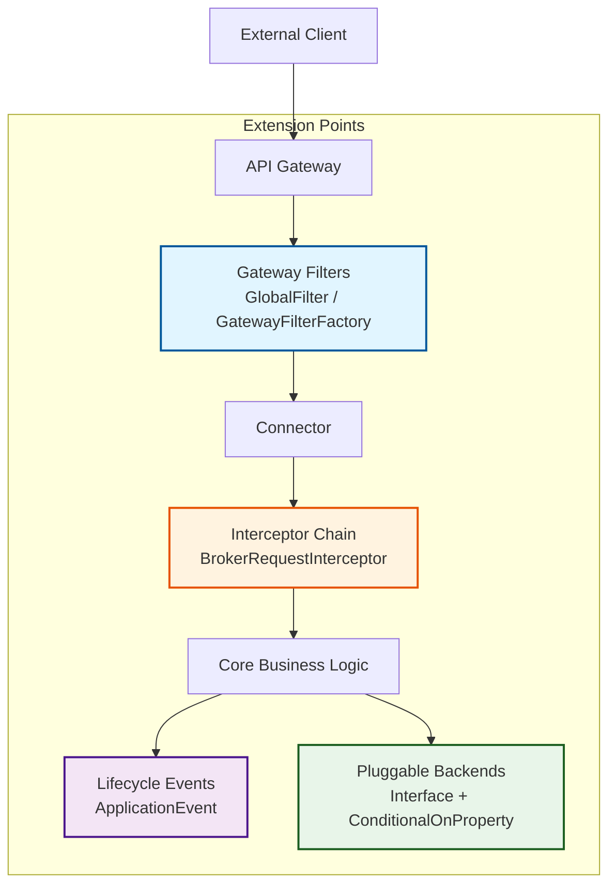

| Extension Point | Layer | Mechanism | Ordering | Scope |
|----------------|-------|-----------|----------|-------|
| Gateway filters | Request routing | `GlobalFilter` / `GatewayFilterFactory` | `@Order` annotation | All requests through the gateway |
| Connector interceptors | Message processing | `BrokerRequestInterceptor` chain | `@Order` annotation | Connector-specific (events, requests, responses, services) |
| Lifecycle events | Cross-cutting | `ApplicationEvent` + `@EventListener` | Publication order | Any module |
| Pluggable backends | Infrastructure | Interface + `@ConditionalOnProperty` | Configuration-driven | Storage, secrets, future backends |

### Gateway Extension Points

The API Gateway is built on Spring Cloud Gateway (reactive, WebFlux-based). It supports two extension mechanisms:

#### GlobalFilter

A `GlobalFilter` runs on every request that passes through the gateway, regardless of route. Implementors register a bean that implements `GlobalFilter` and Spring auto-discovers it.

Use cases:
- Custom authentication schemes (e.g., OAuth 2.0 alongside HMAC)
- Request/response logging and audit trails
- Header enrichment (e.g., injecting correlation IDs, tenant metadata)
- Custom rate limiting strategies
- Request body inspection or transformation

Ordering is controlled via `@Order` or by implementing `Ordered`. Lower values execute first. The core broker filters (authentication, authorization, rate limiting) use well-defined order values, so extensions can position themselves before or after specific core filters.

#### GatewayFilterFactory

A `GatewayFilterFactory` creates filters that apply to specific routes rather than all traffic. This is useful for route-specific behavior � for example, applying extra validation only to event publishing routes, or adding response headers only to queue polling routes.

Implementors define a factory bean, and routes reference it by name in configuration:

```yaml
spring:
  cloud:
    gateway:
      routes:
        - id: events
          predicates:
            - Path=/api/events/**
          filters:
            - CustomPayloadValidator
```

### Connector Interceptor Chain

Each connector (Events, Requests, Responses, Services) supports an ordered interceptor chain for pre- and post-processing of messages. This is the primary extension point for message-level logic.

#### BrokerRequestInterceptor

The `BrokerRequestInterceptor` interface defines two methods:

- `preProcess(BrokerRequest request)` � called before the connector processes the message. Can inspect, modify, or reject the request.
- `postProcess(BrokerRequest request, BrokerResponse response)` � called after processing. Can inspect or modify the response, trigger side effects, or log outcomes.

Use cases:
- Payload validation (e.g., schema validation against SIF XSD, business rule checks)
- Data enrichment (e.g., adding default values, normalizing fields)
- Data transformation (e.g., format conversion, field mapping)
- Audit logging (e.g., recording every message that passes through)
- Analytics and metrics collection
- Content filtering (e.g., redacting sensitive fields)

Multiple interceptors can be registered and are executed in `@Order` sequence. Each interceptor can short-circuit the chain by returning an error response from `preProcess`, preventing downstream interceptors and the core logic from executing.

### Lifecycle Events

The broker publishes Spring `ApplicationEvent` instances at key lifecycle points. Any bean annotated with `@EventListener` (or implementing `ApplicationListener`) can react to these events asynchronously.

Event categories:

| Event | Published When | Typical Extension Use |
|-------|---------------|----------------------|
| `EnvironmentRegisteredEvent` | New environment registers | Provision external resources, send welcome notifications |
| `EnvironmentDeregisteredEvent` | Environment deregisters | Clean up external resources, archive data |
| `MessagePublishedEvent` | Event/request published to queue | External audit trail, analytics pipeline, webhook triggers |
| `MessageDeliveredEvent` | Message delivered to consumer | Delivery confirmation, SLA tracking |
| `SubscriptionCreatedEvent` | New subscription registered | Notify administrators, update dashboards |
| `JobStateChangedEvent` | Job transitions state | External workflow orchestration, status notifications |

Lifecycle events are fire-and-forget from the broker's perspective � a failing listener does not affect the core operation. Listeners run asynchronously by default and should handle their own error recovery.

### Pluggable Backends

The broker already implements pluggable backends for two infrastructure concerns, and the pattern is designed to be extended to future backends:

#### Existing Pluggable Backends

- **Storage**: `StorageProvider` interface with `S3StorageProvider` (production) and `FileSystemStorageProvider` (development). Selected via `STORAGE_TYPE` environment variable.
- **Secrets**: `SecretsBackend` interface with implementations for HashiCorp Vault, AWS Secrets Manager, and database encryption. Selected via configuration properties.

#### Adding New Backends

The pattern for adding a new pluggable backend:

1. Define an interface in `sif-broker-common` (e.g., `NotificationProvider`)
2. Implement the interface in one or more classes
3. Annotate each implementation with `@ConditionalOnProperty` to activate based on configuration
4. The broker selects the active implementation at startup based on the property value

This pattern keeps the core code decoupled from any specific infrastructure provider.

### Packaging Extensions

Implementors package their extensions as a Spring Boot starter JAR:

1. **Create a Maven module** with a dependency on `sif-broker-common` (for shared interfaces and DTOs)
2. **Implement extension beans** � filters, interceptors, event listeners, or backend implementations
3. **Register for auto-discovery** via `META-INF/spring/org.springframework.boot.autoconfigure.AutoConfiguration.imports` (Spring Boot 3.x) or `spring.factories` (Spring Boot 2.x)
4. **Add the JAR as a Maven dependency** of the target broker module
5. Spring Boot auto-discovers and wires the beans at startup � no core code changes needed

#### Extension Configuration

Extensions should follow Spring Boot conventions for configuration:

- Define configuration properties with a unique prefix (e.g., `osdb.extensions.my-extension.*`)
- Use `@ConditionalOnProperty` to enable/disable the extension via configuration
- Provide sensible defaults so the extension works out of the box
- Document all configuration properties in the extension's README

#### Extension Ordering

When multiple extensions of the same type are registered, execution order is controlled by:

- `@Order(value)` annotation � lower values execute first
- `Ordered` interface � programmatic ordering
- Core broker components use order values in well-defined ranges, documented in the extension developer guide, so custom extensions can position themselves precisely

### Extension Isolation

Extensions run in the same JVM as the broker � there is no process-level isolation. This means:

- Extensions have access to the full Spring context (by design, for flexibility)
- A poorly written extension can affect broker performance or stability
- Extensions should be tested thoroughly before deployment
- The broker provides health check endpoints that include extension status
- Logging and metrics from extensions are captured in the same observability pipeline as core broker telemetry

---

## Scalability Considerations

The OSDB is designed to scale from small school districts (hundreds of users) to large state agencies (millions of users). This section describes the scalability strategies, performance optimization techniques, and capacity planning considerations.

### Horizontal Scaling Strategy

The broker uses horizontal scaling (adding more instances) rather than vertical scaling (bigger servers) for all services.

#### Service Scaling Characteristics

| Service | Scaling Trigger | Bottleneck | Typical Instances | Max Instances |
|---------|----------------|------------|-------------------|---------------|
| Gateway | CPU > 70% | HMAC validation | 3-5 | 20 |
| Environment Service | Request rate > 100/sec | Database queries | 2-3 | 10 |
| Queue Service | Message rate > 500/sec | Redis operations | 3-5 | 15 |
| Job Service | Request rate > 50/sec | Database writes | 2-3 | 10 |
| Subscription Service | Request rate > 50/sec | Database queries | 2-3 | 10 |
| Events Connector | Message rate > 200/sec | Queue operations | 2-4 | 12 |
| Requests Connector | Message rate > 200/sec | Queue operations | 2-4 | 12 |
| Responses Connector | Message rate > 200/sec | Queue operations | 2-4 | 12 |
| Services Connector | Job rate > 100/sec | HTTP calls | 2-3 | 10 |

#### Kubernetes Horizontal Pod Autoscaler (HPA)

**Configuration Example**:
```yaml
apiVersion: autoscaling/v2
kind: HorizontalPodAutoscaler
metadata:
  name: gateway-hpa
spec:
  scaleTargetRef:
    apiVersion: apps/v1
    kind: Deployment
    name: gateway
  minReplicas: 3
  maxReplicas: 20
  metrics:
    - type: Resource
      resource:
        name: cpu
        target:
          type: Utilization
          averageUtilization: 70
    - type: Resource
      resource:
        name: memory
        target:
          type: Utilization
          averageUtilization: 80
  behavior:
    scaleUp:
      stabilizationWindowSeconds: 60
      policies:
        - type: Percent
          value: 50
          periodSeconds: 60
    scaleDown:
      stabilizationWindowSeconds: 300
      policies:
        - type: Percent
          value: 25
          periodSeconds: 60
```

**Scaling Behavior**:
- **Scale Up**: Add 50% more pods every 60 seconds when CPU > 70%
- **Scale Down**: Remove 25% of pods every 60 seconds when CPU < 70%
- **Stabilization**: Wait 5 minutes before scaling down (prevents flapping)
- **Min Replicas**: Always run at least 3 instances for high availability
- **Max Replicas**: Cap at 20 instances to prevent runaway scaling

#### Stateless Service Design

All services are designed to be stateless, enabling seamless horizontal scaling:

**1. No In-Memory State**:
- Session data stored in Redis (not in-memory)
- No sticky sessions required
- Any instance can handle any request
- Load balancer can distribute freely

**2. Shared External State**:
- Database state in PostgreSQL
- Cache state in Redis
- Message state in Redis Streams
- File state in S3

**3. Idempotent Operations**:
- Repeated requests produce same result
- Safe to retry failed requests
- No side effects from duplicate processing

**Example - Stateless Event Publishing**:
```java
@RestController
public class EventsController {
    
    // No instance variables - completely stateless
    
    @PostMapping("/api/events")
    public ResponseEntity<EventResponse> publishEvent(
        @RequestHeader("Authorization") String authHeader,
        @RequestBody EventRequest request
    ) {
        // Extract tenant context from request (not stored in instance)
        var tenantContext = authService.authenticate(authHeader);
        
        // Store event in external state (Redis + S3)
        var eventId = queueService.enqueueEvent(tenantContext, request);
        
        // Return response (no state retained)
        return ResponseEntity.accepted()
            .body(new EventResponse(eventId));
    }
}
```

### Database Scaling

PostgreSQL is the primary bottleneck for most operations. Multiple strategies address database scalability:

#### 1. Connection Pooling

**HikariCP Configuration**:
```yaml
spring:
  datasource:
    hikari:
      maximum-pool-size: 20          # Connections per service instance
      minimum-idle: 5                # Minimum idle connections
      connection-timeout: 30000      # 30 seconds
      idle-timeout: 600000           # 10 minutes
      max-lifetime: 1800000          # 30 minutes
      leak-detection-threshold: 60000 # 60 seconds
```

**Connection Pool Sizing**:
```
Total Connections = S(Service Instances � Connections per Instance)

Example for medium deployment:
- Gateway: 3 instances � 20 connections = 60
- Environment Service: 2 instances � 20 connections = 40
- Queue Service: 3 instances � 20 connections = 60
- Job Service: 2 instances � 20 connections = 40
- Subscription Service: 2 instances � 20 connections = 40
- Connectors: 4 services � 2 instances � 20 connections = 160
Total: 400 connections

PostgreSQL max_connections should be set to 500+ for headroom.
```

**Connection Pool Monitoring**:
```java
@Component
public class ConnectionPoolMetrics {
    
    @Scheduled(fixedRate = 60000)  // Every minute
    public void recordMetrics() {
        HikariPoolMXBean pool = hikariDataSource.getHikariPoolMXBean();
        
        meterRegistry.gauge("hikari.connections.active", pool.getActiveConnections());
        meterRegistry.gauge("hikari.connections.idle", pool.getIdleConnections());
        meterRegistry.gauge("hikari.connections.total", pool.getTotalConnections());
        meterRegistry.gauge("hikari.connections.waiting", pool.getThreadsAwaitingConnection());
    }
}
```

#### 2. Read Replicas

**Strategy**: Route read-only queries to read replicas, write queries to primary

**Configuration**:
```yaml
spring:
  datasource:
    primary:
      url: jdbc:postgresql://primary.db.internal:5432/sif_broker
      username: ${DB_USERNAME}
      password: ${DB_PASSWORD}
    
    replica:
      url: jdbc:postgresql://replica.db.internal:5432/sif_broker
      username: ${DB_USERNAME}
      password: ${DB_PASSWORD}
      read-only: true
```

**Routing Logic**:
```java
@Configuration
public class DatabaseRoutingConfig {
    
    @Bean
    public DataSource routingDataSource(
        @Qualifier("primaryDataSource") DataSource primary,
        @Qualifier("replicaDataSource") DataSource replica
    ) {
        var routing = new AbstractRoutingDataSource() {
            @Override
            protected Object determineCurrentLookupKey() {
                return TransactionSynchronizationManager.isCurrentTransactionReadOnly() 
                    ? "replica" : "primary";
            }
        };
        
        Map<Object, Object> dataSources = new HashMap<>();
        dataSources.put("primary", primary);
        dataSources.put("replica", replica);
        
        routing.setTargetDataSources(dataSources);
        routing.setDefaultTargetDataSource(primary);
        
        return routing;
    }
}
```

**Read Replica Benefits**:
- Offload read queries from primary (80% of queries are reads)
- Reduce primary database load by 60-70%
- Improve read query performance (dedicated resources)
- Enable geographic distribution (replicas in multiple regions)

**Read Replica Considerations**:
- Replication lag (typically 100-500ms)
- Eventual consistency for read queries
- Write queries always go to primary
- Failover to primary if replica unavailable

#### 3. Database Indexing

**Index Strategy**:

All foreign keys indexed:
```sql
CREATE INDEX idx_solutions_domain_uuid ON solutions(domain_uuid);
CREATE INDEX idx_zones_solution_uuid ON zones(solution_uuid);
CREATE INDEX idx_environments_solution_uuid ON environments(solution_uuid);
CREATE INDEX idx_environments_zone_id ON environments(zone_id);
CREATE INDEX idx_acls_environment_id ON acls(environment_id);
```

Frequently queried columns indexed:
```sql
CREATE INDEX idx_environments_session_token ON environments(session_token);
CREATE INDEX idx_environments_application_key ON environments(application_key);
CREATE INDEX idx_messages_queue_id ON messages(queue_id);
CREATE INDEX idx_messages_created_at ON messages(created_at);
```

Composite indexes for common queries:
```sql
-- Lookup environment by session token and domain
CREATE INDEX idx_environments_lookup ON environments(session_token, solution_id);

-- Filter messages by queue and status
CREATE INDEX idx_messages_queue_status ON messages(queue_id, status);

-- Filter subscriptions by environment and event type
CREATE INDEX idx_subscriptions_env_event ON subscriptions(environment_id, event_type);
```

**Index Monitoring**:
```sql
-- Find unused indexes
SELECT schemaname, tablename, indexname, idx_scan
FROM pg_stat_user_indexes
WHERE idx_scan = 0
ORDER BY pg_relation_size(indexrelid) DESC;

-- Find missing indexes (queries with sequential scans)
SELECT schemaname, tablename, seq_scan, seq_tup_read
FROM pg_stat_user_tables
WHERE seq_scan > 1000
ORDER BY seq_tup_read DESC;
```

#### 4. Query Optimization

**N+1 Query Prevention**:
```java
// BAD: N+1 queries
List<Solution> solutions = solutionRepository.findAll();
for (Solution solution : solutions) {
    Domain domain = solution.getDomain();  // Lazy load - separate query!
    System.out.println(domain.getName());
}

// GOOD: Single query with join
@Query("SELECT s FROM Solution s JOIN FETCH s.domain")
List<Solution> findAllWithDomain();
```

**Pagination for Large Result Sets**:
```java
// BAD: Load all results into memory
List<Environment> environments = environmentRepository.findAll();

// GOOD: Paginate results
Pageable pageable = PageRequest.of(0, 100);
Page<Environment> environments = environmentRepository.findAll(pageable);
```

**Batch Operations**:
```java
// BAD: Individual inserts
for (Message message : messages) {
    messageRepository.save(message);  // Separate transaction per message
}

// GOOD: Batch insert
messageRepository.saveAll(messages);  // Single transaction
```

#### 5. Database Partitioning (Future)

**Strategy**: Partition large tables by date or tenant

**Example - Partition messages table by month**:
```sql
-- Create partitioned table
CREATE TABLE messages (
    id UUID NOT NULL,
    queue_id UUID NOT NULL,
    payload TEXT,
    created_at TIMESTAMP NOT NULL,
    PRIMARY KEY (id, created_at)
) PARTITION BY RANGE (created_at);

-- Create monthly partitions
CREATE TABLE messages_2026_03 PARTITION OF messages
    FOR VALUES FROM ('2026-03-01') TO ('2026-04-01');

CREATE TABLE messages_2026_04 PARTITION OF messages
    FOR VALUES FROM ('2026-04-01') TO ('2026-05-01');

-- Automatic partition creation via cron job
```

**Benefits**:
- Faster queries (scan only relevant partitions)
- Easier data archival (drop old partitions)
- Improved vacuum performance (per partition)
- Better index performance (smaller indexes per partition)

### Caching Strategy

The broker caches high-cost, low-volatility data � configuration and reference data that is read frequently but changes rarely (environments, ACLs, provider registries, zone/solution hierarchies, etc.). This data typically changes on the order of months or years, making it an ideal candidate for aggressive caching with write-through invalidation.

#### Two-Level Cache Architecture

The broker uses a two-level (L1/L2) cache to minimize latency while maintaining consistency across instances:

```
Request ? L1 (Caffeine, in-process) ? L2 (Redis, distributed) ? Database
```

- **L1 � Caffeine (in-process)**: Each service instance maintains a local in-memory cache. This eliminates network round-trips for the hottest data. Bounded by entry count with LRU eviction.
- **L2 � Redis (distributed)**: Shared across all instances. Acts as the authoritative cache layer. Long TTL as a safety net against missed invalidations.

On a cache miss at L1, the instance checks L2. On a miss at L2, the database is queried and the result is written back to both L2 and L1.

#### Design Principles

1. **Write-through invalidation**: Caches are invalidated when the underlying data is mutated (create, update, delete). No polling or short TTLs needed for correctness.
2. **Cross-instance L1 eviction via Pub/Sub**: When a write occurs, the service publishes an invalidation message on a Redis Pub/Sub channel. All instances subscribe and evict the corresponding L1 entries, ensuring local caches don't serve stale data after another instance performs a write.
3. **Long L2 TTL as a safety net**: A generous TTL (e.g., 24 hours) on Redis entries acts as a backstop against missed invalidations, not as the primary freshness mechanism.
4. **Manual invalidation at any granularity**: Admin endpoints and a future UI button allow operators to flush a single entry, a cache namespace, or all caches across all instances � the "break glass" escape hatch for edge cases and bugs.
5. **Extensible cache registry**: New caches can be added for any high-cost/low-volatility call by annotating the method with `@Cacheable` and registering an eviction path on the corresponding write operations.

#### Cache Configuration

Caches use Spring Cache abstraction with a composite cache manager (Caffeine L1 + Redis L2):

```java
// Example: caching any expensive, rarely-changing lookup
@Cacheable(value = "my-cache", key = "#lookupKey")
public MyDTO getExpensiveData(String lookupKey) {
    return repository.findByKey(lookupKey)
        .orElseThrow(() -> new NotFoundException(lookupKey));
}
```

General configuration:

| Layer | TTL | Eviction | Sizing |
|-------|-----|----------|--------|
| L1 (Caffeine) | 10 minutes | LRU, bounded by entry count | Tuned per cache based on cardinality |
| L2 (Redis) | 24 hours | LRU | Tuned per cache based on cardinality |

Hit rate target: >95% combined (L1 + L2).

#### Cache Invalidation

**Write-Through Invalidation**:

Any service method that mutates cached data evicts the relevant entries from both L1 and L2, and publishes an invalidation event so other instances evict their L1:

```java
@CacheEvict(value = "my-cache", key = "#entity.lookupKey")
public MyEntity update(MyEntity entity) {
    // L2 evicted by @CacheEvict, L1 evicted via Pub/Sub listener
    return repository.save(entity);
}
```

For operations that affect multiple entries (e.g., cascade deletes), use `allEntries = true` on the affected cache or evict entries programmatically.

**Manual / On-Demand Invalidation**:

Admin endpoints provide operational control at varying granularity levels. These are intended as a safety valve � when something gets out of sync due to an edge case or bug, an operator (or a future admin UI) can force a cache reset without restarting services:

```bash
# Nuclear option: clear all caches on all instances (L1 + L2)
POST /api/admin/cache/clear

# Clear a specific cache namespace on all instances
POST /api/admin/cache/clear/{cacheName}

# Clear a single entry within a cache on all instances
POST /api/admin/cache/clear/{cacheName}/{key}
```

Each of these endpoints clears the Redis L2 entry and publishes a Pub/Sub invalidation event so all instances also clear their L1. The response includes a summary of what was cleared.

**Invalidation Flow**:

```
Write/Delete occurs (or admin triggers manual flush)
  ? Evict from local L1 (Caffeine)
  ? Evict from L2 (Redis)
  ? Publish invalidation event on Redis Pub/Sub channel
  ? All other instances receive event ? evict from their L1
```

#### Cache Monitoring

**Metrics**:
```java
@Component
public class CacheMetrics {
    
    @Scheduled(fixedRate = 60000)
    public void recordMetrics() {
        for (String cacheName : cacheManager.getCacheNames()) {
            Cache cache = cacheManager.getCache(cacheName);
            CacheStatistics stats = cache.getStatistics();
            
            meterRegistry.gauge("cache.size", Tags.of("cache", cacheName), 
                stats.getSize());
            meterRegistry.gauge("cache.hit.rate", Tags.of("cache", cacheName), 
                stats.getHitRate());
            meterRegistry.gauge("cache.miss.rate", Tags.of("cache", cacheName), 
                stats.getMissRate());
        }
    }
}
```

**Alerts**:
```yaml
# Alert if cache hit rate drops below 80%
- alert: LowCacheHitRate
  expr: cache_hit_rate < 0.80
  labels:
    severity: warning
  annotations:
    summary: "Low cache hit rate for {{ $labels.cache }}"
    description: "Cache {{ $labels.cache }} hit rate is {{ $value }}"
```

### Message Queue Scaling

Redis Streams provides the message queue infrastructure. Multiple strategies ensure queue scalability:

#### 1. Consumer Groups

**Strategy**: Multiple consumers process messages in parallel

**Configuration**:
```java
// Create consumer group
redisTemplate.opsForStream()
    .createGroup("queue:consumer-123", "consumer-group");

// Multiple consumers read from same group
StreamReadOptions options = StreamReadOptions.empty()
    .count(10)
    .block(Duration.ofSeconds(5));

List<MapRecord<String, Object, Object>> messages = 
    redisTemplate.opsForStream().read(
        Consumer.from("consumer-group", "consumer-1"),
        options,
        StreamOffset.create("queue:consumer-123", ReadOffset.lastConsumed())
    );
```

**Benefits**:
- Parallel message processing
- Automatic load balancing across consumers
- Message acknowledgment prevents duplicate processing
- Failed messages can be retried by other consumers

#### 2. Message Payload Offloading

**Strategy**: Store large message payloads in S3, keep only pointers in Redis

**Implementation**:
```java
public String enqueueMessage(String queueId, String payload) {
    // Store payload in S3
    String storageKey = storageProvider.store(payload);
    
    // Store pointer in Redis
    Map<String, String> messageData = Map.of(
        "storageKey", storageKey,
        "size", String.valueOf(payload.length()),
        "timestamp", Instant.now().toString()
    );
    
    RecordId recordId = redisTemplate.opsForStream()
        .add("queue:" + queueId, messageData);
    
    return recordId.getValue();
}
```

**Benefits**:
- Redis memory usage reduced by 90%+
- Support for large messages (up to 5GB in S3)
- Redis performance remains high (small messages)
- Pluggable storage backend (S3, filesystem, etc.)

#### 3. Queue Sharding

**Strategy**: Distribute queues across multiple Redis instances

**Configuration**:
```yaml
redis:
  cluster:
    nodes:
      - redis-1.internal:6379
      - redis-2.internal:6379
      - redis-3.internal:6379
    max-redirects: 3
```

**Sharding Logic**:
```java
// Hash queue ID to determine Redis node
int shard = Math.abs(queueId.hashCode()) % redisClusterSize;
RedisConnection connection = redisCluster.getConnection(shard);
```

**Benefits**:
- Distribute load across multiple Redis instances
- Scale beyond single Redis instance limits
- Fault isolation (one shard failure doesn't affect others)

#### 4. Dead-Letter Queue

**Strategy**: Move failed messages to dead-letter queue after max retries

**Implementation**:
```java
public void processMessage(Message message) {
    try {
        // Process message
        handleMessage(message);
        
        // Acknowledge success
        redisTemplate.opsForStream().acknowledge(
            "queue:" + message.getQueueId(),
            "consumer-group",
            message.getId()
        );
    } catch (Exception e) {
        message.incrementRetryCount();
        
        if (message.getRetryCount() >= MAX_RETRIES) {
            // Move to dead-letter queue
            moveToDeadLetterQueue(message);
        } else {
            // Retry with exponential backoff
            scheduleRetry(message, calculateBackoff(message.getRetryCount()));
        }
    }
}
```

**Benefits**:
- Prevent poison messages from blocking queue
- Manual inspection and reprocessing of failed messages
- Metrics on failure rates and types

### Load Balancing

Kubernetes Service provides built-in load balancing for all services.

#### Service Load Balancing

**Configuration**:
```yaml
apiVersion: v1
kind: Service
metadata:
  name: gateway
spec:
  selector:
    app: gateway
  ports:
    - protocol: TCP
      port: 8080
      targetPort: 8080
  type: ClusterIP
  sessionAffinity: None  # Round-robin load balancing
```

**Load Balancing Algorithms**:
- **Round-Robin**: Default, distributes requests evenly
- **Least Connections**: Route to instance with fewest active connections
- **IP Hash**: Route based on client IP (sticky sessions)

**Health Checks**:
```yaml
livenessProbe:
  httpGet:
    path: /actuator/health/liveness
    port: 8080
  initialDelaySeconds: 30
  periodSeconds: 10
  
readinessProbe:
  httpGet:
    path: /actuator/health/readiness
    port: 8080
  initialDelaySeconds: 10
  periodSeconds: 5
```

**Benefits**:
- Automatic traffic distribution
- Failed instances removed from rotation
- Zero-downtime deployments (rolling updates)
- Automatic scaling integration

### Performance Optimization

#### 1. Reactive Programming for High Concurrency

**Gateway uses Spring WebFlux (reactive)**:
```java
@RestController
public class GatewayController {
    
    @GetMapping("/api/environments/{id}")
    public Mono<EnvironmentDTO> getEnvironment(@PathVariable UUID id) {
        return environmentServiceClient.getEnvironment(id)
            .timeout(Duration.ofSeconds(30))
            .retry(3)
            .onErrorResume(e -> Mono.error(new ServiceUnavailableException()));
    }
}
```

**Benefits**:
- Handle 10,000+ concurrent connections with minimal threads
- Non-blocking I/O reduces thread pool exhaustion
- Backpressure prevents memory overflow
- Better resource utilization

#### 2. Async Processing for Long-Running Operations

**Queue processing uses async patterns**:
```java
@Service
public class MessageProcessor {
    
    @Async("messageProcessorExecutor")
    public CompletableFuture<Void> processMessage(Message message) {
        return CompletableFuture.runAsync(() -> {
            // Long-running processing
            handleMessage(message);
        });
    }
}

@Configuration
public class AsyncConfig {
    
    @Bean(name = "messageProcessorExecutor")
    public Executor messageProcessorExecutor() {
        ThreadPoolTaskExecutor executor = new ThreadPoolTaskExecutor();
        executor.setCorePoolSize(10);
        executor.setMaxPoolSize(50);
        executor.setQueueCapacity(1000);
        executor.setThreadNamePrefix("msg-processor-");
        executor.initialize();
        return executor;
    }
}
```

**Benefits**:
- Don't block HTTP threads for long operations
- Better throughput for I/O-bound operations
- Configurable thread pools per operation type

#### 3. Batch Processing

**Batch message retrieval**:
```java
// BAD: Retrieve messages one at a time
for (int i = 0; i < 100; i++) {
    Message message = queueService.getNextMessage(queueId);
    processMessage(message);
}

// GOOD: Retrieve messages in batches
List<Message> messages = queueService.getMessages(queueId, 100);
messages.parallelStream().forEach(this::processMessage);
```

**Benefits**:
- Reduce network round trips
- Better throughput (10x improvement)
- Lower latency per message

### Capacity Planning

#### Sizing Guidelines

**Small Deployment (1-10 districts, <10,000 students)**:
- Gateway: 2 instances, 2 CPU, 4GB RAM each
- Backend Services: 1 instance each, 1 CPU, 2GB RAM
- PostgreSQL: 2 CPU, 8GB RAM, 100GB storage
- Redis: 1 CPU, 4GB RAM
- Total: ~20 CPU, ~40GB RAM

**Medium Deployment (10-100 districts, 10,000-100,000 students)**:
- Gateway: 3 instances, 4 CPU, 8GB RAM each
- Backend Services: 2 instances each, 2 CPU, 4GB RAM
- PostgreSQL: 8 CPU, 32GB RAM, 500GB storage
- Redis: 2 CPU, 8GB RAM
- Total: ~60 CPU, ~120GB RAM

**Large Deployment (100+ districts, 100,000+ students)**:
- Gateway: 5 instances, 8 CPU, 16GB RAM each
- Backend Services: 3 instances each, 4 CPU, 8GB RAM
- PostgreSQL: 16 CPU, 64GB RAM, 2TB storage (with read replicas)
- Redis: 4 CPU, 16GB RAM (clustered)
- Total: ~150 CPU, ~300GB RAM

#### Performance Benchmarks

**Target Performance Metrics**:
- API response time: <200ms (p95)
- Throughput: >1,000 requests/second
- Error rate: <0.1%
- Database query time: <50ms (p95)
- Cache hit rate: >90%
- Message processing latency: <1 second (p95)

**Load Testing**:
```bash
# Use k6 for load testing
k6 run --vus 100 --duration 5m load-test.js

# Example load test script
import http from 'k6/http';
import { check } from 'k6';

export default function() {
  const res = http.post('https://broker.example.com/api/events', 
    JSON.stringify({
      eventAction: 'CREATE',
      objectType: 'StudentPersonal',
      objectData: { ... }
    }),
    {
      headers: {
        'Content-Type': 'application/json',
        'Authorization': generateHmacSignature()
      }
    }
  );
  
  check(res, {
    'status is 202': (r) => r.status === 202,
    'response time < 200ms': (r) => r.timings.duration < 200
  });
}
```

### Scalability Testing

**Property-Based Scalability Tests**:
```java
@Property
void systemMaintainsPerformanceUnderLoad(
    @ForAll @IntRange(min = 100, max = 10000) int requestsPerSecond
) {
    // Generate load
    var startTime = Instant.now();
    var responses = generateLoad(requestsPerSecond, Duration.ofMinutes(1));
    var endTime = Instant.now();
    
    // Verify performance
    var p95ResponseTime = calculateP95(responses.stream()
        .map(Response::getDuration)
        .collect(Collectors.toList()));
    
    assertThat(p95ResponseTime).isLessThan(Duration.ofMillis(200));
    
    // Verify throughput
    var actualThroughput = responses.size() / 
        Duration.between(startTime, endTime).getSeconds();
    
    assertThat(actualThroughput).isGreaterThan(requestsPerSecond * 0.95);
}
```

### Summary

The OSDB's scalability architecture provides:

1. **Horizontal Scaling**: All services scale independently based on load
2. **Database Optimization**: Connection pooling, read replicas, indexing, query optimization
3. **Caching Strategy**: Multi-layer caching with Redis reduces database load by 70%+
4. **Queue Scalability**: Consumer groups, payload offloading, sharding support high message volumes
5. **Performance Optimization**: Reactive programming, async processing, batch operations
6. **Capacity Planning**: Clear sizing guidelines from small to large deployments

This architecture enables the broker to scale from small districts to statewide deployments while maintaining consistent performance and reliability.

---

## Security Architecture Overview

Security is a foundational concern for the OSDB, given its role in handling sensitive educational data. This section provides a high-level overview of the security architecture, with detailed coverage in the dedicated Security Architecture document.

### Security Principles

The broker's security architecture is built on these core principles:

1. **Defense in Depth**: Multiple layers of security controls
2. **Least Privilege**: Minimal permissions required for each operation
3. **Zero Trust**: Verify every request, trust nothing by default
4. **Secure by Default**: Security enabled out of the box
5. **Audit Everything**: Comprehensive logging of all security events

### Security Layers

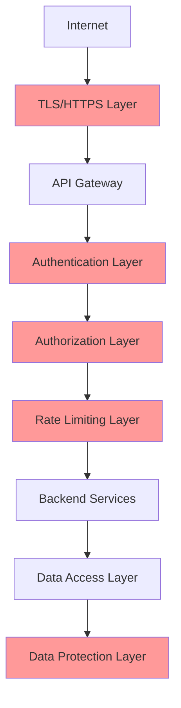

#### Layer 1: Network Security

**TLS/HTTPS Enforcement**:
- All external communication over HTTPS (TLS 1.3)
- Strong cipher suites only (AES-256-GCM, ChaCha20-Poly1305)
- Certificate validation required
- HTTP Strict Transport Security (HSTS) enabled

**Network Segmentation**:
- Gateway exposed to internet (DMZ)
- Backend services in private network
- Database in isolated subnet
- No direct external access to backend services

**Firewall Rules**:
```yaml
# Ingress rules
- Allow: Internet ? Gateway (port 443)
- Allow: Gateway ? Backend Services (port 8081-8088)
- Allow: Backend Services ? PostgreSQL (port 5432)
- Allow: Backend Services ? Redis (port 6379)
- Deny: All other traffic
```

#### Layer 2: Authentication

**HMAC-SHA256 Cryptographic Signing**:

The broker uses HMAC-SHA256 for request authentication per SIF 3.7 specification:

```
Signature = HMAC-SHA256(
    key = shared_secret,
    message = session_token + timestamp
)

Authorization: SIF_HMAC session_token:signature:timestamp
```

**Authentication Flow**:
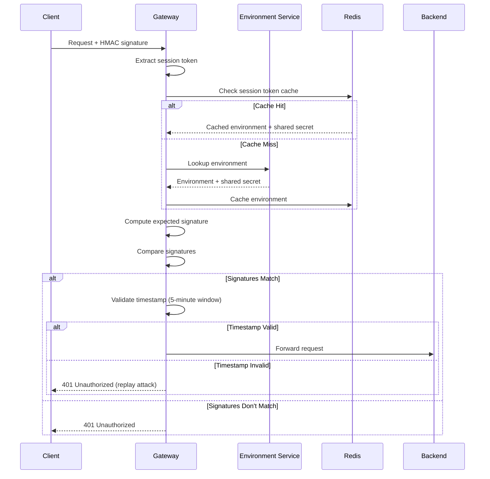

**Timestamp Validation**:
- Prevents replay attacks
- 5-minute window (configurable)
- Server time synchronized via NTP
- Timestamp must be within window of server time

**Session Token Management**:
- UUID v4 format (cryptographically random)
- Unique per environment
- Stored securely in database
- Cached in Redis for performance
- Rotatable without downtime

**Shared Secret Management**:
- Generated on environment creation (32 bytes, base64-encoded)
- Stored in secrets backend (Vault or AWS Secrets Manager)
- Never logged or exposed in responses
- Rotatable via API

#### Layer 3: Authorization

**ACL-Based Access Control**:

Fine-grained permissions control what each environment can do:

```java
public class ACL {
    private UUID environmentId;  // Who
    private String resource;     // What (events, requests, responses, services)
    private String action;       // How (publish, subscribe, query, create)
    private String scope;        // Where (zone:*, context:*, all)
}
```

**Authorization Check**:
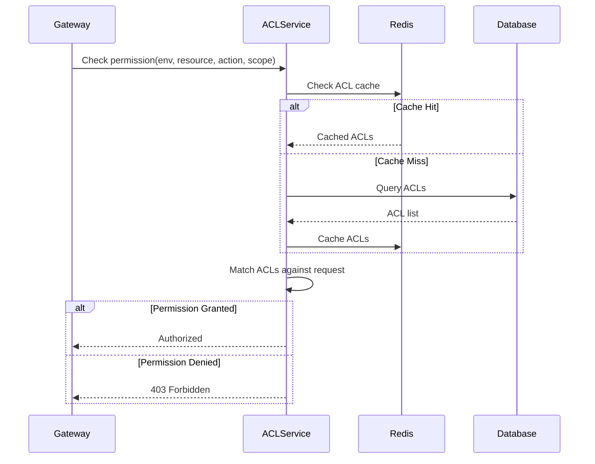

**Permission Examples**:

```bash
# Provider can publish events in its zone
{
  "environmentId": "provider-123",
  "resource": "events",
  "action": "publish",
  "scope": "zone:district-office"
}

# Consumer can subscribe to events in specific zone
{
  "environmentId": "consumer-456",
  "resource": "events",
  "action": "subscribe",
  "scope": "zone:district-office"
}

# Admin can manage all resources
{
  "environmentId": "admin-789",
  "resource": "*",
  "action": "*",
  "scope": "all"
}
```

**Admin Role**:
- Special environment type with elevated privileges
- Can create/update/delete domains, solutions, zones, environments
- Can manage ACLs for all environments
- Bootstrap admin created during initial setup
- Additional admins created by existing admins

#### Layer 4: Rate Limiting

**Distributed Rate Limiting with Redis**:

Prevents abuse and ensures fair resource allocation:

```java
public void checkRateLimit(String domainId, String solutionId, String zoneId) {
    String key = String.format("rate-limit:%s:%s:%s:%s", 
        domainId, solutionId, zoneId, getCurrentMinute());
    
    Long count = redisTemplate.opsForValue().increment(key);
    
    if (count == 1) {
        redisTemplate.expire(key, Duration.ofMinutes(1));
    }
    
    if (count > RATE_LIMIT) {
        throw new RateLimitExceededException();
    }
}
```

**Rate Limiting Configuration**:

Rate limits are configurable per environment based on operational requirements. The system supports multiple rate limiting scopes to ensure fair resource allocation.

**Rate Limit Headers**:
```
X-RateLimit-Limit: 1000
X-RateLimit-Remaining: 847
X-RateLimit-Reset: 1678886400
```

**Rate Limit Scope**:
- Domain-level: Total across all solutions/zones
- Solution-level: Separate limits for production vs. non-production
- Zone-level: Separate limits per zone (prevents one school from impacting others)

#### Layer 5: Data Access Security

**Multi-Tenancy Isolation**:

Every database query includes tenant filtering:

```java
// All queries filtered by domain
@Query("SELECT e FROM Environment e " +
       "JOIN e.solution s " +
       "JOIN s.domain d " +
       "WHERE d.domainId = :domainId")
List<Environment> findByDomain(@Param("domainId") String domainId);
```

**SQL Injection Prevention**:
- Parameterized queries (JPA/Hibernate)
- No string concatenation for SQL
- Input validation on all parameters
- ORM escaping of special characters

**Connection Security**:
- Database connections over SSL/TLS
- Certificate validation required
- Encrypted credentials (from secrets backend)
- Connection pooling with leak detection

#### Layer 6: Data Protection

**Data in Transit**:
- TLS 1.3 for all external communication
- TLS for internal service communication (optional, recommended)
- TLS for database connections
- TLS for Redis connections

**Data at Rest**:
- PostgreSQL encryption at rest (future)
- S3 server-side encryption (SSE-S3 or SSE-KMS)
- Redis persistence encryption (future)
- Encrypted backups

**Sensitive Data Handling**:
- Shared secrets never logged
- Passwords hashed with bcrypt (admin accounts)
- PII encrypted in database (future)
- Audit logs exclude sensitive data

**Data Retention**:
- Active tenant data: Retained indefinitely
- Deleted tenant data: Purged immediately (with optional export)
- Audit logs: Retained for 1 year
- Backups: Retained for 30 days

### Security Headers

All responses include security headers:

```yaml
Strict-Transport-Security: max-age=31536000; includeSubDomains; preload
X-Content-Type-Options: nosniff
X-Frame-Options: DENY
X-XSS-Protection: 1; mode=block
Content-Security-Policy: default-src 'self'
Referrer-Policy: strict-origin-when-cross-origin
Permissions-Policy: geolocation=(), microphone=(), camera=()
```

### Secrets Management

**Pluggable Secrets Backend**:

The broker supports multiple secrets management backends:

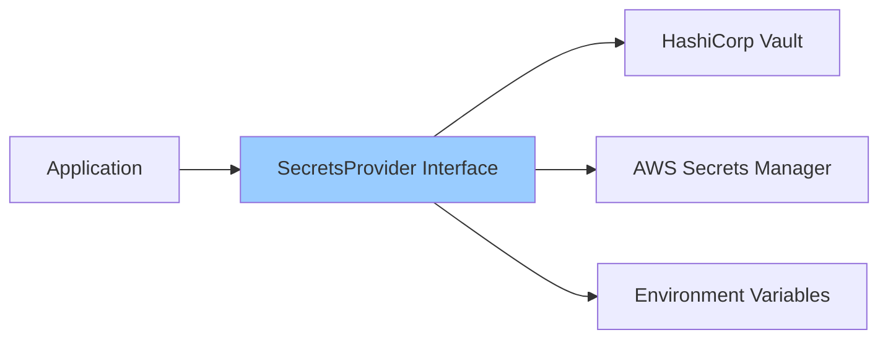

**Secrets Stored**:
- Database passwords
- Redis passwords
- HMAC shared secrets (per environment)
- API keys for external services
- TLS certificates and private keys

**Secret Rotation**:
- Automatic rotation every 90 days
- Zero-downtime rotation (dual-secret period)
- Audit trail of all rotations
- Manual rotation via API

**HashiCorp Vault Integration**:
```java
@Configuration
public class VaultConfig {
    
    @Bean
    public VaultTemplate vaultTemplate() {
        VaultEndpoint endpoint = VaultEndpoint.create("vault.internal", 8200);
        endpoint.setScheme("https");
        
        TokenAuthentication auth = new TokenAuthentication(vaultToken);
        
        return new VaultTemplate(endpoint, auth);
    }
}
```

**AWS Secrets Manager Integration**:
```java
@Configuration
public class SecretsManagerConfig {
    
    @Bean
    public SecretsManagerClient secretsManagerClient() {
        return SecretsManagerClient.builder()
            .region(Region.US_EAST_1)
            .credentialsProvider(DefaultCredentialsProvider.create())
            .build();
    }
}
```

### Audit Logging

**Comprehensive Audit Trail**:

All security-relevant events are logged:

```json
{
  "timestamp": "2026-03-12T10:30:45.123Z",
  "level": "INFO",
  "event_type": "authentication",
  "domain_id": "state-a-doe",
  "solution_id": "production",
  "zone_id": "district-001",
  "environment_id": "550e8400-e29b-41d4-a716-446655440000",
  "session_token": "abc123...",
  "ip_address": "203.0.113.42",
  "user_agent": "DistrictSIS/8.0",
  "operation": "publish_event",
  "resource": "StudentPersonal",
  "action": "CREATE",
  "result": "success",
  "duration_ms": 45
}
```

**Audit Event Types**:
- Authentication attempts (success/failure)
- Authorization checks (granted/denied)
- Resource creation/update/deletion
- ACL changes
- Admin operations
- Rate limit violations
- Security errors (invalid signatures, expired timestamps)

**Audit Log Storage**:
- Stored in PostgreSQL (audit_logs table)
- Replicated to S3 for long-term retention
- Indexed for fast querying
- Retained for 1 year (configurable)

**Audit Log Querying**:
```bash
# Query audit logs by domain
GET /api/admin/audit-logs?domainId=state-a-doe&startDate=2026-03-01&endDate=2026-03-31

# Query failed authentication attempts
GET /api/admin/audit-logs?eventType=authentication&result=failure

# Query admin operations
GET /api/admin/audit-logs?operation=admin_*
```

### Security Monitoring

**Real-Time Security Monitoring**:

```yaml
# Alert on high authentication failure rate
- alert: HighAuthenticationFailureRate
  expr: rate(auth_failures_total[5m]) > 10
  labels:
    severity: warning
  annotations:
    summary: "High authentication failure rate"
    description: "{{ $value }} auth failures per second"

# Alert on rate limit violations
- alert: RateLimitViolations
  expr: rate(rate_limit_exceeded_total[5m]) > 5
  labels:
    severity: warning
  annotations:
    summary: "High rate limit violation rate"
    description: "{{ $value }} rate limit violations per second"

# Alert on authorization failures
- alert: AuthorizationFailures
  expr: rate(authz_failures_total[5m]) > 5
  labels:
    severity: warning
  annotations:
    summary: "High authorization failure rate"
    description: "{{ $value }} authorization failures per second"
```

**Security Metrics**:
```
# Authentication metrics
sif_broker_auth_attempts_total{result="success"} 15000
sif_broker_auth_attempts_total{result="failure"} 50

# Authorization metrics
sif_broker_authz_checks_total{result="granted"} 14500
sif_broker_authz_checks_total{result="denied"} 100

# Rate limiting metrics
sif_broker_rate_limit_checks_total{result="ok"} 14800
sif_broker_rate_limit_checks_total{result="exceeded"} 20
```

### Regulatory Support

The broker provides infrastructure capabilities that help organizations meet regulatory requirements. Specific compliance is the responsibility of the deploying organization.

**Security capabilities that support regulatory needs:**
- Multi-tenancy isolation protects data between organizations
- ACL-based access controls restrict data visibility
- Comprehensive audit logs track all data access
- Data deletion support (soft and hard delete)
- Data export capabilities for portability
- Data minimization (broker stores metadata only, not PII)

**Data Residency**:
- Multi-region deployment support (future)
- Data stored in tenant's home region
- Cross-region replication optional

### Security Testing

**Property-Based Security Tests**:

```java
@Property
void invalidSignatureRejected(@ForAll String sessionToken, @ForAll String payload) {
    // Generate invalid signature
    String invalidSignature = "invalid-signature";
    String authHeader = String.format("SIF_HMAC %s:%s:%d", 
        sessionToken, invalidSignature, Instant.now().getEpochSecond());
    
    // Attempt request with invalid signature
    var response = sendRequest(authHeader, payload);
    
    // Verify rejection
    assertThat(response.getStatus()).isEqualTo(401);
}

@Property
void expiredTimestampRejected(@ForAll String sessionToken, @ForAll String payload) {
    // Generate signature with old timestamp (10 minutes ago)
    long oldTimestamp = Instant.now().minus(10, ChronoUnit.MINUTES).getEpochSecond();
    String signature = generateSignature(sessionToken, sharedSecret, oldTimestamp, payload);
    String authHeader = String.format("SIF_HMAC %s:%s:%d", 
        sessionToken, signature, oldTimestamp);
    
    // Attempt request with expired timestamp
    var response = sendRequest(authHeader, payload);
    
    // Verify rejection (replay attack prevention)
    assertThat(response.getStatus()).isEqualTo(401);
}

@Property
void unauthorizedResourceAccessDenied(
    @ForAll Environment environment,
    @ForAll String resource,
    @ForAll String action
) {
    // Assume environment doesn't have permission
    assumeThat(hasPermission(environment, resource, action)).isFalse();
    
    // Attempt unauthorized operation
    var response = performOperation(environment, resource, action);
    
    // Verify denial
    assertThat(response.getStatus()).isEqualTo(403);
}
```

**Security Scanning**:
- OWASP Dependency Check (vulnerable dependencies)
- SpotBugs (security vulnerabilities in code)
- SonarQube (security hotspots)
- Trivy (container image vulnerabilities)
- Penetration testing (annual)

### Security Best Practices

**For Integrators**:
1. Store shared secrets securely (never in code or logs)
2. Rotate shared secrets every 90 days
3. Use HTTPS for all communication
4. Validate TLS certificates
5. Implement retry logic with exponential backoff
6. Monitor authentication failures
7. Report security issues immediately

**For Operators**:
1. Enable TLS for all communication
2. Use secrets backend (Vault or AWS Secrets Manager)
3. Enable audit logging
4. Monitor security metrics
5. Apply security updates promptly
6. Conduct regular security audits
7. Implement network segmentation
8. Use strong firewall rules
9. Enable database encryption at rest
10. Backup audit logs to separate storage

### Future Security Enhancements

**1. OAuth 2.0 / OpenID Connect**:
- User-based authentication (not just application)
- Integration with identity providers (Okta, Auth0, Azure AD)
- Token refresh and revocation
- Single sign-on (SSO) support

**2. Mutual TLS (mTLS)**:
- Client certificate authentication
- Stronger authentication than HMAC
- Certificate-based authorization
- Zero-trust network architecture

**3. Field-Level Encryption**:
- Encrypt sensitive fields in database (PII)
- Application-level encryption/decryption
- Key management with KMS
- Compliance with data protection regulations

**4. Anomaly Detection**:
- Machine learning for unusual access patterns
- Behavioral analysis per environment
- Automatic blocking of suspicious activity
- Integration with SIEM systems

**5. Security Information and Event Management (SIEM)**:
- Integration with Splunk, ELK, or similar
- Centralized security event aggregation
- Advanced threat detection
- Compliance reporting

### Summary

The OSDB's security architecture provides:

1. **Defense in Depth**: Multiple security layers from network to data
2. **Strong Authentication**: HMAC-SHA256 cryptographic signing per SIF 3.7
3. **Fine-Grained Authorization**: ACL-based access control
4. **Rate Limiting**: Protection against abuse from misconfigured clients
5. **Secrets Management**: Pluggable backend for secure credential storage
6. **Comprehensive Auditing**: All security events logged and monitored
7. **Regulatory Support**: Security infrastructure to help meet regulatory requirements
8. **Security Testing**: Property-based tests and automated scanning

For detailed security information, see the dedicated **Security Architecture** document.

---

## Service Interaction Patterns

This section provides detailed sequence diagrams showing how services interact for key workflows. These diagrams illustrate the complete flow of requests through the system, including authentication, authorization, data processing, and response handling.

### 1. Environment Registration Workflow

New applications register with the broker to obtain credentials:

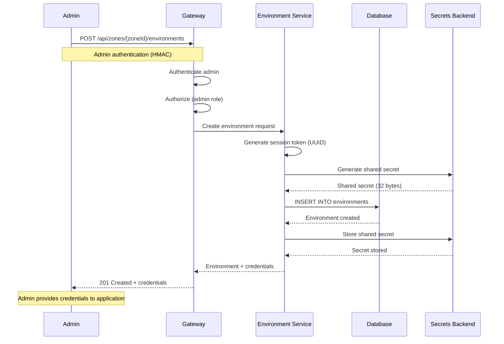

### 2. Event Publishing and Distribution Workflow

Provider publishes event, broker distributes to subscribers:

```mermaid
sequenceDiagram
    participant Provider
    participant Gateway
    participant EventsConn as Events Connector
    participant QueueSvc as Queue Service
    participant SubSvc as Subscription Service
    participant Storage as S3/Filesystem
    participant Redis
    participant Consumer
    
    Provider->>Gateway: POST /{domainId}/{solutionId}/events + HMAC
    Gateway->>Gateway: Authenticate provider
    Gateway->>Gateway: Authorize (events:publish)
    Gateway->>EventsConn: Forward event
    
    EventsConn->>EventsConn: Track metadata (audit)
    EventsConn->>QueueSvc: Enqueue event
    
    QueueSvc->>SubSvc: Match subscriptions
    SubSvc->>SubSvc: Filter by zone/context/type
    SubSvc-->>QueueSvc: Subscriber queue IDs (N queues)
    
    Note over QueueSvc,Redis: Shared payload storage with ref-counted writes
    QueueSvc->>Redis: INCR ref count (sourceId = provider env UUID)
    alt First thread (0→1)
        QueueSvc->>Storage: Store event payload ONCE
        Storage-->>QueueSvc: Storage key
    end
    
    loop For each subscriber
        QueueSvc->>Redis: Add event pointer to queue
    end
    
    QueueSvc-->>EventsConn: Event queued
    EventsConn-->>Gateway: 202 Accepted
    Gateway-->>Provider: 202 Accepted
    
    Note over Consumer: Consumer polls queue
    
    Consumer->>Gateway: GET /queues/{queueId}/messages
    Gateway->>Gateway: Authenticate consumer
    Gateway->>QueueSvc: Get messages
    
    QueueSvc->>Redis: Retrieve event pointers
    Redis-->>QueueSvc: Event pointers (shared storage key)
    
    QueueSvc->>Storage: Retrieve event payloads
    Storage-->>QueueSvc: Event payloads
    
    QueueSvc-->>Gateway: Event messages
    Gateway-->>Consumer: 200 OK + events
    
    Consumer->>Gateway: DELETE /api/queues/{queueId}/messages/{msgId}
    Gateway->>QueueSvc: Acknowledge message
    QueueSvc->>Redis: Remove from queue
```

### 3. Immediate Request/Response Workflow

Consumer sends an immediate request - the broker proxies to the provider and returns the response synchronously:

```mermaid
sequenceDiagram
    participant Consumer
    participant Gateway
    participant ReqConn as Requests Connector
    participant EnvService as Environment Service
    participant Provider
    
    Consumer->>Gateway: GET /api/students/123 + HMAC
    Gateway->>Gateway: Authenticate consumer
    Gateway->>Gateway: Authorize (requests:send)
    Gateway->>ReqConn: Forward request
    
    ReqConn->>EnvService: Discover provider for StudentPersonal
    EnvService-->>ReqConn: Provider environment
    
    ReqConn->>ReqConn: Replace consumer auth with provider auth
    ReqConn->>Provider: GET /students/123 + Provider HMAC
    
    Provider->>Provider: Process request
    Provider-->>ReqConn: 200 OK + Student data
    
    ReqConn-->>Gateway: Return response
    Gateway-->>Consumer: 200 OK + Student data
```

### 4. Delayed Request/Response Workflow

Consumer sends a delayed request (with `queueId`), receives `202 Accepted`, and polls the queue for the response. This diagram shows the variant where the provider supports immediate requests - the broker proxies to the provider but deposits the response into the consumer's queue instead of returning it directly:

```mermaid
sequenceDiagram
    participant Consumer
    participant Gateway
    participant ReqConn as Requests Connector
    participant QueueSvc as Queue Service
    participant EnvService as Environment Service
    participant Redis
    participant Provider
    
    Consumer->>Gateway: POST /api/requests?queueId=consumer-queue + HMAC
    Gateway->>Gateway: Authenticate consumer
    Gateway->>ReqConn: Forward request with queueId
    
    ReqConn->>EnvService: Discover provider
    EnvService-->>ReqConn: Provider environment (immediate)
    
    ReqConn->>ReqConn: Associate request with consumer queue
    ReqConn-->>Gateway: 202 Accepted
    Gateway-->>Consumer: 202 Accepted (request queued)
    
    Note over Consumer,Provider: Async processing begins
    
    ReqConn->>ReqConn: Replace consumer auth with provider auth
    ReqConn->>Provider: Forward request + Provider HMAC
    
    Provider->>Provider: Process request
    Provider-->>ReqConn: 200 OK + Response data
    
    ReqConn->>QueueSvc: Deposit response to consumer queue
    QueueSvc->>Redis: Store response
    
    Note over Consumer: Consumer polls queue
    
    Consumer->>Gateway: GET /api/queues/consumer-queue/messages
    Gateway->>QueueSvc: Get messages
    QueueSvc->>Redis: Retrieve messages
    Redis-->>QueueSvc: Response messages
    QueueSvc-->>Gateway: Response messages
    Gateway-->>Consumer: 200 OK + Response data
```

If the provider is a delayed provider (registered via Subscription Service to receive requests via queue polling), the broker deposits the request into the provider's queue instead. The provider polls, processes, and sends the response to the Responses Connector, which deposits it into the consumer's queue. See the detailed flow diagrams in the [Component Communication Patterns](#component-communication-patterns) section.

### 5. Functional Service Job Workflow

Consumer creates multi-phase job, provider updates phases:

```mermaid
sequenceDiagram
    participant Consumer
    participant Gateway
    participant SvcConn as Services Connector
    participant JobSvc as Job Service
    participant EnvService as Environment Service
    participant QueueSvc as Queue Service
    participant Provider
    
    Consumer->>Gateway: POST /api/services/jobs + HMAC
    Note over Consumer,Gateway: Create StudentEnrollment job
    Gateway->>Gateway: Authenticate consumer
    Gateway->>SvcConn: Create job request
    
    SvcConn->>JobSvc: POST /jobs (REST API call)
    JobSvc->>JobSvc: Create job with phases
    JobSvc-->>SvcConn: Job created (state: NOTSTARTED)
    
    SvcConn->>EnvService: Discover provider for StudentEnrollment
    EnvService-->>SvcConn: Provider environment
    
    SvcConn->>QueueSvc: Notify provider of new job
    QueueSvc-->>SvcConn: Notification queued
    
    SvcConn-->>Gateway: Job created
    Gateway-->>Consumer: 201 Created + Job ID
    
    Note over Provider: Provider polls queue
    
    Provider->>Gateway: GET /api/queues/provider-queue/messages
    Gateway->>QueueSvc: Get messages
    QueueSvc-->>Gateway: Job notification
    Gateway-->>Provider: New job notification
    
    Provider->>Gateway: PUT /api/services/jobs/{jobId} + HMAC
    Note over Provider,Gateway: Update phase: Validation COMPLETED
    Gateway->>SvcConn: Update job request
    
    SvcConn->>JobSvc: PUT /jobs/{jobId} (REST API call)
    JobSvc->>JobSvc: Update phase state
    JobSvc-->>SvcConn: Job updated
    
    SvcConn-->>Gateway: Job updated
    Gateway-->>Provider: 200 OK
    
    Note over Consumer: Consumer polls job status
    
    Consumer->>Gateway: GET /api/services/jobs/{jobId}
    Gateway->>SvcConn: Get job request
    
    SvcConn->>JobSvc: GET /jobs/{jobId} (REST API call)
    JobSvc-->>SvcConn: Job details
    
    SvcConn-->>Gateway: Job details
    Gateway-->>Consumer: 200 OK + Job status
```

### 6. Rate Limiting Workflow

Gateway enforces rate limits before forwarding requests:

```mermaid
sequenceDiagram
    participant Client
    participant Gateway
    participant Redis
    participant Backend
    
    Client->>Gateway: API Request + HMAC
    Gateway->>Gateway: Authenticate client
    Gateway->>Gateway: Extract tenant context
    
    Gateway->>Redis: INCR rate-limit:{domain}:{solution}:{zone}:{minute}
    Redis-->>Gateway: Current count
    
    alt Count <= Rate Limit
        Gateway->>Gateway: Add rate limit headers
        Note over Gateway: X-RateLimit-Limit: 1000<br/>X-RateLimit-Remaining: 847<br/>X-RateLimit-Reset: 1678886400
        
        Gateway->>Backend: Forward request
        Backend-->>Gateway: Response
        Gateway-->>Client: 200 OK + Response
    else Count > Rate Limit
        Gateway->>Gateway: Add rate limit headers
        Note over Gateway: X-RateLimit-Limit: 1000<br/>X-RateLimit-Remaining: 0<br/>X-RateLimit-Reset: 1678886400<br/>Retry-After: 45
        
        Gateway-->>Client: 429 Too Many Requests
    end
```

### 7. Authentication and Authorization Workflow

Complete authentication and authorization flow:

```mermaid
sequenceDiagram
    participant Client
    participant Gateway
    participant Redis
    participant EnvService as Environment Service
    participant Backend
    
    Client->>Gateway: Request + Authorization: SIF_HMAC token:sig:ts
    
    Note over Gateway: Step 1: Extract session token
    Gateway->>Gateway: Parse Authorization header
    
    Note over Gateway: Step 2: Lookup environment
    Gateway->>Redis: GET session-token:{token}
    alt Cache Hit
        Redis-->>Gateway: Cached environment
    else Cache Miss
        Gateway->>EnvService: GET /environments/by-token/{token}
        EnvService-->>Gateway: Environment + shared secret
        Gateway->>Redis: SET session-token:{token}
    end
    
    Note over Gateway: Step 3: Validate signature
    Gateway->>Gateway: Compute expected signature
    Gateway->>Gateway: Compare signatures
    alt Signatures Don't Match
        Gateway-->>Client: 401 Unauthorized
    end
    
    Note over Gateway: Step 4: Validate timestamp
    Gateway->>Gateway: Check timestamp within 5-minute window
    alt Timestamp Expired
        Gateway-->>Client: 401 Unauthorized (replay attack)
    end
    
    Note over Gateway: Step 5: Check rate limit
    Gateway->>Redis: INCR rate-limit:{domain}:{minute}
    Redis-->>Gateway: Current count
    alt Rate Limit Exceeded
        Gateway-->>Client: 429 Too Many Requests
    end
    
    Note over Gateway: Step 6: Check authorization
    Gateway->>Redis: GET acl:{envId}:{resource}:{action}
    alt Cache Hit
        Redis-->>Gateway: Cached ACLs
    else Cache Miss
        Gateway->>EnvService: GET /acls?envId={envId}&resource={resource}
        EnvService-->>Gateway: ACL list
        Gateway->>Redis: SET acl:{envId}:{resource}:{action}
    end
    
    Gateway->>Gateway: Match ACLs against request
    alt No Matching ACL
        Gateway-->>Client: 403 Forbidden
    end
    
    Note over Gateway: Step 7: Forward to backend
    Gateway->>Backend: Forward request
    Backend-->>Gateway: Response
    Gateway-->>Client: Response
```

### 8. Error Handling Workflow

How errors are handled and propagated:

```mermaid
sequenceDiagram
    participant Client
    participant Gateway
    participant Backend
    participant Database
    
    Client->>Gateway: API Request
    Gateway->>Gateway: Authenticate & Authorize
    Gateway->>Backend: Forward request
    
    Backend->>Database: Query database
    
    alt Database Error
        Database-->>Backend: Connection timeout
        Backend->>Backend: Log error with context
        Backend->>Backend: Create error response
        Backend-->>Gateway: 503 Service Unavailable
        Gateway->>Gateway: Add correlation ID
        Gateway-->>Client: 503 Service Unavailable
        Note over Client,Gateway: {"error": "SERVICE_UNAVAILABLE",<br/>"message": "Database temporarily unavailable",<br/>"correlationId": "abc-123"}
    else Business Logic Error
        Database-->>Backend: Query results
        Backend->>Backend: Validate business rules
        Backend->>Backend: Validation failed
        Backend-->>Gateway: 400 Bad Request
        Gateway-->>Client: 400 Bad Request
        Note over Client,Gateway: {"error": "VALIDATION_ERROR",<br/>"message": "Invalid student grade level",<br/>"field": "gradeLevel",<br/>"correlationId": "def-456"}
    else Success
        Database-->>Backend: Query results
        Backend->>Backend: Process results
        Backend-->>Gateway: 200 OK + Data
        Gateway-->>Client: 200 OK + Data
    end
```

### 9. Circuit Breaker Pattern

Services Connector uses circuit breaker for Job Service calls:

```mermaid
sequenceDiagram
    participant SvcConn as Services Connector
    participant CircuitBreaker
    participant JobSvc as Job Service
    
    Note over CircuitBreaker: State: CLOSED (normal)
    
    SvcConn->>CircuitBreaker: Call Job Service
    CircuitBreaker->>JobSvc: Forward call
    JobSvc-->>CircuitBreaker: Success
    CircuitBreaker-->>SvcConn: Success
    
    Note over CircuitBreaker: Failure count: 0
    
    SvcConn->>CircuitBreaker: Call Job Service
    CircuitBreaker->>JobSvc: Forward call
    JobSvc-->>CircuitBreaker: Timeout
    CircuitBreaker-->>SvcConn: Timeout error
    
    Note over CircuitBreaker: Failure count: 1
    
    SvcConn->>CircuitBreaker: Call Job Service
    CircuitBreaker->>JobSvc: Forward call
    JobSvc-->>CircuitBreaker: Timeout
    CircuitBreaker-->>SvcConn: Timeout error
    
    Note over CircuitBreaker: Failure count: 5 (threshold)<br/>State: OPEN (failing)
    
    SvcConn->>CircuitBreaker: Call Job Service
    CircuitBreaker->>CircuitBreaker: Circuit OPEN - fail fast
    CircuitBreaker-->>SvcConn: Circuit open error
    
    Note over CircuitBreaker: Wait 30 seconds...
    Note over CircuitBreaker: State: HALF_OPEN (testing)
    
    SvcConn->>CircuitBreaker: Call Job Service
    CircuitBreaker->>JobSvc: Test call
    JobSvc-->>CircuitBreaker: Success
    CircuitBreaker-->>SvcConn: Success
    
    Note over CircuitBreaker: State: CLOSED (recovered)
```

### 10. Distributed Tracing Workflow

Correlation IDs track requests across services:

```mermaid
sequenceDiagram
    participant Client
    participant Gateway
    participant EventsConn as Events Connector
    participant QueueSvc as Queue Service
    participant Storage
    
    Client->>Gateway: POST /api/events
    Note over Gateway: Generate correlation ID:<br/>corr-abc-123
    
    Gateway->>EventsConn: Forward request
    Note over Gateway,EventsConn: X-Correlation-ID: corr-abc-123
    
    EventsConn->>EventsConn: Log with correlation ID
    Note over EventsConn: [corr-abc-123] Processing event
    
    EventsConn->>QueueSvc: Enqueue event
    Note over EventsConn,QueueSvc: X-Correlation-ID: corr-abc-123
    
    QueueSvc->>QueueSvc: Log with correlation ID
    Note over QueueSvc: [corr-abc-123] Storing payload
    
    QueueSvc->>Storage: Store payload
    Note over QueueSvc,Storage: X-Correlation-ID: corr-abc-123
    
    Storage-->>QueueSvc: Storage key
    QueueSvc-->>EventsConn: Event queued
    EventsConn-->>Gateway: 202 Accepted
    Gateway-->>Client: 202 Accepted
    Note over Gateway,Client: X-Correlation-ID: corr-abc-123
    
    Note over Client,Storage: All logs include correlation ID<br/>for end-to-end tracing
```

These sequence diagrams illustrate the key interaction patterns in the OSDB. They show how services collaborate to implement complex workflows while maintaining security, reliability, and observability.

---

