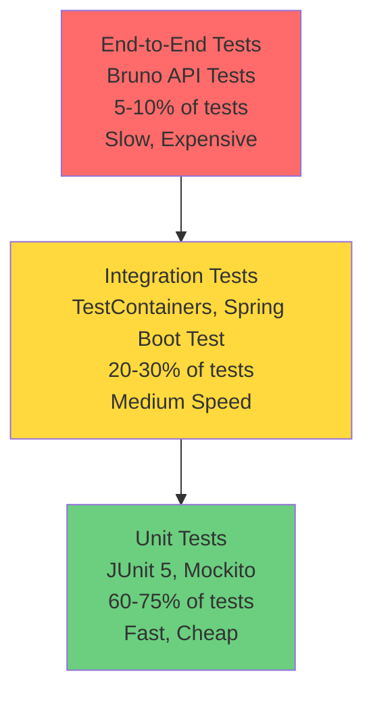
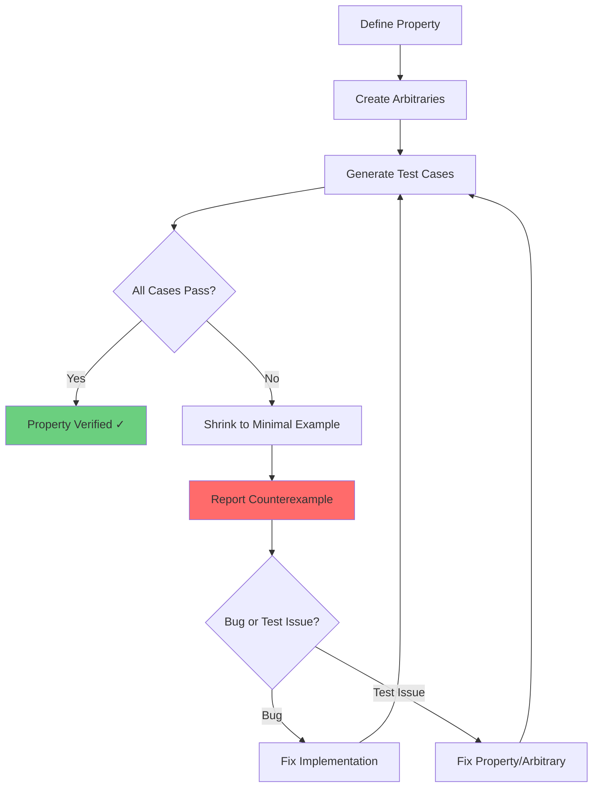
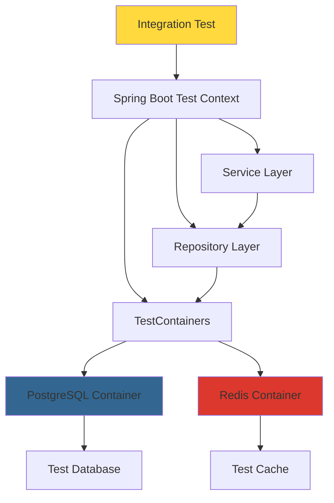
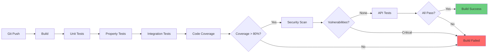

# SIF Unity Broker - Testing Architecture

**Version:** 1.1  
**Date:** March 12, 2026  
**Status:** Active  
**Updated:** April 6, 2026 — HTTP client technology, Bruno test suite additions, port layout corrections

## Table of Contents

1. [Testing Philosophy](#testing-philosophy)
2. [Testing Pyramid](#testing-pyramid)
3. [Property-Based Testing with jqwik](#property-based-testing-with-jqwik)
4. [Property Test Categories](#property-test-categories)
5. [Integration Testing Patterns](#integration-testing-patterns)
6. [API Testing with Bruno](#api-testing-with-bruno)
7. [Unit Testing Standards](#unit-testing-standards)
8. [Test Data Management](#test-data-management)
9. [Performance Testing Strategy](#performance-testing-strategy)
10. [Continuous Integration Testing](#continuous-integration-testing)
11. [Test Organization](#test-organization)
12. [References](#references)

---

## Testing Philosophy

### Testing Goals

The SIF Unity Broker implements a comprehensive testing strategy designed to ensure correctness, reliability, and maintainability of the educational data interoperability platform. Testing is not an afterthought but a core development practice integrated into every phase of the software development lifecycle.

**Primary Testing Goals:**

1. **Correctness**: Verify that the system behaves according to specifications and requirements
2. **Reliability**: Ensure the system operates consistently under various conditions
3. **Regression Prevention**: Detect when changes break existing functionality
4. **Documentation**: Tests serve as executable documentation of system behavior
5. **Confidence**: Enable developers to refactor and enhance code with confidence
6. **Quality Gates**: Enforce minimum quality standards before deployment

### Testing Principles

The testing architecture is built on industry-standard testing principles:

**1. Spec-Driven Development**

All features start with a specification document that defines:
- Business requirements with acceptance criteria
- Technical design with correctness properties
- Implementation tasks with testing requirements

Tests are written based on the specification before implementation begins, ensuring that requirements drive development.

**2. Property-Based Testing First**


Rather than relying solely on example-based tests, the broker uses property-based testing with jqwik to:
- Automatically generate hundreds of test cases from properties
- Discover edge cases that developers might miss
- Shrink failing examples to minimal counterexamples
- Verify universal properties hold across all inputs

**3. Test-Driven Development (TDD)**

Tests are written before implementation:
- Write failing test that defines desired behavior
- Implement minimal code to make test pass
- Refactor while keeping tests green
- Repeat for next requirement

**4. Comprehensive Coverage**

Minimum 80% code coverage across all services:
- Property-based tests for correctness properties
- Integration tests for workflows
- Unit tests for complex logic
- API tests for end-to-end scenarios

**5. Fast Feedback**

Tests are designed for quick execution:
- Unit tests run in milliseconds
- Property tests complete in seconds
- Integration tests use TestContainers for isolation
- CI/CD pipeline provides feedback within minutes

**6. Test Isolation**

Each test is independent and repeatable:
- Tests don't depend on execution order
- Database state is reset between tests
- Test data is generated or cleaned up
- No shared mutable state between tests

### Quality Gates

The project enforces quality gates at multiple levels:

**Development Time:**
- IDE integration shows test results immediately
- Pre-commit hooks run fast unit tests
- Developers run relevant test suites before pushing

**Commit Time:**
- CI pipeline runs all tests on every commit
- Build fails if any test fails
- Code coverage must meet minimum threshold (80%)
- Property tests must pass (no counterexamples)

**Merge Time:**
- All tests must pass before merge
- Code review includes test review
- New features require new tests
- Bug fixes require regression tests

**Release Time:**
- Full test suite must pass
- Performance tests must meet benchmarks
- Integration tests across all services
- API tests validate end-to-end workflows


---

## Testing Pyramid

The SIF Unity Broker follows the testing pyramid strategy, which emphasizes a broad base of fast unit tests, a middle layer of integration tests, and a small top layer of end-to-end tests.

### Pyramid Structure



### Test Distribution

The broker aims for the following test distribution:

| Test Level | Percentage | Execution Time | Purpose |
|------------|-----------|----------------|---------|
| **Unit Tests** | 60-75% | <1s per test | Test individual classes and methods in isolation |
| **Integration Tests** | 20-30% | 1-5s per test | Test interactions between components with real dependencies |
| **End-to-End Tests** | 5-10% | 5-30s per test | Test complete workflows through the API |

### Unit Tests (Base Layer)

**Characteristics:**
- Test individual classes and methods in isolation
- Use mocks for dependencies
- Execute in milliseconds
- No external dependencies (database, network, filesystem)
- Run frequently during development

**What to Test:**
- Business logic in service classes
- Validation logic
- Utility functions
- Data transformations
- Error handling

**Example:**
```java
@Test
void validateDomainId_ValidId_ReturnsTrue() {
    String validId = "state-a-edu-123";
    assertThat(DomainValidator.isValid(validId)).isTrue();
}
```

### Integration Tests (Middle Layer)

**Characteristics:**
- Test interactions between components
- Use real dependencies (database via TestContainers)
- Execute in seconds
- Isolated test environment
- Run before commit and in CI/CD

**What to Test:**
- Database operations (CRUD, queries, transactions)
- Service layer interactions
- Repository layer with real database
- Cascade deletion behavior
- Multi-tenancy data isolation

**Example:**
```java
@SpringBootTest
@Testcontainers
class DomainCrudIntegrationTest {
    @Container
    static PostgreSQLContainer<?> postgres = new PostgreSQLContainer<>("postgres:14");
    
    @Test
    void createAndRetrieveDomain_Success() {
        // Test with real database
    }
}
```


### End-to-End Tests (Top Layer)

**Characteristics:**
- Test complete workflows through the API
- Use real services and dependencies
- Execute in seconds to minutes
- Test from external perspective
- Run before release and in staging

**What to Test:**
- Complete user workflows
- Cross-service interactions
- Authentication and authorization flows
- Error handling across services
- Performance under realistic load

**Example:**
```javascript
// Bruno API test
test("Create domain, solution, and environment workflow", async () => {
    // Complete workflow test
});
```

### Coverage Goals

The broker enforces minimum coverage thresholds:

- **Overall Code Coverage**: >80% across all services
- **Service Layer**: >90% (critical business logic)
- **Controller Layer**: >80% (API endpoints)
- **Repository Layer**: >70% (database operations)
- **Utility Classes**: >85% (shared functionality)

**Coverage Measurement:**
- JaCoCo for Java code coverage
- Reports generated on every build
- Coverage trends tracked over time
- Pull requests show coverage delta

---

## Property-Based Testing with jqwik

### Why Property-Based Testing?

The SIF Unity Broker uses property-based testing as a primary testing strategy because it provides superior bug detection compared to traditional example-based testing.

**Advantages of Property-Based Testing:**

1. **Automatic Test Case Generation**: jqwik generates hundreds of test cases from a single property definition
2. **Edge Case Discovery**: Finds edge cases developers might not think of
3. **Shrinking**: When a test fails, jqwik automatically finds the minimal failing example
4. **Universal Verification**: Properties verify behavior across all possible inputs, not just specific examples
5. **Better Bug Detection**: Discovers bugs that example-based tests miss

**Example Comparison:**

Traditional example-based test:
```java
@Test
void createDomain_ValidInput_Success() {
    DomainCreateRequest request = new DomainCreateRequest("state-a-edu", "State A DOE");
    DomainDTO domain = domainService.createDomain(request);
    assertThat(domain.domainId()).isEqualTo("state-a-edu");
}
```

Property-based test:
```java
@Property
void createDomain_RoundTrip(@ForAll("validDomainIds") String domainId,
                            @ForAll("validDescriptions") String description) {
    DomainCreateRequest request = new DomainCreateRequest(domainId, description);
    DomainDTO created = domainService.createDomain(request);
    DomainDTO retrieved = domainService.getDomain(domainId);
    assertThat(retrieved).isEqualTo(created);
}
```

The property-based test automatically generates hundreds of combinations of domain IDs and descriptions, testing the round-trip property across all valid inputs.


### jqwik Framework

**jqwik** is a property-based testing framework for Java that integrates seamlessly with JUnit 5. It provides:

- **Arbitraries**: Generators for test data (built-in and custom)
- **Properties**: Universal statements that should hold for all inputs
- **Shrinking**: Automatic minimization of failing examples
- **Combinators**: Compose complex generators from simple ones
- **Statistics**: Collect statistics about generated test data

**Key jqwik Concepts:**

1. **@Property**: Marks a method as a property-based test
2. **@ForAll**: Injects generated test data into test parameters
3. **Arbitrary<T>**: Generator for values of type T
4. **@Provide**: Defines custom arbitraries for domain-specific data
5. **Combinators**: Combine multiple arbitraries (combine, map, filter, flatMap)

**jqwik Selection Rationale:**

The broker chose jqwik over alternatives for several reasons:

| Feature | jqwik | QuickCheck (Haskell) | Hypothesis (Python) |
|---------|-------|---------------------|---------------------|
| **Java Integration** | Native JUnit 5 | N/A | N/A |
| **Type Safety** | Full Java type system | Haskell types | Python dynamic |
| **IDE Support** | Excellent (IntelliJ, VS Code) | Good | Good |
| **Shrinking** | Integrated shrinking | Integrated | Integrated |
| **Spring Boot Integration** | Seamless | N/A | N/A |
| **Learning Curve** | Moderate | Steep | Moderate |
| **Documentation** | Comprehensive | Excellent | Excellent |

**Why jqwik for SIF Unity Broker:**
- Native Java integration with Spring Boot
- JUnit 5 compatibility (runs with existing test infrastructure)
- Excellent IDE support for debugging
- Strong type safety catches errors at compile time
- Active development and community support

### Property-Based Testing Workflow



**Workflow Steps:**

1. **Define Property**: Write a universal statement that should always be true
2. **Create Arbitraries**: Define generators for test data
3. **Generate Test Cases**: jqwik generates hundreds of test cases
4. **Execute Tests**: Run property against all generated cases
5. **Shrink on Failure**: If a case fails, jqwik finds minimal failing example
6. **Report Counterexample**: Show the simplest input that breaks the property
7. **Triage**: Determine if it's a bug in code or test
8. **Fix and Retry**: Fix the issue and re-run tests


---

## Property Test Categories

The SIF Unity Broker uses several categories of property-based tests, each serving a specific purpose in verifying system correctness.

### Property Test Categories Table

| Category | Purpose | Example Property | When to Use |
|----------|---------|------------------|-------------|
| **Round-Trip** | Verify data survives create→read cycle | Create domain → retrieve domain → data matches | CRUD operations, serialization |
| **Invariant** | Verify constraints always hold | Domain ID must be unique across all domains | Business rules, constraints |
| **Metamorphic** | Verify relationships between operations | Delete 1 of N solutions → count becomes N-1 | Counting, ordering, relationships |
| **Idempotence** | Verify repeated operations have same effect | Update domain twice → same result as once | Update operations, retries |
| **Commutativity** | Verify operation order doesn't matter | Create A then B = Create B then A | Independent operations |
| **Bug Condition Exploration** | Verify bugs exist before fixing | Rate limit exceeded returns 404 (should fail) | Bugfix specs, regression tests |
| **Preservation** | Verify existing behavior is preserved | Requests within limit still succeed | Bugfix specs, regression prevention |

### Round-Trip Properties

**Definition**: For any valid input, after creating an entity and then retrieving it, the returned entity should contain equivalent data.

**Purpose**: Verify that data persistence and retrieval work correctly without data loss or corruption.

**Pattern**:
```java
@Property
void entityCreationRoundTrip(@ForAll("validInputs") Input input) {
    // Create entity
    Entity created = service.create(input);
    
    // Retrieve entity
    Entity retrieved = service.get(created.getId());
    
    // Verify equivalence
    assertThat(retrieved).isEqualTo(created);
}
```

**Real Example from Codebase**:
```java
/**
 * Property 2: Domain Creation Round-Trip
 * 
 * For any valid domain_id and description, after creating a domain and then 
 * retrieving it, the returned domain should contain equivalent data.
 * 
 * Validates: Requirements 1.5, 1.6, 1.7
 */
@Property
void domainCreationRoundTrip(@ForAll("validDomainIds") String domainId,
                             @ForAll("validDescriptions") String description) {
    DomainCreateRequest request = new DomainCreateRequest(domainId, description);
    DomainDTO created = domainService.createDomain(request);
    DomainDTO retrieved = domainService.getDomain(domainId);
    
    assertThat(retrieved.domainId()).isEqualTo(created.domainId());
    assertThat(retrieved.description()).isEqualTo(created.description());
    assertThat(retrieved.createdAt()).isEqualTo(created.createdAt());
}
```

**When to Use**:
- All CRUD operations
- Data serialization/deserialization
- API request/response cycles
- Database persistence operations


### Invariant Properties

**Definition**: For any operation, certain constraints or business rules must always hold true.

**Purpose**: Verify that business rules and constraints are enforced consistently across all operations.

**Pattern**:
```java
@Property
void invariantAlwaysHolds(@ForAll("validOperations") Operation op) {
    // Perform operation
    Result result = service.execute(op);
    
    // Verify invariant
    assertThat(checkInvariant(result)).isTrue();
}
```

**Real Example from Codebase**:
```java
/**
 * Property 11: Zone Uniqueness Within Solution
 * 
 * For any solution, zone IDs must be unique within that solution.
 * 
 * Validates: Requirement 3.2
 */
@Property
void zoneIdMustBeUniqueWithinSolution(@ForAll("validSolutionIds") String solutionId,
                                      @ForAll("validZoneIds") String zoneId) {
    // Create first zone
    ZoneCreateRequest request1 = new ZoneCreateRequest(solutionId, zoneId, "Zone 1");
    zoneService.createZone(request1);
    
    // Attempt to create duplicate zone
    ZoneCreateRequest request2 = new ZoneCreateRequest(solutionId, zoneId, "Zone 2");
    
    // Invariant: Duplicate zone ID must be rejected
    assertThatThrownBy(() -> zoneService.createZone(request2))
        .isInstanceOf(DuplicateZoneException.class);
}
```

**When to Use**:
- Uniqueness constraints
- Business rule validation
- State machine transitions
- Authorization checks
- Data integrity constraints

### Metamorphic Properties

**Definition**: For related operations, verify that relationships between inputs and outputs hold.

**Purpose**: Test complex behaviors by verifying relationships between operations rather than absolute values.

**Pattern**:
```java
@Property
void metamorphicRelationship(@ForAll("inputs") Input input) {
    // Perform operation 1
    Result result1 = service.operation1(input);
    
    // Perform operation 2
    Result result2 = service.operation2(input);
    
    // Verify relationship
    assertThat(relationship(result1, result2)).isTrue();
}
```

**Real Example from Codebase**:
```java
/**
 * Property 21: Solution Count Metamorphic Property
 * 
 * For any domain containing N solutions, after deleting one solution, 
 * the count of solutions in that domain should be N-1.
 * 
 * Validates: Requirement 9.7
 */
@Property
void solutionCountMetamorphic(@ForAll("domains") Domain domain,
                               @ForAll("solutionCounts") int n) {
    // Create N solutions
    for (int i = 0; i < n; i++) {
        solutionService.createSolution(domain, "solution-" + i);
    }
    
    int countBefore = solutionService.countByDomain(domain.getId());
    assertThat(countBefore).isEqualTo(n);
    
    // Delete one solution
    solutionService.deleteSolution("solution-0");
    
    // Verify count is N-1
    int countAfter = solutionService.countByDomain(domain.getId());
    assertThat(countAfter).isEqualTo(n - 1);
}
```

**When to Use**:
- Counting operations
- Ordering operations
- Filtering operations
- Aggregation operations
- Relationship verification


### Bug Condition Exploration Tests

**Definition**: Tests that are EXPECTED TO FAIL on unfixed code, confirming that a bug exists.

**Purpose**: In bugfix specs, these tests verify that the bug can be reproduced before implementing the fix. When the test fails, it provides a counterexample demonstrating the bug.

**Critical Rules**:
- These tests MUST FAIL on unfixed code (failure confirms bug exists)
- DO NOT fix the test or code when it fails initially
- The failing test becomes a regression test after the fix
- Tests encode the expected (correct) behavior

**Pattern**:
```java
/**
 * Bug Condition Exploration Test
 * 
 * CRITICAL: This test MUST FAIL on unfixed code - failure confirms the bug exists.
 * DO NOT attempt to fix the test or code when it fails.
 * 
 * Validates: Requirement X.Y (bug description)
 */
@Property
@Label("Bug Condition - [description]")
void bugConditionExploration(@ForAll("inputs") Input input) {
    // Arrange: Set up conditions that trigger the bug
    
    // Act: Perform operation that exhibits buggy behavior
    Result result = service.operation(input);
    
    // Assert: Verify CORRECT behavior (will fail on unfixed code)
    assertThat(result).meetsExpectation(); // This assertion FAILS on buggy code
}
```

**Real Example from Codebase**:
```java
/**
 * Property 1: Bug Condition - Rate Limit Exceeded Returns 429
 * 
 * Tests that when rate limit is exceeded, the Gateway returns 429 TOO_MANY_REQUESTS 
 * (not 404 NOT_FOUND).
 * 
 * EXPECTED ON UNFIXED CODE: Test FAILS because response is 404 instead of 429.
 * 
 * Validates: Requirements 1.10, 2.10
 */
@Property
@Label("Bug Condition - Rate limit exceeded returns 429")
void rateLimitExceeded_Returns429Status(@ForAll("environmentIds") UUID environmentId) {
    // Mock rate limiter to return denied response
    when(mockRateLimiter.isAllowed(anyString(), anyInt()))
        .thenReturn(Mono.just(RateLimitResponse.denied(5L)));
    
    // Process request
    filter.filter(exchange, mockChain).block();
    
    // BUG: This assertion FAILS on unfixed code - status is 404 instead of 429
    assertThat(exchange.getResponse().getStatusCode())
        .as("Rate limit exceeded MUST return 429 TOO_MANY_REQUESTS (not 404)")
        .isEqualTo(HttpStatus.TOO_MANY_REQUESTS);
}
```

**When to Use**:
- Bugfix specifications (Task 1: Write bug condition exploration test)
- Regression test creation
- Verifying bug reproduction before fixing
- Documenting expected vs. actual behavior

**Workflow**:
1. Write test that encodes correct behavior
2. Run test - it FAILS, confirming bug exists
3. Counterexample shows minimal case that triggers bug
4. Implement fix
5. Run test - it PASSES, confirming fix works
6. Test becomes regression test


### Preservation Tests

**Definition**: Tests that are EXPECTED TO PASS on unfixed code, verifying that existing correct behavior is preserved after a fix.

**Purpose**: In bugfix specs, these tests establish baseline behavior that must not break when fixing a bug. They ensure the fix doesn't introduce regressions.

**Critical Rules**:
- These tests MUST PASS on unfixed code (confirms baseline is correct)
- Tests verify behavior that should NOT change
- After fix, these tests must still pass
- Protect against regression when fixing bugs

**Pattern**:
```java
/**
 * Preservation Test
 * 
 * CRITICAL: This test MUST PASS on unfixed code (confirms baseline behavior).
 * This behavior must be preserved after the fix.
 * 
 * Validates: Requirement X.Y (preservation requirement)
 */
@Property
@Label("Preservation - [description]")
void preservationTest(@ForAll("inputs") Input input) {
    // Arrange: Set up conditions for correct behavior
    
    // Act: Perform operation that works correctly
    Result result = service.operation(input);
    
    // Assert: Verify correct behavior (PASSES on unfixed code)
    assertThat(result).meetsExpectation(); // This assertion PASSES
}
```

**Real Example from Codebase**:
```java
/**
 * Property 2.1: Preservation - Requests Within Rate Limits Process Successfully
 * 
 * EXPECTED OUTCOME: This test PASSES on unfixed code (confirms baseline behavior)
 * 
 * This property verifies that when requests are within the rate limit for an environment,
 * they continue to be processed successfully. The filter should allow the request to proceed
 * through the filter chain without blocking or returning an error response.
 * 
 * Validates: Requirement 3.7
 */
@Property
@Label("Preservation: Requests within rate limits process successfully")
void requestsWithinRateLimit_ProcessSuccessfully(
    @ForAll("environmentIds") UUID environmentId,
    @ForAll("requestPaths") String path) {
    
    // Mock rate limiter to return allowed response (within rate limit)
    when(mockRateLimiter.isAllowed(anyString(), anyInt()))
        .thenReturn(Mono.just(RateLimitResponse.allowed()));
    
    // Process request
    filter.filter(exchange, mockChain).block();
    
    // Verify the request was allowed to proceed (PASSES on unfixed code)
    assertThat(chainCalled.get())
        .as("Filter chain should be called for requests within rate limit")
        .isTrue();
    
    assertThat(exchange.getResponse().getStatusCode())
        .as("No error status should be set for requests within rate limit")
        .isNull();
}
```

**When to Use**:
- Bugfix specifications (Task 2: Write preservation tests)
- Regression prevention
- Verifying fix doesn't break existing functionality
- Documenting correct behavior that must be maintained

**Relationship to Bug Condition Tests**:

| Aspect | Bug Condition Exploration | Preservation |
|--------|--------------------------|--------------|
| **Expected on Unfixed Code** | FAIL (bug exists) | PASS (baseline correct) |
| **Expected After Fix** | PASS (bug fixed) | PASS (no regression) |
| **Purpose** | Confirm bug exists | Confirm no regression |
| **Verifies** | Buggy behavior → correct | Correct behavior → still correct |


---

## Integration Testing Patterns

Integration tests verify that components work correctly together with real dependencies. The broker uses Spring Boot Test and TestContainers for integration testing.

### Integration Test Architecture



### TestContainers Usage

**TestContainers** provides lightweight, throwaway instances of databases and other services for integration testing.

**Benefits**:
- Real database (not mocks or in-memory)
- Isolated test environment
- Automatic cleanup
- Docker-based portability
- Production-like testing

**Configuration**:
```java
@SpringBootTest
@Testcontainers
@ActiveProfiles("test")
@Transactional
class DomainCrudIntegrationTest {
    
    @Container
    static PostgreSQLContainer<?> postgres = new PostgreSQLContainer<>("postgres:14")
        .withDatabaseName("testdb")
        .withUsername("test")
        .withPassword("test");
    
    @DynamicPropertySource
    static void configureProperties(DynamicPropertyRegistry registry) {
        registry.add("spring.datasource.url", postgres::getJdbcUrl);
        registry.add("spring.datasource.username", postgres::getUsername);
        registry.add("spring.datasource.password", postgres::getPassword);
    }
    
    @Autowired
    private DomainService domainService;
    
    @Test
    void createDomain_ValidInput_Success() {
        // Test with real database
        DomainCreateRequest request = new DomainCreateRequest("state-a-edu", "State A DOE");
        DomainDTO domain = domainService.createDomain(request);
        
        assertThat(domain).isNotNull();
        assertThat(domain.domainId()).isEqualTo("state-a-edu");
    }
}
```

**Container Lifecycle**:
1. Test class loads
2. TestContainers starts PostgreSQL container
3. Spring Boot configures datasource to use container
4. Flyway runs migrations
5. Tests execute against real database
6. After all tests, container is stopped and removed


### HTTP Client Technology for Testing

Events Connector and Responses Connector have been migrated from WebClient (Reactor Netty) to Spring's synchronous `RestClient` with `JdkClientHttpRequestFactory`. This eliminates Reactor Netty non-daemon thread issues that caused test hangs and JVM exit problems. The Gateway still uses Spring Cloud Gateway (reactive/WebFlux). Queue Service and Subscription Service use standard Spring Web MVC (no reactive).

### Spring Boot Test Slices

Spring Boot provides test slices for focused integration testing:

**@SpringBootTest**: Full application context
```java
@SpringBootTest
class FullContextIntegrationTest {
    // All beans loaded, full application context
}
```

**@WebMvcTest**: Controller layer only
```java
@WebMvcTest(DomainController.class)
class DomainControllerTest {
    // Only web layer beans loaded
    @MockBean
    private DomainService domainService;
}
```

**@DataJpaTest**: Repository layer only
```java
@DataJpaTest
class DomainRepositoryTest {
    // Only JPA beans loaded, in-memory database
    @Autowired
    private DomainRepository domainRepository;
}
```

### Integration Test Patterns

**Pattern 1: CRUD Operations**
```java
@Test
void crudOperations_CompleteLifecycle() {
    // Create
    DomainDTO created = domainService.createDomain(request);
    assertThat(created.id()).isNotNull();
    
    // Read
    DomainDTO retrieved = domainService.getDomain(created.domainId());
    assertThat(retrieved).isEqualTo(created);
    
    // Update
    DomainUpdateRequest updateRequest = new DomainUpdateRequest("Updated description");
    DomainDTO updated = domainService.updateDomain(created.domainId(), updateRequest);
    assertThat(updated.description()).isEqualTo("Updated description");
    
    // Delete
    domainService.deleteDomain(created.domainId());
    assertThatThrownBy(() -> domainService.getDomain(created.domainId()))
        .isInstanceOf(DomainNotFoundException.class);
}
```

**Pattern 2: Cascade Deletion**
```java
@Test
void deleteDomain_CascadesToSolutions() {
    // Create domain with solutions
    DomainDTO domain = domainService.createDomain(domainRequest);
    SolutionDTO solution = solutionService.createSolution(solutionRequest);
    
    // Delete domain
    domainService.deleteDomain(domain.domainId());
    
    // Verify cascade
    assertThat(solutionService.solutionExists(solution.solutionId())).isFalse();
}
```

**Pattern 3: Multi-Tenancy Isolation**
```java
@Test
void listSolutions_FilteredByDomain() {
    // Create two domains with solutions
    DomainDTO domain1 = domainService.createDomain(request1);
    DomainDTO domain2 = domainService.createDomain(request2);
    
    solutionService.createSolution(domain1.domainId(), "solution1");
    solutionService.createSolution(domain2.domainId(), "solution2");
    
    // Verify isolation
    List<SolutionDTO> domain1Solutions = solutionService.listByDomain(domain1.domainId());
    assertThat(domain1Solutions).hasSize(1);
    assertThat(domain1Solutions.get(0).solutionId()).isEqualTo("solution1");
}
```

**Pattern 4: Transaction Rollback**
```java
@Test
void createDomain_DatabaseError_RollsBack() {
    // Simulate database error during transaction
    // Verify no partial data is committed
}
```


---

## API Testing with Bruno

Bruno is a Git-friendly API testing tool used for end-to-end API testing of the SIF Unity Broker.

### Why Bruno?

The broker chose Bruno over alternatives for several reasons:

| Feature | Bruno | Postman | Insomnia | REST Client |
|---------|-------|---------|----------|-------------|
| **Git-Friendly** | ✓ Text files | ✗ Binary/Cloud | ✗ Binary | ✓ Text files |
| **Version Control** | ✓ Native | ✗ Requires export | ✗ Requires export | ✓ Native |
| **Environments** | ✓ Multiple | ✓ Multiple | ✓ Multiple | ✗ Limited |
| **Scripting** | ✓ JavaScript | ✓ JavaScript | ✓ JavaScript | ✗ None |
| **Collections** | ✓ Folders | ✓ Collections | ✓ Collections | ✗ Single file |
| **Collaboration** | ✓ Git-based | ✗ Cloud-based | ✗ Cloud-based | ✓ Git-based |
| **Offline** | ✓ Fully offline | ✗ Requires cloud | ✓ Offline | ✓ Offline |
| **Open Source** | ✓ MIT License | ✗ Proprietary | ✗ Proprietary | ✓ MIT License |

**Key Advantages for SIF Unity Broker**:
- All test files in Git (no external dependencies)
- Easy collaboration through pull requests
- Environment-based configuration (local, staging, production)
- JavaScript scripting for complex workflows
- No cloud dependencies or accounts required

### Bruno Test Organization

```
bruno-tests/
├── collection.bru                  # Collection configuration
├── environments/                   # Environment configurations
│   ├── local.bru                   # Local development
│   ├── docker-compose.bru          # Docker Compose
│   ├── kubernetes.bru              # Kubernetes
│   └── standalone.bru              # Standalone services
├── common/                         # Shared scripts
│   ├── auth.js                     # HMAC authentication helpers
│   ├── helpers.js                  # Utility functions
│   └── cleanup.js                  # Test cleanup
├── 01-health-checks/               # Health check tests
│   ├── environment-service-health.bru
│   ├── gateway-health.bru
│   └── ...
├── 02-infrastructure/              # Infrastructure tests
│   ├── environments/               # Environment CRUD
│   ├── domains/                    # Domain CRUD
│   ├── solutions/                  # Solution CRUD
│   ├── zones-contexts/             # Zone/Context CRUD
│   ├── acls/                       # ACL management
│   ├── provider-registry/          # Provider registration
│   ├── subscriptions/              # Subscription management
│   ├── queues/                     # Queue operations
│   └── jobs/                       # Job management
├── 03-inplace-solution/            # End-to-end workflows
│   ├── 00-initialize/              # Setup
│   ├── 01-events-flow/             # Event publishing workflow
│   ├── provider/                   # Provider workflows
│   └── consumer/                   # Consumer workflows
├── 04-security-isolation/          # Security isolation tests
│   └── ...                         # Cross-environment access denial tests
└── 05-eventing-tests/              # Full event distribution flow (21 test files)
    ├── Domain/solution/zone creation
    ├── Provider and consumer environment setup
    ├── ACL entry configuration
    ├── Queue and subscription creation
    ├── Event emission and fan-out
    └── Queue detail verification (message counts, payload integrity)
```


### Bruno Test Patterns

**Pattern 1: Health Check Tests**
```javascript
meta {
  name: Environment Service Health
  type: http
  seq: 1
}

get {
  url: {{baseUrl}}/actuator/health
}

tests {
  test("Status is 200", function() {
    expect(res.status).to.equal(200);
  });
  
  test("Status is UP", function() {
    expect(res.body.status).to.equal("UP");
  });
}
```

**Pattern 2: CRUD Workflow Tests**
```javascript
meta {
  name: Domain CRUD Workflow
  type: http
  seq: 1
}

post {
  url: {{baseUrl}}/domains
  body: json
}

body:json {
  {
    "domainId": "{{domainId}}",
    "description": "Test domain"
  }
}

tests {
  test("Domain created successfully", function() {
    expect(res.status).to.equal(201);
    expect(res.body.domainId).to.equal(bru.getEnvVar("domainId"));
  });
  
  // Save domain UUID for subsequent tests
  bru.setVar("domainUuid", res.body.id);
}
```

**Pattern 3: Authentication Tests**
```javascript
meta {
  name: Authenticated Request
  type: http
  seq: 1
}

get {
  url: {{baseUrl}}/environments
}

headers {
  Authorization: {{sessionToken}}
  timestamp: {{timestamp}}
  signature: {{signature}}
}

pre-request {
  const auth = require('./common/auth.js');
  const timestamp = Date.now().toString();
  const signature = auth.generateHmacSignature(
    bru.getEnvVar("sessionToken"),
    bru.getEnvVar("sharedSecret"),
    timestamp
  );
  
  bru.setVar("timestamp", timestamp);
  bru.setVar("signature", signature);
}

tests {
  test("Authentication successful", function() {
    expect(res.status).to.equal(200);
  });
}
```

**Pattern 4: Negative Testing**
```javascript
meta {
  name: Invalid Domain ID Rejected
  type: http
  seq: 1
}

post {
  url: {{baseUrl}}/domains
  body: json
}

body:json {
  {
    "domainId": "invalid domain id!",
    "description": "Test"
  }
}

tests {
  test("Returns 400 Bad Request", function() {
    expect(res.status).to.equal(400);
  });
  
  test("Error message indicates validation failure", function() {
    expect(res.body.errorCode).to.equal("VALIDATION_ERROR");
  });
}
```

### Bruno Environment Configuration

**local.bru**:
```
vars {
  baseUrl: http://localhost:8080
  gatewayUrl: http://localhost:8080
  environmentServiceUrl: http://localhost:8081
}
```

**docker-compose.bru**:
```
vars {
  baseUrl: http://gateway:8080
  environmentServiceUrl: http://environment-service:8081
}
```


---

## Unit Testing Standards

Unit tests verify individual classes and methods in isolation, using mocks for dependencies.

### JUnit 5 Usage

The broker uses **JUnit 5 (Jupiter)** as the unit testing framework:

**Key Features**:
- `@Test`: Mark test methods
- `@BeforeEach` / `@AfterEach`: Setup and teardown
- `@ParameterizedTest`: Data-driven tests
- `@Nested`: Organize related tests
- `@DisplayName`: Descriptive test names
- `@Tag`: Categorize tests

**Example**:
```java
class DomainServiceTest {
    
    private DomainService domainService;
    private DomainRepository mockRepository;
    
    @BeforeEach
    void setUp() {
        mockRepository = mock(DomainRepository.class);
        domainService = new DomainService(mockRepository);
    }
    
    @Test
    @DisplayName("Create domain with valid input succeeds")
    void createDomain_ValidInput_Success() {
        // Arrange
        DomainCreateRequest request = new DomainCreateRequest("state-a-edu", "State A DOE");
        Domain entity = new Domain(UUID.randomUUID(), "state-a-edu", "State A DOE", Instant.now());
        when(mockRepository.save(any(Domain.class))).thenReturn(entity);
        
        // Act
        DomainDTO result = domainService.createDomain(request);
        
        // Assert
        assertThat(result.domainId()).isEqualTo("state-a-edu");
        verify(mockRepository).save(any(Domain.class));
    }
    
    @Test
    @DisplayName("Create domain with duplicate ID throws exception")
    void createDomain_DuplicateId_ThrowsException() {
        // Arrange
        when(mockRepository.existsByDomainId("state-a-edu")).thenReturn(true);
        DomainCreateRequest request = new DomainCreateRequest("state-a-edu", "State A DOE");
        
        // Act & Assert
        assertThatThrownBy(() -> domainService.createDomain(request))
            .isInstanceOf(DuplicateDomainException.class)
            .hasMessageContaining("state-a-edu");
    }
}
```

### Mocking with Mockito

**Mockito** is used for creating test doubles:

**Common Patterns**:
```java
// Create mock
DomainRepository mockRepository = mock(DomainRepository.class);

// Stub method behavior
when(mockRepository.findByDomainId("state-a-edu")).thenReturn(Optional.of(domain));

// Verify method calls
verify(mockRepository).save(any(Domain.class));
verify(mockRepository, times(2)).findAll();
verify(mockRepository, never()).delete(any());

// Argument capture
ArgumentCaptor<Domain> captor = ArgumentCaptor.forClass(Domain.class);
verify(mockRepository).save(captor.capture());
assertThat(captor.getValue().getDomainId()).isEqualTo("state-a-edu");
```

### Test Naming Conventions

**Method Naming Pattern**: `methodName_condition_expectedBehavior`

Examples:
- `createDomain_ValidInput_Success`
- `createDomain_DuplicateId_ThrowsException`
- `getDomain_NonExistentId_ThrowsNotFoundException`
- `updateDomain_ValidUpdate_ReturnsUpdatedDomain`
- `deleteDomain_WithSolutions_CascadesDelete`

**Alternative Pattern**: `should_expectedBehavior_when_condition`

Examples:
- `should_CreateDomain_When_InputIsValid`
- `should_ThrowException_When_DomainIdIsDuplicate`


### AssertJ for Fluent Assertions

The broker uses **AssertJ** for readable, fluent assertions:

```java
// Basic assertions
assertThat(domain.getDomainId()).isEqualTo("state-a-edu");
assertThat(domain.getDescription()).isNotNull();
assertThat(domain.getCreatedAt()).isBetween(start, end);

// Collection assertions
assertThat(domains).hasSize(3);
assertThat(domains).extracting(Domain::getDomainId)
    .containsExactly("state-a-edu", "state-b-edu", "state-c-edu");
assertThat(domains).anyMatch(d -> d.getDomainId().equals("state-a-edu"));

// Exception assertions
assertThatThrownBy(() -> service.getDomain("invalid"))
    .isInstanceOf(DomainNotFoundException.class)
    .hasMessageContaining("invalid");

// Custom assertions with descriptions
assertThat(domain.getDomainId())
    .as("Domain ID should match request")
    .isEqualTo(request.domainId());
```

### Unit Test Best Practices

**1. Test One Thing Per Test**
```java
// Good: Tests one specific behavior
@Test
void createDomain_DuplicateId_ThrowsException() {
    // Single assertion about duplicate handling
}

// Bad: Tests multiple unrelated behaviors
@Test
void domainOperations() {
    // Tests create, update, delete all in one test
}
```

**2. Use Descriptive Test Names**
```java
// Good: Clear what is being tested
@Test
void createDomain_WithNullDescription_CreatesWithNullDescription() { }

// Bad: Unclear what is being tested
@Test
void test1() { }
```

**3. Follow AAA Pattern (Arrange, Act, Assert)**
```java
@Test
void createDomain_ValidInput_Success() {
    // Arrange: Set up test data and mocks
    DomainCreateRequest request = new DomainCreateRequest("state-a-edu", "State A DOE");
    when(mockRepository.save(any())).thenReturn(entity);
    
    // Act: Execute the method under test
    DomainDTO result = domainService.createDomain(request);
    
    // Assert: Verify the outcome
    assertThat(result.domainId()).isEqualTo("state-a-edu");
}
```

**4. Don't Test Framework Code**
```java
// Bad: Testing Spring Data JPA (framework code)
@Test
void repository_Save_PersistsToDatabase() {
    repository.save(domain);
    // This tests Spring Data, not our code
}

// Good: Test business logic
@Test
void createDomain_ValidInput_CallsRepositorySave() {
    domainService.createDomain(request);
    verify(mockRepository).save(any(Domain.class));
}
```

**5. Keep Tests Fast**
- No database access (use mocks)
- No network calls (use mocks)
- No file I/O (use mocks)
- No Thread.sleep() (use mocks or test utilities)

---

## Test Data Management

Effective test data management is critical for reliable, maintainable tests.

### jqwik Arbitraries for Test Data Generation

**jqwik Arbitraries** are generators that produce test data for property-based tests.

**Built-in Arbitraries**:
```java
// Primitive types
Arbitrary<Integer> ints = Arbitraries.integers().between(1, 100);
Arbitrary<String> strings = Arbitraries.strings().alpha().ofLength(10);
Arbitrary<Boolean> bools = Arbitraries.of(true, false);

// Collections
Arbitrary<List<String>> lists = Arbitraries.strings().list().ofSize(5);
Arbitrary<Set<Integer>> sets = Arbitraries.integers().set().ofMinSize(1).ofMaxSize(10);

// Dates and times
Arbitrary<Instant> instants = Arbitraries.instants();
Arbitrary<LocalDate> dates = Arbitraries.dates();
```


**Custom Arbitraries for Domain Objects**:
```java
@Provide
Arbitrary<String> validDomainIds() {
    // Generate valid domain IDs following naming pattern
    Arbitrary<String> prefixes = Arbitraries.of("state-a", "state-b", "state-c", "state-d");
    Arbitrary<String> suffixes = Arbitraries.of("edu", "gov", "district");
    Arbitrary<Integer> numbers = Arbitraries.integers().between(1, 999);
    
    return Combinators.combine(prefixes, suffixes, numbers)
        .as((prefix, suffix, number) -> prefix + "-" + suffix + "-" + number);
}

@Provide
Arbitrary<String> validDescriptions() {
    String[] templates = {
        "%s Department of Education",
        "%s School District",
        "%s Regional Education Service Center"
    };
    
    Arbitrary<String> template = Arbitraries.of(templates);
    Arbitrary<String> location = Arbitraries.of("State A", "State B", "State C");
    
    return Combinators.combine(template, location)
        .as((t, l) -> String.format(t, l));
}

@Provide
Arbitrary<DomainCreateRequest> domainCreateRequests() {
    return Combinators.combine(validDomainIds(), validDescriptions())
        .as(DomainCreateRequest::new);
}
```

**Combinators for Complex Data**:
```java
@Provide
Arbitrary<Environment> environments() {
    return Combinators.combine(
        validEnvironmentIds(),
        validApplicationNames(),
        environmentTypes(),
        validSolutionIds()
    ).as((id, appName, type, solutionId) -> 
        new Environment(UUID.randomUUID(), id, appName, type, solutionId, Instant.now())
    );
}
```

### Test Fixtures and Builders

**Test Data Builders** provide fluent API for creating test data:

```java
public class DomainTestBuilder {
    private UUID id = UUID.randomUUID();
    private String domainId = "test-domain";
    private String description = "Test Domain";
    private Instant createdAt = Instant.now();
    
    public DomainTestBuilder withId(UUID id) {
        this.id = id;
        return this;
    }
    
    public DomainTestBuilder withDomainId(String domainId) {
        this.domainId = domainId;
        return this;
    }
    
    public DomainTestBuilder withDescription(String description) {
        this.description = description;
        return this;
    }
    
    public Domain build() {
        return new Domain(id, domainId, description, createdAt);
    }
}

// Usage in tests
Domain domain = new DomainTestBuilder()
    .withDomainId("state-a-edu")
    .withDescription("State A Department of Education")
    .build();
```

### Test Data Cleanup

**Integration Test Cleanup**:
```java
@SpringBootTest
@Transactional  // Automatic rollback after each test
class DomainIntegrationTest {
    
    @AfterEach
    void cleanup() {
        // Additional cleanup if needed
        // @Transactional handles most cleanup automatically
    }
}
```

**Property Test Cleanup**:
```java
@Property
void domainCreation(@ForAll("validDomainIds") String domainId) {
    try {
        // Test logic
        DomainDTO domain = domainService.createDomain(request);
        // Assertions
    } finally {
        // Cleanup: Delete created domain
        try {
            domainService.deleteDomain(domainId);
        } catch (Exception e) {
            // Ignore cleanup errors
        }
    }
}
```

### Avoiding Test Data Pollution

**Best Practices**:

1. **Use Unique Identifiers**: Generate unique IDs for each test
```java
String domainId = "test-domain-" + UUID.randomUUID();
```

2. **Isolate Test Data**: Use transactions or cleanup
```java
@Transactional  // Rolls back after test
```

3. **Don't Share Mutable State**: Each test creates its own data
```java
// Bad: Shared mutable state
private static Domain sharedDomain;

// Good: Each test creates its own
@BeforeEach
void setUp() {
    Domain domain = createTestDomain();
}
```

4. **Use Test Containers**: Isolated database per test run
```java
@Container
static PostgreSQLContainer<?> postgres = new PostgreSQLContainer<>("postgres:14");
```


---

## Performance Testing Strategy

Performance testing ensures the broker meets performance requirements and identifies bottlenecks before production deployment.

### Performance Requirements

From [product.md](../../.kiro/steering/product.md), the broker must meet:

| Metric | Target | Measurement |
|--------|--------|-------------|
| **API Response Time** | <200ms (p95) | 95th percentile response time |
| **Throughput** | >1000 req/s | Requests per second sustained |
| **Error Rate** | <0.1% | Percentage of failed requests |
| **System Uptime** | >99.9% | Availability percentage |
| **Database Query Time** | <50ms (p95) | 95th percentile query time |

### Performance Test Types

**1. Load Testing**
- **Purpose**: Verify system handles expected load
- **Approach**: Gradually increase load to target throughput
- **Tools**: JMeter, Gatling, k6
- **Metrics**: Response time, throughput, error rate

**2. Stress Testing**
- **Purpose**: Find breaking point and failure modes
- **Approach**: Increase load beyond expected capacity
- **Tools**: JMeter, Gatling
- **Metrics**: Maximum throughput, failure modes, recovery time

**3. Endurance Testing**
- **Purpose**: Verify system stability over time
- **Approach**: Run at expected load for extended period (hours/days)
- **Tools**: JMeter, Gatling
- **Metrics**: Memory leaks, connection leaks, performance degradation

**4. Spike Testing**
- **Purpose**: Verify system handles sudden load increases
- **Approach**: Sudden increase in load, then return to normal
- **Tools**: JMeter, Gatling
- **Metrics**: Response time during spike, recovery time

### Performance Testing Tools

**JMeter**:
```xml
<ThreadGroup>
  <numThreads>100</numThreads>
  <rampUp>10</rampUp>
  <duration>300</duration>
  
  <HTTPSampler>
    <domain>localhost</domain>
    <port>8080</port>
    <path>/environments</path>
    <method>GET</method>
  </HTTPSampler>
</ThreadGroup>
```

**Gatling (Scala)**:
```scala
val scn = scenario("Domain CRUD")
  .exec(http("Create Domain")
    .post("/domains")
    .body(StringBody("""{"domainId":"test","description":"Test"}"""))
    .check(status.is(201)))
  .pause(1)
  .exec(http("Get Domain")
    .get("/domains/test")
    .check(status.is(200)))

setUp(
  scn.inject(
    rampUsers(100) during (10 seconds),
    constantUsersPerSec(50) during (5 minutes)
  )
).protocols(httpProtocol)
```

### Performance Benchmarks

**Baseline Performance Tests**:
```java
@Test
void benchmark_DomainCreation() {
    int iterations = 1000;
    long start = System.currentTimeMillis();
    
    for (int i = 0; i < iterations; i++) {
        domainService.createDomain(new DomainCreateRequest("domain-" + i, "Test"));
    }
    
    long duration = System.currentTimeMillis() - start;
    double avgTime = duration / (double) iterations;
    
    assertThat(avgTime).isLessThan(50.0); // <50ms average
}
```

### Performance Monitoring

**Metrics Collection**:
- Micrometer for application metrics
- Prometheus for metrics storage
- Grafana for visualization
- Spring Boot Actuator for JVM metrics

**Key Metrics**:
- Request rate (requests/second)
- Response time (p50, p95, p99)
- Error rate (errors/second)
- Database connection pool usage
- JVM heap usage
- Garbage collection time


---

## Continuous Integration Testing

The CI/CD pipeline runs automated tests on every commit, providing fast feedback and enforcing quality gates.

### CI/CD Test Pipeline



### Pipeline Stages

**Stage 1: Build (1-2 minutes)**
```yaml
build:
  stage: build
  script:
    - mvn clean compile
  artifacts:
    paths:
      - target/
```

**Stage 2: Unit Tests (2-3 minutes)**
```yaml
unit-tests:
  stage: test
  script:
    - mvn test -Dtest=**/*Test.java
  artifacts:
    reports:
      junit: target/surefire-reports/TEST-*.xml
```

**Stage 3: Property-Based Tests (3-5 minutes)**
```yaml
property-tests:
  stage: test
  script:
    - mvn test -Dtest=**/*PropertyTest.java
  artifacts:
    reports:
      junit: target/surefire-reports/TEST-*.xml
```

**Stage 4: Integration Tests (5-10 minutes)**
```yaml
integration-tests:
  stage: test
  services:
    - postgres:14
    - redis:6
  script:
    - mvn verify -Dtest=**/*IntegrationTest.java
  artifacts:
    reports:
      junit: target/failsafe-reports/TEST-*.xml
```

**Stage 5: Code Coverage (1 minute)**
```yaml
coverage:
  stage: quality
  script:
    - mvn jacoco:report
    - mvn jacoco:check -Djacoco.minimum.coverage=0.80
  coverage: '/Total.*?([0-9]{1,3})%/'
  artifacts:
    reports:
      coverage_report:
        coverage_format: cobertura
        path: target/site/jacoco/jacoco.xml
```

**Stage 6: Security Scan (2-3 minutes)**
```yaml
security-scan:
  stage: quality
  script:
    - mvn dependency-check:check
    - mvn spotbugs:check
  artifacts:
    reports:
      dependency_scanning: target/dependency-check-report.json
```

**Stage 7: API Tests (5-10 minutes)**
```yaml
api-tests:
  stage: e2e
  services:
    - postgres:14
    - redis:6
  script:
    - docker-compose up -d
    - npm install -g @usebruno/cli
    - bruno run bruno-tests --env docker-compose
  artifacts:
    reports:
      junit: bruno-tests/results/*.xml
```

### Test Execution Strategy

**Parallel Execution**:
```xml
<plugin>
  <groupId>org.apache.maven.plugins</groupId>
  <artifactId>maven-surefire-plugin</artifactId>
  <configuration>
    <parallel>classes</parallel>
    <threadCount>4</threadCount>
  </configuration>
</plugin>
```

**Test Categories**:
```java
// Fast tests (run on every commit)
@Tag("fast")
class DomainServiceTest { }

// Slow tests (run nightly)
@Tag("slow")
class PerformanceTest { }

// Integration tests (run before merge)
@Tag("integration")
class DomainIntegrationTest { }
```

**Selective Test Execution**:
```bash
# Run only fast tests
mvn test -Dgroups=fast

# Run only integration tests
mvn test -Dgroups=integration

# Exclude slow tests
mvn test -DexcludedGroups=slow
```


### Quality Gates

**Pre-Commit Gates** (Local):
- Fast unit tests pass
- Code compiles without warnings
- Code formatting checks pass

**Commit Gates** (CI):
- All unit tests pass
- All property tests pass
- Code coverage >80%
- No critical security vulnerabilities

**Merge Gates** (Pull Request):
- All tests pass (unit, property, integration)
- Code coverage maintained or improved
- Code review approved
- No merge conflicts

**Release Gates** (Deployment):
- All tests pass (including API tests)
- Performance benchmarks met
- Security scan clean
- Documentation updated

### Test Failure Handling

**Flaky Test Detection**:
```yaml
flaky-test-detection:
  script:
    # Run tests 3 times to detect flaky tests
    - mvn test -Dsurefire.rerunFailingTestsCount=3
```

**Test Failure Notifications**:
- Slack notification on test failure
- Email to commit author
- GitHub/GitLab status check failure
- Build badge update

**Test Failure Triage**:
1. **Immediate Failure**: Fix before merging
2. **Flaky Test**: Mark as flaky, investigate separately
3. **Environment Issue**: Retry build
4. **Known Issue**: Link to bug ticket

---

## Test Organization

Consistent test organization makes tests easy to find, understand, and maintain.

### Test Package Structure

Following [structure.md](../../.kiro/steering/structure.md):

```
src/test/java/org/sifunity/broker/<service>/
├── property/                       # Property-based tests (jqwik)
│   ├── DomainCreationRoundTripPropertyTest.java
│   ├── SolutionCascadeDeletionPropertyTest.java
│   ├── SolutionCountMetamorphicPropertyTest.java
│   ├── RateLimitingBugConditionExplorationTest.java
│   └── RateLimitingPreservationTest.java
├── integration/                    # Integration tests
│   ├── DomainCrudIntegrationTest.java
│   ├── SolutionCascadeDeletionIntegrationTest.java
│   └── ZoneIdAcrossDifferentSolutionsIntegrationTest.java
└── unit/                           # Unit tests (if needed)
    └── DomainValidatorTest.java
```

### Test File Naming Conventions

**Property Tests**:
- **Round-Trip**: `{Entity}CreationRoundTripPropertyTest.java`
- **Invariant**: `{Entity}UniquenessPropertyTest.java`
- **Metamorphic**: `{Entity}CountMetamorphicPropertyTest.java`
- **Cascade**: `{Entity}CascadeDeletionPropertyTest.java`
- **Bug Condition**: `{Feature}BugConditionExplorationTest.java`
- **Preservation**: `{Feature}PreservationTest.java`

**Integration Tests**:
- **CRUD**: `{Entity}CrudIntegrationTest.java`
- **Workflow**: `{Workflow}IntegrationTest.java`
- **Cross-Service**: `{Feature}CrossServiceIntegrationTest.java`

**Unit Tests**:
- **Service**: `{Service}Test.java`
- **Controller**: `{Controller}Test.java`
- **Validator**: `{Validator}Test.java`

### Test Method Naming

**Property Tests**:
```java
// Pattern: descriptiveName (no test prefix)
@Property
void domainCreationRoundTrip() { }

@Property
void solutionCountMetamorphic() { }

@Property
void rateLimitExceeded_Returns429Status() { }
```

**Integration/Unit Tests**:
```java
// Pattern: methodName_condition_expectedBehavior
@Test
void createDomain_ValidInput_Success() { }

@Test
void createDomain_DuplicateId_ThrowsException() { }

@Test
void deleteDomain_WithSolutions_CascadesDelete() { }
```


### Test Documentation

**Property Test Documentation**:
```java
/**
 * Property-based test for domain creation round-trip using JUnit 5 RepeatedTest.
 * 
 * <p>This test validates Property 2 from the design document:
 * "For any valid domain_id and description, after creating a domain and then 
 * retrieving it, the returned domain should contain equivalent data (same domain_id, 
 * description, and a valid created_at timestamp)."</p>
 * 
 * <p><strong>Validates: Requirements 1.5, 1.6, 1.7</strong></p>
 * 
 * <p>This test runs 100 iterations with randomized input data to verify that
 * domains are properly persisted with all fields intact and can be retrieved
 * with equivalent data.</p>
 */
@Property
void domainCreationRoundTrip() {
    // Test implementation
}
```

**Integration Test Documentation**:
```java
/**
 * Integration test for domain CRUD operations.
 * 
 * <p>Tests the complete lifecycle of domain management:
 * <ul>
 *   <li>Create domain with valid data</li>
 *   <li>Retrieve domain by domain ID</li>
 *   <li>Update domain description</li>
 *   <li>Delete domain</li>
 * </ul>
 * 
 * <p>Uses TestContainers for isolated PostgreSQL database.
 * 
 * <p><strong>Validates: Requirements 1.5, 1.6, 1.7, 1.8, 1.9</strong></p>
 */
@SpringBootTest
@Testcontainers
class DomainCrudIntegrationTest {
    // Test implementation
}
```

### Test Tags and Categories

**JUnit 5 Tags**:
```java
@Tag("property")
@Tag("domain-solution-hierarchy")
@Tag("domain-solution-hierarchy-property-2")
class DomainCreationRoundTripPropertyTest { }

@Tag("integration")
@Tag("domain-solution-hierarchy")
class DomainCrudIntegrationTest { }

@Tag("unit")
@Tag("fast")
class DomainValidatorTest { }
```

**Running Tests by Tag**:
```bash
# Run all property tests
mvn test -Dgroups=property

# Run tests for specific feature
mvn test -Dgroups=domain-solution-hierarchy

# Run fast tests only
mvn test -Dgroups=fast

# Exclude slow tests
mvn test -DexcludedGroups=slow
```

### Test Configuration

**Test Application Properties** (`src/test/resources/application-test.yml`):
```yaml
spring:
  datasource:
    # Configured by TestContainers dynamically
  jpa:
    hibernate:
      ddl-auto: validate
    show-sql: false
  flyway:
    enabled: true
    locations: classpath:db/migration

logging:
  level:
    org.sifunity.broker: DEBUG
    org.springframework: INFO

# Test-specific configuration
test:
  data:
    cleanup: true
  performance:
    enabled: false
```

---

## References

### Internal Documentation

- [System Architecture](./SYSTEM-ARCHITECTURE.md) - Overall system design and component architecture
- [Data Architecture](./DATA-ARCHITECTURE.md) - Database schema and data management
- [API Architecture](./API-ARCHITECTURE.md) - API design and authentication flows
- [Security Architecture](./SECURITY-ARCHITECTURE.md) - Security mechanisms and threat model

### Steering Files

- [tech.md](../../.kiro/steering/tech.md) - Technology stack and framework details
- [structure.md](../../.kiro/steering/structure.md) - Project structure and naming conventions
- [product.md](../../.kiro/steering/product.md) - Product overview and quality goals

### External Resources

- [jqwik User Guide](https://jqwik.net/docs/current/user-guide.html) - Property-based testing with jqwik
- [JUnit 5 User Guide](https://junit.org/junit5/docs/current/user-guide/) - JUnit 5 testing framework
- [TestContainers Documentation](https://www.testcontainers.org/) - Docker-based integration testing
- [AssertJ Documentation](https://assertj.github.io/doc/) - Fluent assertion library
- [Mockito Documentation](https://javadoc.io/doc/org.mockito/mockito-core/latest/org/mockito/Mockito.html) - Mocking framework
- [Bruno Documentation](https://docs.usebruno.com/) - API testing tool
- [Spring Boot Testing](https://docs.spring.io/spring-boot/docs/current/reference/html/features.html#features.testing) - Spring Boot test support

### Testing Best Practices

- [Test Pyramid](https://martinfowler.com/articles/practical-test-pyramid.html) - Martin Fowler's testing pyramid
- [Property-Based Testing](https://hypothesis.works/articles/what-is-property-based-testing/) - Introduction to PBT
- [Test-Driven Development](https://martinfowler.com/bliki/TestDrivenDevelopment.html) - TDD principles

---

**Document Version:** 1.0  
**Last Updated:** March 12, 2026  
**Status:** Active

